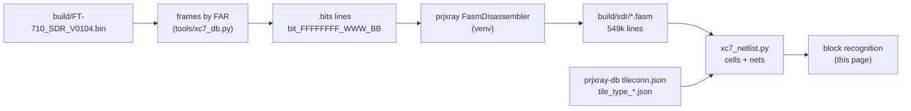
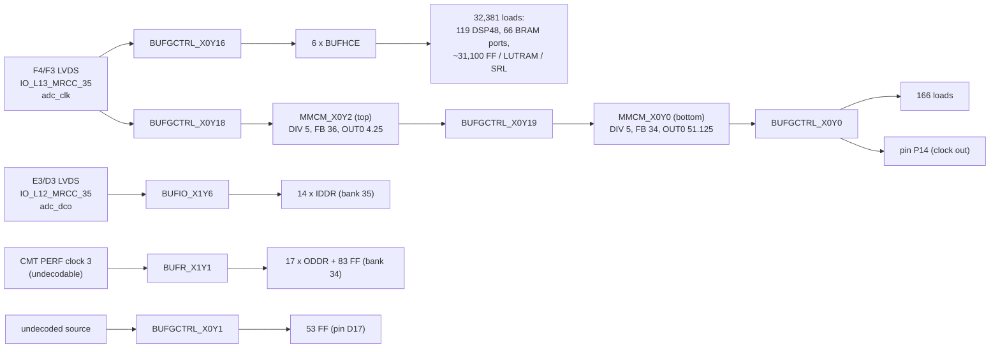
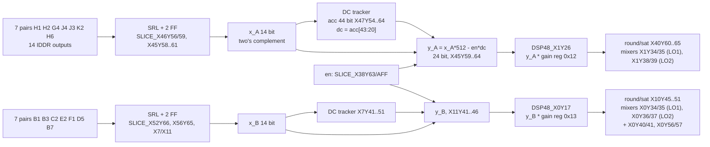
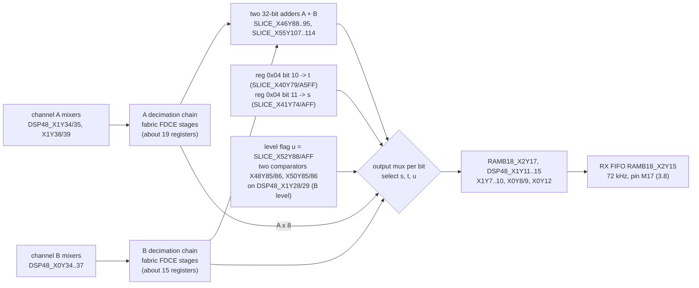
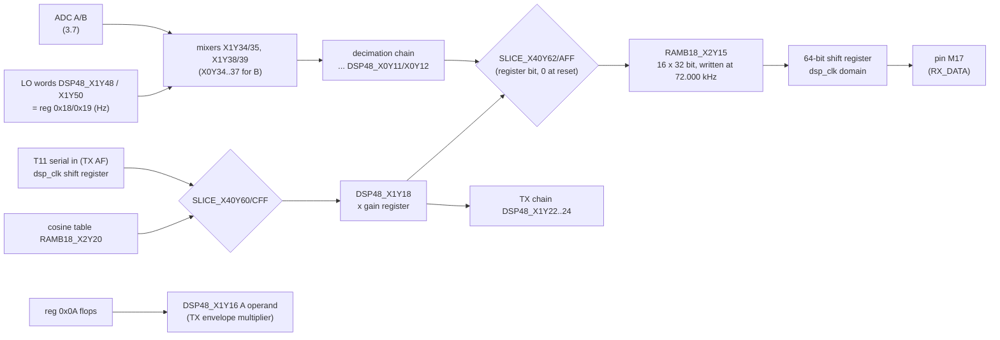
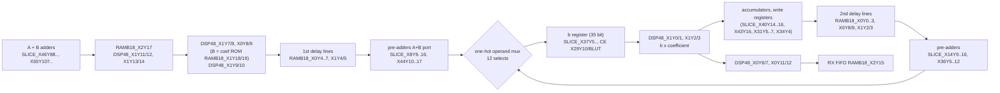
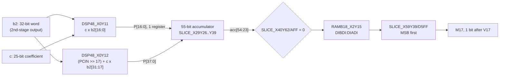
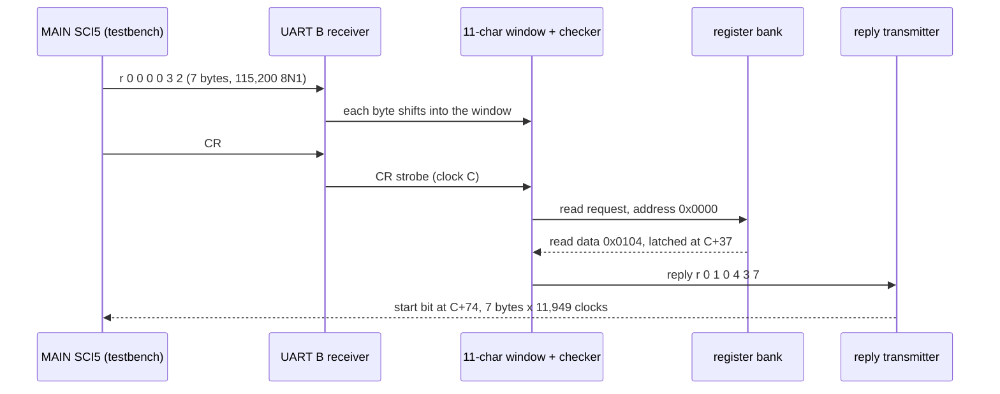

# SDR FPGA netlist recovery (T15)

Back to the [SDR overview](README.md).

This page takes the XC7A50T design from configuration bits ([bitstream.md](bitstream.md)) to FASM features, then to a
cell-level netlist, and then to recognized blocks. Everything derived (FASM, netlist JSON) stays in `build/sdr/` and
is not committed. Tools: `tools/xc7_fasm.py` (T15a), `tools/xc7_netlist.py` (T15b), `tools/xc7_blocks.py` (T15c),
`tools/xc7_netlist_verilog.py` (T15d), `tools/xc7_probe_netlist.py`, `tools/sdr_uart_sim.py`, `tools/sdr_cosim_check.py` (T15e). Reconstructed RTL: [`hdl/sdr/`](../../../hdl/sdr/README.md) (T15e).



## 1. Bitstream to FASM (T15a)

```sh
python3 -I tools/xc7_fasm.py selftest     # .bits format + segbits round trip through prjxray (5 hand-built features)
python3 -I tools/xc7_fasm.py fasm build/FT-710_SDR_V0104.bin build/sdr/FT-710_SDR_V0104.fasm --unknown build/sdr/unknown_bits.txt
python3 -I tools/xc7_fasm.py summary build/sdr/FT-710_SDR_V0104.fasm
```

`fasm` re-runs itself under `~/.local/share/ft710-tools/venv` when prjxray's Python dependencies are missing. It takes
about 18 s and under 1 GB.

**Coverage [fact].** Of 2,360,912 set configuration bits, prjxray's segbits explain all but 24,631. Of those, 24,224
are the per-frame ECC (word 50, bits 0-12, UG470), which belongs to no feature. Only **407 bits (0.017 %) are
unexplained**: DSP_L 100, DSP_R 98, MONITOR_BOT (XADC) 95, RIOB33 86, a few in HCLK/CFG/INT. So the FASM is an almost
complete description of the design.

**FASM lines per tile type [fact].** A merged multi-bit value (for example `ALUT.INIT[63:0]`) counts as one line.

| Tile type | Tiles | PIPs | LUT INIT | BRAM INIT | Other site features |
|---|---|---|---|---|---|
| INT_R / INT_L | 2,750 / 2,737 | 180,500 / 177,756 | | | 65 / 58 (long-line `LV`/`LH` features) |
| CLBLM_R / CLBLM_L | 1,456 / 884 | | 9,509 / 5,944 | | 55,197 / 32,628 |
| CLBLL_L / CLBLL_R | 1,026 / 600 | | 6,983 / 4,172 | | 35,935 / 21,295 |
| BRAM_L / BRAM_R | 51 / 20 | 3,060 / 1,200 | | 2,513 / 940 | 2,318 / 866 |
| DSP_L / DSP_R | 30 / 30 | 2,301 / 2,108 | | | 893 / 783 |
| LIOI3 (+TBYTE*) / RIOI3 (+TBYTE*) | 28 / 34 | 0 / 62 | | | 396 / 595 |
| LIOB33 (+_SING) / RIOB33 | 47 / 35 | | | | 393 / 316 |
| CMT_TOP_R_LOWER_B (MMCM) | 2 | 6 | | | 84 |
| CLK_BUFG_TOP_R / BOT_R / REBUF | 1 / 1 / 6 | 36 / 35 / 0 | | | 16 / 12 / 62 |
| CLK_HROW_TOP_R / BOT_R | 2 / 1 | 15 / 9 | | | 29 / 22 |
| HCLK_L / HCLK_CMT* / HCLK_IOI3 | 52 / 5 / 2 | 129 / 9 / 2 | | | 69 / 19 / 12 |
| **total** | **9,801** | **367,229** | **26,608** | **3,453** | **152,064** |

Notes **[fact for features, inference for meaning]**:
- The 26,608 LUT INIT lines match T13's LUT count exactly ([resources.md](resources.md)).
- IOI tiles: 94 ILOGIC sites carry the `ISERDES.MODE.MASTER` / `IDELAY_TYPE_FIXED` pair (Vivado's default attributes of
  a used input path, not proof of an ISERDES), **10 `IDDR`** and **12 `ODDR`** sites, all in the right I/O bank (RIOI3),
  and 23 `OMUX.D1`/`OQUSED` plain outputs in the left bank (LIOI3). DDR input and output flops on the right bank fit an
  **LVDS DDR ADC capture and a DDR output bus** **[inference]**.
- Per-tile features with no PIP name in `tile_type_*.json` in INT tiles are the bidirectional long lines (`LVx.LVy`,
  `LHx.LHy`); the netlist step treats them as PIPs.

## 2. FASM to cell-level netlist (T15b)

```sh
python3 -I tools/xc7_netlist.py selftest    # hand-built toggle flop routed through an INT tile + FASM value merge
python3 -I tools/xc7_netlist.py build build/sdr/FT-710_SDR_V0104.fasm build/sdr/netlist.json   # ~27 s, < 1.5 GB
python3 -I tools/xc7_netlist.py stats build/sdr/netlist.json
python3 -I tools/xc7_netlist.py net build/sdr/netlist.json SLICE_X12Y43/A5FF   # one cell or one net
```

**Method.** A prjxray *node* is a set of tile wires joined by `tileconn.json`; the tool builds nodes lazily (1.25 M
wires in 0.74 M nodes are touched) and joins them into nets with the 367,368 FASM PIPs plus the `always` pseudo-PIPs
of `ppips_*.db`. Two refinements were needed **[fact, found while testing]**:
- `always` pseudo-PIPs whose two ends are pins of the *same* site are paths through that site (for example BUFHCE I
  to O); following them merged every clock buffer output into one net, so they are skipped. Those between two sites
  (DSP ACOUT to the next DSP's ACIN, for example) are real wires and are kept.
- HCLK_IOI3 has PIPs without segbits (`IO_PLL_CLKn_DMUX` to the BUFIO input and to `RCLKn`, and the clock-capable
  pin to `DMUX` when no FASM PIP selects another source); the tool assumes them, since the design clearly uses them.
- An INT `IMUX`/`BYP_ALT`/`FAN_ALT` wire with no driving PIP is VCC (prjxray `default` pseudo-PIP), and a LUT with no
  INIT bits has INIT = 0, so its O6/O5 are constant 0. Vivado writes `PRECYINIT.C0` into slices without a carry chain,
  so CARRY4s are emitted for every slice and dropped (iteratively, along chains) when no output is used. "Output"
  includes the per-bit carries CO[0..2], which a slice reads through `xOUTMUX.CY` / `xFFMUX.CY`; until #232 only O[0..3]
  and CO[3] counted, see [section 4](#4-structural-verilog-smoke-test-and-simulation-t15d) ("Dropped carry outputs").

**SLICE model** (UG474 + prjxray fuzzer READMEs 011-019): LUT6, or LUT6_2 when O5 is used; FF type from
`FFSYNC`/`LATCH`/`ZRST` (FDRE/FDSE sync, FDCE/FDPE async, LDCE/LDPE latch) and INIT from `ZINI` (Z = inverted);
D muxes `xFFMUX` / `x5FFMUX` (IN_A = O5, IN_B = X bypass); CE/SR from `CEUSEDMUX`/`SRUSEDMUX`; clock inversion from
`NOCLKINV`; CARRY4 with `PRECYINIT` (CIN / AX / 0 / 1) and `xCY0` (DI = O5 or X); MUXF7/MUXF8; output muxes; SLICEM
LUT RAM (RAMD64E, and RAMD32 for the O5 half in `SMALL` mode) and SRLs (SRLC32E, pairs in `SMALL` mode). Hard blocks
keep all routed site pins and their FASM features.

**Result [fact for counts].**

| Cell | Count | Cross-check |
|---|---|---|
| LUT6 / LUT6_2 | 19,431 / 7,177 | 26,608 = T13 LUT count |
| FDRE / FDCE / FDSE / FDPE | 22,044 / 8,784 / 498 / 58 | 31,384 = T13 FF count; no latches |
| CARRY4 (outputs used) | 3,779 (3,692 before #232) | T13 lower bound 3,398 |
| MUXF7 / MUXF8 | 251 / 30 | |
| RAMD64E + RAMD32 (LUT RAM, all `SMALL` = RAM32M-style pairs) | 336 + 336 | 336 `xLUT.RAM` |
| SRLC32E (221 SRL LUTs, 220 of them SRL16 pairs) | 441 | 221 `xLUT.SRL` |
| DSP48E1 | 119 | |
| RAMB18E1 halves in use | 137 | 70 RAMB36 sites |
| IOB / IDDR / ODDR | 116 / 14 / 17 | 110 ILOGIC and 30 OLOGIC are plain pass-through; the 124 IDELAYs only carry Vivado's default (`IDELAY_TYPE_FIXED`) and are not used; unused pins carry only `PULLTYPE`/`IN_TERM`/`SLEW` |
| MMCME2_ADV / BUFGCTRL / BUFHCE / BUFR / BUFIO | 2 / 7 / 16 / 1 / 1 | BUFIO and BUFR carry no FASM features; they are kept when their output is used |

128,343 nets (since #232; 127,648 before): 126,293 with exactly one driver, **none with two or more**, and 2,050 without a driver. The undriven
ones are unused hard-block inputs (ILOGIC clocks, DSP cascade inputs at the bottom of a column, unused IOB O/T, BRAM
cascade pins); only 3 fabric pins (2 SRL data inputs in a `DI_DMC31` chain, 1 FF D) are left unexplained **[fact]**. The flip-flop clocks come from 6 BUFHCE outputs (4,000-7,300 FFs each) and one BUFR (83 FFs) **[fact]**,
see [section 3](#3-recognized-blocks-t15c).

**Corrections to T13 [fact].** prjxray's DSP fuzzer (`100-dsp-mskpat`) writes `Z<reg>` when the register value is
**0**, so the earlier reading "all 119 DSPs fully pipelined" in [resources.md](resources.md) was inverted: `ZMREG` is
set in 55 DSPs (MREG = 0), `ZPREG` in 9 (PREG = 0), `ZOPMODEREG` in 36, `ZCREG` in 107; `USE_DPORT` (pre-adder) is set
in 12. `USE_MULT` has no segbits in prjxray-db. #91: 196 of the 198 unexplained DSP bits are *not* USE_MULT but the
`AREG_1`/`BREG_1` marker bits that the openXC7 fork of prjxray-db (`openXC7/prjxray-db`, HEAD `a8b0926`) adds (tile
bits 27_111, 27_38, 27_271, 27_198); they sit on exactly the 104 A and 92 B registers that this decode already reads as
AREG = 1 / BREG = 1 **[fact]**. The upstream `f4pga/prjxray-db` master is still `0a0adde`, the checkout used here. Two DSP_R
bits (26_245) and the 86 RIOB33 bits (8 positions, 38_88..39_125) stay unexplained by either database.

**Approximations** (marked `approx` on the cells): the O5 halves of SRL16/RAM32 pairs take their data from the X
bypass pin; LUT RAM wider than 64 is not merged into RAM128/256 cells; IDELAY taps and ISERDES modes beyond
pass-through are not decoded; the MUXF7 input order (I1 = A/C LUT) follows UG474 but was not verified on silicon.

## 3. Recognized blocks (T15c)

```sh
python3 -I tools/xc7_blocks.py selftest
python3 -I tools/xc7_blocks.py build/sdr/netlist.json clocks      # clock roots, buffers, loads
python3 -I tools/xc7_blocks.py build/sdr/netlist.json io          # every used pin: package pin, bank, standard, loads, clock
python3 -I tools/xc7_blocks.py build/sdr/netlist.json package     # which packages bond all used IOBs
python3 -I tools/xc7_blocks.py build/sdr/netlist.json dsp         # DSP48E1 register sets, static OPMODE, cascades, sources
python3 -I tools/xc7_blocks.py build/sdr/netlist.json bram        # RAMB18 widths, readers/writers
python3 -I tools/xc7_blocks.py build/sdr/netlist.json logic IOB_X0Y41 2   # equations (LUTs as minimal SOP) around a pin
```

Cell names are prjxray site names plus the BEL (`SLICE_X1Y93/AFF` = the AFF flip-flop of that slice). They are the
names in `build/sdr/netlist.json` and in the Verilog of section 4.

### 3.1 Package

Every used IOB is bonded only in the **CSG324** and **FGG484** packages of the XC7A50T. CPG236, CSG325 and FTG256 lack
19 to 59 of them **[fact]**. Pin names below use CSG324 as a naming convention only; which of the two packages is fitted is
open and is settled by the FPGA's package marking.
`io xc7a50tfgg484-1` gives the FGG484 names.

### 3.2 Clocks



- **One fabric clock** **[fact]**. The LVDS input on F4/F3 (`IO_L13P/N_T2_MRCC_35`) drives BUFGCTRL_X0Y16, and that
  clock reaches every DSP48, 66 block-RAM clock pins and all but about 300 flip-flops. It runs at **125 MHz**
  **[inference, high]**: the UART bit timers below divide by 1,086, which gives 115,200 baud at 125 MHz (the service
  manual says "Operating clock 125MHz, Divide 250MHz by 2"). So the ADC supplies the FPGA's clock, and the whole DSP
  chain runs at that rate.
- **ADC data capture** **[fact for the wiring]**. A second LVDS clock pair on E3/D3 (`IO_L12_MRCC_35`) reaches a
  BUFIO and clocks the 14 IDDRs of bank 35, so the data is captured source-synchronously at double data rate. The
  BUFIO path goes through a PIP that has no prjxray segbits, so the tool assumes it **[inference]**.
- **Two cascaded MMCMs** **[fact]**. MMCM_X0Y2 takes the 125 MHz clock, and MMCM_X0Y0 takes MMCM_X0Y2's CLKOUT0. With
  T13's divider reading (XAPP888 encoding) that is 125 x 36 / 5 / 4.25 = 211.76 MHz, then x 34 / 5 / 51.125 =
  **28.17 MHz** **[inference]**. A second VCO at 1,440 MHz needs a -2 speed grade, so one divider may be misread. This
  clock drives 166 flip-flops and goes straight to pin **P14** (a BUFHCE output on an OBUF) **[fact]**. Open: whether P14 is the
  `DSP_CLK` line to the RT685 (J2002 pin 22). For: P14 is the only pin an MMCM clock reaches (figure above), and `DSP_CLK` is a
  free-running clock from the module into the RT685's PIO2_30/CLKIN (p19). Against: its frequency (below). Settled by measuring J2002 pin 22 (O8).
  Both MMCM resets come from the global reset flip-flop.
  *T19h note:* the RT685's M33 code is built for CLKIN = `DSP_CLK` = **18.432 MHz** **[fact, [ifdsp/m33-platform.md](../ifdsp/m33-platform.md)]**,
  which 28.17 MHz does not match. A feedback multiplier of 22.25 instead of 34 in MMCM_X0Y0 would give 18.4323 MHz; #67 ruled that
  reading out (next note).
  *#67 re-check:* the reading is right. The 40-bit `LKTABLE` of both MMCMs is `1111111111 0100010011 1111101001 0000000001`, which is
  XAPP888's `mmcm_lock_lookup` value for M = 34..36 (M = 22 would be `…0111000010…`); Vivado fills it from the feedback multiplier, so
  M = 22.25 is ruled out. The FASM counter bits: top (X8Y113) FB 18+18 = 36, DIVCLK 2+3 (edge) = 5, CLKOUT0 2+2 + frac 2/8 = 4.25; bottom
  (X8Y9) FB 17+17 = 34, DIVCLK 5, CLKOUT0 26+25 (edge) + frac 1/8 = 51.125 **[fact]**. So P14 = 125 × 36/5/4.25 × 34/5/51.125 =
  **28.166 MHz**, and the bottom VCO sits at 1,440 MHz, the -2 grade's maximum **[inference: speed grade]**. Whether P14 is `DSP_CLK`
  stays open ([system.md O8](../system.md#8-contradictions-and-open-questions)).
- **Bank 34 output clock** **[fact for the wiring]**. BUFR_X1Y1 clocks the 17 ODDRs and 83 flip-flops next to bank 34.
  Its input is a CMT "PERF" clock whose source mux has no segbits, so it cannot be decoded.
- **Global reset** **[fact]**. `SLICE_X10Y76/BFF` (INIT 1) is released by a 3-bit counter in `SLICE_X11Y59`. The second
  UART and some other blocks use a copy delayed by one clock (`SLICE_X2Y89/AFF`).

### 3.3 Pin map by bank

| Bank (VCCO) | Pins | Recognized function | Tag |
|---|---|---|---|
| 35 (2.5 V, LVDS) | 14 LVDS input pairs into IDDRs, plus 2 clock pairs (adc_clk F4/F3, adc_dco E3/D3) | **ADC interface**: 14 DDR data pairs and the capture clock. All of the DSP logic runs in this clock domain | [fact] wiring, [inference] ADC |
| 35 | A5/A6 (`IO_L3_AD5`), inputs with no fabric load | XADC auxiliary input VAUX5 (the MONITOR tile is configured) | [inference] |
| 34 (2.5 V, LVDS) | 17 LVDS output pairs from ODDRs, plus 1 pair driven high | **DDR LVDS output bus**, most likely the **TX DAC**. Every pair's OBUFTDS enable comes from a flip-flop | [fact] wiring, [inference] DAC |
| 14 (3.3 V) | L13 `FCS_B` out (FDPE), K17 `D00_MOSI` in/out, K18 `D01_DIN`, L14 `D02`, M14 `D03` in | **QSPI master in fabric on the configuration-flash pins**: chip select and bidirectional D0, with D1-D3 captured together under a shared enable (`SLICE_X1Y60`), i.e. quad reads. Together with T13's WP finding, this is how the FPGA **rewrites its own configuration flash** during an update | [fact] wiring, [inference] purpose |
| 14 | **M18 in / L18 out** (`IO_L4N/L4P_T0_D05/D04`) | **UART A = debug console** (`UART_DBG`, prompt `[IF]>`): 115,200 8N1 receiver, transmitter and ASCII command parser (3.4, 5.3) | [fact] |
| 14 | **V12 in / U12 out** (`IO_L20N/L20P_T3`) | **UART B = MAIN's UART5** register link: same receiver, 11-character frame window (3.4, 5.2) | [fact] |
| 14 | **N14 (data), T18 (select), R18 (clock) in/out** | **Scope link to the DISPLAY** (#186, `FFT_DAT/FFT_FRM/FFT_CLK`): one tri-state net `SLICE_X1Y36/ALUT = ~R15` drives all three T pins, so the FPGA drives them while input **R15** is high. Out: the scope frame serializer in the `dsp_clk` domain (5.6), 1,700-byte frames every 614,400 `dsp_clk` cycles. In (R15 low, update): an SPI slave in the 125 MHz domain that samples N14 on falling R18 edges. Earlier read as open-drain lines | [fact] wiring and behaviour, [inference] J2002 pins |
| 14 | P14 out | forwarded MMCM_X0Y0 clock (28.17 MHz by the divider reading, 3.2); whether it is `DSP_CLK` is open (O8) | [fact] wiring, open net |
| 14 | **U16 out, V17 out, V16 out** | **I2S-style serial port, running from reset** (#90, simulation): U16 toggles every 2 cycles (31.25 MHz bit clock), V17 every 128 cycles (frame, 64 bit clocks = 2 × 32-bit slots, 125 MHz / 256 = 488.28 kHz), V16 data from clock 65,541. Fits J2002 24 `TX_CLKA` / 26 `TX_FRMA` (the shared RX/TX audio clock and frame) and 33 `RX_DATA`, the RX IQ/audio stream to the RT685  *#154:* the U16 and V17 flip-flops are clocked by `BUFHCE_X0Y9`, the buffer that drives the `dsp_clk` pin (MMCM_X0Y0), and the simulation's MMCM stand-in passes 125 MHz through, so the real frame is `dsp_clk` / 256 (72 kHz at 18.432 MHz), not 488 kHz | [fact] behaviour and clocking, [inference] J2002 pins |
| 14 | **R16 out (clock), P17 out (select), N16 out (data)** | **16-bit SPI write sequence at power-up** (14 words, clocks 155–13,979, same on either edge): `0002 0000` (bit 1 of reg 0 set then cleared: soft reset), then reg 0x10 = C0, 11 = 00, 12 = 2D, 13 = 10, 14 = 20, 16 = 00, 17 = 00, 18 = 00, 19 = 00, 1A = 80, 1B = 03, 1D = 00 (8-bit address + 8-bit data). A 3.3 V chip on the module configured once; which part is open | [fact] words, open part |
| 14 | **M17 out** | **Second data line of the U16/V17 port** (#145): a shift register in the `dsp_clk` domain (`SLICE_X59Y39`) loaded from bit 15 of the SDP x36 buffer RAMB18_X2Y15, which is written from DSP48_X1Y18 (the mixer after the cosine NCO, 3.6). Sampled on the rising U16 edge in 32-bit V17 half-frames it carries bursts of ~10 words (`051EBC00 051EBB85 451EBB85 ... 64196F85 5F410385 ... 40000000`) every 4,096 `dsp_clk` cycles (16 frames), from cycle 6,920 after reset, with no MAIN frame and the ADC at 0. Earlier runs saw it idle because the block RAMs read 0 (#164) Not the DISPLAY scope link (that is N14/T18/R18, 5.6, #186) | [fact] wiring and behaviour |
| 14 | T9, U17, V15, T16, T15 out; N15 = 1; L16, F13 one edge after reset | V15/T16/T15 are tied to 0 and N15 to 1 in the bitstream (no logic behind them). T9 is a register-selected mux of status flops (3.6). U17 serializes ADC group 1 (3.6) and toggles once the ADC inputs move (#91) | [fact] |
| 15 (1.8 V) | B14, B13 out and C14 in/out, all driven from one slice (`SLICE_X42Y80`) | **3-wire SPI master** (clock, select, bidirectional data) at 1.8 V, the usual ADC configuration port | [inference] |
| 15 | B13 = SCK, B14 = CS, C14 = SDIO (data from `SLICE_X42Y80/A5FF`) | **ADC configuration at power-up** (#90, probed simulation): 27 frames of 24 bits, SCK period 8 cycles (15.6 MHz), 72-cycle gaps, MSB first, sampled on the falling edge: `000020 002001 007918 0080AD 00E11A 0014E7 0015C4 0012C0 001200 005E00 005F08 002800 002340 002501 002500 802500 802400 002764 003F20 004020 004330 003001 0018F9 001901 001AF9 001B01 000100`. Bit 23 set on the two `0x025`/`0x024` frames = reads: an Analog Devices-style 24-bit frame (R/W, length, 13-bit address, 8-bit data). The register map is not identified, so the ADC part stays open | [fact] frames, [inference] format |
| 15 | B18, A14, A13, A16 in; D17, F13 out; E17 = 0, D14 = 1 | 1.8 V control and status lines (D17 is in the undecoded BUFGCTRL_X0Y1 domain) | open |

**STARTUPE2 / CCLK (#93) [fact, routing].** prjxray cannot decode the STARTUPE2 site (`CFG_CENTER_MID` has routing bits only), and
`tools/xc7_netlist_verilog.py` writes no STARTUPE2 cell, but the routing into it is visible. Inside `CFG_CENTER_MID_X46Y32` the wire
`CFG_CENTER_STARTUP_USRCCLKO` has one source, `CFG_CENTER_CLK1_7` (a PIP without configuration bits), which runs through
`VFRAME_X47Y29.VFRAME_CLK1` and `INT_INTERFACE_L_X18Y27.INT_INTERFACE_CLK1` to `INT_L_X18Y27.CLK_L1`. The FASM enables
`INT_L_X18Y27.CLK_L1.FAN_BOUNCE5`, and following the enabled PIPs back (`FAN_ALT5` ← `SL1END2` ← SS6 ×3 from Y46 ← SE6 ×4 from
`INT_L_X4Y62`) ends at `CLBLL_L_X4Y62.CLBLL_LOGIC_OUTS6` = `CLBLL_LL_CQ` = **`SLICE_X4Y62/CFF`**. That FDCE is clocked by the main
fabric clock (`BUFHCE_X0Y22`, 4,233 loads), its next state is a LUT6 of its own Q and state flops at `SLICE_X1Y61` and
`SLICE_X4Y63`, and its Q has **no other load in the fabric** (only its own LUT): it is the SPI clock of the fabric flash master,
and its only way out is STARTUPE2 `USRCCLKO` → CCLK. So the design clocks its own configuration flash (D00..D03, FCS_B above) through
STARTUPE2, as T11c/T16 inferred. Reproduce: walk back from `CFG_CENTER_STARTUP_USRCCLKO` over `tileconn.json` and the tile-type
PIPs to an INT tile, then over the FASM's `INT_*` PIP lines, resolving each node across tiles.

The J2002 signals in [interfaces.md](interfaces.md) still have to be matched to these pins one by one. The two UARTs
and the flash pins are certain. UART B is MAIN's UART5 and UART A the debug UART (`UART_DBG`), shown by simulating the
whole netlist (3.4, section 5).

### 3.4 UART links

Both UARTs are the same circuit, placed twice: same structure and same character tables **[fact]**. The receiver of
UART A, read from the equations (`logic IOB_X0Y41 2`):

| Part | Cells | Function | Tag |
|---|---|---|---|
| Synchronizer, edge detect | `SLICE_X1Y96/A5FF`, `SLICE_X1Y97/AFF`, `SLICE_X1Y97/ALUT` | two flip-flops. The LUT resets the bit timer on reset, on every falling RX edge and at the end of each bit | [fact] |
| Bit timer | `SLICE_X0Y94..X0Y97` (16-bit CARRY4 counter) | counts 0..1085 (`0x43D`, terminal decode in `SLICE_X1Y94/DLUT`, `X1Y96/BLUT`, `X1Y97/BLUT`) and gives a sample tick at 542 (`0x21E`, `SLICE_X1Y94/BLUT`). That is **1,086 clocks per bit, i.e. 115,200 baud at 125 MHz, sampled mid-bit and re-aligned on every edge** | [fact] counts, [inference] baud |
| Shift register | 10 FDSE (`SLICE_X0Y93`, `SLICE_X1Y95`), preset to 1 | shifts in the sampled bit on each tick. The frame is complete when the start bit (0) reaches the last stage and the newest bit (the stop bit) is 1 (`SLICE_X0Y93/ALUT.O6`) | [fact] |
| Byte register and strobe | 8 FDRE in `SLICE_X1Y93`, `SLICE_X2Y93`; strobe `SLICE_X1Y92/AFF` | the byte is latched at the end of the frame, with a one-clock valid strobe. The strobe also presets the shift register | [fact] |
| Character classes | LUTs in `SLICE_X1Y92..X3Y94` that read the byte | evaluated over all 256 byte values (section 4): hex digits `0-9 A-F a-f`, `CR`, `CR`/`BS`, the command letters **`r`, `w`, `x`**, the separators `,` and space, `LF`, `#` | [fact] |

So the FPGA parses **ASCII lines**: a command letter (`r`, `w`, and an undocumented **`x`**), hex digits, `,` or space
separators, `BS` editing, and `CR`/`LF` line ends **[fact for the character set, inference for the grammar]**. MAIN's
side of UART5 (`sdr_reg_access` 0xFFFA1485, `FUN_fffa30f9`, `FUN_fffa31ae`, `FUN_fffa3083`) sends exactly that
**[fact]**:

| Frame from MAIN | Bytes | Reply MAIN expects |
|---|---|---|
| read | `r` + 4 hex address + 2 hex checksum + `CR` | 7 bytes: 5 characters, then a 2-hex checksum of those 5. MAIN parses the value with `hex2word` |
| write | `w` + 4 hex address + 4 hex value + 2 hex checksum + `CR` | one byte, `0x06` (ACK) |

**Which UART is which [fact, T15e simulation].** UART B (V12/U12) is **MAIN's UART5**: simulated with the whole
netlist, it answers MAIN's boot frame `r000032` CR with `r010437` (register 0 = 0x0104 = V01-04, the version MAIN stores
for `VE2;`) and a write with ACK 0x06. UART A (M18/L18) is the **debug console** (`UART_DBG`): it prints the prompt
`[IF]>`, echoes what it receives and takes `r 0000` / `w 0015 1234` style commands (section 5). The structural hints
of T15c fit: UART B keeps the last 11 characters in an 88-FF window, UART A works character by character. The
module-side J2002-to-FPGA traces are still not in the service manual, so this rests on behaviour, not on the pin path.

The checksum is the 8-bit sum of all the characters before it, written as two upper-case hex digits (`byte2hex`,
`"0123456789ABCDEF"`) **[fact, MAIN code]**. On the transmit side, `SLICE_X1Y94/A5FF` drives L18 (UART A) and
`SLICE_X2Y101/AFF` drives U12 (UART B). Within ten register stages the transmit path reaches about 1,400 flip-flops,
i.e. the control-register bank of the whole design **[fact for the cone size]**.

### 3.5 DSP and block-RAM structure

- **119 DSP48E1, all in the 125 MHz domain** **[fact]**. Register sets, using prjxray's fuzzer semantics (`Z<reg>` means
  the register is 0): 36 with only A/B/P registers, 25 with A/B/M/P/OPMODE registers, 23 with **A cascaded** from the
  DSP below (`A_INPUT = CASCADE`, BREG 2), 10 with all registers and the **pre-adder** (`USE_DPORT`), and a few small
  groups.
- **Cascades** **[fact]**. 34 DSPs take their A (32) or B (2) operand from the DSP below through ACOUT/BCOUT: pairs that
  share one operand, the shape of one sample multiplied by two coefficients (an I/Q mixer, or a complex multiply)
  **[inference]**. One chain has three DSPs. Only 2 DSPs add PCIN (OPMODE Z = PCIN). The adder trees after the
  multipliers are in fabric (`CARRY4` on the P outputs).
- **Static control pins (#91)**. In 117 of the 119 DSPs the OPMODE/ALUMODE/INMODE pins are tied to constants. The raw
  pin values (ALUMODE 3, OPMODE `0o077`/`0o177`) are not the modes: the DSP has programmable inverters on these pins, and
  prjxray's `ZIS_<pin>_INVERTED` bit = 1 means **not inverted** (the same Z convention as `ZINV_*` on block RAMs and `ZINI`
  on flip-flops), an absent bit means inverted. Effective value = pin XOR `IS_*_INVERTED` **[inference, high]**:

  | DSPs | effective OPMODE | ALUMODE | INMODE | Reading |
  |---|---|---|---|---|
  | 36 | `005` X=M Y=M Z=0 | 0 (Z+X+Y+CIN) | 00000 | P = A*B |
  | 35 | `065` X=M Y=M Z=C | 0 | 00000 (2: 00100) | P = A*B + C, C routed to constant 0 |
  | 36 | `125` X=M Y=M Z=PCIN>>17 | 0 | 00000 | upper half of a wide product: P = A*B + (PCIN >> 17) |
  | 10 | `025` X=M Y=M Z=PCIN | 0 | 00100 / dynamic | systolic chain with pre-adder: P = (D+A)*B + PCIN |
  | 2 | dynamic: X in {0, P}, Z in {0, PCIN} (OPMODE[1], OPMODE[4] from two fabric nets) | 0 | 00100 | accumulate / load / clear at the top of a PCIN chain |

  Every other reading fails: raw pins give X = A:B, Y = C, ALUMODE = subtract and an illegal Z on 36 DSPs; the opposite
  polarity gives X = P, Y = all-ones and ALUMODE 15 (a logic op) on every DSP. The chosen polarity is checked by the
  routing **[fact for each check]**: (1) X = Y = M (`0101`) on all 117 static DSPs, the only legal multiply setting;
  (2) the C bus is routed to constant 0 on every Z = C DSP and left unrouted (VCC, all ones) on every Z = 0 and
  Z = PCIN>>17 DSP, where C is unused;
  (3) INMODE[2] = 1 (D into the pre-adder) on the 10 `USE_DPORT` DSPs whose D bus is routed; (4) 33 of the 36 Z = PCIN>>17 DSPs
  sit directly above a Z = C DSP (the others above a PCIN>>17 or PCIN DSP: longer chains), and most Z = C DSPs send
  exactly 17 P bits to the fabric: the usual split of a multiply wider than 25 x 18 into a low and a high partial product; (5) CARRYIN is unrouted (VCC) with
  `ZIS_CARRYIN_INVERTED` clear, i.e. CIN = 0, with CARRYINSEL = 000. `tools/xc7_blocks.py ... dsp` prints the effective
  modes; `tools/xc7_netlist_verilog.py` writes `IS_OPMODE/ALUMODE/INMODE/CARRYIN/CLK_INVERTED`.
- **USE_MULT (#91)**. It has no configuration bit that prjxray or the openXC7 fork knows. Every static DSP selects
  X = Y = M, which is illegal unless `USE_MULT` is `MULTIPLY` (or `DYNAMIC`), so those 117 are `MULTIPLY`
  **[inference, high]**; the 2 dynamic accumulators never select M, so their setting (likely `NONE`) does not change
  their function. The netlist keeps `MULTIPLY` on all 119.
- **Block RAM to DSP** **[fact for the connections]**:

| Table ([bram-tables.md](bram-tables.md)) | Site | Read by | Reading |
|---|---|---|---|
| 1024-tap symmetric filter | RAMB18_X2Y28 | B inputs of DSP48_X1Y31..X1Y34 (36 bits) | coefficient ROM of a time-multiplexed FIR; the A side comes from RAMB18_X2Y25/X2Y30/X2Y31 (sample buffers) [inference] |
| cosine, 0.5 degree steps, 800 x 16 | RAMB18_X2Y20 | 16 LUTs | NCO lookup, multiplexed in fabric in front of the mixer DSPs [inference] |
| raised-cosine ramp, 720 steps | RAMB18_X2Y19 | 12 LUTs + 4 FFs | TX keying envelope [inference, T13] |
| 36-bit FIR bank | RAMB18_X1Y11/X1Y17/X2Y14/X2Y16 | 9 LUTs each | coefficient multiplexer in front of the decimating FIRs [inference] |
| x9 phase tables (replicated x4) | RAMB18_X0Y50..59, X1Y54..59, X2Y32..39 | DSP A inputs (9-15 bits each) + FFs | twiddle/phase operands of the FFT/scope engine [inference] |
| x4 tables, writable | RAMB18_X0Y42..47 | DSP A inputs; data written from FFs | initialized coefficient RAM that the control bank can rewrite [inference] |
| RAMB18_X1Y18/X1Y19, RAMB18_X2Y10 | | DSP B (18 + 18) / DSP A (25) | coefficient ROMs of further multipliers [fact] |

### 3.6 Routing ties: ADC/DAC pins and block-RAM tables to their logic (#146)

```sh
python3 -I tools/xc7_blocks.py build/sdr/netlist.json reach CELL[,CELL] fwd|back [REGS] [PINRE]
python3 -I tools/xc7_blocks.py build/sdr/netlist.json reach RAMB18_X2Y20 fwd 1 '^DO'     # -> DSP48_X1Y18.A
```

`reach` walks the routed nets from a cell through LUT/carry/mux logic and at most REGS fabric registers (never through
clock, reset or enable pins) and lists the hard blocks it meets (DSP, BRAM, IOB, IDDR/ODDR, MMCM) with the number of
registers in between. All connections below are **[fact, routing]**; what the blocks do is **[inference]** unless marked.
Deeper than 2-3 registers the paths run through the shared register bank and reach almost everything, so only the
first hard block on each path is meaningful.

**ADC input pairs (bank 35).** The 14 IDDR pairs form **two groups of 7**; each group is written into its own RAMB36 3
registers later and reaches its own first multiplier 4 registers later:

| Group | Pairs (P pin, CSG324) | Capture RAM (d3) | First DSP (d4) | Output pin |
|---|---|---|---|---|
| 1 | H6, K2, J3, J4, G4, H1, H2 | RAMB18_X0Y24/25 (RAMB36_X0Y12, x9) | DSP48_X1Y26.A, then X1Y27.A (d5) | **U17** at d6: its whole fan-in is these 7 pairs (175 cells, no DSP/BRAM) |
| 2 | F1, C2, E2, D5, B3, B1, B7 | RAMB18_X0Y22/23 (RAMB36_X0Y11) | DSP48_X0Y17.A, then X0Y20.A (d6) | V16 (I2S data) at d6 |

7 DDR pairs carry 14 bits per clock, so this fits a **dual-channel 14-bit ADC with 7 DDR LVDS pairs per channel**
(confirmed bit by bit in 3.7, #172),
consistent with the Analog Devices-style 24-bit SPI frames on B13/B14/C14 **[inference]**. Both groups also reach T9 at
d3; T9 is a register-selected 2-to-1 mux of status flops, a debug/monitor output **[inference]**. Simulated with
pseudo-random ADC bits (#91), U17 and V16 start toggling at clock ~65,500.

**DAC output pairs (bank 34).** 16 of the 17 ODDR pairs take their data from **DSP48_X1Y26.P** 3 registers back,
the same DSP that ADC group 1 reaches first and that RAMB18_X2Y24 feeds (A input, 2 registers): one multiplier
drives the whole output bus **[fact]**, so it is the TX output scaling stage, with ADC group 1 reaching it through a
mux (loop-back or feedback path) **[inference]**. The 17th pair (R7/T6, OLOGIC_X1Y4) is a **forwarded clock**: its ODDR has D1 = D2 = 1 with
D2 inverted, so it drives 1 then 0 on every BUFR_X1Y1 clock **[fact: `netlist.json` cell OLOGIC_X1Y4]**. Only its output
enable (T1, through `SLICE_X65Y4/BFF`) is logic, reached from the inputs T13 and P15 (4 registers), so the clock is switched
on and off by those inputs **[fact for the wiring]**; R1 is held at 1.

**Block-RAM tables.** First hard block on the data outputs (DO, through at most 1 register) and on the address inputs
(back, at most 3 registers). Table names from [bram-tables.md](bram-tables.md):

| Table | RAMB18 | DO feeds | Address from |
|---|---|---|---|
| cosine, 0.5 deg steps | X2Y20 | DSP48_X1Y18.A (1 reg) | DSP48_X1Y38.P (2 regs): a phase accumulator |
| raised-cosine ramp | X2Y19 | DSP48_X1Y16.B (1 reg) | DSP48_X1Y12.P (2 regs) |
| 36-bit FIR bank (+ X2Y18, X1Y16) | X1Y11, X1Y17, X2Y14, X2Y16 | DSP48_X1Y0.A, X1Y2.A (1 reg) | DSP48_X0Y9.P, X1Y7.P (2 regs) |
| 1024-tap symmetric filter | X2Y28 | DSP48_X1Y31.B, X1Y33.B (direct) | fabric counter |
| X2Y25 (decaying, even entries) | X2Y25 | DSP48_X1Y32.A (direct) | |
| 12-bit phase, phase-step and quadratic phase tables, 4 lanes | lane 1: X0Y38/39, X2Y36-39; lane 2: X0Y50-53, X1Y56/57; lane 3: X0Y54/55, X1Y54/55, X2Y32/33; lane 4: X0Y56-59, X1Y58/59 | lane 1: DSP48_X1Y42/44.A; lane 2: X1Y47/49.A; lane 3: X1Y53/54.A; lane 4: X1Y58/59.A (all direct) | lane 1: DSP48_X1Y39.P (1 reg); X0Y50 and X0Y56 (lanes 2, 4): DSP48_X1Y57.P (2 regs); others deeper |
| 9-bit quadratic phase x2, 2-D twiddle phase, step table (RAMB36 x9: X0Y5, X0Y6, X1Y4, X1Y7) | X0Y10-13, X1Y8/9, X1Y14/15 | merged in fabric, 2 regs on: DSP48_X0Y8/9.A, X1Y7/8.A, X1Y0/1.B and the write addresses of RAMB18_X0Y0-9, X1Y2-7 | **DSP48_X0Y23.P** (1 reg), the dynamic accumulator of 3.5 |
| constants 0x1FF / 0x1F (RAMB36 x9: X0Y21-23) | X0Y42-47 | DSP48_X1Y36.A, X1Y40.A (direct) | |
| coefficient ROMs | X1Y18/19; X2Y10; X0Y16 | DSP48_X0Y8.B, X1Y7.B; X1Y9.A; X1Y13.A (1 reg) | |
| X2Y24 (rising segment) | X2Y24 | DSP48_X1Y26/27.A (2 regs) | |
| X2Y29 (hump) | X2Y29 | | RAMB18_X1Y31 DO (1 reg): a table addressed by another RAM |

Readings **[inference]**: the four phase-table lanes are four identical channels, each with its own DSP pair in column
X1 rows 42-59, as the 4x replication suggested; the four flagged x9 tables are one block (an accumulator-addressed set
of phase/step tables whose outputs are selected in fabric) feeding the FIR-bank multipliers and the addresses of the
x4 sample RAMs at the bottom of columns X0/X1, the shape of the zoom/FFT scope engine; the cosine table is the NCO of
a mixer (DSP48_X1Y18) driven by the phase accumulator DSP48_X1Y38; the raised-cosine ramp multiplies a signal in
DSP48_X1Y16 (TX keying envelope).

### 3.7 ADC capture: two 14-bit channels, DC removal and per-channel gain (#172)

Traced forward from the 14 IDDRs with `tools/xc7_blocks.py ... logic/reach` and scripts over `netlist.json`, then
checked in the whole-netlist Verilator model with `hdl/sdr/sim/adc_main.cpp` (constant and decaying inputs on each
channel, probes on every stage listed below).



- **Q1 and Q2 are adjacent bits of one word, not two channels [fact, routing; simulation].** The bit position of
  every IDDR output is read off the carry chain that takes the word (`SLICE_X44Y57..X44Y60` for group 1,
  `SLICE_X6Y43..X6Y46` / `SLICE_X11Y43..X11Y46` for group 2), chain bit 9 = ADC bit 0. Each pair carries bits 2k (Q1) and 2k+1 (Q2):

  | ADC bit | 1:0 | 3:2 | 5:4 | 7:6 | 9:8 | 11:10 | 13:12 |
  |---|---|---|---|---|---|---|---|
  | channel A (group 1) | H1 `ILOGIC_X1Y66` | H2 `X1Y70` | G4 `X1Y60` | J4 `X1Y58` | J3 `X1Y56` | K2 `X1Y54` | H6 `X1Y52` |
  | channel B (group 2) | B1 `ILOGIC_X1Y82` | B3 `X1Y80` | C2 `X1Y68` | E2 `X1Y72` | F1 `X1Y64` | D5 `X1Y78` | B7 `X1Y96` |

  So the 14 IDDRs form two 14-bit words (7 pairs each, two bits per pair per clock: the "interleaved" DDR LVDS mode of
  dual ADCs), and the earlier reading "channel A on one edge, B on the other" ([hardware.md](../../hardware.md)) is
  wrong. With the ADC model driving these pins (`ADCA=const:1000 ADCB=const:-2000`) the probed words read exactly
  1000 and -2000 **[fact, simulation]**.
- **Capture pipeline [fact].** Every Q pin feeds one SRL (`SLICE_X46Y56`, `X46Y59`, `X52Y66`, `X56Y65`, A/B/C/D LUTs, clock
  `BUFHCE_X1Y21` = the 125 MHz fabric clock, all 28 with the same static address `A[3:0] = 0001`), then two flip-flops
  (`SLICE_X46Y5x` → `SLICE_X45Y58..61` for A, → `SLICE_X7Y43..51`, `X11Y45/46`, `X13Y50` for B). The SRL is where the
  word leaves the BUFIO (`adc_dco`) domain. One word per channel per 125 MHz clock: **125 MSPS per channel** **[fact
  for the structure; inference that the fabric clock is 125 MHz, 3.2]**.
- **Format: two's complement, no inversion [fact].** The MSB (Q2 of H6 / B7) is sign-extended into the 24-bit
  subtractor (chain bit 23 uses the same flip-flop) and into DSP A[29:23]; no LUT inverts it, so the words are already
  two's complement (the ADC's output-format register, an SPI write in 3.3, would select that **[inference]**). A board-level P/N swap would
  show as an inverted bit, and none is seen.
- **DC removal per channel [fact, equations; simulation].** `d = x*2^9 - dc` (chain `SLICE_X44Y55..X44Y60`, CYINIT = 1,
  S = XNOR) feeds a 44-bit accumulator `acc += sext(d)` (`SLICE_X47Y54..X47Y64`, its own carry chain), and
  `dc = acc[43:20]`: a first-order DC tracker with a time constant of 2^20 samples (8.4 ms at 125 MSPS, corner about
  19 Hz). The output `y = x*2^9 - (en ? dc : 0)` (chain `SLICE_X45Y59..X45Y64`, registered there, 24 bits) is the
  DC-free sample. Channel B has the same circuit at `SLICE_X6Y41..46` (d), `SLICE_X7Y41..51` (acc), `SLICE_X11Y41..46` (y).
  Both channels share one enable, `SLICE_X38Y63/AFF` (= `SLICE_X37Y62/AFF`, a register bit muxed by `SLICE_X41Y70/B5FF`),
  which is 1 after reset. Simulated with x_A = 1000: y_A starts at 512,000 and decays as 512,000·e^(-t/2^20) (179,343 at
  clock 1,100,000; e^-1.05 predicts 179,300) **[fact, simulation]**.
- **Per-channel gain = MAIN registers 0x12 and 0x13 [fact, simulation].** y_A goes to A of **DSP48_X1Y26**, y_B to A of
  **DSP48_X0Y17** (A[29:23] = sign), each `P = A*B` (OPMODE 005, AREG = BREG = PREG = 1, MREG = 0: P = y(t-2)·g, checked in
  simulation with the fixed DSP model, see 4.4). B[15:0] is a 16-bit unsigned gain (B[17:16] = 0) from the register bank
  (`SLICE_X29Y66/AFF`... for A, `SLICE_X15Y55`... for B, one pipeline FF). Writing `w00121234` set g_A = 0x1234 and
  `w00135678` set g_B = 0x5678 in simulation; both read 0x8000 after reset. MAIN writes **0x8000 to both in RX**
  ([main/sdr-link.md](../main/sdr-link.md) `sdr_upd_r12/r13`): equal weights for the sum that reg 0x04 = 0xE519 selects (below)
  **[fact, simulation]**. The 42 P bits go through a rounding incrementer and saturation (`SLICE_X40Y60..X40Y65` for A,
  `SLICE_X10Y45..X10Y51` for B) into the mixers.
- **No dither subtraction [fact for this segment].** Between the pins and the gain DSPs the only arithmetic is the DC
  tracker; no pseudo-random sequence or second operand is subtracted, so the dither from the module's D/A is removed
  by filtering (out of band), not digitally **[inference]**.
- **Mixing: separate per channel, shared LOs [fact, routing].** Channel A feeds the wide multipliers DSP48_X1Y34/35 and
  DSP48_X1Y38/39 (B ports, 35-bit signal split 17 + 18, `[AP]` cascades with `Z = PCIN>>17`); channel B feeds
  DSP48_X0Y34/35 and DSP48_X0Y36/37 (plus DSP48_X0Y40/41 and X0Y56/57, which only channel B reaches). The A operands are
  shared: X1Y34 and X0Y34 both take `SLICE_X54Y126..131` (from DSP48_X1Y50.P), X1Y38 and X0Y36 both take
  `SLICE_X39Y117..122` (from DSP48_X1Y48.P). So both channels are multiplied by the same two local-oscillator words
  (I and Q, or two receivers) **[inference for what the LOs are]**.

**The two channels are added after mixing and decimation, at 5 MSPS, under MAIN register 0x04 (#172).** Static
tracing and four channel-separated whole-netlist runs settle it:



- **Method [fact].** `hdl/sdr/sim/ddc_main.cpp` (now with `ADC1=off`, `ADC2=off|tone:...` and `PROBE_HASH=1`) was run on
  a netlist with every flip-flop, SRL, LUT-RAM, DSP P, BRAM DO and carry output probed (54,414 probes, `PROBE_PORTS=1`
  build, see the reproduce block below), 1.3 M clocks, frames `w000A0004 w00180098 w00199680`, a 10.002 MHz tone of
  1000 LSB on channel A only, on channel B only, on both, and on neither. A probe "depends on A" when its change
  history (a hash of every change after clock 560,000) differs between the A-only and the silent run; the same for B.
- **Every stage up to the adder belongs to one channel [fact, simulation].** 7 IDDRs, the gain DSP48_X1Y26, the mixers
  DSP48_X1Y34/35/38/39, 16 SRLs and 3,043 flip-flops depend on A only; 7 IDDRs, 52 DSPs, 19 BRAMs, the LUT-RAMs and
  13,338 flip-flops on B only. No register depends on both. The only cells that see both channels are **16 CARRY4**:
  the two 32-bit chains `SLICE_X46Y88..X46Y95` and `SLICE_X55Y107..X55Y114`.
- **They are adders [fact, equations].** In each chain bit j has `DI = B_j` and `S = B_j XOR A_j` with CYINIT = 0, so
  `O = A + B`. The A operands (e.g. `SLICE_X45Y96/AFF`, `X41Y95/BFF`, ... `X41Y98/DFF`) lead back, through A-only cells,
  to DSP48_X1Y34/35/38/39 (19 to 21 registers), DSP48_X1Y26 (22) and the A IDDRs (27); the B operands (e.g.
  `SLICE_X46Y92/CFF`, `X46Y90/BFF`) lead back to DSP48_X0Y34..37 (15 to 18) and DSP48_X0Y17. Both chains take A from
  both A mixer pairs, so they are the two outputs of the complex mixer (I and Q) **[inference]**.
- **An output mux per bit picks the result [fact, equations].** With `s = SLICE_X41Y74/AFF`, `t = SLICE_X40Y79/A5FF`
  and `u = SLICE_X52Y88/AFF` (bit map in `SLICE_X44Y90`, `X45Y89..95`, `X49Y90`, `X56Y89` for the first chain,
  `SLICE_X56Y98`, `X56Y107` ... for the second):

  | s | t | u | output word |
  |---|---|---|---|
  | 0 | 1 | x | **A + B** |
  | 1 | 0 | 1 | **A × 8** (bit j = A bit j−3, bits 0..2 = 0) |
  | 1 | 0 | 0 | B |
  | 0 | 0 | x | B |
  | 1 | 1 | x | B |

- **s and t are MAIN register 0x04 bits 11 and 10 [fact, simulation].** Writing reg 0x04 one bit at a time
  (0x0001 ... 0x8000, plus 0x0000, 0xE519, 0xFFFF; regs 0x03, 0x0B..0x0F, 0x12..0x16, 0x1A..0x27, 0x02, 0x05 with 0xFFFF)
  changed `t` only for 0x0400 and `s` only for 0x0800; the other registers left both alone. Reset state: s = 1, t = 0.
  `s` comes from `SLICE_X40Y70/A5FF` and `t` from `SLICE_X40Y70/AFF` (one register-bank word, write enable
  `SLICE_X49Y60/ALUT.O5`), each through one more flip-flop.
- **MAIN selects the sum in RX [fact].** MAIN writes **reg 0x04 = 0xE519** in RX ([main/sdr-link.md](../main/sdr-link.md)
  `sdr_upd_r04`): bit 10 = 1, bit 11 = 0, so `t = 1, s = 0`, the A + B row. With 0xE519 written the simulation gives,
  over 20,000 clocks (with a 10.002 MHz tone of 1000 LSB on A and a 10.003 MHz tone of 700 LSB on B):
  out(t) = A(t−25) + B(t−25) on every clock; the A and B operands in the two-channel run equal those of the
  single-channel runs bit for bit; out(A and B) = out(A only) + out(B only) exactly; the operands and the sum change
  every **25 clocks**, i.e. **5 MSPS** (125 MHz / 25) **[fact, simulation]**. With reg 0x04 = 0x0800 (s = 1) the output
  is B(t−25) on every clock **[fact, simulation]**. Since reg 0x12 = reg 0x13 = 0x8000 (equal gains) the sum adds the
  two converters' copies of the same RF with equal weight, the scheme of Yaesu's diagram (two A/Ds, FPGA sums)
  **[inference: the RF divider is on the board, not in the FPGA]**.
- **The sum feeds the RX chain [fact, routing].** The mux flip-flops lead, through B-class cells (the sum depends on
  B in every run), to RAMB18_X2Y17 and DSP48_X1Y11..15 (10 to 14 registers), DSP48_X1Y7..10, DSP48_X0Y8/9, DSP48_X0Y12
  (20) and the RX FIFO RAMB18_X2Y15 (24): the decimating FIRs and the 72 kHz output of 3.8. In the reset state
  (s = 1, t = 0, u = 0) the RX words on M17 depend on channel B only: the A-only run gives the same words as the
  silent run, and the A+B run the same words as the B-only run **[fact, simulation]**.
- **u is a hysteresis flag on a B level [fact, equations; inference for the use].** `u` is set by the carry out of
  comparator `SLICE_X50Y85..86` (level above twice the threshold) and cleared by comparator `SLICE_X48Y85..86` (level
  below the threshold; RTL paragraph below); both compare a word from
  `SLICE_X51Y102..104` (B-only, from DSP48_X1Y28/29, which channel B reaches through DSP48_X0Y40/41) with register
  bits (`SLICE_X38Y76`, `X28Y79`, `X14Y80`). So mode s = 1 is an **overload switch**: channel B normally, A × 8 while
  B's level is above a threshold. Which channel is the less sensitive one on the board is not in the netlist. With a
  tone near full scale (8000 LSB) on both channels and reg 0x04 = 0x0800, `u` stayed 0 in simulation (thresholds at
  their reset values) **[fact, simulation]**. MAIN never selects this mode in RX (above).
- **IDDR edge mode: SAME_EDGE_PIPELINED [inference, strong].** prjxray's `segbits_rioi3*.db` has
  `IFF.DDR_CLK_EDGE.OPPOSITE_EDGE = !26_99 27_98` and `SAME_EDGE = 26_99 !27_98` for ILOGIC_Y0; its fuzzer
  (`035-iob-ilogic/generate.py`) tags three values, so the third, SAME_EDGE_PIPELINED, is the pattern with both bits 0.
  Both bits read 0 in the bitstream for all 14 IDDR sites (`RIOI3_X43Y51..Y95`, the `TBYTESRC`/`TBYTETERM` tiles
  included), while their other ILOGIC bits (`IDDR.IN_USE`, `ZINV_C`, `ZINIT_Q1`) read as set **[fact for the bits]**.
  So Q1 (rising-edge sample) and Q2 (the following falling-edge sample) appear together on the next rising edge of the
  BUFIO clock. The simulation's `-DIDDR_DDR` stand-in also presents both on one rising edge; it pairs the falling-edge
  bit before the rising edge instead of after it, which only shifts where the harness puts the odd bits, not the bit
  map above.
- **SRL depth.** The dual-SRL16 address bug in `tools/xc7_netlist.py` (fixed for #193: the O6 half had A6 = 1, 16
  clocks too deep, UG474 Fig. 18) made ADC bits 0..3 and 8..11 arrive 16 clocks late; with the fixed netlist all 14 bits
  arrive at the same delay. Every simulation in this subsection used the fixed netlist.

**Re-verified with the fixed netlist (#193 SRL fix):** the channel split (every cell one channel), the mixers per
channel, the adders, the mux and the reg 0x04 bits. The constant and decaying-input results earlier in 3.7 (1000 /
−2000 read back, the DC tracker, the gain registers 0x12/0x13) were simulated before the fix; constant and slow inputs
are not affected by an SRL delay, so they stand, but they were not re-run.

**RTL of the front end (T24) [fact, slice simulation; equations].** `hdl/sdr/adc_dc.v`, `adc_gain.v` and
`adc_combine.v` re-implement the stages above and match their netlist slices on every clock (counts in
[hdl/sdr/README.md](../../../hdl/sdr/README.md); slices = the blocks `adc_dc_a/b`, `adc_gain_a/b`, `adc_combine_mux` of
`tools/sdr_blocks.tsv`). Writing them settled these details:

- **Capture latency.** From the IDDR outputs to the x register: SRL tap 1 (2 clocks), one flip-flop, then the x register
  with the synchronous reset `SLICE_X4Y43/CFF`; x, the 44-bit accumulator and y share that reset. Both channels have the
  same structure and latency. The accumulator adds the sign-extended 24-bit d (`acc += sext(d)`): its upper 20 bits use
  an inverted-carry form of the sign extension in the LUTs (`SLICE_X47Y60..Y64`), equivalent to the plain sum on
  4,000,000 random and full-scale clocks.
- **Gain stage.** The gain DSP computes `P = a * b` with A and B registered once (y and the 16 gain bits, B[17:16] = 0),
  so the gain is unsigned and **0x8000 is unity** (P = y * 2^15). The 42-bit product is registered (FDCE, asynchronous
  clear `SLICE_X4Y43/BFF`) and rounded at bit 15 **half away from zero**: the increment is pr[14] for a positive product
  and pr[14] & (pr[13:0] != 0) for a negative one, suppressed when pr[40:15] is all ones (unreachable with a 24 x 16-bit
  product). The 27-bit result is **clamped symmetrically to +/-(2^23 - 1)**: -2^23 itself becomes -(2^23 - 1)
  (`SLICE_X37Y72/BLUT` detects it). The 24-bit result goes to the mixers' B ports, bits 16..0 to the low DSP and 23..17
  (sign repeated in B17..B6) to the high one.
- **Override field.** After the clamp a mux replaces the word by `{v, 16'h0}` while an 8-bit register field v is non-zero
  (channel A: `SLICE_X40Y72/C5FF` = bit 7, `X40Y72/DFF`, `X36Y60/BFF`, `X43Y72/BFF`, `X40Y72/CFF`, `X40Y72/BFF`,
  `X43Y72/DFF`, `X43Y72/CFF` = bit 0, all written through the enable `SLICE_X35Y67/CLUT`; channel B: `SLICE_X36Y60/C5FF`,
  `X36Y60/B5FF`, `X36Y60/A5FF`, `X36Y60/DFF`, `X32Y66/BFF`, `X32Y66/AFF`, `X36Y60/CFF`, `X36Y60/AFF`), so a constant can
  be fed into each channel's mixers instead of the ADC (a test or calibration input **[inference]**). Open: which MAIN
  register holds the two fields; would be settled by a one-bit-at-a-time register sweep in the whole netlist, as for reg
  0x04.
- **Combine.** The four operand words are registers with the 5 MSPS strobe as clock enable (`SLICE_X52Y107/DLUT`) and a
  synchronous reset that wins over it (`SLICE_X50Y112/A5FF`, INIT 1); the output words load on the same strobe. In the
  A x 8 row bits 0..2 are cleared through the flip-flops' reset pin (`SLICE_X56Y98/DLUT = srst | s & u & ~t & ce`). The
  level flag is `u <= (l[16:1] > thr) | u & ~(l[15:0] < thr)`: set when the 17-bit level l (registered from the carry
  chain `SLICE_X51Y100..Y104`) exceeds twice the 16-bit threshold, cleared when it falls below the threshold. The
  threshold bit order, read off the 2-bit comparator LUTs, is in `hdl/sdr/tb_adc_combine.v`.

**Open.** (1) What triggers `u` in practice: the thresholds' register (the bits at `SLICE_X38Y76`, `X28Y79`, `X14Y80`)
and the meaning of the level from DSP48_X1Y28/29; would be settled by a register sweep with a large tone on B, as for
reg 0x04. (2) Why the M17 words still look like noise with a tone on the ADC (3.8): the stages up to and including the
adder are clean and linear; the first stages that do not scale are DSP48_X0Y7 / DSP48_X1Y3 (#193); #232 traced the break to the second decimator stage (3.9), and #246 settled the rest (a harness framing error, 3.10). (3) Whether the
board feeds both converters the same RF (Yaesu's diagram says a divider) and at what levels; would be settled by the
SDR module's schematic or by measuring J3003.

Reproduce (derived files, never commit):

```sh
python3 -I tools/xc7_probe_netlist.py --declared --ports build/sdr/vl/OBJ/probe_ports.h \
  NETLIST.json NET.v PORTS.v PORTS.names @PROBES          # PROBES: every FF/SRL/LUT-RAM Q, DSP P, BRAM DO, CARRY4 O
NET=PORTS.v PROBE_W=1701 PROBE_PORTS=1 MAIN=ddc_main.cpp OBJ=OBJ VDEFS="+define+MMCM_FRAC +define+IDDR_DDR" hdl/sdr/sim/build_full.sh
PROBE_HASH=1 PROBE_FROM=560000 ADC=tone:10002000:1000 ADC2=off Vft710_sdr 1300000 w000A0004 w00180098 w00199680   # A only
PROBE_HASH=1 PROBE_FROM=560000 ADC=tone:10002000:1000 ADC1=off Vft710_sdr 1300000 w000A0004 w00180098 w00199680   # B only
DUMPBITS=740000:760000:1:<probe indices> ADC=tone:10002000:1000 ADC2=tone:10003000:700 Vft710_sdr 760000 \
  w000A0004 w00180098 w00199680 w0004E519                                              # sum mode, operand and output bits
```

A single probe port of 54k bits makes Verilator build one concatenation chain that did not compile in 3 hours, so
`--ports` writes 32-bit ports `probe_w<k>` and a `probe_ports.h` (`IData* probe_ptr[]`, `PROBE_WORD(w)`) that
`PROBE_PORTS=1` builds include; `--declared` drops probes on nets the Verilog does not declare (unused CARRY4 outputs).

### 3.8 RX IF stream to the DSP, reg 0x0A, the TX AF input (#193)

#193 asked where the FPGA puts the signal for the HiFi4, which expects the SSB/CW carrier at 18 kHz and the FM carrier
at 24 kHz in its 72 kHz RX IF stream ([ifdsp/dsp-chains.md](../ifdsp/dsp-chains.md#answers-to-the-86-open-points-184)).
Static tracing over `netlist.json` plus whole-netlist runs with `hdl/sdr/sim/ddc_main.cpp` (built with
`VDEFS="+define+MMCM_FRAC +define+IDDR_DDR"`: `DSP_CLK` at 18.432 MHz from a phase accumulator in the MMCM stand-in, DDR
ADC capture, and the #172 DSP-inverter fix). MAIN's frames go in on UART B; the ADC is driven with a 14-bit sine in the
#172 bit map; the output port is decoded per half-frame.



**The RX NCO is reg 0x18/0x19 [fact, simulation].** With `w00180098 w00199680` (10,000,000 Hz) and a 10.002 MHz tone
on the ADC, the local-oscillator words that #172 found shared by both channels' mixers, DSP48_X1Y48.P and DSP48_X1Y50.P,
are sinusoids at 10.000 MHz, the gain DSP48_X1Y26 carries the 10.002 MHz tone, and the upper partial products of the
mixers (DSP48_X1Y35, DSP48_X1Y39) peak at 20.0 MHz (sum product; the 2 kHz difference is the wanted output) in a
16,000-clock dump (`DUMP=56-77:...`). So MAIN's reg 0x18/0x19 value, RX frequency plus the mode offset (SSB
±(1500 + shift), none in AM/FM), is the frequency the ADC samples are mixed down by **[fact]**: the passband centre goes
to 0 Hz (complex baseband) in the mixers. A further set of DSPs (DSP48_X1Y42..44) shows a 14.0 MHz LO at the same
time, a second receiver path (scope or lane) **[inference]**.

**The 72 kHz output and its pin [fact, simulation and netlist].**

- The RX samples leave the 125 MHz domain through **RAMB18_X2Y15**, an SDP 36-bit RAM used as a 16 × 32-bit FIFO
  (write address `SLICE_X60Y35`, 4 bits, clock `BUFHCE_X1Y9` = 125 MHz; read address `SLICE_X55Y35`, clock
  `BUFHCE_X1Y8` = `DSP_CLK`). Its write enable `SLICE_X31Y30/A5FF` pulses every **1,736 or 1,737 clocks** (8 × 1,736
  + 1,737 = 15,625 clocks per 9 samples), i.e. **exactly 72.000 kHz** of the 125 MHz clock (1,323 intervals measured).
  The decimation to 72 kHz is therefore done in the 125 MHz domain with a fractional 1,736 1/9 cadence; the word
  rate does not depend on `DSP_CLK`.
- The read side loads a 64-flip-flop shift register (`SLICE_X56Y38`, `X58Y36..39`, `X59Y37..39`, `X61Y38`; load strobe
  `SLICE_X15Y42/DLUT` from the same 7-bit counter as U16/V17) and shifts it out on **pin M17**. Decoded on rising U16
  edges with the I2S one-bit delay, **both 32-bit slots of every frame carry the same word** (correlation 1.0 over 460
  frames). With the ADC at 0 every word is 0; with a tone on the ADC the words are non-zero. (`ddc_main.cpp`'s `H` lines
  applied that delay only from #246 on; earlier `H` words carry the previous word's LSB in bit 31, see 3.10.) So **M17 is the RX IF data
  line (J2002 pin 33 `RX_DATA`, FC3 on the RT685)** **[inference, strong; the module's pin routing is not in the
  service manual]**, not the scope port as 5.5 first read it. The HiFi4's `rxif_dma_to_fifo` de-interleaves two slots; it gets
  the same sample twice.
- The FIFO only balances if the frame rate equals the write rate: frame = `DSP_CLK` / 256 must be 72 kHz, i.e.
  **`DSP_CLK` = 18.432 MHz**, the value the RT685 code assumes, and not the 28.17 MHz the MMCM settings read as (3.2,
  [system.md O8](../system.md#8-contradictions-and-open-questions)) **[inference, strong]**.
- **V16 is not RX data [fact].** Its flip-flop `SLICE_X6Y68/BFF` is the carry out of a 13-bit accumulator
  (`SLICE_X6Y65..68`) that adds a 13-bit register (`SLICE_X7Y66/67`, loaded from `SLICE_X5Y66`...) each 125 MHz clock: a
  first-order sigma-delta (pulse-density) output of a 13-bit level. With the ADC at 0 it stays 0, with noise it toggles
  (4.4). Open: where V16 goes. A pulse-density bit stream becomes an analog level only through an RC filter, and the module
  lines that carry levels toward MAIN are `FADC0/1` (J2002 34/44) and `ENV_S/ENV_H` (30/32) ([interfaces.md](interfaces.md#j2002-pin-map));
  nothing in the netlist or the manual links V16 to any of them. Settled by tracing V16 on the module or probing those pins.
- The FIFO input word is a 2-to-1 mux (`SLICE_X43Y42`, `X44Y41`, `X47Y40`, `X50Y39`, select **`SLICE_X40Y62/AFF`**, a
  register-bank bit written from bus bit 11, 0 after reset): 0 = the decimation chain (DSP48_X0Y12 via `SLICE_X33Y32`),
  1 = DSP48_X1Y18's product (via `SLICE_X47Y43`), the TX-audio / tone multiplier below. MAIN never sets it as far as the
  tested registers go; the address of that register is not mapped yet.

**Reg 0x0A's flip-flops and where they go [fact].** Writing reg 0x0A pulses one write enable, `SLICE_X33Y76/DLUT`
(net n51794), and only that one among the 42 enables of the register bank (simulation, writes to 0x0A, 0x18, 0x19, 0x08,
0x09). The register is 16 flip-flops: bit 0 = `SLICE_X61Y75/BFF`, bit 1 = `SLICE_X61Y75/CFF`, bit 2 =
`SLICE_X53Y76/AFF`, plus `SLICE_X46Y70/BFF`, `X58Y80/B,C,C5,DFF`, `X50Y76/A,B,CFF`, `X49Y75/A..DFF`, `X52Y77/DFF` for
the upper bits (bus bits from the same simulation; bits 3/5, 7/9/11/15, 8/14 and 10/13 are not told apart). The class
values decode in LUTs: `SLICE_X46Y62/ALUT.O5` = class ≥ 3 (LSB, USB, RTTY), `SLICE_X46Y62/BLUT.O5` = class 2 or 3,
`SLICE_X46Y63/ALUT.O5` = not class 4, `SLICE_X49Y62/ALUT.O5` = class 0 (CW, gated by `SLICE_X54Y66/C5FF`),
`SLICE_X56Y63/ALUT.O5` = class 1 or 3. They drive:

- `SLICE_X44Y61/AFF`, `X44Y61/BFF`, `X46Y62/CFF`, `X46Y62/DFF`, `X46Y63/CFF`, `X42Y61/AFF`, whose only hard-block load is
  the **A operand of DSP48_X1Y16**, the multiplier whose B operand is the raised-cosine ramp (RAMB18_X2Y19), i.e. the TX
  keying envelope. Per class the A bits come from different words: USB from `SLICE_X52Y71`, LSB from `SLICE_X52Y73`, FM
  from `SLICE_X44Y64`, a constant for CW (`X46Y63/CFF` set by the class-0 decode), 0 for AM and RTTY on the four word bits
  **[fact, equations]**. So reg 0x0A selects the **TX modulation source** that the envelope multiplier shapes
  **[inference]**; DSP48_X1Y16/17 feed DSP48_X1Y23, which also takes the TX-audio product of DSP48_X1Y18.
- Through two registers, the address counter (`SLICE_X59Y92..94`, `X62Y92..94`) of the fourth phase-table lane
  (RAMB18_X0Y56..59, X1Y58/59 → DSP48_X1Y58/59) **[fact, routing]**; what that lane does is open.

**Reg 0x0A does not change the RX IF stream [fact, simulation].** The same run (ADC tone 10.002 MHz, NCO 10 MHz, writes
0x0A / 0x18 / 0x19 at the same clocks) with class 4, 2 and 0 gives **bit-identical** M17 words for all 922 half-frames
after clock 700,000. Controls with one extra write after the same three (compared from clock 900,000 on, 692 half-frames): reg 0x08 = 0x0098
(TX frequency) leaves every word identical, while reg 0x1E = 0xFED4 (the USB passband centre, −300 × 5 Hz), reg 0x16 =
0x0031 (FM filter class) and reg 0x19 + 1 Hz each change all of them **[fact, simulation]**. So the RX path listens to
0x18/0x19, 0x1E and 0x16, not to 0x0A or 0x08.

**#193 follow-up: one cause found and fixed, the words are still not interpretable.**

- **Capture skew (fixed) [fact, simulation].** Driving 400-LSB tones at 10 kHz, 1 MHz and 10 MHz and comparing the DC-free
  word on DSP48_X1Y26.P (y_A · 0x8000) bit by bit with the driven sample showed ADC bits 4–7 and 12–13 arriving 7 clocks after
  the pins and bits 0–3 and 8–11 arriving 23 clocks after them (every bit matching 100 % at its delay), while the IDDR outputs
  themselves matched the pins at delay 0. The late bits are exactly those whose capture SRL is the O6 half of a dual SRL16; the
  netlist gave those halves address A6 = 1, i.e. 16 extra clocks ("Dual SRL16 address" in section 4). At 10 kHz the error is
  invisible, at 1 MHz and above the word is scrambled to about 10 times the tone amplitude whatever that amplitude is, which
  accounts for the amplitude-independent noise above. With the fixed netlist all 14 bits arrive at delay 7, y_A is the clean
  tone (6.71·10⁹ = 400 · 512 · 32768 peak) and doubles with the input; the mixers (DSP48_X1Y35/X1Y39, X0Y35/37/41/57) and the
  multiply-accumulate DSPs DSP48_X1Y12, X1Y10, X1Y8 and X0Y9 are linear (RMS error of v(2A) − 2·v(A) ≤ 1 %, `lin2.py`-style
  comparison of two runs at 400 and 800 LSB, 12,000 clocks from clock 700,000). UART B still ACKs all 30 frames of a full
  MAIN RX register set **[fact, simulation]**.
- **Still noise at M17 [fact, simulation].** With the fixed netlist the 72 kHz words on M17 are still white and near full scale,
  both for the #214 stimulus (class 4, NCO 10 MHz, 400 and 4,000 LSB) and with MAIN's whole RX register set written first (30
  frames: 0x03, 0x04, 0x08–0x0F, 0x12–0x16, 0x18/0x19, 0x1A–0x1F, 0x20–0x27 with USB values, NCO = carrier + 1,500 Hz, tone at
  carrier + 1 kHz; and FM values, reg 0x0A = 2, 0x16 = 0x31, 0x1F = 16,000), at every bit offset of the 64-bit frame.
- **Where the signal stops scaling [fact, simulation].** Two upper partial products, DSP48_X0Y7 (cascade X0Y6/X0Y7) and DSP48_X1Y3
  (chain X1Y0..X1Y3), keep the same RMS at 400 and 800 LSB (4.2·10⁷ / 4.0·10⁷ and 2.6·10⁷ / 2.4·10⁷), and the output multiplier
  DSP48_X0Y12 that feeds the FIFO grows only from 1.9·10⁹ to 2.5·10⁹. Their operands come through the wide time-multiplexed
  operand muxes in front of DSP48_X0Y11..X0Y15, which select among about 70 BRAM and DSP outputs. A stage whose output is
  independent of the input level is either a legitimate normalisation (an AGC or block-floating-point step in the FPGA) or
  the next model error (candidates: the BRAM read/write-collision and output-register corner cases, the LUT-RAM SMALL halves,
  the DSP pattern-detect/dynamic-OPMODE paths of the two dynamic DSPs) **[open]**. #232 followed this up: it is **not** an AGC
  or normalisation, and the break sits earlier, in the second decimator stage (3.9).

So the carrier placement per mode is still **not** confirmed by simulation. Open: where the SSB carrier and the FM carrier land
in the 72 kHz stream; would be settled by fixing the model error that 3.9 narrows down, then re-running the USB/LSB/CW/AM/FM
register sets and reading the tone's position on M17.

**Before #193's fix:** **What the words contain is not settled.** With the tone on the ADC the 72 kHz words look like white noise near full
scale (spectral peak < 10 % of the power), from 40 LSB (−46 dBFS) to 4,000 LSB input, while the stages up to the mixers
are clean sinusoids (above). So something between the mixers and the FIFO does not work in this simulation as it does on
the radio: a register MAIN writes and these runs did not (the full RX set is reg 0x03, 0x04, 0x0B..0x16, 0x1A..0x1F,
0x20..0x27, [main/sdr-link.md](../main/sdr-link.md)), or a model gap (the LUT-RAM/SRL "SMALL mode" approximation of
section 4, BRAM corner cases; the IDDR edge mode is decoded in 3.7 and the dual-SRL16 address was fixed for #193) **[open]**. Therefore the IF placement itself (where the carrier lands
in the 72 kHz stream per mode) is **not confirmed by simulation**. What the evidence says **[inference]**:

- The FPGA mixes the passband centre that MAIN puts in reg 0x18/0x19 to 0 Hz, then decimates to 72 kHz. To give the
  HiFi4 a real stream with the SSB carrier at 18 kHz and inverted sideband, the passband centre (dial ± 1500 Hz) must land
  at 18 − 1.5 = 16.5 kHz (USB) or 19.5 kHz (LSB), and an FM carrier (reg 0x18 = dial, no offset) at 24 kHz. Since reg
  0x0A does not touch the RX words, that per-mode shift is **not** taken from reg 0x0A. The RX-only registers MAIN
  sends per mode and that do change the RX words (above), reg 0x1E (signed passband centre / 5 Hz, sign flipped for the USB-side modes) and reg 0x16 (filter class:
  0x0n CW, 0x1n SSB/data, 0x2n AM, 0x3n FM), are the candidates for the final shift and filter.
- So the inference in dsp-chains.md "the FPGA shifts by class (reg 0x0A)" is replaced by "the FPGA's RX output does not
  depend on reg 0x0A; the per-mode placement must come from reg 0x1E / 0x16 (or the DSP side)".

**TX AF input: T11, taken as audio [fact for the wiring, inference for the meaning].** Pin **T11** (`IOB_X0Y12`) is the
only input sampled in the `DSP_CLK` domain: `SLICE_X62Y50/AFF` (clock `BUFHCE_X1Y20` = `DSP_CLK`) shifts it in, on the
U16/V17 timing, through `SLICE_X62Y50/51`, `X63Y51`, `X64Y51/52` and the SRLs of `SLICE_X60Y49`; the word is latched at
the frame strobe `SLICE_X15Y42/DLUT` (`SLICE_X61Y52`, `X62Y48`, `X62Y51/DFF`, `X64Y52`). So T11 is J2002 pin 28 `TX_DATA`
(FC2 `TX_AF`) **[inference, strong]**. Its word goes to the A operand of **DSP48_X1Y18** through the mux
`SLICE_X60Y50/51`, `SLICE_X61Y51` (select `SLICE_X40Y60/CFF`, a register bit from bus bit 15, 0 after reset: 0 = TX
audio, 1 = the cosine table RAMB18_X2Y20), and DSP48_X1Y18's B operand is a register (`SLICE_X30Y67`, `X30Y71`, `X30Y73`,
the bank written through enable `SLICE_X29Y70/CLUT`). The product feeds DSP48_X1Y22/23/24 and the TX side, where reg
0x0A's class words and the keying envelope (DSP48_X1Y16) also arrive. The audio sample is scaled as it is, with no NCO
or mixer before DSP48_X1Y18: the FPGA takes the TX AF stream as **baseband audio** and modulates it itself, which is what
the HiFi4 side showed (its modulators are gated off by reg 0x4006 = 0) **[inference]**. A TX simulation (PTT, TX
registers 0x08/0x09, an I2S tone on T11, DAC pins) was not run.

**The AESS branch (#193 point 2) [fact].** Nothing on the SDR side carries it: the FPGA has one RX data line (M17) with
the same word in both slots, and MAIN sends the SDR no AESS value (the only AESS read among the SDR updaters,
`FUN_fffb54a0` in `sdr_upd_r16_filter`, sets MAIN's own TX→RX unmute delay 0x20B4A, not the reg 0x16 value). The AESS
split (branches A/B, reg 0x4020 low-pass, reg 0x56 delay) is in the HiFi4, and the speaker routing and AESS level are
on MAIN's analog side ([main/peripherals.md](../main/peripherals.md#speaker-routing-speaker_route-0x20fcc-fact)).

Reproduce:

```sh
python3 -I tools/xc7_probe_netlist.py build/sdr/netlist.json build/sdr/ft710_sdr.v OUT.v OUT.names @PROBES
NET=OUT.v PROBE_W=<words> MAIN=ddc_main.cpp OBJ=obj_ddc VDEFS="+define+MMCM_FRAC +define+IDDR_DDR" hdl/sdr/sim/build_full.sh
ADC=tone:10002000:40 HALF_FROM=600000 build/sdr/vl/obj_ddc/Vft710_sdr 1500000 w000A0004 w00180098 w00199680
```

(`H` lines: half-frame words on M17; `DUMP=W0-W1:FROM:TO:EVERY` prints probe words for time series; `PROBE_COUNT=1`
counts toggles per probe.)

### 3.9 RX decimator: where the signal stops being linear (#232)

#232 asked whether the stages that stop scaling with the input (3.8: DSP48_X0Y7, DSP48_X1Y3) are a real AGC or
normalisation, an undriven coefficient walk, or a model error, and then where the carrier lands per mode. Method: probed
builds of the whole netlist (`tools/xc7_probe_netlist.py --declared --ports`, up to 6,256 probes: A/B/C/P/OPMODE of
DSP48_X0Y0..X1Y16, DI/DO/ADDR/WE of RAMB18_X*Y9..Y19, the 16 adder CARRY4s of 3.7, and the fan-in cones of the operand
register and of the second-stage delay-line RAMs), `ddc_main.cpp`, frames `w000A0004 w00180098 w00199680 w0004E519`
(sum mode, NCO 10 MHz), a 10.002 MHz tone on both channels at 0, 400, 800 and 1,200 LSB. Each probed bus was rebuilt
as a full-width word (low partial product unsigned, high one signed and shifted by 17; RAM words as described below).
"Linear" means v(2A) − v(0) = 2·(v(A) − v(0)) within 1 % RMS. Two kinds of run: steady state (tone on from clock 0,
12,000-15,000 clocks dumped from clock 800,000 or 900,000), and **onset** runs with the new `ADC_FROM=700000` (ADC at 0
until then, all frames already written), which show the order in which the signal reaches each stage.



- **Zero in, zero out [fact, simulation].** With the ADC at 0 every probed bus of the chain stays 0 (steady-state run,
  every probed bus at RMS 0), so nothing in the chain is a free-running source.
- **Linear part [fact, simulation].** In steady state the sum (3.7), RAMB18_X2Y17's 32-bit word (DIBDI:DIADI), the 35-bit
  products of DSP48_X1Y11/12, X1Y13/14, X1Y9/10, X1Y7/8 and X0Y8/9, and the two first-stage pre-adder chains
  `SLICE_X8Y9..X8Y16` and `SLICE_X44Y10..X44Y17` are linear (ratio 2.000, error ≤ 0.1 %). Onset order (first clock that
  differs from the silent run, tone on at 700,000): sum 700,109, RAMB18_X2Y17 701,261, DSP48_X1Y11/12 701,268, X1Y7/8
  712,391, X0Y8/9 714,127, X1Y9/10 716,129, chain X44Y10 729,813, the operand b 729,750, chains X14Y9/X36Y5 735,022,
  DSP48_X0Y6.B 747,130, X0Y11.B 750,597, FIFO input 752,317. That order and the routing put the delay-line RAMs and the
  pre-adders of the diagram in the RX path **[inference, strong]**; `fir_bank` and `scope_engine_x9` (3.6) had claimed some
  of the same cells.
- **Pre-adders [fact, equations].** Each of the four 32-bit CARRY4 chains adds the port-A and port-B words of one pair of RAM
  tiles (`S = DOA_k XOR DOB_k`, `DI = DOA_k`): a symmetric-FIR pre-add of two taps **[inference]**. The 32-bit word is 18 bits
  from one tile and 14 from the next. Within a tile, chain bits 0..17 are lower-half pin 0, upper-half pin 0, lower 1, upper 1,
  … lower 3, upper 3, lower parity, lower 4, upper 4, … upper 7, upper parity: two 9-bit bytes {P, D[7:0]} with D[2k] in the
  lower half and D[2k+1] in the upper half, the RAMB36 interleave of 4.4. A RAMB36 x18 and two RAMB18 x9 halves on the same
  address store and return the same word, so the two-half model is equivalent for these tiles **[inference]**. In the second
  tile of each chain the upper half's pin 3 is not used (its DI is tied 0, e.g. RAMB18_X0Y5 DIADI3): open why.
- **Operand mux and b register [fact, equations; simulation].** DSP48_X1Y0.B/X1Y1.B take a 35-bit word b from flip-flops
  `SLICE_X37Y5`, `X40Y6`, `X38Y8`, … (CE `SLICE_X29Y10/BLUT`, reset `SLICE_X15Y11/CLUT`), each fed by an AND-OR mux of the four
  chains (selects `SLICE_X14Y6/ALUT` → X8Y9, `SLICE_X15Y8/CLUT` → X44Y10, `SLICE_X15Y6/ALUT` → X14Y9, `SLICE_X30Y11/CLUT` → X36Y5)
  and eight register sources (selects `SLICE_X29Y4/BLUT`, `X34Y7/B,C,DLUT`, `X34Y8/C,DLUT`, `X31Y5/B,CLUT`). DSP48_X1Y2/X1Y3 take
  the same b one clock later (`SLICE_X53Y5/BFF` ← `SLICE_X37Y5/CFF`, …). In simulation exactly one select is high on every
  clock (15,001 of 15,001), the schedule per 15,000 clocks is 618 / 618 / 618 / 13,099 plus 6 each for the register sources,
  and it is the same in every run; b equals the selected chain word of the previous clock whenever it loads. The A operands
  of DSP48_X1Y0..3 and X0Y6/X0Y11 are identical in all runs (coefficients, changing about 1,600 times per 12,000 clocks): the
  coefficient walk runs and does not depend on the input **[fact, simulation]**.
- **Where it breaks [fact, simulation].** The two second-stage pre-adder chains `SLICE_X14Y9..16` (RAMB18_X0Y2/3 + X0Y8/9)
  and `SLICE_X36Y5..12` (RAMB18_X1Y2/3 + X0Y0/1) are not linear in steady state (ratio 1.19 / 1.30 for 2A, error 0.90 / 0.76),
  and neither are the accumulator chains in the fan-in cone of those RAMs (`SLICE_X42Y7`, `X52Y7`, `X54Y6`, `X41Y14`, `X45Y6`,
  `X45Y12`, `X45Y16`) nor b as a whole. From there on (DSP48_X0Y6/7, X0Y11/12, FIFO) the output does not depend on the input
  amplitude **at all**: after the tone onset, X0Y6.B, the X0Y6/7 product, X0Y11.B, the X0Y11/12 product and the FIFO input word
  are identical at 400, 800 **and 1,200 LSB** on 100 % of the clocks where they differ from the silent run, and X0Y6.B takes
  only 19 values (0 on 83,766 of 90,001 clocks, then 0x140, −0x320, 0x2300, 0x464A, 0x5A12, 0x3EFC, …), the shape of a filter's
  impulse response.
- **Not an AGC or normalisation [inference, strong].** A normaliser (block floating point) gives the same mantissa at A and
  2A but a different one at 3A; an AGC needs time to settle and then still passes the waveform. Here the words are the same
  for A, 2A and 3A from the first sample, so what reaches DSP48_X0Y6 carries no amplitude information: the tone does not get
  through the second stage in the model.
- **Not a missing register [fact, simulation].** With MAIN's whole USB register set written first (31 frames, all ACKed:
  0x03 = E63D, 0x04 = E519, 0x08/09 = 10 MHz, 0x0A = 4, 0x0B = 0x006E (inside MAIN's RX range 105…117; not checked against the ROM entry
  for this band), 0x0C = 2203, 0x0D = 9, 0x0E = 1200, 0x0F = 1800, 0x12/13 = 8000, 0x14 = 0x15 = 2000, 0x16 = 0x12,
  0x18/19 = 10,001,500, 0x1A = 0, 0x1B = 6, 0x1C = 2, 0x1D = 0, 0x1E = FED4, 0x1F = 2400, 0x20/21 = 10 MHz, 0x22 = 100,
  0x23 = 8000, 0x24 = 0317, 0x25 = 0, 0x26 = 0610, 0x27 = 8000) and a 10.001 MHz tone from clock 4,250,000, the same stages are
  identical at 400 and 1,200 LSB.
- **The output [fact, simulation].** On M17 (650 words per run, 2.0 M clocks) the words are near full scale (RMS 1.3·10⁹,
  peaks 2.15·10⁹) with no line above 9 % of the power at 400, 800 and 1,200 LSB. (Before the fix below; these words were
  also read without the I2S one-bit delay, see 3.10.)
- **The delay-line RAM itself.** For RAMB18_X0Y2/X0Y3 a software memory built from the probed address, write-enable and data
  drivers predicts DOA at a latency of 2 clocks (DOA_REG = 1) on 42 of 42 checkable clocks **[fact, simulation]**, but that
  RAM is written only 3 times in 15,000 clocks, so its stored words could not be checked in that window.

**The first wrong element: the sign bit of b (a netlist-tool bug) [fact].** A 2,126-probe build (b, the A/B/P pins of
DSP48_X1Y0..3, every non-constant pin of the eight second-stage RAM halves, 1,800 FFs in the fan-in of their DI pins and
the fan-out of the MAC, the CE/R nets of those FFs, the b CE `SLICE_X29Y10/BLUT` and the 12 operand-mux selects), dumped on
every clock from 700,000 to 800,000 (100,001 clocks; tone onset at 700,000, runs at 0, 400 and 800 LSB; netlist before the
fix below, except where marked):
- **b is the first bus that is not linear.** At clock 730,042 (select `SLICE_X15Y8/CLUT` → chain `SLICE_X44Y10`) b is 0 at
  400 LSB and **0x0_FFFF_FFFF** (+4,294,967,295) at 800 LSB: the chain word −1 arrived with bits 32..34 clear. Bits 32..34 of b
  (`SLICE_X37Y14/BFF` → DSP48_X1Y1.B15..B17) are an OR of `SLICE_X32Y8/CLUT` (register sources), `SLICE_X35Y15/BLUT` and
  `SLICE_X36Y17/BLUT`; the last one takes the three chain selects on I1, I2, I4, and its INIT 0x44F444F4FFFF44F4 depends on all
  six inputs, but the netlist had I0, I3 and I5 tied to 1, which makes it 0 for every select. So every negative pre-adder word
  of the chains X8Y9, X14Y9 and X44Y10 was loaded into b as a positive 33-bit number (+2³²), and the products, the window sums
  and the words written back into the second-stage RAMs were dominated by 2³²·c·[x < 0]: a function of the sign of the signal
  only, which is why everything after it was the same at 400, 800 and 1,200 LSB.
- **Cause:** the CARRY4 pruning bug of [section 4](#4-structural-verilog-smoke-test-and-simulation-t15d) ("Dropped carry
  outputs"). The three lost inputs are the carry outs `SLICE_X8Y17`, `SLICE_X14Y17`, `SLICE_X44Y18` CO[0] (`AOUTMUX.CY`), the
  bit above each 32-bit pre-adder; `SLICE_X36Y13` CO[0] (above chain X36Y5) was lost the same way.
- **The other candidates are cleared.** (1) Accumulator control: DSP48_X1Y0..3 have constant OPMODE/ALUMODE/CE/RST pins
  (X1Y0: P = A·B; X1Y1: P = (PCIN ≫ 17) + A·B; X1Y2: P = PCIN + A·B; X1Y3: P = (PCIN ≫ 17) + A·B, a 35 × 42-bit product
  b·c split as b = b_hi·2¹⁷ + b_lo, c = c_hi·2¹⁷ + c_lo, with the B inputs of X1Y2/X1Y3 delayed so the four partial products
  line up) **[fact, cells]**. The fabric accumulator `SLICE_X46Y0..Y18` (76 bits) adds the product on every clock with no
  load/clear term in its LUTs (sync reset `SLICE_X13Y13/CLUT`, CE `SLICE_X13Y13/DLUT`), and `SLICE_X45Y0..Y18` subtracts two
  snapshots of the same source taken under two different CEs (`SLICE_X30Y3/DLUT`, `SLICE_X31Y6/BLUT`): an integrate-and-
  difference window sum, linear in modular arithmetic **[inference, from the LUT INITs]**; `SLICE_X42Y7..Y17` rounds it
  (bits 31 up) and LUTs such as `SLICE_X40Y15/BLUT` clamp it on overflow before the write registers (CE `SLICE_X31Y5/ALUT`).
  (2) RAM write path: all eight halves share one address, WE (`SLICE_X13Y8/BFF`) and EN (`SLICE_X29Y3/AFF`); they are written
  19 times in 100,001 clocks (one word every 5,208–5,209 clocks, i.e. at 24 kHz, address +1 each time), and a software memory
  built from WE/ADDRA/DI predicts DOA on **874 of 874** checkable clocks for each of the four tiles **[fact, simulation]**. The
  "unused pin" is consistent on both sides: in the second (14-bit) tile of each chain the pre-adder reads lower 0..7 and upper
  0..2, 4..6, i.e. two 7-bit bytes of the RAMB36 interleave, and neither DI nor DO of upper pin 3/7 or the parity pins is
  used **[fact, cells]**. (3) RAMB36 as two RAMB18 halves: these tiles carry no BRAM36 width flag, both halves are x9 TDP
  (`READ/WRITE_WIDTH_x_9`, `DOA_REG`/`DOB_REG`, WRITE_FIRST since neither `WRITE_MODE_x_READ_FIRST` nor `_NO_CHANGE` is set,
  prjxray `segbits_bram_l.db`), with identical address, WE and EN nets, which a RAMB36 x18 with the interleave of 4.4
  matches **[inference]**; no difference showed in the RAM check above.
- **After the fix** (netlist rebuilt with `tools/bootstrap.sh --only sdr`) b stays small and linear in the same window
  (largest |b| 8 at 800 LSB, the ±1 rounding steps of the first stage), and nothing reaches the second-stage RAMs or
  DSP48_X0Y6.B in those 100,000 clocks **[fact, simulation]**.

**Carrier position per mode [fact, simulation].** `ddc_main` with MAIN's RX register set for each mode at dial 10 MHz (18
frames: 0x03, 0x04, 0x08/09, 0x0A, 0x0B = 0x006A, 0x0E, 0x0F, 0x12/13, 0x14, 0x15, 0x16, 0x18/19, 0x1D, 0x1E, 0x1F with the
values of [main/sdr-link.md](../main/sdr-link.md); the scope, NB, RTTY, CW-shape and TX-drive registers left at reset; all
frames ACKed `06`), a 2,000 LSB tone on both channels, 4.6 M clocks, FFT of the 1,094 M17 frames after clock 2.7 M (frame
period 1,736 clocks = 72.005 kHz, Hann window, bin 66 Hz). The two half-frames of each frame carry the same signal (A ≈ B,
the spectrum of A + jB is symmetric), i.e. a real IF:

| Mode (0x0A) | NCO 0x18/19 | Tone | Line in the 72 kHz IF | Carrier (dial) at |
|---|---|---|---|---|
| USB (4) | 10,001,500 | dial + 1,000 Hz | 16,981 Hz | 17,981 Hz ≈ fs/4, upper sideband inverted |
| LSB (3) | 9,998,500 | dial − 1,000 Hz | 19,021 Hz | 18,021 Hz ≈ fs/4 |
| CW-U (0), width 500 | 10,000,000 | dial + 700 Hz | 17,113 / 17,442 Hz (two bins) | ≈ 18 kHz |
| AM (1) | 10,000,000 | dial | 24,023 Hz | 24,023 Hz ≈ fs/3 |
| FM (2) | 10,000,000 | dial | 24,023 Hz | 24,023 Hz ≈ fs/3 |

So the FPGA puts the SSB/CW carrier at fs/4 and the AM/FM carrier at fs/3, which is where the HiFi4 expects SSB/CW and FM
([ifdsp/dsp-chains.md](../ifdsp/dsp-chains.md)); in USB the audio is inverted around fs/4 (tone above the carrier → below
18 kHz) and in LSB it is not **[fact for the line positions, inference for the carrier from the NCO offset]**.

**The output level (settled in 3.10, #246).** These runs read the M17 words without the I2S one-bit delay, so bit 31 of
every word was the previous word's LSB; that harness error, not the FPGA, made the words look near full scale (RMS
1.5·10⁹), left the line only 14–27 % of the power and gave 1,000 and 2,000 LSB the same line amplitude. Read correctly the
output follows the input exactly (3.10). The line positions in the table are not affected: the misplaced bit adds a
broadband component, not a line.

**Reg 0x0B [fact].** For 10 MHz `gen_subband_of_freq` returns 5 (first boundary above 10 MHz is 11.8 MHz, table
0xFFF887CC), and row 5 of the table at 0xFFF87FFA is {0x006A, 0x1800, 0x0060, 0x0A00}, so MAIN writes **0x006A** in RX (and
0x0060 in TX), not the 0x006E used in the runs above (0x006E is row 9, 17.8–20 MHz). The mode runs use 0x006A.

Reproduce (derived files under `build/sdr/vl/`, never commit):

```sh
python3 -I tools/xc7_probe_netlist.py --declared --ports build/sdr/vl/OBJ/probe_ports.h \
  build/sdr/netlist.json build/sdr/ft710_sdr.v PROBED.v PROBED.names @PROBES
NET=$PWD/PROBED.v PROBE_W=<words> PROBE_PORTS=1 MAIN=ddc_main.cpp OBJ=OBJ VDEFS="+define+MMCM_FRAC +define+IDDR_DDR" \
  hdl/sdr/sim/build_full.sh                 # NET must be an absolute path: the script changes directory
# PROBE_FROM beyond the run: without it every probe toggle is printed (gigabytes)
ADC_FROM=700000 PROBE_FROM=999999999 GAP_BITS=10 DUMP=0-<words-1>:700000:790000:1 ADC=tone:10002000:400 \
  build/sdr/vl/OBJ/Vft710_sdr 790000 w000A0004 w00180098 w00199680 w0004E519
# mode runs (unprobed build: MAIN=ddc_main.cpp OBJ=obj_ddc, same VDEFS): FRAMES = MAIN's 18 RX registers for the mode
GAP_BITS=2 HALF_FROM=0 ADC=tone:10001000:2000 build/sdr/vl/obj_ddc/Vft710_sdr 4600000 FRAMES   # USB; FFT the H lines
```

### 3.10 RX output word and level (#246)

#246 asked why, after the CARRY4 fix, the M17 words stayed near full scale and the line amplitude did not follow the input
(3.9): an FPGA AGC or normaliser, or another model or harness error. **It was a harness error: `ddc_main.cpp` framed the
M17 words one bit early. There is no AGC, normaliser or limiter in the RX path between 8 and 8,000 LSB.** Method: the
unprobed `ddc_main` build and a 343-probe build (`--declared --ports`: the 55-bit output accumulator, the A/B operands of
DSP48_X0Y6/X0Y7, X0Y11/X0Y12 and X1Y0/X1Y1, the P buses of DSP48_X0Y7 and X1Y3, the 32 FIFO input pins and the
accumulator/FIFO strobes), MAIN's USB register set at dial 10 MHz (the 18 frames of 3.9, last ACK at clock 2,450,495), a
10.001 MHz tone on both channels from clock 0 at 8, 64, 1,000, 2,000 and 8,000 LSB, 3.5–4.0 M clocks.



- **Output multiplier and accumulator [fact, cells].** DSP48_X0Y11 (OPMODE pins 0111111 with `IS_OPMODE_INVERTED` 0x0A: P = M)
  and DSP48_X0Y12 (pins 1111111 with 0x2A: P = (PCIN ≫ 17) + M, A cascaded from X0Y11, BREG = 2) form one 25 × 32-bit
  product per clock: c (X0Y11.A, 25 bits signed) times b2 (X0Y11.B = bits 16..0, unsigned; X0Y12.B = bits 31..17, sign in
  B14..B17). The carry chain `SLICE_X29Y26..Y39` is a 55-bit accumulator: bits 0..16 take X0Y11.P0..P16 through one register
  (`SLICE_X28Y26/AFF`, …, `SLICE_X13Y30/B5FF`), bits 17..54 take X0Y12.P0..P37 directly; each LUT is `S = clr ? P : P XOR acc`
  (e.g. `SLICE_X29Y39/CLUT` INIT 0xAAAAAAAA66666666, clear `SLICE_X49Y12/BLUT`, CE `SLICE_X49Y12/CLUT`, both decoded from the
  state counter `SLICE_X48Y12..Y13`): a multiply-accumulate-and-dump. X0Y12.P38..P47 are not used.
- **The output word is acc[54:23], unsaturated [fact, cells].** Acc bits 23..54 are latched under `SLICE_X29Y19/AFF` and go,
  through the 2-to-1 mux of 3.8 (select `SLICE_X40Y62/AFF`; for instance `SLICE_X43Y42/DLUT`, LUT6_2 INIT 0xFF0FF000CACACACA:
  with I2 = 0, O5 = I0 = acc bit 54 via `SLICE_X41Y41/DFF` → DIBDI15, O6 = I4 = acc bit 25 → DIADI2), to RAMB18_X2Y15 (SDP,
  36 bits: DIADI = word bits 15..0, DIBDI = bits 31..16). No LUT compares the top bits, so nothing rounds or saturates
  the word. The serializer's last flip-flop `SLICE_X59Y39/D5FF` (the M17 driver) loads DOBDO15, word bit 31: MSB first.
- **M17 carries the word one bit clock after the V17 edge [fact, simulation].** In the probed run (2,000 LSB, clocks
  3,000,000–3,350,000) all 203 FIFO input words appear on M17, in order, when each M17 word is taken from the second rising
  U16 edge after a V17 edge to the first after the next (the I2S one-bit delay); framed between V17 edges (as `ddc_main`
  printed its `H` lines) or two bits late, none of them do. The V17 = 0 and V17 = 1 slots of a frame carry the same word
  (100 % of the frames).
- **The harness error and what it caused [fact, simulation].** Framed between V17 edges, bit 31 of each word is the
  previous word's LSB and bits 30..0 are the true bits 31..1. The true words are far below full scale, so that one bit
  put about half of the words near ±2³¹ (0x7FFFFFxx, 0x800000xx at 64 LSB): at 2,000 LSB the old framing gives RMS 1.5·10⁹ with 39 % of the power in the line,
  the corrected words RMS 1.1·10⁸ with 99.7 %. That is the #232/#246 symptom (near full scale, 14–27 % in the line, the
  same line amplitude at 1,000 and 2,000 LSB). `ddc_main.cpp` now frames with the delay (`I2S_DELAY=1`, the default;
  `I2S_DELAY=0` gives the old framing); its words match the old ones re-framed in software on 910 of 910 half-frames.
- **The output follows the input [fact, simulation].** After the settling below (clock 3.25 M on), USB set:

  | Tone | Output RMS | Line amplitude | Line share | Word-by-word against the run above |
  |---|---|---|---|---|
  | 8 LSB | 4.51·10⁵ | 5.65·10⁵ | 99.7 % | – |
  | 2,000 LSB | 1.12·10⁸ | 1.41·10⁸ | 99.7 % | gain 248.8 (2,000 / 8.04; the 8 LSB sine rounds), error 0.00 % |
  | 8,000 LSB | 4.64·10⁸ | 4.81·10⁸ | 98.1 % | gain 4.000, error 0.00 % |

  "Error" is the RMS of y − g·x over the RMS of y, on the 144 common words from 3.25 M to 3.5 M; during the settling
  (2.5–3.25 M) it is 0.26 % (8 → 2,000) and 0.00 % (2,000 → 8,000). So the RX path is linear and time-invariant in level
  from −60 dBFS to −0.2 dBFS at the ADC: an AGC, a normaliser (block floating point) or a limiter would change the ratio
  between these runs, and none does. A full-scale ADC tone gives words of about 0.33 of full scale (peak 7.0·10⁸ at
  8,000 LSB), so the 32-bit word does not clip **[fact for this tone and register set]**. Over the 781 steady words from 3.4 M to
  4.6 M (2,000 LSB) the line is at 16,963 Hz (bin 92 Hz) with 100.0 % of the power, the next component −49.6 dB: the USB
  position of the table in 3.9 (16,981 Hz) within one bin.
- **Register writes alone do not disturb it [fact, simulation].** Writing reg 0x08 (TX frequency) or rewriting reg 0x1F
  with its value at clock 3,300,000 (ACK at 3,440,052) leaves every word identical to the other run's (402 words, 3.3–4.0 M).

**Settling: a long, linear, time-invariant filter, not a gain loop.** After the last USB frame the output rose by about
95 dB over 0.8 M clocks and then stayed flat (2,000 LSB: RMS 1.5·10³ at 2.5 M, 1.1·10⁸ from 3.25 M), with the same time
course at every amplitude (the ratios above hold during the rise). The probes put the rise in the second stage: the
operands b1 (DSP48_X0Y6/X0Y7.B) and b2 (DSP48_X0Y11/X0Y12.B) grow from 26 dB to 116 dB (relative to 1 LSB²) between 2.45 M
and 3.1 M, while the coefficient operands c1 and c2 repeat the same pattern in every 200,000-clock window and do not grow
**[fact, simulation]**. Three 5.4 M-clock runs (2,000 LSB, USB set) with the tone on throughout, switched on at clock
2,600,000 (`ADC_FROM`) and switched off at 3,500,000 (`ADC_TO`, new) show what kind of element that is **[fact,
simulation]**:

| Run | First word that differs from the steady run | Main step | Difference to the steady run |
|---|---|---|---|
| on at 2,600,000 | the first non-zero word at 2.86 M (+0.26 M) | between 3.73 M and 3.82 M (+1.13…+1.22 M): −1.6 dB → −22.5 dB | −64 dB at 4.16 M, −100 dB at 4.42 M, at the rounding floor (−155 dB) from 4.6 M (+2.0 M) |
| off at 3,500,000 | identical word for word up to 3.83 M (+0.33 M), then −120 dB | between 4.62 M and 4.70 M (+1.12…+1.20 M): −13.6 dB → −0.4 dB | the output decays to 1.6·10³ (−97 dB) at 5.3 M (+1.8 M) |

The switched-on run ends bit for bit on the steady run's words, and the two transients mirror each other (off = steady −
on, shifted by 0.9 M), as a linear time-invariant system must give; an AGC or any other gain that adapts would not.
So the RX path delays the signal by about **1.17 M clocks (9.4 ms)** and its response to a step lasts about **2 M clocks
(16 ms)**, with tails rising from −120 dB to the main step over 0.9 M clocks on both sides **[fact, simulation]**. That is
the shape of a long linear-phase FIR with very high stopband attenuation (symmetric tails, group delay half the length),
the channel filter that reg 0x1F (width) and reg 0x1E (passband centre) set **[inference]**. The rise after the last
USB frame is a transient of the same path: it starts when reg 0x1E and 0x1F are written (ACKs at 2.32 M and 2.45 M; before
that the passband is elsewhere and the tone is attenuated), and it is linear in the input like the switched-on run
**[inference, from the timing and the linearity]**. Open: why it reaches the steady level after 0.8 M clocks rather than
the ~1.2 M of a tone switched on (the stages before the filter that 0x1E/0x1F change already carry the tone, which would
shorten it); would be settled by the same on/off runs with the tone on throughout and only reg 0x1F rewritten with a new
width.
The HiFi4 (and anyone reading `RX_DATA` on a radio) therefore sees about 9 ms of FPGA latency and a settling time of about
16 ms after a frequency or filter change. Open: the exact tap count and window of that filter and how it is split between
the decimator stages; would be settled by reading the coefficient walk (c1, c2 and the A operands of DSP48_X1Y0..3) over
one output period and the delay-line lengths (the RAM address ranges of 3.9).

**#246 is answered.** The RX words follow the input linearly (8 to 8,000 LSB, 0.00 % error); there is no FPGA AGC, so no
control register or time constant to find; the near-full-scale words came from the harness's framing and are fixed in
`ddc_main.cpp`; the slow rise is the FPGA's long channel filter.

Reproduce (derived files under `build/sdr/vl/`, never commit):

```sh
# unprobed: MAIN=ddc_main.cpp OBJ=obj_ddc VDEFS="+define+MMCM_FRAC +define+IDDR_DDR" hdl/sdr/sim/build_full.sh
USB="w0003E63D w0004E519 w00080098 w00099680 w000A0004 w000B006A w000E1200 w000F1800 w00128000 w00138000 w00142000 \
  w00152000 w00160012 w00180098 w00199C5C w001D0000 w001EFED4 w001F0960"
GAP_BITS=2 ADC=tone:10001000:2000 build/sdr/vl/obj_ddc/Vft710_sdr 3500000 $USB    # H lines: V17 = 0 slot, one per frame
ADC_FROM=2600000 GAP_BITS=2 ADC=tone:10001000:2000 build/sdr/vl/obj_ddc/Vft710_sdr 5400000 $USB   # tone switched on
ADC_TO=3500000 GAP_BITS=2 ADC=tone:10001000:2000 build/sdr/vl/obj_ddc/Vft710_sdr 5400000 $USB     # tone switched off
# probed (343 probes, 11 words): probe list = SLICE_X29Y26..Y39 FFs, DSP48_X0Y11/X0Y12/X0Y6/X0Y7/X1Y0/X1Y1 A/B pins,
# DSP48_X0Y7/X1Y3 P, RAMB18_X2Y15 DIADI/DIBDI, SLICE_X49Y12/B,CLUT, SLICE_X29Y19/AFF, SLICE_X31Y30/A5FF
PROBE_FROM=999999999 DUMP=0-10:2400000:3400000:16 GAP_BITS=2 ADC=tone:10001000:2000 build/sdr/vl/OBJ/Vft710_sdr 3400000 $USB
```

## 4. Structural Verilog, smoke test and simulation (T15d)

```sh
python3 -I tools/xc7_netlist_verilog.py selftest
python3 -I tools/xc7_netlist_verilog.py verilog build/sdr/netlist.json build/sdr/ft710_sdr.v --xdc build/sdr/ft710_sdr.xdc
python3 -I tools/xc7_netlist_verilog.py prims build/sdr/prims.v          # RAMD64E/RAMD32 for Yosys
python3 -I tools/xc7_netlist_verilog.py simprims build/sdr/simprims.v    # + IBUFDS/IDDR/ODDR/BUFR/BUFIO/MMCM sim models
python3 -I tools/xc7_netlist_verilog.py slice build/sdr/netlist.json OUT.v --seeds CELL[,CELL] --depth N
```

**Level-1 netlist [fact for the counts].** `build/sdr/ft710_sdr.v` (15 MB, never committed) is one module,
`ft710_sdr`, with 116 ports and 63,474 UNISIM instances: LUT6 19,431, LUT6_2 7,177, FDRE 22,044, FDCE 8,784, FDSE 498,
FDPE 58, CARRY4 3,692, MUXF7 251, MUXF8 30, SRLC32E 441, RAMD64E 336, RAMD32 336, DSP48E1 119, RAMB18E1 75 + RAMB36E1 31 (#164; 137 RAMB18E1 with `--ramb18`) (with their
INIT_xx/INITP_xx contents), IDDR 14, ODDR 17, MMCME2_ADV 2, BUFGCTRL 7, BUFHCE 16, BUFR 1, BUFIO 1, and on the pins
IBUFDS 16, OBUFTDS 18, IBUF 19, OBUF 24, IOBUF 5. Parameters are the recovered ones: LUT INIT, FF INIT and clock
inversion, DSP register attributes, A/B_INPUT, USE_DPORT, MASK/PATTERN, BRAM widths, output registers, write modes,
MMCM DIVCLK_DIVIDE / CLKFBOUT_MULT_F / CLKOUT0_DIVIDE_F, IOSTANDARD per pin.

**Ports and XDC.** Ports are named after CSG324 package pins (`io_T9`, `io_R8_p`/`io_T8_n`) except where T15c found
the function: `adc_clk_p/n`, `adc_dco_p/n`, `uart_a_rx/tx`, `uart_b_rx/tx`, `flash_cs_n`, `flash_d0..d3`, `dsp_clk`.
`build/sdr/ft710_sdr.xdc` has `PACKAGE_PIN` and `IOSTANDARD` for all 116 ports (LVDS_25 on banks 34/35, LVCMOS33 on
bank 14, LVCMOS18 on bank 15) **[fact for the pin/site mapping, inference for the standard of multi-standard
features]**.

**LUT RAM / SRL16 pairs (#92) [fact].** In SMALL mode a SLICEM LUT holds two 32-bit halves. The O6 half takes
its data from DI2 = the X bypass pin and the O5 half from DI1 (the I pin or the shift chain): UG474 Figure 7 (RAM32M, p. 23:
DID[0] via AX..DX to DI2, read on O6; DID[1] via DI to DI1, read on O5) and Figure 18 (dual SRL16, p. 35: SHIFTIN1 (AI) to DI1
and O5, SHIFTIN2 (AX) to DI2 and O6/MC31) **[fact, `Manuals/AMD/ug474_7Series_CLB.pdf`]**; nextpnr-xilinx packs them the same way. `tools/xc7_netlist.py` had the two swapped until #92; 556 O5-half cells are
affected. UART B and the console give identical answers with the old and the new netlist; data paths that use these cells
should be re-simulated.

**Dual SRL16 address (#193) [fact].** In the same SMALL mode the LUT's A6 pin is the mode select (tied high) and both SRL16
halves are addressed by A[5:2] only (UG474 Figure 18, p. 36: `A[3:0]` → `A[5:2]` on both halves, no A6). `tools/xc7_netlist.py`
wrote the O6 half as an SRLC32E with `A[4]` = A6 = 1, i.e. 16 clocks deeper than the hardware; the O5 half already had
`A[4]` = 0. All **220** O6 halves of SRL16 pairs were affected. One visible effect: in the ADC capture (3.7) the O6 halves carry
ADC bits 0–3 and 8–11 of each channel, so in simulation those bits arrived 16 clocks after bits 4–7 and 12–13 (measured on
DSP48_X1Y26.P with a 1 MHz tone: delay 23 against 7 clocks, every bit matching at its delay). Constant or slow inputs, which #172
used, hide this; any fast signal is scrambled, with errors near full scale whatever the tone level, which is what #214 saw on M17.
Fixed in `tools/xc7_netlist.py` (both halves `A[4]` = GND); rebuild `build/sdr/netlist.json` and `ft710_sdr.v` before any further
data-path simulation.

**Dropped carry outputs (#232) [fact].** A slice can pass the carry out of one bit of its CARRY4 (CO[0], CO[1] or CO[2]) to
its AMUX/BMUX/CMUX pin or FF with `xOUTMUX.CY` / `xFFMUX.CY`; `tools/xc7_netlist.py` modelled those pins, but its pruning step
dropped a CARRY4 unless O[0..3] or CO[3] had a load. In 30 slices the only load is such a CO[k] (for example `SLICE_X8Y17`:
`PRECYINIT.CIN`, `AOUTMUX.CY`, the carry out above the 32-bit pre-adder `SLICE_X8Y9..X8Y16`), so those CARRY4s, and the
57 CARRY4s below them whose only load was the next carry in, were dropped: **87 CARRY4s**. Their loads were then undriven,
and an undriven IMUX/BYP/FAN pin reads as VCC (section 2), so **825 pins** read 1 instead of a carry: 701 LUT inputs and 124
FF clock enables (whole comparator chains such as `SLICE_X23Y125..Y133` and `SLICE_X29Y123..Y131`, whose result is one
CO[k], included). FASM routing confirms the lost connections: `SLICE_X36Y17/BLUT` (used in all six inputs by its INIT) has
PIPs on B1, B4 and B6 (`INT_L_X24Y17.IMUX_L15.ER1END3`, `IMUX_L27.EE2END1`, `IMUX_L12.WL1END1`) that trace back to
`LOGIC_OUTS20` (AMUX) of `CLBLM_R_X7Y17`, `CLBLM_R_X11Y17` and `LOGIC_OUTS_L20` of `CLBLL_L_X28Y18`, i.e. `SLICE_X8Y17`,
`SLICE_X14Y17` and `SLICE_X44Y18`, the three slices above the pre-adder chains of 3.9. Fixed by counting CO[0..2] as
outputs (the selftest now builds a slice whose only load is CO[0] through `AOUTMUX.CY`); the cell count goes from
63,648 to 63,735. The UART smoke test of `bootstrap.sh --only sdr` still gives the documented replies (`r010437` on UART B,
`0104` and the `[IF]>` prompt on the console). The effect on the RX decimator is in 3.9.

**Approximations** (written as comments next to the instance): `USE_MULT = "MULTIPLY"` on every DSP (no segbits; see 3.5, #91),
RAMB36 pairs without the BRAM36 width flag written as two RAMB18E1 halves (the 31 flagged x9 pairs are written as RAMB36E1 since #164, section 4.4), IDDR edge mode not emitted (prjxray has no feature for SAME_EDGE_PIPELINED; both enum bits read 0, 3.7), OLOGIC T inversion not decoded (tri-state
enables as routed), MMCM `CLKIN1_PERIOD` assumed 8 ns, BUFR/BUFIO inputs from undecodable PERF/CCIO PIPs.

### 4.1 Smoke test

Yosys 0.23 parses and elaborates the whole netlist against its Xilinx cell library: `read_verilog -lib
+/xilinx/cells_sim.v +/xilinx/cells_xtra.v build/sdr/prims.v; read_verilog build/sdr/ft710_sdr.v; hierarchy -check
-top ft710_sdr; stat` finishes in 9 s (1.4 GB) with **no errors**; the only warnings are the three real-valued MMCM
parameters **[fact]**. Every instance type, port name and parameter name therefore exists in the UNISIM library.
Icarus Verilog 11 compiles the same netlist (`iverilog -g2012` with `cells_sim.v` and `simprims.v`) **[fact]**.

### 4.2 Simulation of the UART receiver

`slice` cuts a sub-netlist: the seed cells and their fan-in through LUT/CARRY/MUX/FF stages, stopping at clock pins,
hard blocks and register-driven resets; inputs from outside become ports named after their driver. The UART A
receiver (seeds: the byte register and the strobe, depth 4) is 76 cells. Driving its RX pin with 115,200 baud frames
in Icarus, the netlist slice returns **every byte exactly** (`r 0 A CR 0x55 0xA5 ...`), with the strobe two clocks
long **[fact]**. This checks the whole chain bitstream -> FASM -> cell netlist -> Verilog on a real block: LUT INIT
bit order, FF types and INIT, CARRY4 wiring, local resets and routing.

The behavioural `hdl/sdr/uart_rx.v` (T15e) matches that slice **cycle by cycle** (0 mismatches in 260,417 clocks,
including senders 2 % slow and fast) **[fact]**.

### 4.3 What simulation says about the command parser

- The parser's character classes come from evaluating its LUTs over all 256 byte values (`hdl/sdr/uart_charclass.v`)
  **[fact]**.
- A 3,580-cell slice of UART A's transmit cone (depth 10) answers every received character with `?` (`0x3F`), and
  after `CR` sends 9-bit frames without a stop bit. That slice ties ~500 boundary nets (register bank, other blocks)
  to 0, so this is **not** the radio's real behaviour, only evidence that the transmitter is driven by the parser
  per character **[inference]**. UART B's slice sends nothing under the same conditions. (Superseded by the
  whole-netlist simulation in section 5.)
- A full-netlist simulation (63k cells in Icarus, with functional models for IBUFDS/IDDR/ODDR/BUFR/BUFIO/MMCM from
  `simprims` and the Yosys DSP48E1/RAMB18E1 models, the DSP `$fatal` mode checks removed) compiles to a 195 MB image
  but runs at under 5 us of simulated time per minute on the shared box, so one UART exchange (~3 ms) would take
  over ten hours; it was stopped **[fact]**. A compiled simulator (Verilator) is the way to run the whole design
(section 5).

### 4.4 True RAMB36E1 and a working block-RAM model (#164)

**Block RAMs did nothing in every earlier whole-design simulation [fact].** Yosys 0.23's `cells_sim.v` declares
RAMB18E1 and RAMB36E1 with ports, parameters and timing only, no behaviour, and `build_full.sh` used that declaration,
so all 137 block-RAM outputs read 0 in the runs of #89, #90 and T15e. `hdl/sdr/sim/xc7_bram_vl.v` now models both
primitives from UG473: widths 1-36 (RAMB18 SDP 36, RAMB36 SDP 72), the INIT/INITP layout, byte write enables,
WRITE_FIRST / READ_FIRST / NO_CHANGE, the output register with RSTREG_PRIORITY, and the inverted control pins. Not
modelled: cascade, ECC, FIFO mode, non-zero INIT_A/B or SRVAL (all are 0 here), port collisions.
`hdl/sdr/sim/tb_bram.v` checks it (Icarus: PASS).

**Control-pin inversion [fact].** prjxray's `ZINV_<pin>` = 1 means *not* inverted. Every used BRAM leaves its four
RST pins unrouted (VCC) with `ZINV_RST*` clear, i.e. inverted to an inactive 0; 5 `ENARDEN` and 44 `ENBWREN` pins are
inverted the same way (unused ports held disabled). The writer now passes `IS_*_INVERTED`; without it every BRAM
would sit in reset.

**RAMB36E1 for the 31 flagged pairs.** A tile with `RAMB36.BRAM36_*_WIDTH_1` is a true RAMB36 in x9 (#92), so
`tools/xc7_netlist.py` copies the tile's RAMB36 features onto both halves (`RAMB36.<feature>` params) and
`tools/xc7_netlist_verilog.py` writes one RAMB36E1 per flagged pair (`--ramb18` restores the old two-half reading):

| RAMB36E1 port | from the halves | source |
|---|---|---|
| DOADO/DOBDO/DIADI/DIBDI bit 2k, 2k+1 | lower half (Y0) pin k, upper half (Y1) pin k | `tile_type_BRAM_*.json`: RAMB36 pin DOADO1 = wire `BRAM_FIFO36_DOADOU0`, which drives the same `LOGIC_OUTS` wire as the Y1 RAMB18's DOADO0 [fact] |
| DOPADOP/DIPADIP bit 0, 1 | Y0 pin 0, Y1 pin 0 | same (`DIPADIP1` = `..._DIPADIPU0`) [fact] |
| ADDR bit k+1 | RAMB18 address pin k | `BRAM_ADDRARDADDRL<k+1>` feeds FIFO18 `ADDRARDADDR<k>` [fact]; bit 0 and the cascade bit 15 are tied 1 (unused at x9) |
| INIT/INITP bit j | bit j/2 of half Y(j mod 2) | the interleave rule of [bram-tables.md](bram-tables.md) |

Checks **[fact]**: in all 31 pairs the two halves share every clock, enable, reset, address and write-enable net
(the writer reports any difference; there is none). The data bits are 4 + 4 and the parity output is read from the
lower half only (23 pairs read `DOP` on Y0, none on Y1), while the parity *input* is routed to both halves with the
same net (20 pairs; the DIP net equals on both halves in all of them). That is what a RAMB36 x9 needs if entry i's parity bit lives in half (i mod 2): the INITP
interleave. The contents agree: for the 9-bit phase table RAMB36_X0Y5, 100 % of the second differences modulo 512
lie within +-3 of 0 with the interleaved parity, against 52-59 % with the parity concatenated, taken from one half,
or dropped; RAMB36_X1Y4 gives 100 % against 95-98 % **[fact for the numbers, inference that the interleave is the
hardware layout]**. The 8 data bits are the same in the RAMB36 and the two-half reading (same pins, same INIT bits);
what the halves lose is the parity bit, which is the MSB of the 9-bit tables and the 9th bit of the x9 RAMs.

**Data-path re-check (#164) [fact, `pins_main.cpp`, 300,000 clocks, inputs 0].** Four builds of the pin harness:
(1) the old netlist (before the #92 LUT-RAM DI fix, BRAMs 0), (2) DI fix, BRAMs 0, (3) DI fix + BRAM model with the
pairs as two RAMB18, (4) DI fix + BRAM model + RAMB36E1:

| Output | (1) | (2) | (3) | (4) |
|---|---|---|---|---|
| I2S clock U16 / frame V17 | 2-cycle / 128-cycle | same | same | same |
| I2S data V16 | toggles from clock 65,541 | **constant 0** | 0 | 0 |
| R16/P17/N16 power-up SPI | 14 words `0002 0000 10C0 ... 1D00`, clocks 155-13,979 | same | same | same |
| B13/B14 ADC SPI clock/select | 27 frames, clocks 2-6,876 | same | same | same |
| M17 | idle | idle | **active from clock 6,920**, 38,330 edges | active from 6,928, 36,162 edges (differs from (3)) |
| UART A console, UART B link | | same console bytes in (2) and (4) | | `full_main` build: `r010437` at clock 225,163, ACK, read-back `1234`, reg 6 = `020A`, reg 0x30 = `0023`; console `0104`, `1234`, `r 000#` = `1200`, `x` = `Err`: all as documented in section 5 |

So the power-up SPI and ADC configuration sequences and the I2S timing do not depend on LUT RAM or block RAM. The
I2S data that #90 saw from clock 65,541 came from the swapped SRL/LUT-RAM data pins: with the fix and all ADC inputs
at 0 the RX stream is silent, as it should be **[inference]**. M17 is driven through block-RAM contents and the
RAMB36 parity bits change its pattern; it is followed up in #145. The DSP48E1s still run with the wrong mode-pin
polarity in these builds (#91), so no DSP data path is checked yet.

**DSP polarity in simulation (#91) [fact].** Before #91 the Verilog DSPs had no `IS_*_INVERTED`, so in every whole-design
run they computed `Z - (A:B + C)` with nonsense operands instead of products. With the polarity written, the UART link and
console answer as before, and the pin harness gives identical pins with the ADC inputs at 0. With pseudo-random bits on
the 14 ADC pairs (`ADC=noise` in `pins_main.cpp`), V16 (I2S data) and U17 come alive from clock 65,541 / 65,578, but
identically with and without the DSP fix: at the power-up register state the path to these pins does not depend on
DSP results. U17's whole fan-in is 175 cells reaching 7 of the 14 IDDR pairs and no DSP or BRAM (a serializer of
raw ADC bits); V16's reaches everything through the register bank. Exercising the DSP chain needs register settings
MAIN writes (#146).

**Correction (#172) [fact].** The `IS_*_INVERTED` parameters written for #91 had **no effect**: Yosys' `DSP48E1` model
(`cells_sim.v`, Yosys 0.23) declares them but never applies them. Probing DSP48_X1Y26 with y_A = 499,947 and gain
0x8000 gave P = -(y·2^18 + 2^15) (the raw pins: `Z - (A:B + C + CIN)` with C = all ones), not y·2^15. Since #172
`hdl/sdr/sim/build_full.sh` XORs the four inverters into the model where INMODE/OPMODE/ALUMODE/CARRYIN enter; with that
P = y(t-2)·g exactly. Every whole-netlist run before this fix (#91, #145, #146, #164, #193 ...) simulated the DSPs
with the wrong modes, so results that depend on DSP outputs need a rebuild and re-run.

## 5. Whole-design simulation and the UART protocols (T15e)

```sh
hdl/sdr/sim/build_full.sh                                      # Verilator 5.006, ~2.5 min, -> build/sdr/vl/obj_full
python3 -I tools/sdr_uart_sim.py b:r0000 b:w00151234 b:r0015   # frames with checksum + CR on UART B
python3 -I tools/sdr_uart_sim.py "a:=r 0000\r"                 # raw text on UART A (console)
python3 -I tools/xc7_probe_netlist.py ...                      # expose internal nets on a `probe` port
```

The Yosys `cells_sim.v` models trip Verilator 5.006 (an internal error on CARRY4 with constant inputs), so the small
primitives have their own models in `hdl/sdr/sim/xc7_prims_vl.v`, the block RAMs in `hdl/sdr/sim/xc7_bram_vl.v` (#164, section 4.4); DSP48E1 still comes from Yosys (with
the `$fatal` mode checks removed). One detail mattered: the recovered BUFGCTRLs have `S1 = I1 = 1` because unrouted
pins sit at their tie value, so the model must pass I0; with a textbook BUFGCTRL model the whole design has no
clock. All inputs other than the clock and the two RX pins are tied to 0. The model runs at **~15,000 clocks/s**
(one MAIN exchange of ~0.2 M clocks in ~15 s) **[fact]**.

### 5.1 End-to-end MAIN exchange [fact]



With the reset released by the design's own counter, `r000032` CR sent from clock 108,500 gives the reply
**`r010437`** (`72 30 31 30 34 33 37`), first byte complete at clock 225,163 **[fact]**. MAIN accepts it: byte 0 echo,
value `0104`, sum `37` over the first five bytes.

### 5.2 Register link (UART B) [fact unless marked]

Recovered by simulation and confirmed by the RTL co-simulation (`hdl/sdr/uart_link.v`, section 5.4):

| Line (last characters before CR) | Reply |
|---|---|
| `r` aaaa ss | `r` vvvv ss, 7 bytes, no CR; ss = 8-bit sum of `r`vvvv in upper-case hex |
| `w` aaaa vvvv ss | ACK 0x06, **one byte** (MAIN arms a 7-byte receive, but its `sci5_rx_byte_hook` 0xFFF94962 shortens it to 1 byte when byte 0 is 0x06 or `?` [fact, T19h]) |
| anything else, including `x...`, upper-case `R`, missing or wrong checksum, wrong length | `?` 0x3F |

- **Window, not a parser.** The receiver shifts every character except CR into an 11-character window (88 FFs,
  `SLICE_X0..X2Y107..Y111`, cleared only at reset). At CR the checker looks at the last 11 (write) or 7 (read)
  characters, so junk, LF, BS or a second letter in front of a frame do not matter, and **CR alone repeats the
  previous command** (a repeated read reads again). Address and value digits may be lower case; the two checksum
  characters must be upper case, because they are compared with the FPGA's own rendering of the sum.
- **Datapath.** Hex digits go into 4-bit nibble registers (the 4-FF groups in `SLICE_X7..X10Y95..Y100`), the read
  result is latched from the register bank's read-data flip-flops (`SLICE_X9..X14Y63..Y70`) into 16 FFs
  (`SLICE_X5Y103..X7Y101`, enable `SLICE_X15Y106/CLUT`), and the transmitter takes a 5-bit symbol
  (`SLICE_X3Y103/AFF`, `X5Y102/AFF`, `X6Y102/AFF`, `X6Y102/BFF`, `X7Y104/AFF`) that LUTs turn into the ASCII byte
  (hex digits, `r`, ACK, `?`). The bit timer is `SLICE_X0Y102..X0Y105`, the pad flip-flop `SLICE_X2Y101/AFF`.
- **Timing** (clocks after the receiver's CR strobe): read-data latch +37; first start bit +74 for a read reply,
  +69 for the ACK, +37 for `?` when the line has no frame shape, +45/+47 for a read-shaped line whose first/second
  checksum digit is wrong, +49/+51 for a write-shaped one. Each reply byte is start + 8 data + 2 stop bits + 3 clocks.
- **Register values** after reset (other inputs tied 0): 0x00 = 0x0104 (read-only), 0x01 = 0x000F, 0x02 = 0, 0x03 =
  0x8800, 0x04 = 0x8810, 0x05 = 0, 0x06 = 0x020A, 0x07 = 0, 0x0A = 0, 0x15 = 0x1FFF, 0x30 = 0x0023, 0x32/0x33/0x37 = 0.
  Unmapped addresses tried read 0xCCCC (0x00FF, 0xA8B2, 0xB837, 0xFFFF) or 0 (0x0100, 0x90E4). Write and read-back
  work for 0x03, 0x15, 0x30, 0x31. MAIN's 0x37 = 0xBCC5 unlock is ACKed and reads back 0.

### 5.3 Debug console (UART A, M18/L18) [fact unless marked]

- After reset it prints the prompt **`[IF]>`** (no CR/LF before it).
- Every character other than CR and BS is echoed at once: the character set as itself, `a-f` in upper case, `#` as
  0x06, `s` as `:` (in every position, not only after `r`), everything else as `?` (e.g. `q`). Under the quiet mode
  below nothing is echoed.
- **Structure (#204) [fact: netlist equations, `tools/xc7_blocks.py` logic, checked by simulation].** The console is a
  **line editor with a 15-character buffer and a CR pattern matcher**, not a character-by-character parser:

  ```mermaid
  flowchart LR
    RX[receiver byte SLICE_X1Y93 / X2Y93] --> ENC[code LUTs 5 bit]
    ENC -->|push, every byte but CR/BS| LB[line buffer 15 x 5 FFs<br/>CE SLICE_X5Y95/BLUT]
    BS[BS] -->|pop| LB
    LB -->|positions 0 1 4 5 9 10| M[CR matcher -> SLICE_X5Y89/AFF<br/>X5Y87/CFF, X5Y87/BFF]
    M --> F[command FSM SLICE_X2Y91 A/B, X4Y92 A/B,<br/>X5Y90 A/B, X4Y91/AFF, X5Y91/AFF]
    F --> TX[reply / echo transmitter]
    F -->|clear after CR| LB
  ```

  - *Byte register.* Bit order of the receiver's byte FFs: bit 0 `SLICE_X2Y93/AFF`, 1 `X1Y93/AFF`, 2 `X1Y93/BFF`,
    3 `X1Y93/CFF`, 4 `X1Y93/DFF`, 5 `X2Y93/BFF`, 6 `X1Y93/B5FF`, 7 `X2Y93/CFF`. `SLICE_X0Y92/AFF` and `/BFF` delay the
    byte strobe `X1Y92/AFF`; `SLICE_X0Y92/ALUT` = `~AFF | BFF` is 0 for one clock after each byte.
  - *Code.* The chain-head LUTs (`SLICE_X3Y92/BLUT.O5`, `X3Y93/ALUT.O6`, `X1Y93/BLUT.O6`, `X4Y92/CLUT.O5`,
    `X3Y94/CLUT`) turn the byte into a 5-bit code, evaluated over all 256 bytes: `0-9 A-F a-f` = 0x00-0x0F, space 0x10,
    CR 0x11, LF 0x12, BS 0x13, `x` 0x14, `w` 0x15, `r` 0x16, `,` 0x17, `G` 0x1C, `s` 0x1D, `#` 0x1E, **every other
    byte 0x1F, the value of an empty slot**. Hex fields are read as the low nibble of the code, which is why `G` = **C**
    (`w 0015 G0#0` reads back `C0E0`) and `#` = E.
  - *Line buffer.* 5 shift chains of 15 FFs, one bit of the code each (head to tail):
    `X3Y92/AFF > X4Y90/CFF > X4Y86/A,B,A5,B5 > X3Y87/A,B,A5,B5,C,D,C5,D5 > X3Y88/BFF`,
    `X3Y95/AFF > X4Y88/CFF > X6Y88/A,B,A5,B5,C,D,C5,D5 > X2Y88/A,B,A5,B5 > X3Y88/AFF`,
    `X3Y95/BFF > X4Y88/DFF > X4Y87/A,B,A5,B5 > X4Y88/A,B,A5,B5 > X3Y89/A,B,A5,B5 > X3Y88/CFF`,
    `X4Y87/CFF > X3Y86/B5,A,B,A5,C,D,C5,D5 > X2Y87/A,B,C,B5,C5 > X3Y88/DFF`,
    `X4Y90/AFF > X4Y90/BFF > X5Y88/A,B,A5,B5,C,D,C5,D5 > X2Y90/A,B,A5,B5 > X2Y92/AFF`.
    Every D LUT is `clear | (~ALUT0 & previous) | (ALUT0 & next)` with enable `SLICE_X5Y95/BLUT`: a received byte
    other than CR/BS (`X3Y93/DLUT` = 0 only for CR and BS) shifts its code in at position 0; the BS handler (FSM state
    `01011000`, term `SLICE_X3Y95/CLUT`) shifts the other way (pop, the tail refilled with 0x1F by its set pin
    `X3Y95/DLUT`); `SLICE_X3Y90/ALUT` sets all 75 FFs to 1 (empty) in FSM state `00001000`, i.e. after every CR.
    A 16th character pushes the oldest out.
  - *CR matcher.* At CR the three FFs `SLICE_X5Y89/AFF`, `X5Y87/CFF`, `X5Y87/BFF` load a command code; their cones
    read **only buffer positions 0, 1, 4, 5, 9 and 10** (0 = newest). Checked exhaustively over all 23 codes at
    positions 0/1/4/5 for five (9, 10) pairs (5 x 614,656 evaluations of the netlist LUTs, 0 mismatches), the code is,
    in this order of priority:

    | Buffer (0 = last character before CR) | Code | Command |
    |---|---|---|
    | pos 10 = `w`, pos 9 = space | 100 | **write**: address = pos 8..5, value = pos 3..0 |
    | pos 5 = `r`, pos 4 = space | 001 | **read** pos 3..0 |
    | pos 5 = `E`/`e`, pos 4 = space | 010 | **examine** (new, #204) |
    | pos 5 = `D`/`d`, pos 4 = space | 101 | **dump** (new, #204) |
    | pos 1 = `#` | 011 | **quiet mode** (new, #204) |
    | pos 0 = empty (0x1F: nothing typed, or an unknown byte last) | 000 | nothing: CR LF prompt |
    | anything else | 111 | `Err` |

    The FSM then branches on `SLICE_X2Y91/AFF,BFF` (`AFF <= a & (~c | b)` via `X1Y91/BLUT`, `BFF` via `X1Y91/DLUT`
    from state `00001000`; 111 -> `11`, the `Err` path).
  - **Consequences [fact, simulation]:** positions 2, 3, 6-8 are never checked, so any character there is taken as
    its code's low nibble (`r 000r` reads register 6, `r 0 01` reads register 1, the `w` separator can be any
    character: `w 0015x1234` writes). An unknown byte as the last character makes the line "empty" (`r 0000q` prints
    only the prompt) unless a command still matches (position 0 is not part of the `r`/`w`/`E`/`D` tests). Junk before the command does not matter
    as long as the command is the last 6 / 11 characters.
- **`x` [fact, settled #204]:** code 0x14 is pushed like any character, but the matcher compares no position with
  0x14 and the eighth code (110) is never produced, so **`x` has no command in this bitstream**: every line ending in
  `x...` (or with `x` at the command position) is `Err`, as every form tried since #147 showed. Its entry in the
  character tables only gives it a code and an echo. No input pin or register state can change this: the matcher's
  inputs are the buffer, the byte register and the FSM.
- **New commands (#204) [fact, simulation]:**
  - `E AAAA` (or `e`): CR LF, then `VVVV ` CR LF for AAAA, AAAA+1, ... without end. `D AAAA` (or `d`): CR LF, then lines
    `AAAA : ` + 8 x `VVVV ` + CR LF, the address counting on (`D 0015` -> `0015 : ...`, `001D : ...`). Both run until
    the next CR line restarts the engine; characters typed meanwhile are echoed into the running output and garble
    it (two senders on one transmitter). Power-up values listed this way (other inputs 0): 0x06 = 020A, 0x07 = 0,
    0x08 = 00D5, 0x09 = 9F80, 0x0A = 0, 0x0B = 0058, 0x0C = 220E, 0x0D = 000E, 0x0E = 1200, 0x0F = 1000, 0x10/0x11 =
    FF00, 0x12/0x13 = 8000, 0x14 = 2000, 0x16 = 0010, 0x17 = 2000, 0x18 = 0089, 0x19 = 5440, 0x1A-0x1C = 0.
  - `#` as the second-to-last character (`#0`, `a#0`) switches the console into a **quiet mode** and prints nothing:
    from then on no echo, no CR LF, no prompt and no `Err`; `r AAAA` answers the bare 4 hex digits (`0104`), `w`
    writes silently. A second `#0` does not switch it back; only reset does [fact for the sequences tried]. This
    looks like a mode for a program on the other end [inference].
- **BS [fact, settled #204]:** BS is an edit key, not a hex digit. With the transmitter idle it is echoed as
  **BS SP BS** and removes the last character (`r 0001`, pause, BS, CR -> `Err`, three digits left). If it arrives while
  an echo is still being sent (always the case for characters typed back to back at full speed), the FSM waits in
  state `01010000` for a transmitter-idle edge it has already missed: the following CR sends one BS and handles the
  line **without** the pop (`r 0001<BS><CR>` reads register 1, `r 000<BS><CR>` = Err), and a further character makes
  the netlist send a burst of garbage bytes and lose the line (`w 0015 12<BS>4` writes nothing). #89's reading of BS
  as hex B came from a harness with a different gap and is superseded.
- On CR: `r AAAA` prints CR LF `VVVV ` CR LF `[IF]>`; `w AAAA VVVV` writes silently and prints CR LF `[IF]>`; an
  empty line prints CR LF `[IF]>`; everything else `Err` CR LF `[IF]>`. LF is code 0x12 (`r 0000<LF><CR>` = Err:
  the read no longer sits at positions 0-5).
- It reads the same register bank as the link (register 0 = 0104, writes to 0x15 read back) **[fact]**; the two
  command engines meet at the shared bus flip-flops around `SLICE_X10..X15Y85..Y89` **[inference]**.
- **RTL (#147, #204).** `hdl/sdr/uart_console.v` (`ft710_uart_console`, with `uart_console_echo.vh`, `uart_rx.v`,
  `uart_tx.v`) models the buffer, the matcher with its priorities, E/D, quiet mode and both BS cases (not the garbage
  burst). `tools/sdr_console_check.py` plays `hdl/sdr/sim/console_lines.txt` (58 lines in 20 groups that each start from reset: reads, writes, every error class, restarts, dropped commands, `#`/`G` digits, `s`, BS in both cases, quiet mode, `E`, `D`, `x`) into the Verilator netlist and into the
  RTL testbench `hdl/sdr/tb_uart_console.v` and compares the UART A bytes: **all 20 groups identical** **[fact]**. Reply bytes have 2 stop bits (11,949 clocks each, as in the netlist); an echo may start in the second stop bit, because the netlist's echo keeps the input's rhythm (10,850 clocks per byte). The RTL is byte-level, not
  cycle-accurate; its testbench register bank models the registers listed in 5.2 and above.
- **How to reach it on the radio [fact: schematic p19].** TP2025 = UART OUT (`SDR_DBG_OUT`, J2002 pin 47) and TP2024 = UART IN
  (`SDR_DBG_IN`, J2002 pin 45) on the MAIN unit's "DEBUG UART" test points ([interfaces.md](interfaces.md)).
- N14, T18, R18 are not console lines: they are the scope link (5.6). Their shared tri-state net is `~R15`; the register
  bank shares flip-flops with the console, which is why the console's transmit cone reaches them **[fact]**.

### 5.4 RTL equivalence (T15e) [fact]

`hdl/sdr/sim/cosim_top.v` runs the whole netlist and `ft710_uart_link` in one Verilator model, feeds both the same
UART B input and the RTL the netlist's read-data bus (a 17-bit probe port added by `tools/xc7_probe_netlist.py`), and
compares the two TX pins on every clock. Directed runs (`cosim_directed.sh`: boot reads, unlock, writes, every NAK
latency class, junk, LF, empty line) and random runs (`cosim_random.sh`: reads, writes, corrupted and lower-case sums,
wrong lengths, junk prefixes, lines split by idle gaps) show **0 mismatching clocks** (counts in
[T15e](../../tasks/T15e-fpga-uart-rtl.md)). Not compared: the RTL's own bus strobes (writes are checked through
read-back) and a CR during a running reply.

### 5.5 What starts the "scope SPI" (#145)

*#193:* with `DSP_CLK` at 18.432 MHz and an ADC tone, M17 carries the 72 kHz RX samples (0 with the ADC at 0), the same word in both slots: it is the RX IF data line, not the scope port (3.8).

**Nothing has to start it [fact, simulation].** #62/#90 looked for a three-pin scope port (`FFT_CLK/FRM/DAT`, J2002
23/25/27) among the idle bank-14 outputs and found none active. With working block RAMs (#164) the only new output is
**M17**, and it needs no trigger: it starts 6,920 `dsp_clk` cycles after reset with all inputs at 0 and no MAIN frames.
It is not a separate SPI master: M17 is a shift register clocked by `dsp_clk` that reuses the U16 bit clock and V17
frame of the I2S-style port (the same 7-bit counter in `SLICE_X15Y42/43` drives U16 = bit clock, V17 = frame, and the
load/shift strobes of M17's register `SLICE_X59Y39`) **[fact, netlist equations]**. Its data comes from bit 15 of
RAMB18_X2Y15, an SDP x36 buffer that DSP48_X1Y18 (the mixer behind the cosine NCO) fills **[fact, routing]**. Every
4,096 `dsp_clk` cycles (16 frames) it sends a burst of about 10 non-zero 32-bit words.

So the port has two data lines on one clock and frame: V16 (125 MHz domain, ADC group 2, I2S `RX_DATA`) and M17
(`dsp_clk` domain, a buffered DSP stream in bursts). No other output of the bitstream can be a clock or frame for a
second port among the output-only pins: V15/T16/T15 are tied to 0 and N15 to 1 in the configuration, T9 is a status mux, U17 a raw ADC serializer
**[fact]**. *#186 correction:* the DISPLAY scope link is **not** M17 but the three bidirectional pins N14/T18/R18 (5.6), which the
whole-netlist harnesses could not see because the IOBUF model never drives its pad. M17 stays the second data line of the
U16/V17 port, most likely toward the RT685 **[inference]**. Reproduce:
`ADC=noise LOGPINS="io_U16 io_V17 io_M17 " LOGTO=30000 build/sdr/vl/obj_pins/Vft710_sdr 30000` with a netlist written after
#164/#91, then sample M17 on rising U16 edges between V17 edges.

**Power-up SPI part on R16/P17/N16 [open].** The 14 writes are the only traffic on these pins: N16 is output-only, so
the part is written, never read back. Format: 16 bits, MSB first, 8-bit address + 8-bit data, a soft-reset bit (bit 1
of register 0) set and cleared, then registers 0x10-0x1B and 0x1D, on 3.3 V bank 14 **[fact]**. The TX DAC behind the 16
LVDS DDR output pairs (2.5 V bank 34) is one candidate **[inference]**: it is the only other converter the netlist shows
(16 data pairs from one multiplier plus a forwarded clock pair, 3.6), and the netlist reads the 1.8 V port as the ADC's.
Against it: the module's other parts (clock divider, ADC driver, dither D/A) are unknown, so they cannot be excluded, and
no DAC register map checked matches the values. Open: which part this is; settled by the module's IC marking (#191). Candidates with the evidence for and against them (none confirmed):
[hardware.md](../../hardware.md#candidates-not-confirmed-171-191).

### 5.6 Scope frame serializer: the DISPLAY's RSPI2 link (#186)

**Which pins [fact, routing and FASM].** The DISPLAY's scope link must be bidirectional: in normal use the FPGA is the SPI
master, during an SDR update the DISPLAY drives the same `SDR_SCLK/SS/MOSI` lines as master ([display/spi-links.md](../display/spi-links.md#link-1-sdr-module-scope-data-rspi2)).
The only bank-14 pins that are both driven and read are N14, T18 and R18. Their three IOB `T` inputs share one net,
`SLICE_X1Y36/ALUT = ~R15` (input pin R15, `IO_L13N_T2_MRCC_14`), and the OLOGIC tiles carry `ZINV_T1` (not inverted), so the
FPGA **drives the three lines while R15 is high and releases them while R15 is low**. R15 is also synchronized
(`SLICE_X1Y41/AFF`) into a register read mux (`SLICE_X39Y60/BLUT`), so MAIN can read its level. That R15 is `SDR_UPDATE`
(J2002 pin 53 "WP", held low by MAIN for the whole update) is **[inference]**: it is the one MAIN line whose timing fits.

| Pin | Out (R15 = 1) | In (R15 = 0, update) | J2002 [inference] |
|---|---|---|---|
| R18 | bit clock `SLICE_X12Y49/AFF` (FDPE, `dsp_clk`) | synchronized by `SLICE_X1Y57/D5FF`, falling edge detected by `SLICE_X4Y59/CLUT` | 23 `FFT_CLK` |
| T18 | select, active low, `SLICE_X5Y50/AFF` | `SLICE_X3Y52/CFF`, resets the receive counters (`SLICE_X11Y62` ...) | 25 `FFT_FRM` |
| N14 | data `SLICE_X12Y48/AFF` | sampled into `SLICE_X4Y61/AFF` on the falling R18 edge | 27 `FFT_DAT` |

Of the candidates #62 left, T9 (`SLICE_X36Y56/ALUT`, an AND-OR of status flops) and U17 (`SLICE_X6Y64/BFF`, a carry-out
of the ADC group-1 logic) are output-only, and M17 belongs to the U16/V17 port (5.5) **[fact]**.

**Serializer [fact, netlist equations; behaviour from the slice simulation].** All in the `dsp_clk` domain (MMCM_X0Y0
CLKOUT0 through BUFHCE_X0Y9/X0Y21/X1Y8/X1Y20); 119 cells:

| Part | Cells | Function |
|---|---|---|
| frame counter | `SLICE_X14Y50`..`X14Y54` (5 CARRY4, 20 FDCE), wrap decode `SLICE_X15Y51/BLUT` | counts 0..614,399, then 0 again |
| phase decode | `SLICE_X15Y48`..`X15Y51`, `SLICE_X13Y51/52`, `SLICE_X12Y51` | select window, bit-clock window, byte loads, second-half flag |
| byte register | `SLICE_X57Y48/49/50` (8 FDCE, enable `SLICE_X47Y49/DLUT`), bit select `SLICE_X57Y49/F7AMUX` from counter bits 5-7 | one byte every 256 clocks, MSB first |
| byte source | LUTs in front of the byte register, select `SLICE_X40Y60/BFF` | RAMB18_X2Y21 port B `DOBDO0..7`, or the read address low byte (test pattern) |
| read address | `SLICE_X15Y49/AFF`, `SLICE_X58Y49`, `SLICE_X58Y50` (10 bits), bank `SLICE_X34Y53/AFF` | index 0..850 per half, bank toggles at every frame wrap |
| clear | `SLICE_X13Y53/CLUT = ~SLICE_X28Y73/A5FF \| SLICE_X1Y47/AFF` | asynchronous: counters cleared, the three pin flops preset to 1 (idle high) |

**Frame-start condition.** Nothing external starts a frame: once the clear is released the counter free-runs and every
wrap starts the next frame. The clear is the enable flop `SLICE_X28Y73/A5FF` (125 MHz domain), a mux of two register bits:
`SLICE_X33Y73/AFF` = **register 0x04 bit 3** when `SLICE_X41Y70/B5FF` = 0, and `SLICE_X32Y73/AFF` = **register 0x03 bit 3** when
it is 1 **[fact, whole-netlist simulation: `w0004 0008` sets X33Y73 and starts frames 481 clocks later; 0x4000, 0x2000, 0x0400
and 0x0001 do not; a 0xFFFF write to reg 0x03 sets X32Y73]**. `SLICE_X41Y70/B5FF` is a mux of input P15 and register flops
(`SLICE_X41Y71`), so it most likely follows TX/RX (J2002 43 `TRX`) **[inference]**. MAIN writes reg 0x04 = 0xE519 (RX) and
reg 0x03 = 0xE63D/0xE61D ([main/sdr-link.md](../main/sdr-link.md)), both with bit 3 set, so the scope runs as soon as MAIN has
initialized the module **[fact for the values]**. Both bits reset to 0, which is why no earlier run started the scope.
**Register 0x06** sets the test-pattern flop `SLICE_X40Y60/BFF` (a 0xFFFF write did; bit not isolated; reset value 0x020A
leaves it 0) **[fact]**.

**Frame format [fact, slice simulation; cycle-exact RTL `hdl/sdr/scope_spi.v`].** Counter values `c` (in `dsp_clk` cycles):

| Item | Value |
|---|---|
| period | 614,400 cycles (one frame per counter wrap) |
| select (T18) low | c = 481 .. 435,713 (435,233 cycles) |
| bit clock (R18) | idles high; low for 16 cycles from c = 529 + 32 k, k = 0..13,599: 32 cycles per bit, **13,600 bits = 1,700 bytes** |
| data (N14) | changes on the rising edge (bit j of the frame from c = 513 + 32 j), sampled on the falling edge, MSB first; 0 outside the bytes |
| bytes 0..849 | RAMB18_X2Y21 bank b, index 0..849 (byte k loaded at c = 512 + 256 k); test mode: k mod 256 |
| bytes 850..1699 | **constant 0xCC** (produced by the counter-bit logic; also in test mode) |
| bank | toggles at each wrap: frames alternate between RAM halves 0..1023 and 1024..2047 |

So the **second 850 bytes** that the DISPLAY never reads are filler, not a second trace. The frame period is **614,400
`dsp_clk` cycles**: 21.81 ms (45.8 frames/s) at the 28.166 MHz that the MMCM reading gives, or exactly **33.33 ms (30
frames/s)** if `dsp_clk` is 18.432 MHz, the RT685's `CLKIN` ([system.md O8](../system.md#8-contradictions-and-open-questions)).
That 30 Hz equals the DISPLAY GUI's one-record-per-33-ms rate is **[inference]** support for 18.432 MHz; the bit rate is then
576 kbit/s. The bit clock idles high and data changes on its rising edge; the DISPLAY's RSPI2 slave is set to CPOL 0, CPHA 1,
which also samples on the falling edge, so the bits agree; only the idle level differs **[inference]**.

**Writer side [fact for the wiring].** Port A of RAMB18_X2Y21 (x9, clock BUFHCE_X1Y21 from BUFGCTRL_X0Y16, the 125 MHz
fabric clock; port B shares the same net) is written in the other bank (`SLICE_X41Y110/AFF = ~SLICE_X34Y53/AFF`): ping-pong,
so a frame is never read while it is written. Write enable `SLICE_X35Y127/BFF` (= `ENARDEN` = `WEA`), data `DIADI0..7` =
`SLICE_X58Y53/54` A/B LUTs: a 10-bit value (`SLICE_X41Y64`, `X41Y65`, `X40Y66`) plus a rounding bit through the carry chain
`SLICE_X57Y53..X57Y55`, clamped when bits 8-10 are set (the clamp clears bit 0, so it gives 0xFE) **[fact for the equations;
0xFE also seen in simulation]**. The index (address bits 3-12) is a LUT mux (`SLICE_X41Y120` A-D LUTs, `SLICE_X38Y123/BLUT`,
`SLICE_X37Y120/ALUT`) of **two 10-bit counters**, `SLICE_X35Y120..X35Y122` and `SLICE_X40Y120..X40Y122` (same reset/set
net `SLICE_X31Y121/DLUT`, same enable `SLICE_X34Y122/BLUT`), switched by `SLICE_X35Y127/CLUT`, one state of the writer's
sequencer (`SLICE_X30Y125..X30Y127`, `SLICE_X31Y126/127`, `SLICE_X33Y124`) **[fact, LUT INITs]**.

**Write order: one centre-out sweep per frame [fact, whole-netlist simulation, `hdl/sdr/sim/scope_wr_main.cpp`].** With
MAIN's set-up, every frame period the writer makes exactly **852 writes** into the free bank, in 14,884 clocks: index 425
twice (both counters start there), then the pairs 425 − k, 425 + k for k = 1..425, i.e. one counter counts down 425 → 0 and the
other up 425 → 850, 9 clocks then 26 clocks apart. Index 850 is written but never sent (the serializer reads 0..849). The
sweep starts 8,430 clocks after each bank switch (sweeps at 1,268,269 + 614,400 n; bank switches at 1,259,839 + 614,400 n)
**[fact, simulation with both clocks at 125 MHz]**; that the bank switch is what starts it is **[inference]** from the fixed
offset. The bytes the probe saw written are exactly the bytes the serializer sent in the next frame **[fact: all 850 equal in
every frame compared]**.

**Header and trailer = the outermost 25 bins on each side [fact for the mechanism; inference for "bins"].**

- The header (frame bytes 0..24) and trailer (825..849) are written in the same sweep, by the same two counters, through the
  same data path as the 800 points: the header is steps k = 401..425 of the down counter (index 425 − k), the trailer steps
  k = 400..424 of the up counter (index 425 + k) **[fact, simulation]**.
- The data path does not depend on the index counters or on the writer's sequencer: neither appears in its fan-in within
  three register stages (`SLICE_X58Y53/54` back through `SLICE_X41Y64/65`, `X40Y66`, the `SLICE_X38Y71..X38Y74` adder, register-bank
  flops such as `SLICE_X10Y81/CFF` and `SLICE_X11Y82`, and DSP48_X0Y37/X0Y40 two stages back) **[fact, netlist cone]**. So no
  constant, counter or register field is inserted at fixed positions.
- Reg 0x27 (the scope reference level, [main/sdr-link.md](../main/sdr-link.md)) moves **all 850 bytes alike**: with ADC noise,
  0x8080 instead of MAIN's 0x8044 adds +0x3C (mod 256) to every byte, header and trailer included (850 of 850, two frames)
  **[fact, simulation]**. Header and trailer bytes cover the same value range as the middle (0xD7..0xF0/0xF8 vs 0xD7..0xFB
  for one noise frame) **[fact, simulation]**.
- Before MAIN's last set-up writes (0x26, 0x27) arrive every byte is 0xCC; with no ADC input, or with the sine drive of this
  harness, every byte is the clamp value 0xFE afterwards **[fact, simulation]**. (The serializer's 850-byte 0xCC filler is
  separate logic; whether the equal value is a coincidence is not known.)

So the 850-byte record is one trace line of 850 positions centred on index 425 (bin 0 of the span); the DISPLAY draws
positions 25..824 and passes all 850 to the PC **[inference from the write order and the shared data path]**. *Open:* what the
outer 25 bins on each side show on the radio (beyond the drawn span, possibly in the filter roll-off), and which of reg 0x26 /
0x27 releases the 0xCC state; would be settled by an FT4222 capture, or by a simulation with a scope chain that produces a
real spectrum (the values in these runs are not a recognisable spectrum of the input).

*Netlist version (2026-11-01):* the write-order, period and reg 0x27 results above were re-run on the netlist with the SRL16
fix from #193 (`tools/xc7_netlist.py`, O6 SRL16 half address bit A[4] = 0), with the same frame period (614,400), frame size
(13,600 bits), sweep (852 writes) and offsets; only the noise-frame byte values changed (they depend on the DSP chain).

Reproduce: the slice and `hdl/sdr/tb_scope_spi.v` (commands in [hdl/sdr/README.md](../../../hdl/sdr/README.md)); the whole
netlist with `hdl/sdr/sim/scope_main.cpp` (frames on the pins) or `hdl/sdr/sim/scope_wr_main.cpp` (RAM writes plus frames;
probe and build commands in the files), e.g.
`GAP=20 ADC=noise Vft710_sdr 3200000 w00152000 w00240317 w0003E63D w00040519 w00200000 w00210000 w00220006 w00238000 w00260610 w00278044`.

### 5.7 Remaining pins

Not done in T15e (see 5.5 for #145): matching the DISPLAY scope SPI and the I2S lines to the remaining bank 14/15 pins (section 3.3). #90 (2026-10-28) found the I2S port (U16/V17/V16) and decoded the two power-up configuration transfers (R16/P17/N16 and
B13/B14/C14) with `hdl/sdr/sim/pins_main.cpp`; the scope SPI did not start in simulation (table in 3.3).
The whole-design model can now do it by driving candidate input pins and watching outputs.

