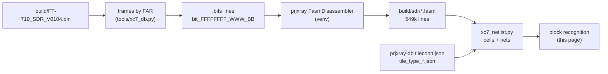
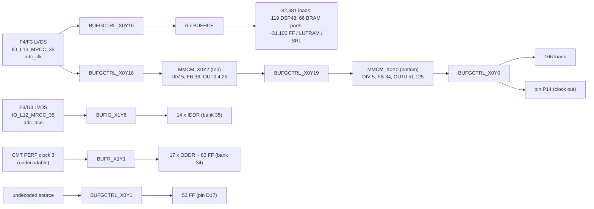
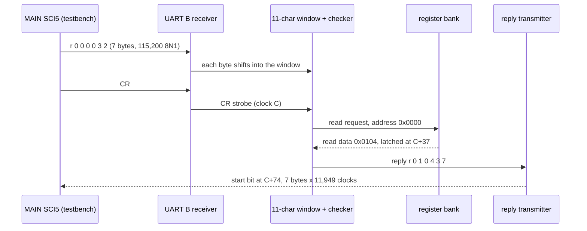

# SDR FPGA netlist recovery (T15)

Back to the [SDR overview](README.md).

This page takes the XC7A50T design from configuration bits ([bitstream.md](bitstream.md)) to FASM features, then to a
cell-level netlist, and then to recognized blocks. Everything derived (FASM, netlist JSON) stays in `build/sdr/` and
is not committed. Tools: `tools/xc7_fasm.py` (T15a), `tools/xc7_netlist.py` (T15b), `tools/xc7_blocks.py` (T15c),
`tools/xc7_netlist_verilog.py` (T15d), `tools/xc7_probe_netlist.py`, `tools/sdr_uart_sim.py`, `tools/sdr_cosim_check.py` (T15e). Reconstructed RTL: [`hdl/sdr/`](../../../hdl/sdr/README.md) (T15e).



## 1. Bitstream to FASM (T15a)

```sh
python3 -I tools/xc7_fasm.py selftest     # .bits format + segbits round trip through prjxray (5 hand-built features)
python3 -I tools/xc7_fasm.py fasm build/FT-710_SDR_V0104.bin build/sdr/FT-710_SDR_V0104.fasm --unknown build/sdr/unknown_bits.txt
python3 -I tools/xc7_fasm.py summary build/sdr/FT-710_SDR_V0104.fasm
```

`fasm` re-runs itself under `~/.local/share/ft710-tools/venv` when prjxray's Python dependencies are missing. It takes
about 18 s and under 1 GB.

**Coverage [fact].** Of 2,360,912 set configuration bits, prjxray's segbits explain all but 24,631. Of those, 24,224
are the per-frame ECC (word 50, bits 0-12, UG470), which belongs to no feature. Only **407 bits (0.017 %) are
unexplained**: DSP_L 100, DSP_R 98, MONITOR_BOT (XADC) 95, RIOB33 86, a few in HCLK/CFG/INT. So the FASM is an almost
complete description of the design.

**FASM lines per tile type [fact].** A merged multi-bit value (for example `ALUT.INIT[63:0]`) counts as one line.

| Tile type | Tiles | PIPs | LUT INIT | BRAM INIT | Other site features |
|---|---|---|---|---|---|
| INT_R / INT_L | 2,750 / 2,737 | 180,500 / 177,756 | | | 65 / 58 (long-line `LV`/`LH` features) |
| CLBLM_R / CLBLM_L | 1,456 / 884 | | 9,509 / 5,944 | | 55,197 / 32,628 |
| CLBLL_L / CLBLL_R | 1,026 / 600 | | 6,983 / 4,172 | | 35,935 / 21,295 |
| BRAM_L / BRAM_R | 51 / 20 | 3,060 / 1,200 | | 2,513 / 940 | 2,318 / 866 |
| DSP_L / DSP_R | 30 / 30 | 2,301 / 2,108 | | | 893 / 783 |
| LIOI3 (+TBYTE*) / RIOI3 (+TBYTE*) | 28 / 34 | 0 / 62 | | | 396 / 595 |
| LIOB33 (+_SING) / RIOB33 | 47 / 35 | | | | 393 / 316 |
| CMT_TOP_R_LOWER_B (MMCM) | 2 | 6 | | | 84 |
| CLK_BUFG_TOP_R / BOT_R / REBUF | 1 / 1 / 6 | 36 / 35 / 0 | | | 16 / 12 / 62 |
| CLK_HROW_TOP_R / BOT_R | 2 / 1 | 15 / 9 | | | 29 / 22 |
| HCLK_L / HCLK_CMT* / HCLK_IOI3 | 52 / 5 / 2 | 129 / 9 / 2 | | | 69 / 19 / 12 |
| **total** | **9,801** | **367,229** | **26,608** | **3,453** | **152,064** |

Notes **[fact for features, inference for meaning]**:
- The 26,608 LUT INIT lines match T13's LUT count exactly ([resources.md](resources.md)).
- IOI tiles: 94 ILOGIC sites carry the `ISERDES.MODE.MASTER` / `IDELAY_TYPE_FIXED` pair (Vivado's default attributes of
  a used input path, not proof of an ISERDES), **10 `IDDR`** and **12 `ODDR`** sites, all in the right I/O bank (RIOI3),
  and 23 `OMUX.D1`/`OQUSED` plain outputs in the left bank (LIOI3). DDR input and output flops on the right bank fit an
  **LVDS DDR ADC capture and a DDR output bus** **[inference]**.
- Per-tile features with no PIP name in `tile_type_*.json` in INT tiles are the bidirectional long lines (`LVx.LVy`,
  `LHx.LHy`); the netlist step treats them as PIPs.

## 2. FASM to cell-level netlist (T15b)

```sh
python3 -I tools/xc7_netlist.py selftest    # hand-built toggle flop routed through an INT tile + FASM value merge
python3 -I tools/xc7_netlist.py build build/sdr/FT-710_SDR_V0104.fasm build/sdr/netlist.json   # ~27 s, < 1.5 GB
python3 -I tools/xc7_netlist.py stats build/sdr/netlist.json
python3 -I tools/xc7_netlist.py net build/sdr/netlist.json SLICE_X12Y43/A5FF   # one cell or one net
```

**Method.** A prjxray *node* is a set of tile wires joined by `tileconn.json`; the tool builds nodes lazily (1.25 M
wires in 0.74 M nodes are touched) and joins them into nets with the 367,368 FASM PIPs plus the `always` pseudo-PIPs
of `ppips_*.db`. Two refinements were needed **[fact, found while testing]**:
- `always` pseudo-PIPs whose two ends are pins of the *same* site are paths through that site (for example BUFHCE I
  to O); following them merged every clock buffer output into one net, so they are skipped. Those between two sites
  (DSP ACOUT to the next DSP's ACIN, for example) are real wires and are kept.
- HCLK_IOI3 has PIPs without segbits (`IO_PLL_CLKn_DMUX` to the BUFIO input and to `RCLKn`, and the clock-capable
  pin to `DMUX` when no FASM PIP selects another source); the tool assumes them, since the design clearly uses them.
- An INT `IMUX`/`BYP_ALT`/`FAN_ALT` wire with no driving PIP is VCC (prjxray `default` pseudo-PIP), and a LUT with no
  INIT bits has INIT = 0, so its O6/O5 are constant 0. Vivado writes `PRECYINIT.C0` into slices without a carry chain,
  so CARRY4s are emitted for every slice and dropped (iteratively, along chains) when no output is used.

**SLICE model** (UG474 + prjxray fuzzer READMEs 011-019): LUT6, or LUT6_2 when O5 is used; FF type from
`FFSYNC`/`LATCH`/`ZRST` (FDRE/FDSE sync, FDCE/FDPE async, LDCE/LDPE latch) and INIT from `ZINI` (Z = inverted);
D muxes `xFFMUX` / `x5FFMUX` (IN_A = O5, IN_B = X bypass); CE/SR from `CEUSEDMUX`/`SRUSEDMUX`; clock inversion from
`NOCLKINV`; CARRY4 with `PRECYINIT` (CIN / AX / 0 / 1) and `xCY0` (DI = O5 or X); MUXF7/MUXF8; output muxes; SLICEM
LUT RAM (RAMD64E, and RAMD32 for the O5 half in `SMALL` mode) and SRLs (SRLC32E, pairs in `SMALL` mode). Hard blocks
keep all routed site pins and their FASM features.

**Result [fact for counts].**

| Cell | Count | Cross-check |
|---|---|---|
| LUT6 / LUT6_2 | 19,431 / 7,177 | 26,608 = T13 LUT count |
| FDRE / FDCE / FDSE / FDPE | 22,044 / 8,784 / 498 / 58 | 31,384 = T13 FF count; no latches |
| CARRY4 (outputs used) | 3,692 | T13 lower bound 3,398 |
| MUXF7 / MUXF8 | 251 / 30 | |
| RAMD64E + RAMD32 (LUT RAM, all `SMALL` = RAM32M-style pairs) | 336 + 336 | 336 `xLUT.RAM` |
| SRLC32E (221 SRL LUTs, 220 of them SRL16 pairs) | 441 | 221 `xLUT.SRL` |
| DSP48E1 | 119 | |
| RAMB18E1 halves in use | 137 | 70 RAMB36 sites |
| IOB / IDDR / ODDR | 116 / 14 / 17 | 110 ILOGIC and 30 OLOGIC are plain pass-through; the 124 IDELAYs only carry Vivado's default (`IDELAY_TYPE_FIXED`) and are not used; unused pins carry only `PULLTYPE`/`IN_TERM`/`SLEW` |
| MMCME2_ADV / BUFGCTRL / BUFHCE / BUFR / BUFIO | 2 / 7 / 16 / 1 / 1 | BUFIO and BUFR carry no FASM features; they are kept when their output is used |

127,648 nets: 125,597 with exactly one driver, **none with two or more**, and 2,051 without a driver. The undriven
ones are unused hard-block inputs (ILOGIC clocks, DSP cascade inputs at the bottom of a column, unused IOB O/T, BRAM
cascade pins); only 3 fabric pins (2 SRL data inputs in a `DI_DMC31` chain, 1 FF D) are left unexplained **[fact]**. The flip-flop clocks come from 6 BUFHCE outputs (4,000-7,300 FFs each) and one BUFR (83 FFs) **[fact]**,
see [section 3](#3-recognized-blocks-t15c).

**Corrections to T13 [fact].** prjxray's DSP fuzzer (`100-dsp-mskpat`) writes `Z<reg>` when the register value is
**0**, so the earlier reading "all 119 DSPs fully pipelined" in [resources.md](resources.md) was inverted: `ZMREG` is
set in 55 DSPs (MREG = 0), `ZPREG` in 9 (PREG = 0), `ZOPMODEREG` in 36, `ZCREG` in 107; `USE_DPORT` (pre-adder) is set
in 12. `USE_MULT` has no segbits in prjxray-db. #91: 196 of the 198 unexplained DSP bits are *not* USE_MULT but the
`AREG_1`/`BREG_1` marker bits that the openXC7 fork of prjxray-db (`openXC7/prjxray-db`, HEAD `a8b0926`) adds (tile
bits 27_111, 27_38, 27_271, 27_198); they sit on exactly the 104 A and 92 B registers that this decode already reads as
AREG = 1 / BREG = 1 **[fact]**. The upstream `f4pga/prjxray-db` master is still `0a0adde`, the checkout used here. Two DSP_R
bits (26_245) and the 86 RIOB33 bits (8 positions, 38_88..39_125) stay unexplained by either database.

**Approximations** (marked `approx` on the cells): the O5 halves of SRL16/RAM32 pairs take their data from the X
bypass pin; LUT RAM wider than 64 is not merged into RAM128/256 cells; IDELAY taps and ISERDES modes beyond
pass-through are not decoded; the MUXF7 input order (I1 = A/C LUT) follows UG474 but was not verified on silicon.

## 3. Recognized blocks (T15c)

```sh
python3 -I tools/xc7_blocks.py selftest
python3 -I tools/xc7_blocks.py build/sdr/netlist.json clocks      # clock roots, buffers, loads
python3 -I tools/xc7_blocks.py build/sdr/netlist.json io          # every used pin: package pin, bank, standard, loads, clock
python3 -I tools/xc7_blocks.py build/sdr/netlist.json package     # which packages bond all used IOBs
python3 -I tools/xc7_blocks.py build/sdr/netlist.json dsp         # DSP48E1 register sets, static OPMODE, cascades, sources
python3 -I tools/xc7_blocks.py build/sdr/netlist.json bram        # RAMB18 widths, readers/writers
python3 -I tools/xc7_blocks.py build/sdr/netlist.json logic IOB_X0Y41 2   # equations (LUTs as minimal SOP) around a pin
```

Cell names are prjxray site names plus the BEL (`SLICE_X1Y93/AFF` = the AFF flip-flop of that slice). They are the
names in `build/sdr/netlist.json` and in the Verilog of section 4.

### 3.1 Package

Every used IOB is bonded only in the **CSG324** and **FGG484** packages of the XC7A50T. CPG236, CSG325 and FTG256 lack
19 to 59 of them **[fact]**. Pin names below use CSG324 (15 x 15 mm, the likelier one on a small module) **[guess]**.
`io xc7a50tfgg484-1` gives the FGG484 names.

### 3.2 Clocks



- **One fabric clock** **[fact]**. The LVDS input on F4/F3 (`IO_L13P/N_T2_MRCC_35`) drives BUFGCTRL_X0Y16, and that
  clock reaches every DSP48, 66 block-RAM clock pins and all but about 300 flip-flops. It runs at **125 MHz**
  **[inference, high]**: the UART bit timers below divide by 1,086, which gives 115,200 baud at 125 MHz (the service
  manual says "Operating clock 125MHz, Divide 250MHz by 2"). So the ADC supplies the FPGA's clock, and the whole DSP
  chain runs at that rate.
- **ADC data capture** **[fact for the wiring]**. A second LVDS clock pair on E3/D3 (`IO_L12_MRCC_35`) reaches a
  BUFIO and clocks the 14 IDDRs of bank 35, so the data is captured source-synchronously at double data rate. The
  BUFIO path goes through a PIP that has no prjxray segbits, so the tool assumes it **[inference]**.
- **Two cascaded MMCMs** **[fact]**. MMCM_X0Y2 takes the 125 MHz clock, and MMCM_X0Y0 takes MMCM_X0Y2's CLKOUT0. With
  T13's divider reading (XAPP888 encoding) that is 125 x 36 / 5 / 4.25 = 211.76 MHz, then x 34 / 5 / 51.125 =
  **28.17 MHz** **[inference]**. A second VCO at 1,440 MHz needs a -2 speed grade, so one divider may be misread. This
  clock drives 166 flip-flops and goes straight to pin **P14** (a BUFHCE output on an OBUF). That fits the `DSP_CLK`
  line to the RT685 (J2002 pin 22) **[guess]**. Both MMCM resets come from the global reset flip-flop.
  *T19h note:* the RT685's M33 code is built for CLKIN = `DSP_CLK` = **18.432 MHz** **[fact, [ifdsp/m33-platform.md](../ifdsp/m33-platform.md)]**,
  which 28.17 MHz does not match. If MMCM_X0Y0's feedback multiplier were 22.25 instead of 34 (same DIVCLK 5 and CLKOUT0 51.125), the
  chain would give 18.4323 MHz (18 ppm off) with a legal 942 MHz VCO **[guess]**.
  *#67 re-check:* the reading is right. The 40-bit `LKTABLE` of both MMCMs is `1111111111 0100010011 1111101001 0000000001`, which is
  XAPP888's `mmcm_lock_lookup` value for M = 34..36 (M = 22 would be `…0111000010…`); Vivado fills it from the feedback multiplier, so
  M = 22.25 is ruled out. The FASM counter bits: top (X8Y113) FB 18+18 = 36, DIVCLK 2+3 (edge) = 5, CLKOUT0 2+2 + frac 2/8 = 4.25; bottom
  (X8Y9) FB 17+17 = 34, DIVCLK 5, CLKOUT0 26+25 (edge) + frac 1/8 = 51.125 **[fact]**. So P14 = 125 × 36/5/4.25 × 34/5/51.125 =
  **28.166 MHz**, and the bottom VCO sits at 1,440 MHz, the -2 grade's maximum **[inference: speed grade]**. Whether P14 is `DSP_CLK`
  stays open ([system.md O8](../system.md#8-contradictions-and-open-questions)).
- **Bank 34 output clock** **[fact for the wiring]**. BUFR_X1Y1 clocks the 17 ODDRs and 83 flip-flops next to bank 34.
  Its input is a CMT "PERF" clock whose source mux has no segbits, so it cannot be decoded.
- **Global reset** **[fact]**. `SLICE_X10Y76/BFF` (INIT 1) is released by a 3-bit counter in `SLICE_X11Y59`. The second
  UART and some other blocks use a copy delayed by one clock (`SLICE_X2Y89/AFF`).

### 3.3 Pin map by bank

| Bank (VCCO) | Pins | Recognized function | Tag |
|---|---|---|---|
| 35 (2.5 V, LVDS) | 14 LVDS input pairs into IDDRs, plus 2 clock pairs (adc_clk F4/F3, adc_dco E3/D3) | **ADC interface**: 14 DDR data pairs and the capture clock. All of the DSP logic runs in this clock domain | [fact] wiring, [inference] ADC |
| 35 | A5/A6 (`IO_L3_AD5`), inputs with no fabric load | XADC auxiliary input VAUX5 (the MONITOR tile is configured) | [inference] |
| 34 (2.5 V, LVDS) | 17 LVDS output pairs from ODDRs, plus 1 pair driven high | **DDR LVDS output bus**, most likely the **TX DAC**. Every pair's OBUFTDS enable comes from a flip-flop | [fact] wiring, [inference] DAC |
| 14 (3.3 V) | L13 `FCS_B` out (FDPE), K17 `D00_MOSI` in/out, K18 `D01_DIN`, L14 `D02`, M14 `D03` in | **QSPI master in fabric on the configuration-flash pins**: chip select and bidirectional D0, with D1-D3 captured together under a shared enable (`SLICE_X1Y60`), i.e. quad reads. Together with T13's WP finding, this is how the FPGA **rewrites its own configuration flash** during an update | [fact] wiring, [inference] purpose |
| 14 | **M18 in / L18 out** (`IO_L4N/L4P_T0_D05/D04`) | **UART A = debug console** (`UART_DBG`, prompt `[IF]>`): 115,200 8N1 receiver, transmitter and ASCII command parser (3.4, 5.3) | [fact] |
| 14 | **V12 in / U12 out** (`IO_L20N/L20P_T3`) | **UART B = MAIN's UART5** register link: same receiver, 11-character frame window (3.4, 5.2) | [fact] |
| 14 | N14, T18, R18 in/out | Each has an output FDPE (INIT 1, MMCM domain) enabled from a LUT, and an input synchronized in the 125 MHz domain: open-drain-style lines, I2C or similar | [guess] |
| 14 | P14 out | forwarded MMCM clock (`DSP_CLK`?) | [guess] |
| 14 | **U16 out, V17 out, V16 out** | **I2S-style serial port, running from reset** (#90, simulation): U16 toggles every 2 cycles (31.25 MHz bit clock), V17 every 128 cycles (frame, 64 bit clocks = 2 × 32-bit slots, 125 MHz / 256 = 488.28 kHz), V16 data from clock 65,541. Fits J2002 24 `TX_CLKA` / 26 `TX_FRMA` (the shared RX/TX audio clock and frame) and 33 `RX_DATA`, the RX IQ/audio stream to the RT685  *#154:* the U16 and V17 flip-flops are clocked by `BUFHCE_X0Y9`, the buffer that drives the `dsp_clk` pin (MMCM_X0Y0), and the simulation's MMCM stand-in passes 125 MHz through, so the real frame is `dsp_clk` / 256 (72 kHz at 18.432 MHz), not 488 kHz | [fact] behaviour and clocking, [inference] J2002 pins |
| 14 | **R16 out (clock), P17 out (select), N16 out (data)** | **16-bit SPI write sequence at power-up** (14 words, clocks 155–13,979, same on either edge): `0002 0000` (bit 1 of reg 0 set then cleared: soft reset), then reg 0x10 = C0, 11 = 00, 12 = 2D, 13 = 10, 14 = 20, 16 = 00, 17 = 00, 18 = 00, 19 = 00, 1A = 80, 1B = 03, 1D = 00 (8-bit address + 8-bit data). A 3.3 V chip on the module configured once; which part is open | [fact] words, open part |
| 14 | **M17 out** | **Second data line of the U16/V17 port** (#145): a shift register in the `dsp_clk` domain (`SLICE_X59Y39`) loaded from bit 15 of the SDP x36 buffer RAMB18_X2Y15, which is written from DSP48_X1Y18 (the mixer after the cosine NCO, 3.6). Sampled on the rising U16 edge in 32-bit V17 half-frames it carries bursts of ~10 words (`051EBC00 051EBB85 451EBB85 ... 64196F85 5F410385 ... 40000000`) every 4,096 `dsp_clk` cycles (16 frames), from cycle 6,920 after reset, with no MAIN frame and the ADC at 0. Earlier runs saw it idle because the block RAMs read 0 (#164) | [fact] wiring and behaviour, [inference] scope data |
| 14 | T9, U17, V15, T16, T15 out; N15 = 1; L16, F13 one edge after reset | V15/T16/T15 are tied to 0 and N15 to 1 in the bitstream (no logic behind them). T9 is a register-selected mux of status flops (3.6). U17 serializes ADC group 1 (3.6) and toggles once the ADC inputs move (#91) | [fact] |
| 15 (1.8 V) | B14, B13 out and C14 in/out, all driven from one slice (`SLICE_X42Y80`) | **3-wire SPI master** (clock, select, bidirectional data) at 1.8 V, the usual ADC configuration port | [inference] |
| 15 | B13 = SCK, B14 = CS, C14 = SDIO (data from `SLICE_X42Y80/A5FF`) | **ADC configuration at power-up** (#90, probed simulation): 27 frames of 24 bits, SCK period 8 cycles (15.6 MHz), 72-cycle gaps, MSB first, sampled on the falling edge: `000020 002001 007918 0080AD 00E11A 0014E7 0015C4 0012C0 001200 005E00 005F08 002800 002340 002501 002500 802500 802400 002764 003F20 004020 004330 003001 0018F9 001901 001AF9 001B01 000100`. Bit 23 set on the two `0x025`/`0x024` frames = reads: an Analog Devices-style 24-bit frame (R/W, length, 13-bit address, 8-bit data). The register map is not identified, so the ADC part stays open | [fact] frames, [inference] format |
| 15 | B18, A14, A13, A16 in; D17, F13 out; E17 = 0, D14 = 1 | 1.8 V control and status lines (D17 is in the undecoded BUFGCTRL_X0Y1 domain) | open |

**STARTUPE2 / CCLK (#93) [fact, routing].** prjxray cannot decode the STARTUPE2 site (`CFG_CENTER_MID` has routing bits only), and
`tools/xc7_netlist_verilog.py` writes no STARTUPE2 cell, but the routing into it is visible. Inside `CFG_CENTER_MID_X46Y32` the wire
`CFG_CENTER_STARTUP_USRCCLKO` has one source, `CFG_CENTER_CLK1_7` (a PIP without configuration bits), which runs through
`VFRAME_X47Y29.VFRAME_CLK1` and `INT_INTERFACE_L_X18Y27.INT_INTERFACE_CLK1` to `INT_L_X18Y27.CLK_L1`. The FASM enables
`INT_L_X18Y27.CLK_L1.FAN_BOUNCE5`, and following the enabled PIPs back (`FAN_ALT5` ← `SL1END2` ← SS6 ×3 from Y46 ← SE6 ×4 from
`INT_L_X4Y62`) ends at `CLBLL_L_X4Y62.CLBLL_LOGIC_OUTS6` = `CLBLL_LL_CQ` = **`SLICE_X4Y62/CFF`**. That FDCE is clocked by the main
fabric clock (`BUFHCE_X0Y22`, 4,233 loads), its next state is a LUT6 of its own Q and state flops at `SLICE_X1Y61` and
`SLICE_X4Y63`, and its Q has **no other load in the fabric** (only its own LUT): it is the SPI clock of the fabric flash master,
and its only way out is STARTUPE2 `USRCCLKO` → CCLK. So the design clocks its own configuration flash (D00..D03, FCS_B above) through
STARTUPE2, as T11c/T16 inferred. Reproduce: walk back from `CFG_CENTER_STARTUP_USRCCLKO` over `tileconn.json` and the tile-type
PIPs to an INT tile, then over the FASM's `INT_*` PIP lines, resolving each node across tiles.

The J2002 signals in [interfaces.md](interfaces.md) still have to be matched to these pins one by one. The two UARTs
and the flash pins are certain. UART B is MAIN's UART5 and UART A the debug UART (`UART_DBG`), shown by simulating the
whole netlist (3.4, section 5).

### 3.4 UART links

Both UARTs are the same circuit, placed twice: same structure and same character tables **[fact]**. The receiver of
UART A, read from the equations (`logic IOB_X0Y41 2`):

| Part | Cells | Function | Tag |
|---|---|---|---|
| Synchronizer, edge detect | `SLICE_X1Y96/A5FF`, `SLICE_X1Y97/AFF`, `SLICE_X1Y97/ALUT` | two flip-flops. The LUT resets the bit timer on reset, on every falling RX edge and at the end of each bit | [fact] |
| Bit timer | `SLICE_X0Y94..X0Y97` (16-bit CARRY4 counter) | counts 0..1085 (`0x43D`, terminal decode in `SLICE_X1Y94/DLUT`, `X1Y96/BLUT`, `X1Y97/BLUT`) and gives a sample tick at 542 (`0x21E`, `SLICE_X1Y94/BLUT`). That is **1,086 clocks per bit, i.e. 115,200 baud at 125 MHz, sampled mid-bit and re-aligned on every edge** | [fact] counts, [inference] baud |
| Shift register | 10 FDSE (`SLICE_X0Y93`, `SLICE_X1Y95`), preset to 1 | shifts in the sampled bit on each tick. The frame is complete when the start bit (0) reaches the last stage and the newest bit (the stop bit) is 1 (`SLICE_X0Y93/ALUT.O6`) | [fact] |
| Byte register and strobe | 8 FDRE in `SLICE_X1Y93`, `SLICE_X2Y93`; strobe `SLICE_X1Y92/AFF` | the byte is latched at the end of the frame, with a one-clock valid strobe. The strobe also presets the shift register | [fact] |
| Character classes | LUTs in `SLICE_X1Y92..X3Y94` that read the byte | evaluated over all 256 byte values (section 4): hex digits `0-9 A-F a-f`, `CR`, `CR`/`BS`, the command letters **`r`, `w`, `x`**, the separators `,` and space, `LF`, `#` | [fact] |

So the FPGA parses **ASCII lines**: a command letter (`r`, `w`, and an undocumented **`x`**), hex digits, `,` or space
separators, `BS` editing, and `CR`/`LF` line ends **[fact for the character set, inference for the grammar]**. MAIN's
side of UART5 (`sdr_reg_access` 0xFFFA1485, `FUN_fffa30f9`, `FUN_fffa31ae`, `FUN_fffa3083`) sends exactly that
**[fact]**:

| Frame from MAIN | Bytes | Reply MAIN expects |
|---|---|---|
| read | `r` + 4 hex address + 2 hex checksum + `CR` | 7 bytes: 5 characters, then a 2-hex checksum of those 5. MAIN parses the value with `hex2word` |
| write | `w` + 4 hex address + 4 hex value + 2 hex checksum + `CR` | one byte, `0x06` (ACK) |

**Which UART is which [fact, T15e simulation].** UART B (V12/U12) is **MAIN's UART5**: simulated with the whole
netlist, it answers MAIN's boot frame `r000032` CR with `r010437` (register 0 = 0x0104 = V01-04, the version MAIN stores
for `VE2;`) and a write with ACK 0x06. UART A (M18/L18) is the **debug console** (`UART_DBG`): it prints the prompt
`[IF]>`, echoes what it receives and takes `r 0000` / `w 0015 1234` style commands (section 5). The structural hints
of T15c fit: UART B keeps the last 11 characters in an 88-FF window, UART A works character by character. The
module-side J2002-to-FPGA traces are still not in the service manual, so this rests on behaviour, not on the pin path.

The checksum is the 8-bit sum of all the characters before it, written as two upper-case hex digits (`byte2hex`,
`"0123456789ABCDEF"`) **[fact, MAIN code]**. On the transmit side, `SLICE_X1Y94/A5FF` drives L18 (UART A) and
`SLICE_X2Y101/AFF` drives U12 (UART B). Within ten register stages the transmit path reaches about 1,400 flip-flops,
i.e. the control-register bank of the whole design **[fact for the cone size]**.

### 3.5 DSP and block-RAM structure

- **119 DSP48E1, all in the 125 MHz domain** **[fact]**. Register sets, using prjxray's fuzzer semantics (`Z<reg>` means
  the register is 0): 36 with only A/B/P registers, 25 with A/B/M/P/OPMODE registers, 23 with **A cascaded** from the
  DSP below (`A_INPUT = CASCADE`, BREG 2), 10 with all registers and the **pre-adder** (`USE_DPORT`), and a few small
  groups.
- **Cascades** **[fact]**. 34 DSPs take their A (32) or B (2) operand from the DSP below through ACOUT/BCOUT: pairs that
  share one operand, the shape of one sample multiplied by two coefficients (an I/Q mixer, or a complex multiply)
  **[inference]**. One chain has three DSPs. Only 2 DSPs add PCIN (OPMODE Z = PCIN). The adder trees after the
  multipliers are in fabric (`CARRY4` on the P outputs).
- **Static control pins (#91)**. In 117 of the 119 DSPs the OPMODE/ALUMODE/INMODE pins are tied to constants. The raw
  pin values (ALUMODE 3, OPMODE `0o077`/`0o177`) are not the modes: the DSP has programmable inverters on these pins, and
  prjxray's `ZIS_<pin>_INVERTED` bit = 1 means **not inverted** (the same Z convention as `ZINV_*` on block RAMs and `ZINI`
  on flip-flops), an absent bit means inverted. Effective value = pin XOR `IS_*_INVERTED` **[inference, high]**:

  | DSPs | effective OPMODE | ALUMODE | INMODE | Reading |
  |---|---|---|---|---|
  | 36 | `005` X=M Y=M Z=0 | 0 (Z+X+Y+CIN) | 00000 | P = A*B |
  | 35 | `065` X=M Y=M Z=C | 0 | 00000 (2: 00100) | P = A*B + C, C routed to constant 0 |
  | 36 | `125` X=M Y=M Z=PCIN>>17 | 0 | 00000 | upper half of a wide product: P = A*B + (PCIN >> 17) |
  | 10 | `025` X=M Y=M Z=PCIN | 0 | 00100 / dynamic | systolic chain with pre-adder: P = (D+A)*B + PCIN |
  | 2 | dynamic: X in {0, P}, Z in {0, PCIN} (OPMODE[1], OPMODE[4] from two fabric nets) | 0 | 00100 | accumulate / load / clear at the top of a PCIN chain |

  Every other reading fails: raw pins give X = A:B, Y = C, ALUMODE = subtract and an illegal Z on 36 DSPs; the opposite
  polarity gives X = P, Y = all-ones and ALUMODE 15 (a logic op) on every DSP. The chosen polarity is checked by the
  routing **[fact for each check]**: (1) X = Y = M (`0101`) on all 117 static DSPs, the only legal multiply setting;
  (2) the C bus is routed to constant 0 on every Z = C DSP and left unrouted (VCC, all ones) on every Z = 0 and
  Z = PCIN>>17 DSP, where C is unused;
  (3) INMODE[2] = 1 (D into the pre-adder) on the 10 `USE_DPORT` DSPs whose D bus is routed; (4) 33 of the 36 Z = PCIN>>17 DSPs
  sit directly above a Z = C DSP (the others above a PCIN>>17 or PCIN DSP: longer chains), and most Z = C DSPs send
  exactly 17 P bits to the fabric: the usual split of a multiply wider than 25 x 18 into a low and a high partial product; (5) CARRYIN is unrouted (VCC) with
  `ZIS_CARRYIN_INVERTED` clear, i.e. CIN = 0, with CARRYINSEL = 000. `tools/xc7_blocks.py ... dsp` prints the effective
  modes; `tools/xc7_netlist_verilog.py` writes `IS_OPMODE/ALUMODE/INMODE/CARRYIN/CLK_INVERTED`.
- **USE_MULT (#91)**. It has no configuration bit that prjxray or the openXC7 fork knows. Every static DSP selects
  X = Y = M, which is illegal unless `USE_MULT` is `MULTIPLY` (or `DYNAMIC`), so those 117 are `MULTIPLY`
  **[inference, high]**; the 2 dynamic accumulators never select M, so their setting (likely `NONE`) does not change
  their function. The netlist keeps `MULTIPLY` on all 119.
- **Block RAM to DSP** **[fact for the connections]**:

| Table ([bram-tables.md](bram-tables.md)) | Site | Read by | Reading |
|---|---|---|---|
| 1024-tap symmetric filter | RAMB18_X2Y28 | B inputs of DSP48_X1Y31..X1Y34 (36 bits) | coefficient ROM of a time-multiplexed FIR; the A side comes from RAMB18_X2Y25/X2Y30/X2Y31 (sample buffers) [inference] |
| cosine, 0.5 degree steps, 800 x 16 | RAMB18_X2Y20 | 16 LUTs | NCO lookup, multiplexed in fabric in front of the mixer DSPs [inference] |
| raised-cosine ramp, 720 steps | RAMB18_X2Y19 | 12 LUTs + 4 FFs | TX keying envelope [inference, T13] |
| 36-bit FIR bank | RAMB18_X1Y11/X1Y17/X2Y14/X2Y16 | 9 LUTs each | coefficient multiplexer in front of the decimating FIRs [inference] |
| x9 phase tables (replicated x4) | RAMB18_X0Y50..59, X1Y54..59, X2Y32..39 | DSP A inputs (9-15 bits each) + FFs | twiddle/phase operands of the FFT/scope engine [inference] |
| x4 tables, writable | RAMB18_X0Y42..47 | DSP A inputs; data written from FFs | initialized coefficient RAM that the control bank can rewrite [inference] |
| RAMB18_X1Y18/X1Y19, RAMB18_X2Y10 | | DSP B (18 + 18) / DSP A (25) | coefficient ROMs of further multipliers [fact] |

### 3.6 Routing ties: ADC/DAC pins and block-RAM tables to their logic (#146)

```sh
python3 -I tools/xc7_blocks.py build/sdr/netlist.json reach CELL[,CELL] fwd|back [REGS] [PINRE]
python3 -I tools/xc7_blocks.py build/sdr/netlist.json reach RAMB18_X2Y20 fwd 1 '^DO'     # -> DSP48_X1Y18.A
```

`reach` walks the routed nets from a cell through LUT/carry/mux logic and at most REGS fabric registers (never through
clock, reset or enable pins) and lists the hard blocks it meets (DSP, BRAM, IOB, IDDR/ODDR, MMCM) with the number of
registers in between. All connections below are **[fact, routing]**; what the blocks do is **[inference]** unless marked.
Deeper than 2-3 registers the paths run through the shared register bank and reach almost everything, so only the
first hard block on each path is meaningful.

**ADC input pairs (bank 35).** The 14 IDDR pairs form **two groups of 7**; each group is written into its own RAMB36 3
registers later and reaches its own first multiplier 4 registers later:

| Group | Pairs (P pin, CSG324) | Capture RAM (d3) | First DSP (d4) | Output pin |
|---|---|---|---|---|
| 1 | H6, K2, J3, J4, G4, H1, H2 | RAMB18_X0Y24/25 (RAMB36_X0Y12, x9) | DSP48_X1Y26.A, then X1Y27.A (d5) | **U17** at d6: its whole fan-in is these 7 pairs (175 cells, no DSP/BRAM) |
| 2 | F1, C2, E2, D5, B3, B1, B7 | RAMB18_X0Y22/23 (RAMB36_X0Y11) | DSP48_X0Y17.A, then X0Y20.A (d6) | V16 (I2S data) at d6 |

7 DDR pairs carry 14 bits per clock, so this fits a **dual-channel 14-bit ADC with 7 DDR LVDS pairs per channel**,
consistent with the Analog Devices-style 24-bit SPI frames on B13/B14/C14 **[inference]**. Both groups also reach T9 at
d3; T9 is a register-selected 2-to-1 mux of status flops, a debug/monitor output **[inference]**. Simulated with
pseudo-random ADC bits (#91), U17 and V16 start toggling at clock ~65,500.

**DAC output pairs (bank 34).** 16 of the 17 ODDR pairs take their data from **DSP48_X1Y26.P** 3 registers back,
the same DSP that ADC group 1 reaches first and that RAMB18_X2Y24 feeds (A input, 2 registers): one multiplier
drives the whole output bus **[fact]**, so it is the TX output scaling stage, with ADC group 1 reaching it through a
mux (loop-back or feedback path) **[inference]**. The 17th pair (R7/T6, OLOGIC_X1Y4) is fed from the inputs T13 and P15
(4 registers); R1 is held at 1.

**Block-RAM tables.** First hard block on the data outputs (DO, through at most 1 register) and on the address inputs
(back, at most 3 registers). Table names from [bram-tables.md](bram-tables.md):

| Table | RAMB18 | DO feeds | Address from |
|---|---|---|---|
| cosine, 0.5 deg steps | X2Y20 | DSP48_X1Y18.A (1 reg) | DSP48_X1Y38.P (2 regs): a phase accumulator |
| raised-cosine ramp | X2Y19 | DSP48_X1Y16.B (1 reg) | DSP48_X1Y12.P (2 regs) |
| 36-bit FIR bank (+ X2Y18, X1Y16) | X1Y11, X1Y17, X2Y14, X2Y16 | DSP48_X1Y0.A, X1Y2.A (1 reg) | DSP48_X0Y9.P, X1Y7.P (2 regs) |
| 1024-tap symmetric filter | X2Y28 | DSP48_X1Y31.B, X1Y33.B (direct) | fabric counter |
| X2Y25 (decaying, even entries) | X2Y25 | DSP48_X1Y32.A (direct) | |
| 12-bit phase, phase-step and quadratic phase tables, 4 lanes | lane 1: X0Y38/39, X2Y36-39; lane 2: X0Y50-53, X1Y56/57; lane 3: X0Y54/55, X1Y54/55, X2Y32/33; lane 4: X0Y56-59, X1Y58/59 | lane 1: DSP48_X1Y42/44.A; lane 2: X1Y47/49.A; lane 3: X1Y53/54.A; lane 4: X1Y58/59.A (all direct) | lane 1: DSP48_X1Y39.P (1 reg); X0Y50 and X0Y56 (lanes 2, 4): DSP48_X1Y57.P (2 regs); others deeper |
| 9-bit quadratic phase x2, 2-D twiddle phase, step table (RAMB36 x9: X0Y5, X0Y6, X1Y4, X1Y7) | X0Y10-13, X1Y8/9, X1Y14/15 | merged in fabric, 2 regs on: DSP48_X0Y8/9.A, X1Y7/8.A, X1Y0/1.B and the write addresses of RAMB18_X0Y0-9, X1Y2-7 | **DSP48_X0Y23.P** (1 reg), the dynamic accumulator of 3.5 |
| constants 0x1FF / 0x1F (RAMB36 x9: X0Y21-23) | X0Y42-47 | DSP48_X1Y36.A, X1Y40.A (direct) | |
| coefficient ROMs | X1Y18/19; X2Y10; X0Y16 | DSP48_X0Y8.B, X1Y7.B; X1Y9.A; X1Y13.A (1 reg) | |
| X2Y24 (rising segment) | X2Y24 | DSP48_X1Y26/27.A (2 regs) | |
| X2Y29 (hump) | X2Y29 | | RAMB18_X1Y31 DO (1 reg): a table addressed by another RAM |

Readings **[inference]**: the four phase-table lanes are four identical channels, each with its own DSP pair in column
X1 rows 42-59, as the 4x replication suggested; the four flagged x9 tables are one block (an accumulator-addressed set
of phase/step tables whose outputs are selected in fabric) feeding the FIR-bank multipliers and the addresses of the
x4 sample RAMs at the bottom of columns X0/X1, the shape of the zoom/FFT scope engine; the cosine table is the NCO of
a mixer (DSP48_X1Y18) driven by the phase accumulator DSP48_X1Y38; the raised-cosine ramp multiplies a signal in
DSP48_X1Y16 (TX keying envelope).

## 4. Structural Verilog, smoke test and simulation (T15d)

```sh
python3 -I tools/xc7_netlist_verilog.py selftest
python3 -I tools/xc7_netlist_verilog.py verilog build/sdr/netlist.json build/sdr/ft710_sdr.v --xdc build/sdr/ft710_sdr.xdc
python3 -I tools/xc7_netlist_verilog.py prims build/sdr/prims.v          # RAMD64E/RAMD32 for Yosys
python3 -I tools/xc7_netlist_verilog.py simprims build/sdr/simprims.v    # + IBUFDS/IDDR/ODDR/BUFR/BUFIO/MMCM sim models
python3 -I tools/xc7_netlist_verilog.py slice build/sdr/netlist.json OUT.v --seeds CELL[,CELL] --depth N
```

**Level-1 netlist [fact for the counts].** `build/sdr/ft710_sdr.v` (15 MB, never committed) is one module,
`ft710_sdr`, with 116 ports and 63,474 UNISIM instances: LUT6 19,431, LUT6_2 7,177, FDRE 22,044, FDCE 8,784, FDSE 498,
FDPE 58, CARRY4 3,692, MUXF7 251, MUXF8 30, SRLC32E 441, RAMD64E 336, RAMD32 336, DSP48E1 119, RAMB18E1 75 + RAMB36E1 31 (#164; 137 RAMB18E1 with `--ramb18`) (with their
INIT_xx/INITP_xx contents), IDDR 14, ODDR 17, MMCME2_ADV 2, BUFGCTRL 7, BUFHCE 16, BUFR 1, BUFIO 1, and on the pins
IBUFDS 16, OBUFTDS 18, IBUF 19, OBUF 24, IOBUF 5. Parameters are the recovered ones: LUT INIT, FF INIT and clock
inversion, DSP register attributes, A/B_INPUT, USE_DPORT, MASK/PATTERN, BRAM widths, output registers, write modes,
MMCM DIVCLK_DIVIDE / CLKFBOUT_MULT_F / CLKOUT0_DIVIDE_F, IOSTANDARD per pin.

**Ports and XDC.** Ports are named after CSG324 package pins (`io_T9`, `io_R8_p`/`io_T8_n`) except where T15c found
the function: `adc_clk_p/n`, `adc_dco_p/n`, `uart_a_rx/tx`, `uart_b_rx/tx`, `flash_cs_n`, `flash_d0..d3`, `dsp_clk`.
`build/sdr/ft710_sdr.xdc` has `PACKAGE_PIN` and `IOSTANDARD` for all 116 ports (LVDS_25 on banks 34/35, LVCMOS33 on
bank 14, LVCMOS18 on bank 15) **[fact for the pin/site mapping, inference for the standard of multi-standard
features]**.

**LUT RAM / SRL16 pairs (#92) [fact].** In SMALL mode a SLICEM LUT holds two 32-bit halves. The O6 half takes
its data from DI2 = the X bypass pin and the O5 half from DI1 (the I pin or the shift chain): UG474 Figure 7 (RAM32M, p. 23:
DID[0] via AX..DX to DI2, read on O6; DID[1] via DI to DI1, read on O5) and Figure 18 (dual SRL16, p. 35: SHIFTIN1 (AI) to DI1
and O5, SHIFTIN2 (AX) to DI2 and O6/MC31) **[fact, `Manuals/AMD/ug474_7Series_CLB.pdf`]**; nextpnr-xilinx packs them the same way. `tools/xc7_netlist.py` had the two swapped until #92; 556 O5-half cells are
affected. UART B and the console give identical answers with the old and the new netlist; data paths that use these cells
should be re-simulated.

**Approximations** (written as comments next to the instance): `USE_MULT = "MULTIPLY"` on every DSP (no segbits; see 3.5, #91),
RAMB36 pairs without the BRAM36 width flag written as two RAMB18E1 halves (the 31 flagged x9 pairs are written as RAMB36E1 since #164, section 4.4), IDDR edge mode not decoded, OLOGIC T inversion not decoded (tri-state
enables as routed), MMCM `CLKIN1_PERIOD` assumed 8 ns, BUFR/BUFIO inputs from undecodable PERF/CCIO PIPs.

### 4.1 Smoke test

Yosys 0.23 parses and elaborates the whole netlist against its Xilinx cell library: `read_verilog -lib
+/xilinx/cells_sim.v +/xilinx/cells_xtra.v build/sdr/prims.v; read_verilog build/sdr/ft710_sdr.v; hierarchy -check
-top ft710_sdr; stat` finishes in 9 s (1.4 GB) with **no errors**; the only warnings are the three real-valued MMCM
parameters **[fact]**. Every instance type, port name and parameter name therefore exists in the UNISIM library.
Icarus Verilog 11 compiles the same netlist (`iverilog -g2012` with `cells_sim.v` and `simprims.v`) **[fact]**.

### 4.2 Simulation of the UART receiver

`slice` cuts a sub-netlist: the seed cells and their fan-in through LUT/CARRY/MUX/FF stages, stopping at clock pins,
hard blocks and register-driven resets; inputs from outside become ports named after their driver. The UART A
receiver (seeds: the byte register and the strobe, depth 4) is 76 cells. Driving its RX pin with 115,200 baud frames
in Icarus, the netlist slice returns **every byte exactly** (`r 0 A CR 0x55 0xA5 ...`), with the strobe two clocks
long **[fact]**. This checks the whole chain bitstream -> FASM -> cell netlist -> Verilog on a real block: LUT INIT
bit order, FF types and INIT, CARRY4 wiring, local resets and routing.

The behavioural `hdl/sdr/uart_rx.v` (T15e) matches that slice **cycle by cycle** (0 mismatches in 260,417 clocks,
including senders 2 % slow and fast) **[fact]**.

### 4.3 What simulation says about the command parser

- The parser's character classes come from evaluating its LUTs over all 256 byte values (`hdl/sdr/uart_charclass.v`)
  **[fact]**.
- A 3,580-cell slice of UART A's transmit cone (depth 10) answers every received character with `?` (`0x3F`), and
  after `CR` sends 9-bit frames without a stop bit. That slice ties ~500 boundary nets (register bank, other blocks)
  to 0, so this is **not** the radio's real behaviour, only evidence that the transmitter is driven by the parser
  per character **[inference]**. UART B's slice sends nothing under the same conditions. (Superseded by the
  whole-netlist simulation in section 5.)
- A full-netlist simulation (63k cells in Icarus, with functional models for IBUFDS/IDDR/ODDR/BUFR/BUFIO/MMCM from
  `simprims` and the Yosys DSP48E1/RAMB18E1 models, the DSP `$fatal` mode checks removed) compiles to a 195 MB image
  but runs at under 5 us of simulated time per minute on the shared box, so one UART exchange (~3 ms) would take
  over ten hours; it was stopped **[fact]**. A compiled simulator (Verilator) is the way to run the whole design
(section 5).

### 4.4 True RAMB36E1 and a working block-RAM model (#164)

**Block RAMs did nothing in every earlier whole-design simulation [fact].** Yosys 0.23's `cells_sim.v` declares
RAMB18E1 and RAMB36E1 with ports, parameters and timing only, no behaviour, and `build_full.sh` used that declaration,
so all 137 block-RAM outputs read 0 in the runs of #89, #90 and T15e. `hdl/sdr/sim/xc7_bram_vl.v` now models both
primitives from UG473: widths 1-36 (RAMB18 SDP 36, RAMB36 SDP 72), the INIT/INITP layout, byte write enables,
WRITE_FIRST / READ_FIRST / NO_CHANGE, the output register with RSTREG_PRIORITY, and the inverted control pins. Not
modelled: cascade, ECC, FIFO mode, non-zero INIT_A/B or SRVAL (all are 0 here), port collisions.
`hdl/sdr/sim/tb_bram.v` checks it (Icarus: PASS).

**Control-pin inversion [fact].** prjxray's `ZINV_<pin>` = 1 means *not* inverted. Every used BRAM leaves its four
RST pins unrouted (VCC) with `ZINV_RST*` clear, i.e. inverted to an inactive 0; 5 `ENARDEN` and 44 `ENBWREN` pins are
inverted the same way (unused ports held disabled). The writer now passes `IS_*_INVERTED`; without it every BRAM
would sit in reset.

**RAMB36E1 for the 31 flagged pairs.** A tile with `RAMB36.BRAM36_*_WIDTH_1` is a true RAMB36 in x9 (#92), so
`tools/xc7_netlist.py` copies the tile's RAMB36 features onto both halves (`RAMB36.<feature>` params) and
`tools/xc7_netlist_verilog.py` writes one RAMB36E1 per flagged pair (`--ramb18` restores the old two-half reading):

| RAMB36E1 port | from the halves | source |
|---|---|---|
| DOADO/DOBDO/DIADI/DIBDI bit 2k, 2k+1 | lower half (Y0) pin k, upper half (Y1) pin k | `tile_type_BRAM_*.json`: RAMB36 pin DOADO1 = wire `BRAM_FIFO36_DOADOU0`, which drives the same `LOGIC_OUTS` wire as the Y1 RAMB18's DOADO0 [fact] |
| DOPADOP/DIPADIP bit 0, 1 | Y0 pin 0, Y1 pin 0 | same (`DIPADIP1` = `..._DIPADIPU0`) [fact] |
| ADDR bit k+1 | RAMB18 address pin k | `BRAM_ADDRARDADDRL<k+1>` feeds FIFO18 `ADDRARDADDR<k>` [fact]; bit 0 and the cascade bit 15 are tied 1 (unused at x9) |
| INIT/INITP bit j | bit j/2 of half Y(j mod 2) | the interleave rule of [bram-tables.md](bram-tables.md) |

Checks **[fact]**: in all 31 pairs the two halves share every clock, enable, reset, address and write-enable net
(the writer reports any difference; there is none). The data bits are 4 + 4 and the parity output is read from the
lower half only (23 pairs read `DOP` on Y0, none on Y1), while the parity *input* is routed to both halves with the
same net (20 pairs; the DIP net equals on both halves in all of them). That is what a RAMB36 x9 needs if entry i's parity bit lives in half (i mod 2): the INITP
interleave. The contents agree: for the 9-bit phase table RAMB36_X0Y5, 100 % of the second differences modulo 512
lie within +-3 of 0 with the interleaved parity, against 52-59 % with the parity concatenated, taken from one half,
or dropped; RAMB36_X1Y4 gives 100 % against 95-98 % **[fact for the numbers, inference that the interleave is the
hardware layout]**. The 8 data bits are the same in the RAMB36 and the two-half reading (same pins, same INIT bits);
what the halves lose is the parity bit, which is the MSB of the 9-bit tables and the 9th bit of the x9 RAMs.

**Data-path re-check (#164) [fact, `pins_main.cpp`, 300,000 clocks, inputs 0].** Four builds of the pin harness:
(1) the old netlist (before the #92 LUT-RAM DI fix, BRAMs 0), (2) DI fix, BRAMs 0, (3) DI fix + BRAM model with the
pairs as two RAMB18, (4) DI fix + BRAM model + RAMB36E1:

| Output | (1) | (2) | (3) | (4) |
|---|---|---|---|---|
| I2S clock U16 / frame V17 | 2-cycle / 128-cycle | same | same | same |
| I2S data V16 | toggles from clock 65,541 | **constant 0** | 0 | 0 |
| R16/P17/N16 power-up SPI | 14 words `0002 0000 10C0 ... 1D00`, clocks 155-13,979 | same | same | same |
| B13/B14 ADC SPI clock/select | 27 frames, clocks 2-6,876 | same | same | same |
| M17 | idle | idle | **active from clock 6,920**, 38,330 edges | active from 6,928, 36,162 edges (differs from (3)) |
| UART A console, UART B link | | same console bytes in (2) and (4) | | `full_main` build: `r010437` at clock 225,163, ACK, read-back `1234`, reg 6 = `020A`, reg 0x30 = `0023`; console `0104`, `1234`, `r 000#` = `1200`, `x` = `Err`: all as documented in section 5 |

So the power-up SPI and ADC configuration sequences and the I2S timing do not depend on LUT RAM or block RAM. The
I2S data that #90 saw from clock 65,541 came from the swapped SRL/LUT-RAM data pins: with the fix and all ADC inputs
at 0 the RX stream is silent, as it should be **[inference]**. M17 is driven through block-RAM contents and the
RAMB36 parity bits change its pattern; it is followed up in #145. The DSP48E1s still run with the wrong mode-pin
polarity in these builds (#91), so no DSP data path is checked yet.

**DSP polarity in simulation (#91) [fact].** Before #91 the Verilog DSPs had no `IS_*_INVERTED`, so in every whole-design
run they computed `Z - (A:B + C)` with nonsense operands instead of products. With the polarity written, the UART link and
console answer as before, and the pin harness gives identical pins with the ADC inputs at 0. With pseudo-random bits on
the 14 ADC pairs (`ADC=noise` in `pins_main.cpp`), V16 (I2S data) and U17 come alive from clock 65,541 / 65,578, but
identically with and without the DSP fix: at the power-up register state the path to these pins does not depend on
DSP results. U17's whole fan-in is 175 cells reaching 7 of the 14 IDDR pairs and no DSP or BRAM (a serializer of
raw ADC bits); V16's reaches everything through the register bank. Exercising the DSP chain needs register settings
MAIN writes (#146).

## 5. Whole-design simulation and the UART protocols (T15e)

```sh
hdl/sdr/sim/build_full.sh                                      # Verilator 5.006, ~2.5 min, -> build/sdr/vl/obj_full
python3 -I tools/sdr_uart_sim.py b:r0000 b:w00151234 b:r0015   # frames with checksum + CR on UART B
python3 -I tools/sdr_uart_sim.py "a:=r 0000\r"                 # raw text on UART A (console)
python3 -I tools/xc7_probe_netlist.py ...                      # expose internal nets on a `probe` port
```

The Yosys `cells_sim.v` models trip Verilator 5.006 (an internal error on CARRY4 with constant inputs), so the small
primitives have their own models in `hdl/sdr/sim/xc7_prims_vl.v`, the block RAMs in `hdl/sdr/sim/xc7_bram_vl.v` (#164, section 4.4); DSP48E1 still comes from Yosys (with
the `$fatal` mode checks removed). One detail mattered: the recovered BUFGCTRLs have `S1 = I1 = 1` because unrouted
pins sit at their tie value, so the model must pass I0; with a textbook BUFGCTRL model the whole design has no
clock. All inputs other than the clock and the two RX pins are tied to 0. The model runs at **~15,000 clocks/s**
(one MAIN exchange of ~0.2 M clocks in ~15 s) **[fact]**.

### 5.1 End-to-end MAIN exchange [fact]



With the reset released by the design's own counter, `r000032` CR sent from clock 108,500 gives the reply
**`r010437`** (`72 30 31 30 34 33 37`), first byte complete at clock 225,163 **[fact]**. MAIN accepts it: byte 0 echo,
value `0104`, sum `37` over the first five bytes.

### 5.2 Register link (UART B) [fact unless marked]

Recovered by simulation and confirmed by the RTL co-simulation (`hdl/sdr/uart_link.v`, section 5.4):

| Line (last characters before CR) | Reply |
|---|---|
| `r` aaaa ss | `r` vvvv ss, 7 bytes, no CR; ss = 8-bit sum of `r`vvvv in upper-case hex |
| `w` aaaa vvvv ss | ACK 0x06, **one byte** (MAIN arms a 7-byte receive, but its `sci5_rx_byte_hook` 0xFFF94962 shortens it to 1 byte when byte 0 is 0x06 or `?` [fact, T19h]) |
| anything else, including `x...`, upper-case `R`, missing or wrong checksum, wrong length | `?` 0x3F |

- **Window, not a parser.** The receiver shifts every character except CR into an 11-character window (88 FFs,
  `SLICE_X0..X2Y107..Y111`, cleared only at reset). At CR the checker looks at the last 11 (write) or 7 (read)
  characters, so junk, LF, BS or a second letter in front of a frame do not matter, and **CR alone repeats the
  previous command** (a repeated read reads again). Address and value digits may be lower case; the two checksum
  characters must be upper case, because they are compared with the FPGA's own rendering of the sum.
- **Datapath.** Hex digits go into 4-bit nibble registers (the 4-FF groups in `SLICE_X7..X10Y95..Y100`), the read
  result is latched from the register bank's read-data flip-flops (`SLICE_X9..X14Y63..Y70`) into 16 FFs
  (`SLICE_X5Y103..X7Y101`, enable `SLICE_X15Y106/CLUT`), and the transmitter takes a 5-bit symbol
  (`SLICE_X3Y103/AFF`, `X5Y102/AFF`, `X6Y102/AFF`, `X6Y102/BFF`, `X7Y104/AFF`) that LUTs turn into the ASCII byte
  (hex digits, `r`, ACK, `?`). The bit timer is `SLICE_X0Y102..X0Y105`, the pad flip-flop `SLICE_X2Y101/AFF`.
- **Timing** (clocks after the receiver's CR strobe): read-data latch +37; first start bit +74 for a read reply,
  +69 for the ACK, +37 for `?` when the line has no frame shape, +45/+47 for a read-shaped line whose first/second
  checksum digit is wrong, +49/+51 for a write-shaped one. Each reply byte is start + 8 data + 2 stop bits + 3 clocks.
- **Register values** after reset (other inputs tied 0): 0x00 = 0x0104 (read-only), 0x01 = 0x000F, 0x02 = 0, 0x03 =
  0x8800, 0x04 = 0x8810, 0x05 = 0, 0x06 = 0x020A, 0x07 = 0, 0x0A = 0, 0x15 = 0x1FFF, 0x30 = 0x0023, 0x32/0x33/0x37 = 0.
  Unmapped addresses tried read 0xCCCC (0x00FF, 0xA8B2, 0xB837, 0xFFFF) or 0 (0x0100, 0x90E4). Write and read-back
  work for 0x03, 0x15, 0x30, 0x31. MAIN's 0x37 = 0xBCC5 unlock is ACKed and reads back 0.

### 5.3 Debug console (UART A, M18/L18) [fact unless marked]

- After reset it prints the prompt **`[IF]>`** (no CR/LF before it).
- Every character is echoed at once; characters outside its set come back as `?` (e.g. `q`). LF is echoed and does nothing.
- **`#` and BS are hex digits** (#89, `hdl/sdr/sim/pins_main.cpp` with `CONSOLE=`) **[fact]**: the console's hex decoder reads
  `#` (0x23) as **E** and BS (0x08) as **B**. `#` is echoed as 0x06, BS as `B`. So `r 000#` reads register 0x0E (`1200`),
  `r 000<BS>` reads 0x0B (`0058`), `w 0015 12<BS>4` stores 0x12B4 (read back as `12B4`), and BS does not edit the line. The
  earlier "`#` then `Err`" came from lines whose digit count the extra character broke; `r ####` reads 0xEEEE (unmapped,
  `CCCC`). Unmapped registers read `CCCC`.
- On CR: `r AAAA` prints CR LF `VVVV ` CR LF `[IF]>`; `w AAAA VVVV` or `w AAAA,VVVV` writes silently and prints CR LF
  `[IF]>`. Exactly four hex digits and one separator (space or comma) are required; anything else (`r0`, `r 15`,
  `r  0001`, trailing space, `0x` prefixes, two operands for `r`) prints `Err` CR LF `[IF]>`.
- It reads the same register bank as the link (register 0 = 0104, writes to 0x15 read back) **[fact]**; the two
  command engines meet at the shared bus flip-flops around `SLICE_X10..X15Y85..Y89` **[inference]**.
- **`x`**: accepted by the echo filter, but every form tried (`x`, `x 0000`, `x 0000 0000`, `x 00000000`,
  `x 0000,0000`, `x 0000 0000 0000`, `x0015`, also after `w 0037 BCC5`) gives `Err`, as on the link. So `x` is in the
  character tables of both engines but has **no reachable function** in this bitstream with the other inputs at 0
  **[fact for the tried forms]**. **Not gated by an input pin** (#89): with each of the 12 unassigned inputs (U13, T13, V10,
  T11, T14, R15, P15, L15, B18, A14, A13, A16) held high in turn, and with all of them high, `x` and `x 0000` still give `Err`
  **[fact, simulation]**; so `x` is unused in this bitstream, or needs a register state no tried sequence reaches **[inference]**.
- The "garbled BS echo" was the echo `B` overlapping the next frame in the old harness; with a gap between characters
  it is a clean `B` (above).
- The console's transmit cone also drives the three open-drain-style pins N14, T18, R18 (shared tri-state enable)
  **[fact for the wiring, function open]**.

### 5.4 RTL equivalence (T15e) [fact]

`hdl/sdr/sim/cosim_top.v` runs the whole netlist and `ft710_uart_link` in one Verilator model, feeds both the same
UART B input and the RTL the netlist's read-data bus (a 17-bit probe port added by `tools/xc7_probe_netlist.py`), and
compares the two TX pins on every clock. Directed runs (`cosim_directed.sh`: boot reads, unlock, writes, every NAK
latency class, junk, LF, empty line) and random runs (`cosim_random.sh`: reads, writes, corrupted and lower-case sums,
wrong lengths, junk prefixes, lines split by idle gaps) show **0 mismatching clocks** (counts in
[T15e](../../tasks/T15e-fpga-uart-rtl.md)). Not compared: the RTL's own bus strobes (writes are checked through
read-back) and a CR during a running reply.

### 5.5 What starts the "scope SPI" (#145)

**Nothing has to start it [fact, simulation].** #62/#90 looked for a three-pin scope port (`FFT_CLK/FRM/DAT`, J2002
23/25/27) among the idle bank-14 outputs and found none active. With working block RAMs (#164) the only new output is
**M17**, and it needs no trigger: it starts 6,920 `dsp_clk` cycles after reset with all inputs at 0 and no MAIN frames.
It is not a separate SPI master: M17 is a shift register clocked by `dsp_clk` that reuses the U16 bit clock and V17
frame of the I2S-style port (the same 7-bit counter in `SLICE_X15Y42/43` drives U16 = bit clock, V17 = frame, and the
load/shift strobes of M17's register `SLICE_X59Y39`) **[fact, netlist equations]**. Its data comes from bit 15 of
RAMB18_X2Y15, an SDP x36 buffer that DSP48_X1Y18 (the mixer behind the cosine NCO) fills **[fact, routing]**. Every
4,096 `dsp_clk` cycles (16 frames) it sends a burst of about 10 non-zero 32-bit words.

So the port has two data lines on one clock and frame: V16 (125 MHz domain, ADC group 2, I2S `RX_DATA`) and M17
(`dsp_clk` domain, a buffered DSP stream in bursts). No other output of the bitstream can be a clock or frame for a
second port: V15/T16/T15 are tied to 0 and N15 to 1 in the configuration, T9 is a status mux, U17 a raw ADC serializer
**[fact]**. The reading that the DISPLAY scope data is M17, sharing `TX_CLKA`/`TX_FRMA` (or wired to `FFT_CLK/FRM` on the
module) is **[inference]**; the J2002 pin of M17 is not in the service manual. Reproduce:
`ADC=noise LOGPINS="io_U16 io_V17 io_M17 " LOGTO=30000 build/sdr/vl/obj_pins/Vft710_sdr 30000` with a netlist written after
#164/#91, then sample M17 on rising U16 edges between V17 edges.

**Power-up SPI part on R16/P17/N16 [open].** The 14 writes are the only traffic on these pins: N16 is output-only, so
the part is written, never read back. Format: 16 bits, MSB first, 8-bit address + 8-bit data, a soft-reset bit (bit 1
of register 0) set and cleared, then registers 0x10-0x1B and 0x1D, on 3.3 V bank 14 **[fact]**. The TX DAC behind the 16
LVDS DDR output pairs (2.5 V bank 34) is the obvious candidate, since nothing else on the module needs configuring and
the ADC has its own 1.8 V port **[guess]**. No register map checked here matches the values; the part needs the
module's IC marking (follow-up #191).

### 5.6 Remaining pins

Not done in T15e (see 5.5 for #145): matching the DISPLAY scope SPI and the I2S lines to the remaining bank 14/15 pins (section 3.3). #90 (2026-10-28) found the I2S port (U16/V17/V16) and decoded the two power-up configuration transfers (R16/P17/N16 and
B13/B14/C14) with `hdl/sdr/sim/pins_main.cpp`; the scope SPI did not start in simulation (table in 3.3).
The whole-design model can now do it by driving candidate input pins and watching outputs.

