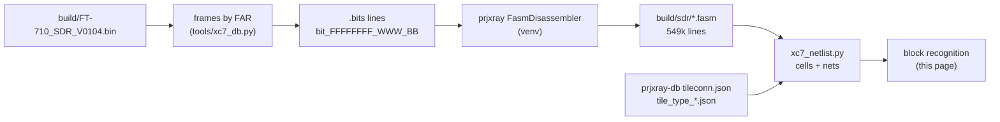
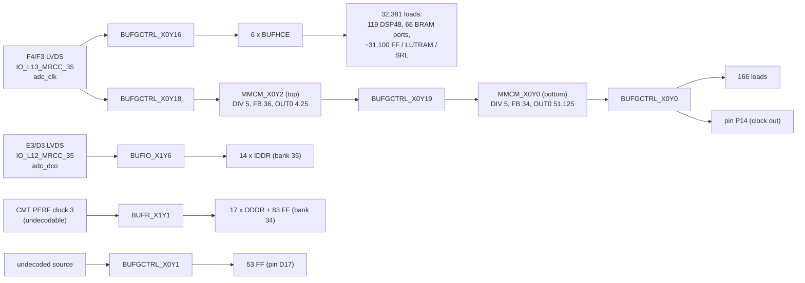

# SDR FPGA netlist recovery (T15)

Back to the [SDR overview](README.md).

This page takes the XC7A50T design from configuration bits ([bitstream.md](bitstream.md)) to FASM features, then to a
cell-level netlist, and then to recognized blocks. Everything derived (FASM, netlist JSON) stays in `build/sdr/` and
is not committed. Tools: `tools/xc7_fasm.py` (T15a), `tools/xc7_netlist.py` (T15b), `tools/xc7_blocks.py` (T15c),
`tools/xc7_netlist_verilog.py` (T15d). Reconstructed RTL: [`hdl/sdr/`](../../../hdl/sdr/README.md) (T15e).



## 1. Bitstream to FASM (T15a)

```sh
python3 -I tools/xc7_fasm.py selftest     # .bits format + segbits round trip through prjxray (5 hand-built features)
python3 -I tools/xc7_fasm.py fasm build/FT-710_SDR_V0104.bin build/sdr/FT-710_SDR_V0104.fasm --unknown build/sdr/unknown_bits.txt
python3 -I tools/xc7_fasm.py summary build/sdr/FT-710_SDR_V0104.fasm
```

`fasm` re-runs itself under `~/.local/share/ft710-tools/venv` when prjxray's Python dependencies are missing. It takes
about 18 s and under 1 GB.

**Coverage [fact].** Of 2,360,912 set configuration bits, prjxray's segbits explain all but 24,631. Of those, 24,224
are the per-frame ECC (word 50, bits 0-12, UG470), which belongs to no feature. Only **407 bits (0.017 %) are
unexplained**: DSP_L 100, DSP_R 98, MONITOR_BOT (XADC) 95, RIOB33 86, a few in HCLK/CFG/INT. So the FASM is an almost
complete description of the design.

**FASM lines per tile type [fact].** A merged multi-bit value (for example `ALUT.INIT[63:0]`) counts as one line.

| Tile type | Tiles | PIPs | LUT INIT | BRAM INIT | Other site features |
|---|---|---|---|---|---|
| INT_R / INT_L | 2,750 / 2,737 | 180,500 / 177,756 | | | 65 / 58 (long-line `LV`/`LH` features) |
| CLBLM_R / CLBLM_L | 1,456 / 884 | | 9,509 / 5,944 | | 55,197 / 32,628 |
| CLBLL_L / CLBLL_R | 1,026 / 600 | | 6,983 / 4,172 | | 35,935 / 21,295 |
| BRAM_L / BRAM_R | 51 / 20 | 3,060 / 1,200 | | 2,513 / 940 | 2,318 / 866 |
| DSP_L / DSP_R | 30 / 30 | 2,301 / 2,108 | | | 893 / 783 |
| LIOI3 (+TBYTE*) / RIOI3 (+TBYTE*) | 28 / 34 | 0 / 62 | | | 396 / 595 |
| LIOB33 (+_SING) / RIOB33 | 47 / 35 | | | | 393 / 316 |
| CMT_TOP_R_LOWER_B (MMCM) | 2 | 6 | | | 84 |
| CLK_BUFG_TOP_R / BOT_R / REBUF | 1 / 1 / 6 | 36 / 35 / 0 | | | 16 / 12 / 62 |
| CLK_HROW_TOP_R / BOT_R | 2 / 1 | 15 / 9 | | | 29 / 22 |
| HCLK_L / HCLK_CMT* / HCLK_IOI3 | 52 / 5 / 2 | 129 / 9 / 2 | | | 69 / 19 / 12 |
| **total** | **9,801** | **367,229** | **26,608** | **3,453** | **152,064** |

Notes **[fact for features, inference for meaning]**:
- The 26,608 LUT INIT lines match T13's LUT count exactly ([resources.md](resources.md)).
- IOI tiles: 94 ILOGIC sites carry the `ISERDES.MODE.MASTER` / `IDELAY_TYPE_FIXED` pair (Vivado's default attributes of
  a used input path, not proof of an ISERDES), **10 `IDDR`** and **12 `ODDR`** sites, all in the right I/O bank (RIOI3),
  and 23 `OMUX.D1`/`OQUSED` plain outputs in the left bank (LIOI3). DDR input and output flops on the right bank fit an
  **LVDS DDR ADC capture and a DDR output bus** **[inference]**.
- Per-tile features with no PIP name in `tile_type_*.json` in INT tiles are the bidirectional long lines (`LVx.LVy`,
  `LHx.LHy`); the netlist step treats them as PIPs.

## 2. FASM to cell-level netlist (T15b)

```sh
python3 -I tools/xc7_netlist.py selftest    # hand-built toggle flop routed through an INT tile + FASM value merge
python3 -I tools/xc7_netlist.py build build/sdr/FT-710_SDR_V0104.fasm build/sdr/netlist.json   # ~27 s, < 1.5 GB
python3 -I tools/xc7_netlist.py stats build/sdr/netlist.json
python3 -I tools/xc7_netlist.py net build/sdr/netlist.json SLICE_X12Y43/A5FF   # one cell or one net
```

**Method.** A prjxray *node* is a set of tile wires joined by `tileconn.json`; the tool builds nodes lazily (1.25 M
wires in 0.74 M nodes are touched) and joins them into nets with the 367,368 FASM PIPs plus the `always` pseudo-PIPs
of `ppips_*.db`. Two refinements were needed **[fact, found while testing]**:
- `always` pseudo-PIPs whose two ends are pins of the *same* site are paths through that site (for example BUFHCE I
  to O); following them merged every clock buffer output into one net, so they are skipped. Those between two sites
  (DSP ACOUT to the next DSP's ACIN, for example) are real wires and are kept.
- HCLK_IOI3 has PIPs without segbits (`IO_PLL_CLKn_DMUX` to the BUFIO input and to `RCLKn`, and the clock-capable
  pin to `DMUX` when no FASM PIP selects another source); the tool assumes them, since the design clearly uses them.
- An INT `IMUX`/`BYP_ALT`/`FAN_ALT` wire with no driving PIP is VCC (prjxray `default` pseudo-PIP), and a LUT with no
  INIT bits has INIT = 0, so its O6/O5 are constant 0. Vivado writes `PRECYINIT.C0` into slices without a carry chain,
  so CARRY4s are emitted for every slice and dropped (iteratively, along chains) when no output is used.

**SLICE model** (UG474 + prjxray fuzzer READMEs 011-019): LUT6, or LUT6_2 when O5 is used; FF type from
`FFSYNC`/`LATCH`/`ZRST` (FDRE/FDSE sync, FDCE/FDPE async, LDCE/LDPE latch) and INIT from `ZINI` (Z = inverted);
D muxes `xFFMUX` / `x5FFMUX` (IN_A = O5, IN_B = X bypass); CE/SR from `CEUSEDMUX`/`SRUSEDMUX`; clock inversion from
`NOCLKINV`; CARRY4 with `PRECYINIT` (CIN / AX / 0 / 1) and `xCY0` (DI = O5 or X); MUXF7/MUXF8; output muxes; SLICEM
LUT RAM (RAMD64E, and RAMD32 for the O5 half in `SMALL` mode) and SRLs (SRLC32E, pairs in `SMALL` mode). Hard blocks
keep all routed site pins and their FASM features.

**Result [fact for counts].**

| Cell | Count | Cross-check |
|---|---|---|
| LUT6 / LUT6_2 | 19,431 / 7,177 | 26,608 = T13 LUT count |
| FDRE / FDCE / FDSE / FDPE | 22,044 / 8,784 / 498 / 58 | 31,384 = T13 FF count; no latches |
| CARRY4 (outputs used) | 3,692 | T13 lower bound 3,398 |
| MUXF7 / MUXF8 | 251 / 30 | |
| RAMD64E + RAMD32 (LUT RAM, all `SMALL` = RAM32M-style pairs) | 336 + 336 | 336 `xLUT.RAM` |
| SRLC32E (221 SRL LUTs, 220 of them SRL16 pairs) | 441 | 221 `xLUT.SRL` |
| DSP48E1 | 119 | |
| RAMB18E1 halves in use | 137 | 70 RAMB36 sites |
| IOB / IDDR / ODDR | 116 / 14 / 17 | 110 ILOGIC and 30 OLOGIC are plain pass-through; the 124 IDELAYs only carry Vivado's default (`IDELAY_TYPE_FIXED`) and are not used; unused pins carry only `PULLTYPE`/`IN_TERM`/`SLEW` |
| MMCME2_ADV / BUFGCTRL / BUFHCE / BUFR / BUFIO | 2 / 7 / 16 / 1 / 1 | BUFIO and BUFR carry no FASM features; they are kept when their output is used |

127,648 nets: 125,597 with exactly one driver, **none with two or more**, and 2,051 without a driver. The undriven
ones are unused hard-block inputs (ILOGIC clocks, DSP cascade inputs at the bottom of a column, unused IOB O/T, BRAM
cascade pins); only 3 fabric pins (2 SRL data inputs in a `DI_DMC31` chain, 1 FF D) are left unexplained **[fact]**. The flip-flop clocks come from 6 BUFHCE outputs (4,000-7,300 FFs each) and one BUFR (83 FFs) **[fact]**,
see [section 3](#3-recognized-blocks-t15c).

**Corrections to T13 [fact].** prjxray's DSP fuzzer (`100-dsp-mskpat`) writes `Z<reg>` when the register value is
**0**, so the earlier reading "all 119 DSPs fully pipelined" in [resources.md](resources.md) was inverted: `ZMREG` is
set in 55 DSPs (MREG = 0), `ZPREG` in 9 (PREG = 0), `ZOPMODEREG` in 36, `ZCREG` in 107; `USE_DPORT` (pre-adder) is set
in 12. `USE_MULT` has no segbits in prjxray-db (it is probably among the 198 unexplained DSP bits).

**Approximations** (marked `approx` on the cells): the O5 halves of SRL16/RAM32 pairs take their data from the X
bypass pin; LUT RAM wider than 64 is not merged into RAM128/256 cells; IDELAY taps and ISERDES modes beyond
pass-through are not decoded; the MUXF7 input order (I1 = A/C LUT) follows UG474 but was not verified on silicon.

## 3. Recognized blocks (T15c)

```sh
python3 -I tools/xc7_blocks.py selftest
python3 -I tools/xc7_blocks.py build/sdr/netlist.json clocks      # clock roots, buffers, loads
python3 -I tools/xc7_blocks.py build/sdr/netlist.json io          # every used pin: package pin, bank, standard, loads, clock
python3 -I tools/xc7_blocks.py build/sdr/netlist.json package     # which packages bond all used IOBs
python3 -I tools/xc7_blocks.py build/sdr/netlist.json dsp         # DSP48E1 register sets, static OPMODE, cascades, sources
python3 -I tools/xc7_blocks.py build/sdr/netlist.json bram        # RAMB18 widths, readers/writers
python3 -I tools/xc7_blocks.py build/sdr/netlist.json logic IOB_X0Y41 2   # equations (LUTs as minimal SOP) around a pin
```

Cell names are prjxray site names plus the BEL (`SLICE_X1Y93/AFF` = the AFF flip-flop of that slice). They are the
names in `build/sdr/netlist.json` and in the Verilog of section 4.

### 3.1 Package

Every used IOB is bonded only in the **CSG324** and **FGG484** packages of the XC7A50T. CPG236, CSG325 and FTG256 lack
19 to 59 of them **[fact]**. Pin names below use CSG324 (15 x 15 mm, the likelier one on a small module) **[guess]**.
`io xc7a50tfgg484-1` gives the FGG484 names.

### 3.2 Clocks



- **One fabric clock** **[fact]**. The LVDS input on F4/F3 (`IO_L13P/N_T2_MRCC_35`) drives BUFGCTRL_X0Y16, and that
  clock reaches every DSP48, 66 block-RAM clock pins and all but about 300 flip-flops. It runs at **125 MHz**
  **[inference, high]**: the UART bit timers below divide by 1,086, which gives 115,200 baud at 125 MHz (the service
  manual says "Operating clock 125MHz, Divide 250MHz by 2"). So the ADC supplies the FPGA's clock, and the whole DSP
  chain runs at that rate.
- **ADC data capture** **[fact for the wiring]**. A second LVDS clock pair on E3/D3 (`IO_L12_MRCC_35`) reaches a
  BUFIO and clocks the 14 IDDRs of bank 35, so the data is captured source-synchronously at double data rate. The
  BUFIO path goes through a PIP that has no prjxray segbits, so the tool assumes it **[inference]**.
- **Two cascaded MMCMs** **[fact]**. MMCM_X0Y2 takes the 125 MHz clock, and MMCM_X0Y0 takes MMCM_X0Y2's CLKOUT0. With
  T13's divider reading (XAPP888 encoding) that is 125 x 36 / 5 / 4.25 = 211.76 MHz, then x 34 / 5 / 51.125 =
  **28.17 MHz** **[inference]**. A second VCO at 1,440 MHz needs a -2 speed grade, so one divider may be misread. This
  clock drives 166 flip-flops and goes straight to pin **P14** (a BUFHCE output on an OBUF). That fits the `DSP_CLK`
  line to the RT685 (J2002 pin 22) **[guess]**. Both MMCM resets come from the global reset flip-flop.
- **Bank 34 output clock** **[fact for the wiring]**. BUFR_X1Y1 clocks the 17 ODDRs and 83 flip-flops next to bank 34.
  Its input is a CMT "PERF" clock whose source mux has no segbits, so it cannot be decoded.
- **Global reset** **[fact]**. `SLICE_X10Y76/BFF` (INIT 1) is released by a 3-bit counter in `SLICE_X11Y59`. The second
  UART and some other blocks use a copy delayed by one clock (`SLICE_X2Y89/AFF`).

### 3.3 Pin map by bank

| Bank (VCCO) | Pins | Recognized function | Tag |
|---|---|---|---|
| 35 (2.5 V, LVDS) | 14 LVDS input pairs into IDDRs, plus 2 clock pairs (adc_clk F4/F3, adc_dco E3/D3) | **ADC interface**: 14 DDR data pairs and the capture clock. All of the DSP logic runs in this clock domain | [fact] wiring, [inference] ADC |
| 35 | A5/A6 (`IO_L3_AD5`), inputs with no fabric load | XADC auxiliary input VAUX5 (the MONITOR tile is configured) | [inference] |
| 34 (2.5 V, LVDS) | 17 LVDS output pairs from ODDRs, plus 1 pair driven high | **DDR LVDS output bus**, most likely the **TX DAC**. Every pair's OBUFTDS enable comes from a flip-flop | [fact] wiring, [inference] DAC |
| 14 (3.3 V) | L13 `FCS_B` out (FDPE), K17 `D00_MOSI` in/out, K18 `D01_DIN`, L14 `D02`, M14 `D03` in | **QSPI master in fabric on the configuration-flash pins**: chip select and bidirectional D0, with D1-D3 captured together under a shared enable (`SLICE_X1Y60`), i.e. quad reads. Together with T13's WP finding, this is how the FPGA **rewrites its own configuration flash** during an update | [fact] wiring, [inference] purpose |
| 14 | **M18 in / L18 out** (`IO_L4N/L4P_T0_D05/D04`) | **UART A**: 115,200 8N1 receiver, transmitter and ASCII command parser (3.4) | [fact] |
| 14 | **V12 in / U12 out** (`IO_L20N/L20P_T3`) | **UART B**: a second, identical instance | [fact] |
| 14 | N14, T18, R18 in/out | Each has an output FDPE (INIT 1, MMCM domain) enabled from a LUT, and an input synchronized in the 125 MHz domain: open-drain-style lines, I2C or similar | [guess] |
| 14 | P14 out | forwarded MMCM clock (`DSP_CLK`?) | [guess] |
| 14 | 9 more inputs, 13 more outputs (3 tied low, 1 tied high) | control lines (TX, SEND, FSK, OVF, DET, I2S), not yet matched to J2002 pins | open |
| 15 (1.8 V) | B14, B13 out and C14 in/out, all driven from one slice (`SLICE_X42Y80`) | **3-wire SPI master** (clock, select, bidirectional data) at 1.8 V, the usual ADC configuration port | [inference] |
| 15 | B18, A14, A13, A16 in; D17, F13 out; E17 = 0, D14 = 1 | 1.8 V control and status lines (D17 is in the undecoded BUFGCTRL_X0Y1 domain) | open |

The J2002 signals in [interfaces.md](interfaces.md) still have to be matched to these pins one by one. The two UARTs
and the flash pins are certain. One UART is MAIN's UART5 and the other the debug UART (`UART_DBG`); 3.4 and section 4
explain how far the netlist tells them apart.

### 3.4 UART links

Both UARTs are the same circuit, placed twice: same structure and same character tables **[fact]**. The receiver of
UART A, read from the equations (`logic IOB_X0Y41 2`):

| Part | Cells | Function | Tag |
|---|---|---|---|
| Synchronizer, edge detect | `SLICE_X1Y96/A5FF`, `SLICE_X1Y97/AFF`, `SLICE_X1Y97/ALUT` | two flip-flops. The LUT resets the bit timer on reset, on every falling RX edge and at the end of each bit | [fact] |
| Bit timer | `SLICE_X0Y94..X0Y97` (16-bit CARRY4 counter) | counts 0..1085 (`0x43D`, terminal decode in `SLICE_X1Y94/DLUT`, `X1Y96/BLUT`, `X1Y97/BLUT`) and gives a sample tick at 542 (`0x21E`, `SLICE_X1Y94/BLUT`). That is **1,086 clocks per bit, i.e. 115,200 baud at 125 MHz, sampled mid-bit and re-aligned on every edge** | [fact] counts, [inference] baud |
| Shift register | 10 FDSE (`SLICE_X0Y93`, `SLICE_X1Y95`), preset to 1 | shifts in the sampled bit on each tick. The frame is complete when the start bit (0) reaches the last stage and the newest bit (the stop bit) is 1 (`SLICE_X0Y93/ALUT.O6`) | [fact] |
| Byte register and strobe | 8 FDRE in `SLICE_X1Y93`, `SLICE_X2Y93`; strobe `SLICE_X1Y92/AFF` | the byte is latched at the end of the frame, with a one-clock valid strobe. The strobe also presets the shift register | [fact] |
| Character classes | LUTs in `SLICE_X1Y92..X3Y94` that read the byte | evaluated over all 256 byte values (section 4): hex digits `0-9 A-F a-f`, `CR`, `CR`/`BS`, the command letters **`r`, `w`, `x`**, the separators `,` and space, `LF`, `#` | [fact] |

So the FPGA parses **ASCII lines**: a command letter (`r`, `w`, and an undocumented **`x`**), hex digits, `,` or space
separators, `BS` editing, and `CR`/`LF` line ends **[fact for the character set, inference for the grammar]**. MAIN's
side of UART5 (`sdr_reg_access` 0xFFFA1485, `FUN_fffa30f9`, `FUN_fffa31ae`, `FUN_fffa3083`) sends exactly that
**[fact]**:

| Frame from MAIN | Bytes | Reply MAIN expects |
|---|---|---|
| read | `r` + 4 hex address + 2 hex checksum + `CR` | 7 bytes: 5 characters, then a 2-hex checksum of those 5. MAIN parses the value with `hex2word` |
| write | `w` + 4 hex address + 4 hex value + 2 hex checksum + `CR` | one byte, `0x06` (ACK) |

The checksum is the 8-bit sum of all the characters before it, written as two upper-case hex digits (`byte2hex`,
`"0123456789ABCDEF"`) **[fact, MAIN code]**. On the transmit side, `SLICE_X1Y94/A5FF` drives L18 (UART A) and
`SLICE_X2Y101/AFF` drives U12 (UART B). Within ten register stages the transmit path reaches about 1,400 flip-flops,
i.e. the control-register bank of the whole design **[fact for the cone size]**.

### 3.5 DSP and block-RAM structure

- **119 DSP48E1, all in the 125 MHz domain** **[fact]**. Register sets, using prjxray's fuzzer semantics (`Z<reg>` means
  the register is 0): 36 with only A/B/P registers, 25 with A/B/M/P/OPMODE registers, 23 with **A cascaded** from the
  DSP below (`A_INPUT = CASCADE`, BREG 2), 10 with all registers and the **pre-adder** (`USE_DPORT`), and a few small
  groups.
- **Cascades** **[fact]**. 34 DSPs take their A (32) or B (2) operand from the DSP below through ACOUT/BCOUT: pairs that
  share one operand, the shape of one sample multiplied by two coefficients (an I/Q mixer, or a complex multiply)
  **[inference]**. One chain has three DSPs. Only 2 DSPs add PCIN (OPMODE Z = PCIN). The adder trees after the
  multipliers are in fabric (`CARRY4` on the P outputs).
- **Static control pins**. In 117 of the 119 DSPs the OPMODE/ALUMODE/INMODE pins are tied to constants: ALUMODE reads 3
  everywhere, OPMODE reads `0o077` on 81 and `0o177` on 36 **[fact for the routed constants]**. Taken literally, `0o177`
  has an illegal Z code, so either the pins' inversion bits or the "unrouted DSP pin = VCC" reading is still wrong; the
  mode decode stays **[open]**.
- **Block RAM to DSP** **[fact for the connections]**:

| Table ([bram-tables.md](bram-tables.md)) | Site | Read by | Reading |
|---|---|---|---|
| 1024-tap symmetric filter | RAMB18_X2Y28 | B inputs of DSP48_X1Y31..X1Y34 (36 bits) | coefficient ROM of a time-multiplexed FIR; the A side comes from RAMB18_X2Y25/X2Y30/X2Y31 (sample buffers) [inference] |
| cosine, 0.5 degree steps, 800 x 16 | RAMB18_X2Y20 | 16 LUTs | NCO lookup, multiplexed in fabric in front of the mixer DSPs [inference] |
| raised-cosine ramp, 720 steps | RAMB18_X2Y19 | 12 LUTs + 4 FFs | TX keying envelope [inference, T13] |
| 36-bit FIR bank | RAMB18_X1Y11/X1Y17/X2Y14/X2Y16 | 9 LUTs each | coefficient multiplexer in front of the decimating FIRs [inference] |
| x9 phase tables (replicated x4) | RAMB18_X0Y50..59, X1Y54..59, X2Y32..39 | DSP A inputs (9-15 bits each) + FFs | twiddle/phase operands of the FFT/scope engine [inference] |
| x4 tables, writable | RAMB18_X0Y42..47 | DSP A inputs; data written from FFs | initialized coefficient RAM that the control bank can rewrite [inference] |
| RAMB18_X1Y18/X1Y19, RAMB18_X2Y10 | | DSP B (18 + 18) / DSP A (25) | coefficient ROMs of further multipliers [fact] |

## 4. Structural Verilog, smoke test and simulation (T15d)

```sh
python3 -I tools/xc7_netlist_verilog.py selftest
python3 -I tools/xc7_netlist_verilog.py verilog build/sdr/netlist.json build/sdr/ft710_sdr.v --xdc build/sdr/ft710_sdr.xdc
python3 -I tools/xc7_netlist_verilog.py prims build/sdr/prims.v          # RAMD64E/RAMD32 for Yosys
python3 -I tools/xc7_netlist_verilog.py simprims build/sdr/simprims.v    # + IBUFDS/IDDR/ODDR/BUFR/BUFIO/MMCM sim models
python3 -I tools/xc7_netlist_verilog.py slice build/sdr/netlist.json OUT.v --seeds CELL[,CELL] --depth N
```

**Level-1 netlist [fact for the counts].** `build/sdr/ft710_sdr.v` (15 MB, never committed) is one module,
`ft710_sdr`, with 116 ports and 63,474 UNISIM instances: LUT6 19,431, LUT6_2 7,177, FDRE 22,044, FDCE 8,784, FDSE 498,
FDPE 58, CARRY4 3,692, MUXF7 251, MUXF8 30, SRLC32E 441, RAMD64E 336, RAMD32 336, DSP48E1 119, RAMB18E1 137 (with their
INIT_xx/INITP_xx contents), IDDR 14, ODDR 17, MMCME2_ADV 2, BUFGCTRL 7, BUFHCE 16, BUFR 1, BUFIO 1, and on the pins
IBUFDS 16, OBUFTDS 18, IBUF 19, OBUF 24, IOBUF 5. Parameters are the recovered ones: LUT INIT, FF INIT and clock
inversion, DSP register attributes, A/B_INPUT, USE_DPORT, MASK/PATTERN, BRAM widths, output registers, write modes,
MMCM DIVCLK_DIVIDE / CLKFBOUT_MULT_F / CLKOUT0_DIVIDE_F, IOSTANDARD per pin.

**Ports and XDC.** Ports are named after CSG324 package pins (`io_T9`, `io_R8_p`/`io_T8_n`) except where T15c found
the function: `adc_clk_p/n`, `adc_dco_p/n`, `uart_a_rx/tx`, `uart_b_rx/tx`, `flash_cs_n`, `flash_d0..d3`, `dsp_clk`.
`build/sdr/ft710_sdr.xdc` has `PACKAGE_PIN` and `IOSTANDARD` for all 116 ports (LVDS_25 on banks 34/35, LVCMOS33 on
bank 14, LVCMOS18 on bank 15) **[fact for the pin/site mapping, inference for the standard of multi-standard
features]**.

**Approximations** (written as comments next to the instance): `USE_MULT = "MULTIPLY"` on every DSP (no segbits),
RAMB36 pairs written as two RAMB18E1 halves, IDDR edge mode not decoded, OLOGIC T inversion not decoded (tri-state
enables as routed), MMCM `CLKIN1_PERIOD` assumed 8 ns, BUFR/BUFIO inputs from undecodable PERF/CCIO PIPs.

### 4.1 Smoke test

Yosys 0.23 parses and elaborates the whole netlist against its Xilinx cell library: `read_verilog -lib
+/xilinx/cells_sim.v +/xilinx/cells_xtra.v build/sdr/prims.v; read_verilog build/sdr/ft710_sdr.v; hierarchy -check
-top ft710_sdr; stat` finishes in 9 s (1.4 GB) with **no errors**; the only warnings are the three real-valued MMCM
parameters **[fact]**. Every instance type, port name and parameter name therefore exists in the UNISIM library.
Icarus Verilog 11 compiles the same netlist (`iverilog -g2012` with `cells_sim.v` and `simprims.v`) **[fact]**.

### 4.2 Simulation of the UART receiver

`slice` cuts a sub-netlist: the seed cells and their fan-in through LUT/CARRY/MUX/FF stages, stopping at clock pins,
hard blocks and register-driven resets; inputs from outside become ports named after their driver. The UART A
receiver (seeds: the byte register and the strobe, depth 4) is 76 cells. Driving its RX pin with 115,200 baud frames
in Icarus, the netlist slice returns **every byte exactly** (`r 0 A CR 0x55 0xA5 ...`), with the strobe two clocks
long **[fact]**. This checks the whole chain bitstream -> FASM -> cell netlist -> Verilog on a real block: LUT INIT
bit order, FF types and INIT, CARRY4 wiring, local resets and routing.

The behavioural `hdl/sdr/uart_rx.v` (T15e) matches that slice **cycle by cycle** (0 mismatches in 260,417 clocks,
including senders 2 % slow and fast) **[fact]**.

### 4.3 What simulation says about the command parser

- The parser's character classes come from evaluating its LUTs over all 256 byte values (`hdl/sdr/uart_charclass.v`)
  **[fact]**.
- A 3,580-cell slice of UART A's transmit cone (depth 10) answers every received character with `?` (`0x3F`), and
  after `CR` sends 9-bit frames without a stop bit. That slice ties ~500 boundary nets (register bank, other blocks)
  to 0, so this is **not** the radio's real behaviour, only evidence that the transmitter is driven by the parser
  per character **[inference]**. UART B's slice sends nothing under the same conditions.
- A full-netlist simulation (63k cells in Icarus, with functional models for IBUFDS/IDDR/ODDR/BUFR/BUFIO/MMCM and the
  Yosys DSP48E1/RAMB18E1 models) compiles; see the T15d task file for how far it ran.
