# FT-710 system overview: how the four images work together

This page describes the whole radio: which processor runs which image, the buses between them, and the main end-to-end flows
(power-on, firmware update, CAT, tuning, transmit, scope). It is built from the per-image pages and does not repeat their detail.
Every flow links to the page that holds the addresses and the function tables.

| Image | Page |
|---|---|
| MAIN (MC), RX651 | [main/README.md](main/README.md) |
| DISPLAY (PC), RZ/A1H | [display/README.md](display/README.md) |
| IFDSP (ID), i.MX RT685 | [ifdsp/README.md](ifdsp/README.md) |
| SDR (SR), XC7A50T bitstream | [sdr/README.md](sdr/README.md) |

Other references: hardware and schematic facts in [../hardware.md](../hardware.md), memory maps in [../memory-maps.md](../memory-maps.md),
CAT commands in [../cat-commands.md](../cat-commands.md), the SFL container in [../sfl-format.md](../sfl-format.md), and custom-firmware
feasibility in [../custom-firmware.md](../custom-firmware.md).

Tags follow AGENTS.md: **[fact]** = seen in code, data or the service manual (the cited page holds the address), **[inference]**,
**[guess]**. A tag on this page is the tag of the claim on the cited page, unless this page says it settled the claim. Function names are
the current Ghidra names used on the per-image pages. All work here is static; nothing was sent to the radio.

## 1. The radio at a glance

| Image | Device (ref, board) | Code | OS / structure | Main job | Clocks |
|---|---|---|---|---|---|
| MAIN `MC` V01-12 | Renesas RX651 R5F56514 (Q1001, MAIN unit) | 512 KB flash at 0xFFF80000 | no RTOS: 16-task polled super-loop `main_loop` | radio state, CAT, EEPROM, RF/PA control, TX/RX sequencing; master of the SDR and DSP control links | 24 MHz crystal, ICLK 120 MHz, PCLKB 60 MHz **[fact]** |
| DISPLAY `PC` V01-08 | Renesas RZ/A1H R7S721001 (Q6009, DISPLAY unit) | 3.3 MB in 10 MB on-chip SRAM, loaded from a 16 MB SPI flash with two banks | NORTi µITRON 4.0, ~32 tasks, 10 ms tick | touch GUI, keys/encoders, SD card, RTC, all firmware updates, PC scope stream (FT4222H) | 48 MHz, CPU 384 MHz **[inference]** |
| IFDSP `ID` V01-01 | NXP i.MX RT685 (Q2002, MAIN unit) | 415 KB image in 16 MB QSPI (FlexSPI XIP) | M33: FreeRTOS (console, codec set-up); HiFi4: Cadence XOS threads (audio) | IF/AF DSP: demodulation, filters, AGC, NR, TX audio processing, codec I/O | CLKIN 18.432 MHz from the SDR module, M33 198 MHz, DSP 594 MHz **[fact]** |
| SDR `SR` V01-04 | Xilinx Artix-7 XC7A50T on the plug-in SDR module (J2002/J3003) | 2.19 MB bitstream in the module's QSPI flash | no CPU, no soft core **[inference, high]** | ADC capture, RX down-conversion (NCO + FIR), scope/FFT data, TX up-conversion, `DSP_CLK` | 250 MHz sample clock, 125 MHz fabric (p6) **[fact]** |

There is a fifth programmable part, the EPF021M (Q1805) in the DVI/HDMI chain, with no firmware in any SFL file **[guess]**
([hardware.md](../hardware.md#dvihdmi-external-display-main-dvi-sheet-p18)).

**Who is master of what** **[fact for the code paths; the summary is inference]**:

- **DISPLAY** owns the power key, the front panel and the SD card. It switches the MAIN CPU's power and reset lines, wakes MAIN with the
  `F0` hello, and is the only CPU that can update the others.
- **MAIN** owns the radio state. Everything that tunes, keys or configures the RF chain goes through MAIN, and MAIN pushes that state to
  the FPGA (SCI5), the DSP (SCI4) and the DISPLAY (SCI1) by polling for changes.
- **SDR FPGA** and **RT685** are register-file slaves on their control UARTs. They are SPI **masters** on their data links to the DISPLAY.

## 2. Block diagrams

### 2.1 Processors and control/data buses

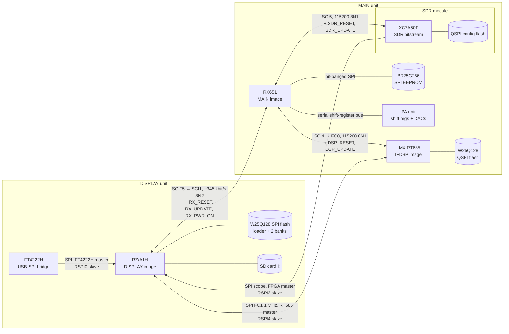

Sources: [hardware.md](../hardware.md#inter-processor-topology) (wiring, service manual p17/p19/p62) **[fact]**,
[display/spi-links.md](display/spi-links.md) (SPI roles) **[fact]**, [main/sci.md](main/sci.md) (UART settings) **[fact]**.
Each link's frame format is in [section 3](#3-inter-cpu-protocol-summary).

### 2.2 USB and PC connections

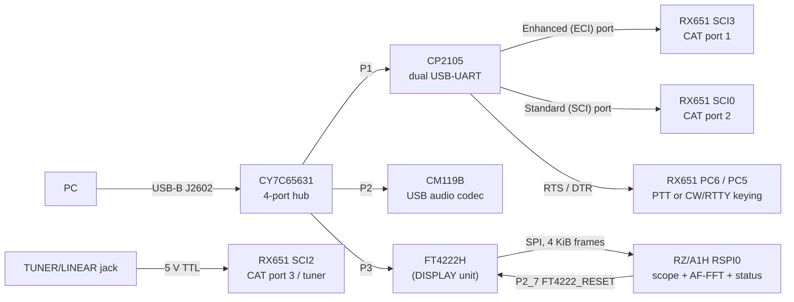

- CAT runs on three ports. The reply goes back to the port the command came in on, and the AI broadcast goes to every port with AI on
  ([main/cat.md](main/cat.md)) **[fact]**. Port 1 = SCI3 starts at 38400 baud, port 2 = SCI0 at 4800, both are reprogrammed from the menu
  (`sci3_set_baud`, `sci0_set_baud`) ([main/sci.md](main/sci.md#channels)) **[fact]**.
- RTS/DTR of the Standard port are PTT sources 3/4 when the PC KEYING setting selects them ([main/tx-protection.md](main/tx-protection.md#ptt-sources-fact))
  **[fact]**.
- The FT4222H is held in reset until a MAIN-side setting (bit 2 of the 0x24 settings frame) releases it. The PC then reads the SDR scope,
  the DSP AF-FFT and a 151-byte status block ([display/spi-links.md](display/spi-links.md#link-3-ft4222h-usb-to-spi-bridge-rspi0))
  **[fact for the code; the PC software is unknown]**.
- The CM119B is the USB sound card. Its analog side was not traced in the schematic and no firmware touches it **[inference]**; MAIN's MOD
  SOURCE setting selects USB audio as the TX source (`tx_mod_gain`, [main/dsp-link.md](main/dsp-link.md)) **[fact for the setting]**.
- The RX651 and RZ/A1H on-chip USB ports are not used for the PC: the RX651 USB pins go to test points (p17), and the RZ/A1H USB host
  only serves a USB keyboard/mouse (HID) ([display/input.md](display/input.md)) **[fact]**.

### 2.3 Signal path (receive and transmit)

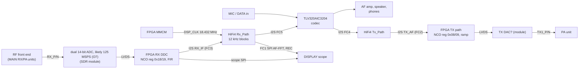

Wiring and I2S/flexcomm assignment are **[fact]** (p6, p19; [ifdsp/README.md](ifdsp/README.md#block-diagram)). The blocks inside the FPGA are
**[inference]** from BRAM tables and DSP48 use ([sdr/README.md](sdr/README.md)). The DSP rate of 12 kHz is **[inference, strong]**
([ifdsp/hifi4.md](ifdsp/hifi4.md)). The RX path is clocked by the codec DAC and the TX path by the codec ADC, with 2-deep FIFOs to the SDR
side **[fact, hifi4.md]**.

### 2.4 Storage and debug access

| Store / header | Owner | Holds | Written by | Page |
|---|---|---|---|---|
| W25Q128 SPI flash | DISPLAY | loader (0), bank flags (0x3E0000/0x3F0000), bank 1 (0x400000), bank 2 (0xA00000) | DISPLAY self-update | [display/update.md](display/update.md#6-display-self-update-spi-flash-banks) |
| SD card `I:\FT-710\` | DISPLAY | `.SFL` update files, MemList/Menu backups, screenshots, WAV recordings | user / DISPLAY | [display/update.md](display/update.md), [display/peripherals.md](display/peripherals.md) |
| RX651 code flash | MAIN | MAIN image | DISPLAY via serial boot mode | [display/update.md](display/update.md#5-main-update-rx651-serial-boot-mode) |
| BR25G256 EEPROM (32 KB) | MAIN | all settings, memories, band stacks, calibration (`cfg105`) | MAIN (`eeprom_*`), CAT `SPW`/`E9` | [main/eeprom.md](main/eeprom.md) |
| RX651 data flash | MAIN | not present on the R5F56514 (T18) | — | [main/README.md](main/README.md#memory-map-summary) |
| RT685 QSPI flash | IFDSP | IFDSP image (FlexSPI XIP) | DISPLAY via MAIN relay + RT685 ROM ISP | [display/update.md](display/update.md#7-ifdsp-update-rt685-rom-isp-through-main) |
| SDR module QSPI flash | SDR | bitstream (boots from 0; update writes 0x240000.. and the header at 0x480000) | the FPGA fabric, fed by DISPLAY + MAIN | [sdr/interfaces.md](sdr/interfaces.md#configuration-and-update-sequence) |
| S-35190A RTC | DISPLAY | date/time, sent to MAIN as `E3` | DISPLAY, or MAIN via `0x65` | [display/peripherals.md](display/peripherals.md) |
| J1004 "RX-CPU DEBUG" | MAIN | FINE debug + SCI1 boot UART | — | [hardware.md](../hardware.md#q1001-main-cpu-renesas-rx651-image-mc) |
| J6003 | DISPLAY | ARM JTAG | — | [hardware.md](../hardware.md#q6009-display-cpu-renesas-rza1h-image-pc) |
| J2009 "DSP_JTAG" | IFDSP | SWD + FC0 UART | — | [hardware.md](../hardware.md#q2002-if-dsp-nxp-imx-rt685-image-id) |
| J2001 "SDR JTAG" | SDR | FPGA JTAG | — | [hardware.md](../hardware.md#sdr-module-image-sr) |

Adapters for each header are listed in [custom-firmware.md](../custom-firmware.md#debug-adapters-per-recovery-path).

## 3. Inter-CPU protocol summary

| Link | Physical | Line | Framing | Check | Ack / retry | Pages |
|---|---|---|---|---|---|---|
| DISPLAY ↔ MAIN (control) | RZ SCIF5 P6_6/P6_7 ↔ RX SCI1 P26/P30 | 8N2; MAIN 340.9 kbit/s, DISPLAY nominal 345600 (see [C1](#8-contradictions-and-open-questions)) | `cmd, payload[n], sum8`, no start byte; `n` from a 43-entry table per command; ACK 0x06 / NAK 0x15 single bytes; `'Z'` tunnel frames with a 16-bit length | 8-bit sum of cmd + payload. MAIN checks it and NAKs; the DISPLAY does not check it, only range-checks fields | stop-and-wait, one frame outstanding each way. MAIN: 30 ms window, 3 retries, then drop. DISPLAY: ~10 ms cyclic timeout, 3 retries, then error box or reset of MAIN and itself | [main/display-link.md](main/display-link.md), [display/mainlink.md](display/mainlink.md) |
| MAIN → SDR FPGA (control) | RX SCI5 → J2002 pin 46/48 | 115200 8N1 | ASCII `rAAAAss\r` (8 B) / `wAAAAVVVVss\r` (12 B); reply 1 B for a write, 7 B for a read | sum8 of the preceding characters as 2 hex digits | reply 0x06 (or `?`) for a write, `r VVVV ss` for a read (MAIN's `sci5_rx_byte_hook` picks the length from byte 0; corrected by T19h, see T15e); 6 ms timeout; no retry counter, the shadow-compare re-sends next pass | [main/sdr-link.md](main/sdr-link.md#frame-format) |
| MAIN → RT685 (control) | RX SCI4 → FLEXCOMM0 | 115200 8N1 | after `i DB00\r`: `rAAAAss\r` → `rDDDDss`; `wAAAADDDDss\r` → 0x06; `?` = invalid | sum8 as 2 hex digits | 6 ms timeout; shadow-compare re-send; no limit, no error report after boot | [main/dsp-link.md](main/dsp-link.md), [ifdsp/control-link.md](ifdsp/control-link.md) |
| SDR FPGA → DISPLAY (scope) | FFT_CLK/FRM/DAT → RZ RSPI2 (P8_3..P8_6) | SPI mode 1, FPGA master | 1700-byte DMA frame per SS edge; the first 850 B are kept: 25-byte header + 800 points + 25 | none | none; DMA re-armed on every SS edge | [display/spi-links.md](display/spi-links.md#link-1-sdr-module-scope-data-rspi2) |
| RT685 ↔ DISPLAY (AF data) | FC1 SPI ↔ RZ RSPI4 (P2_8..P2_11) | SPI 1 MHz, RT685 master, full duplex | 4600 B each way: 600 B AF-FFT record + 4000 B of 16 kHz stereo PCM (REC); playback PCM the other way | none | none; ping-pong buffers | [display/spi-links.md](display/spi-links.md#link-2-if-dsp-fftrecplay-rspi4), [ifdsp/hifi4.md](ifdsp/hifi4.md) |
| PC (FT4222H) ↔ DISPLAY | ACC SPI ↔ RZ RSPI0 (P2_12..P2_15) | SPI, FT4222H master | 4096 B: scope 850 B @0, AF-FFT 600 B @0x6A4, status 151 B @0xB64, trailer `0x01EE01FF`×4 | none (test mode: magic 0xEEAFCCBA) | none | [display/spi-links.md](display/spi-links.md#link-3-ft4222h-usb-to-spi-bridge-rspi0) |
| PC ↔ MAIN (CAT) | CP2105 → SCI3 / SCI0, jack → SCI2 | 4800–38400 at reset, menu-set | ASCII `XX…;`, 104 primary + 10 extended mnemonics; binary `SP`/`E9` sub-frames | binary `SP` sub-commands: sum8 | reply on the same port, `?;` on any error, sets silent; AI broadcasts | [main/cat.md](main/cat.md), [../cat-commands.md](../cat-commands.md) |
| DISPLAY → MAIN → RT685 (update tunnel) | SCI1 + SCI4 | as above | DISPLAY `Z len16 payload sum8` → MAIN forwards the payload (NXP MCUBoot packet `5A …`) | relay sum8; MCUBoot CRC-16 | MCUBoot ACK `5A A1` per packet | [main/dsp-link.md](main/dsp-link.md#dsp-firmware-update-bridge), [display/update.md](display/update.md#7-ifdsp-update-rt685-rom-isp-through-main) |
| DISPLAY → MAIN → FPGA (update bridge) | SCI1 + SCI5 | as above | DISPLAY `FD 00 AAAA VVVV sum` / `FE 00 AAAA sum` (ASCII hex fields) → MAIN `w`/`r` frames | sum8 | MAIN answers 06 / 15 / `7D 00 VVVV sum` | [main/sdr-link.md](main/sdr-link.md#sdr-update-bridge) |
| DISPLAY → MAIN (serial boot) | SCIF5 + RX_RESET/RX_UPDATE | 9600, then 345600 | Renesas RX boot protocol `01 LNH LNL CMD data SUM 03`, replies `81` | packet sum | per-command reply; read-back compare | [display/update.md](display/update.md#5-main-update-rx651-serial-boot-mode) |
| M33 ↔ HiFi4 (on-chip) | shared SRAM 0x20070000 + MU-A, rpmsg-lite | — | 32K × 16-bit register file; rpmsg endpoints 0x28 ↔ 0x1E are set up but idle | — | — | [ifdsp/ipc.md](ifdsp/ipc.md) |
| MAIN SCI7 "C4" | P90/P92 | 9600 at create | — | — | never started in V01-12 | [main/dsp-link.md](main/dsp-link.md#sci7-c4-uart) |
| DISPLAY SCIF4 | `ACC_UMOSI/UMISO`? | 38400 | probe `F0`, then `1E 00 31` / `1F 00 32` | — | `uart4_link_init` has no caller | [display/mainlink.md](display/mainlink.md#10-the-unused-scif4-link-fact) |

All rows are **[fact]** from the cited pages, except where those pages tag a field otherwise.

**Common design.** All three control UARTs use the same "shadow register" idea **[fact for each link; the common pattern is inference]**:
MAIN computes the wanted value of every remote register from its own radio state, sends a write only when it differs from the last
acknowledged value, sends at most one frame per `main_loop` pass per link, and lets a missed ACK fall through to a re-send on a later pass.
The DISPLAY link applies the same rule to whole frames (`displink_copy_if_changed`). There are no unsolicited messages from the FPGA or the
DSP; status is polled (DSP regs 1–4 every 20 ms in steady RX/TX).

## 4. Power on and power off

### 4.1 Power-on of all CPUs

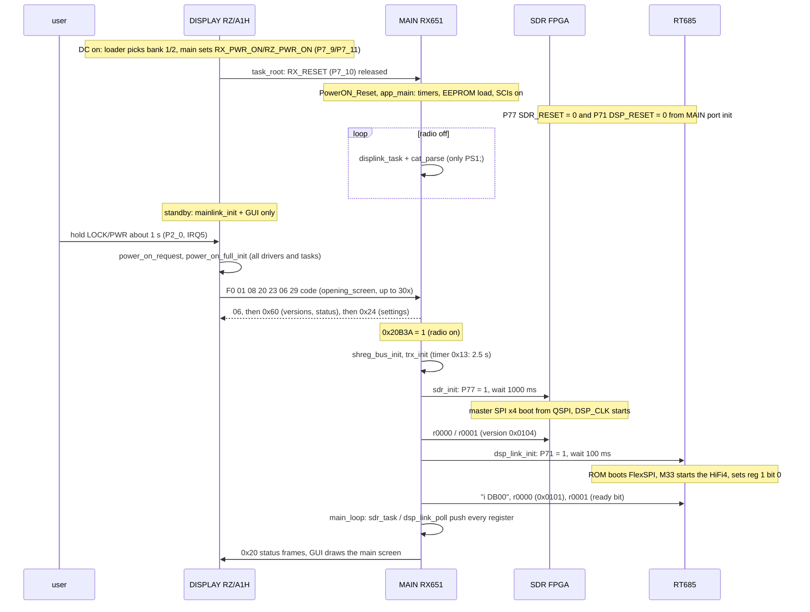

Sources: [display/boot-rtos.md](display/boot-rtos.md#3-task_root-0x201170c8-boot-modes), [display/input.md](display/input.md#boot-key-combinations),
[main/README.md](main/README.md#reset-and-boot-flow), [main/display-link.md](main/display-link.md#link-control),
[main/sdr-link.md](main/sdr-link.md#boot-sequence-sdr_init-proposed-sdr_init), [main/dsp-link.md](main/dsp-link.md#boot-handshake),
[ifdsp/README.md](ifdsp/README.md#boot-flow), [sdr/README.md](sdr/README.md#boot--configuration-flow). Every step is **[fact]** on those pages
except:

- That MAIN is powered and running while the DISPLAY is in standby: **[inference]** from `RX_PWR_ON` going high in the DISPLAY `main` and
  `RX_RESET` being released in the common part of `task_root`.
- That the DISPLAY sends the `F0` hello only after the power key: **[inference, this page]**. The only callers of `mainlink_hello_poweron`
  are `opening_screen` (reached from `power_on_request`) and `mainlink_wait_status` (decomp/display, checked for this page).
- The order "FPGA first, DSP second" fits the RT685 being clocked by the FPGA's `DSP_CLK` **[inference]**: `sdr_init` waits 1 s for the
  FPGA before `dsp_link_init` releases the DSP.
- **Boot key combinations** travel in the `F0` code byte. Code 1 resets the settings, 7 swaps the region code, 2/4/5 start service screens
  in MAIN, 4 also turns on the FT4222H test overlay in the DISPLAY, and 6 (DNR + A/B + QMB) starts the DISPLAY's maintenance/loader screen
  and tells MAIN to stay off (see [C3](#8-contradictions-and-open-questions)) **[fact for the code paths]**.
- **Boot failures**: if the FPGA or the DSP does not answer, MAIN sets `boot_error` 0x20B36 = 3 or 2 and carries on
  ([main/sdr-link.md](main/sdr-link.md#globals)) **[fact]**; how it is shown is open.

### 4.2 Power-off

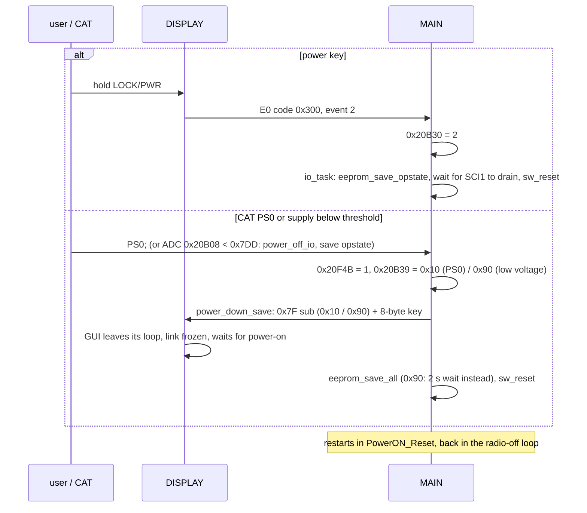

**[fact]** for each MAIN step ([main/README.md](main/README.md#power-states), [main/display-link.md](main/display-link.md#main--display-frames),
[main/peripherals.md](main/peripherals.md#power-on--off)) and the DISPLAY's handling of a keyed `0x7F`
([display/mainlink.md](display/mainlink.md#8-how-the-gui-is-driven)). T19h traced both exits: 0x20F4B is read only by `displink_tx_schedule`
0xFFF95F58, which calls `power_down_save` 0xFFF98797 (the only builder of `0x7F`); the power key's 0x20B30 = 2 is handled in `io_task`
0xFFFB6D56, which saves and resets without a `0x7F` frame **[fact]**. (This replaces an earlier note that left the power-key order open.)
How the DISPLAY learns about a power-key shutdown is then its own key handling, not a MAIN frame **[inference]**.

## 5. Firmware update

The DISPLAY is the only CPU with the SD card, so every update starts there. The user path is **SD CARD → FIRMWARE UPDATE**; the DISPLAY
checks each `I:\FT-710\FT-710__Vxxxx.sfl` by its salted CRC-32 only (no tag, length, signature or model check) and then runs the
selected writers in the order MAIN, DISPLAY, IFDSP, SDR ([display/update.md](display/update.md#1-summary-for-custom-firmware)) **[fact]**.

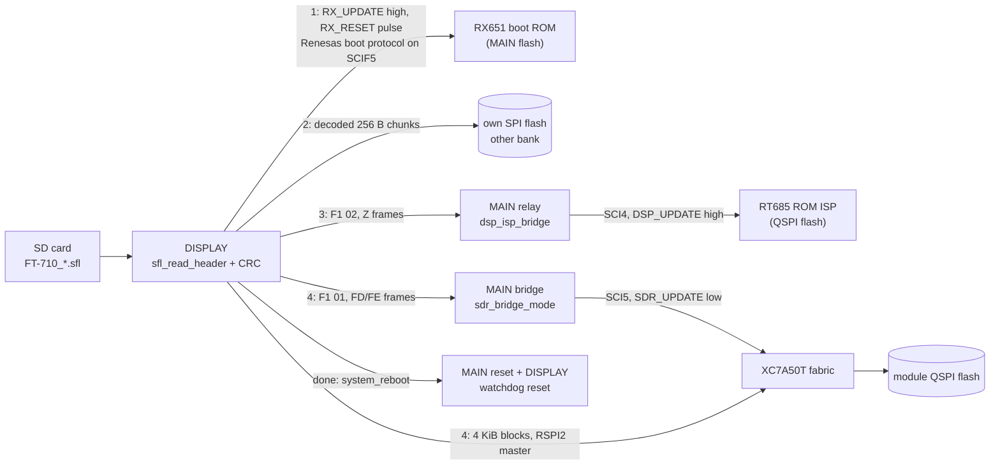

All edges are **[fact]** from [display/update.md](display/update.md), [main/dsp-link.md](main/dsp-link.md#dsp-firmware-update-bridge) and
[main/sdr-link.md](main/sdr-link.md#sdr-update-bridge); that the FPGA fabric writes its own flash is **[inference]**
([custom-firmware.md](../custom-firmware.md#update-and-recovery-paths)).

### 5.1 MAIN: RX651 serial boot mode over the DISPLAY link

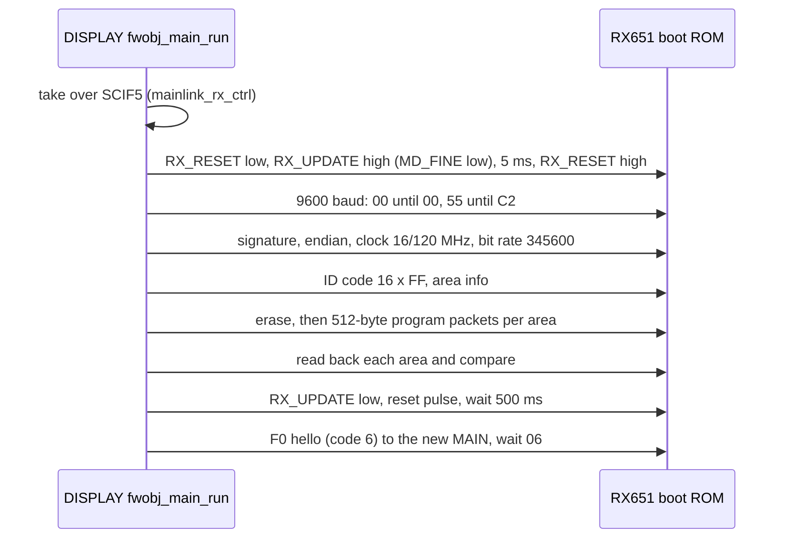

[display/update.md §5](display/update.md#5-main-update-rx651-serial-boot-mode) **[fact]**. The SFL payload of MAIN is Motorola S-records; each
record checksum is checked. The ID code of 16 × 0xFF works because the option-setting memory in the image is all 0xFF **[fact]**. The same
SCI1 pins are on J1004, so an external Renesas Flash Programmer can do the same with the DISPLAY held in reset **[inference]**
([custom-firmware.md](../custom-firmware.md#debug-adapters-per-recovery-path)).

### 5.2 DISPLAY: bank write

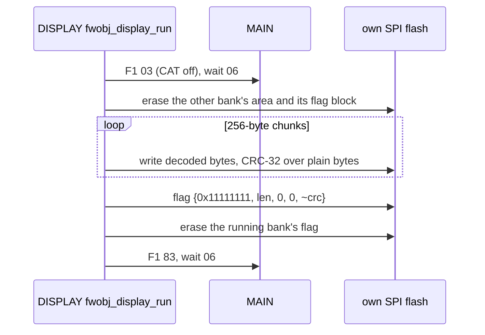

[display/update.md §6](display/update.md#6-display-self-update-spi-flash-banks) **[fact]**. The boot loader only checks `flag == 0x11111111` and
`len != 0`, bank 1 first, so an interrupted write leaves the old bank bootable **[inference from the order]**.

### 5.3 IFDSP: RT685 ROM ISP relayed by MAIN

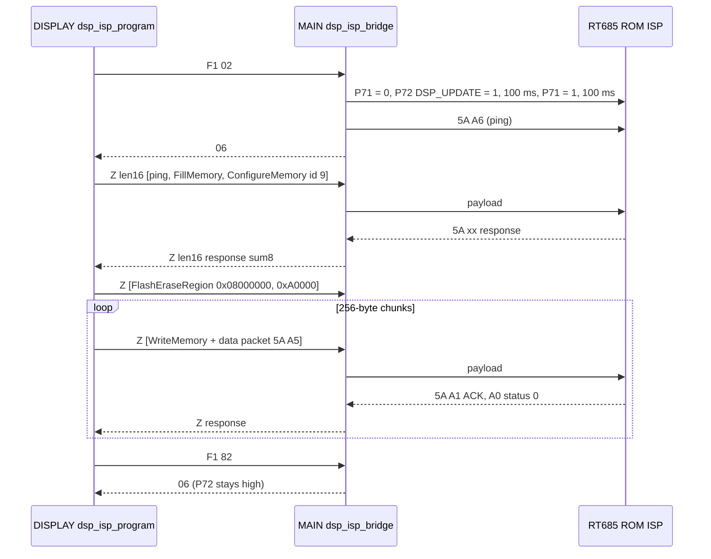

[display/update.md §7](display/update.md#7-ifdsp-update-rt685-rom-isp-through-main) and [main/dsp-link.md](main/dsp-link.md#dsp-firmware-update-bridge)
**[fact]**. After `F1 82` the RT685 stays in ISP mode until the final `system_reboot` **[inference]**. There is no read-back.

### 5.4 SDR: register bridge through MAIN, data over the scope SPI

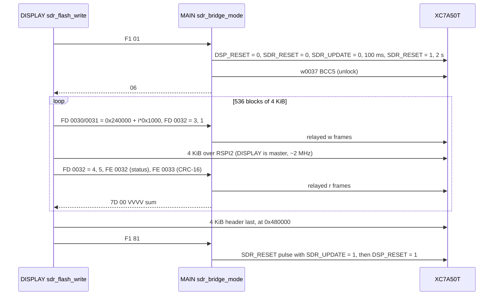

[display/update.md §8](display/update.md#8-sdr-update-fpga-registers-through-main-data-over-the-sdr-spi),
[main/sdr-link.md](main/sdr-link.md#sdr-update-bridge), [sdr/interfaces.md](sdr/interfaces.md#configuration-and-update-sequence) **[fact]**.
The SFL file must be exactly 0x43075A bytes. The meaning of reg 0x32 commands 3/1/4/5 and the 0x240000/0x480000 slot layout versus a boot from
address 0 are open ([C7](#8-contradictions-and-open-questions)).

## 6. End-to-end flows

### 6.1 CAT command round trip, with AI

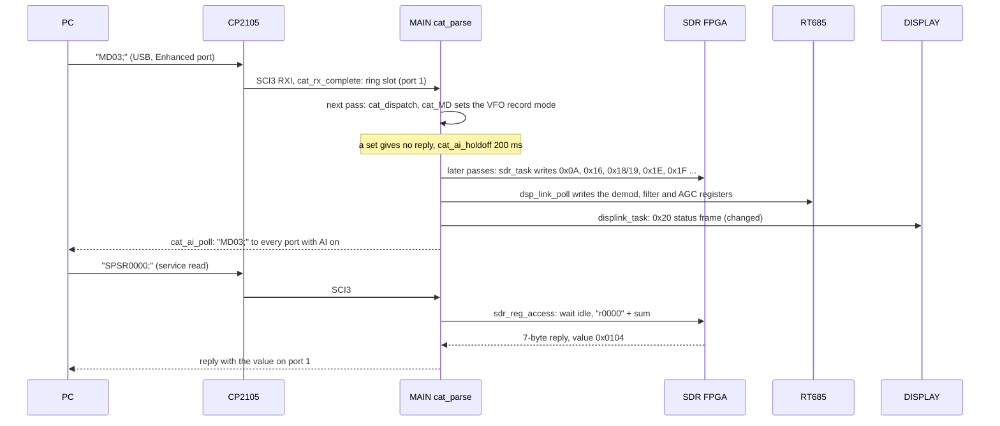

Sources: [main/cat.md](main/cat.md#request--reply-sequence), [main/sdr-link.md](main/sdr-link.md#sdr-register-map-as-seen-from-main),
[main/dsp-link.md](main/dsp-link.md#registers-written), [../cat-commands.md](../cat-commands.md). The parser, ring, reply port and AI path are
**[fact]**. The register list after a mode change is **[fact]** for the updaters that depend on the mode; the order and the exact set for
`MD03;` are **[inference]**. The `SPSR` reply format is in [cat-commands.md](../cat-commands.md#sp--service--debug-command-family-undocumented-high-risk).
`SPS`/`SPD` are high-risk service commands; never send them without the owner's approval.

- At most one CAT command is parsed and one reply sent per `main_loop` pass, and every downstream link sends at most one frame per pass, so
  a CAT change reaches the FPGA, the DSP and the DISPLAY a few passes later, one register at a time **[inference from the structure]**.
- `cat_parse` drops everything except `PS1;` while the radio is off, and returns at once while the DISPLAY has disabled CAT (`F1 03`, sent
  before a DISPLAY self-update) **[fact]**.
- No DSP or FPGA register is ever read on behalf of normal CAT reads; they answer from MAIN RAM. The exceptions are `SPSR`/`SPDR` and
  values MAIN polls anyway (DSP status regs 1–4) **[inference from the handlers]**.

### 6.2 Frequency change: main dial → SDR NCO and display

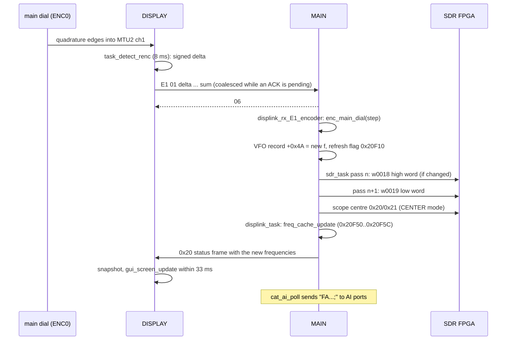

Sources: [display/input.md](display/input.md#rotary-encoders-and-pots), [display/mainlink.md](display/mainlink.md#6-tx-path-ack-and-retries-fact-unless-tagged),
[main/ui-keys.md](main/ui-keys.md#encoders-e1), [main/radio-control.md](main/radio-control.md#frequency-path), [main/sdr-link.md](main/sdr-link.md).
**[fact]** for each hop. That `enc_main_dial` ends in the same record update and refresh flag as `cat_FA_FB` is **[inference]** (the dial
path `FUN_fffc53dc`/`FUN_fffc5a84` is not traced to the byte). Notes:

- The DISPLAY sends raw counter deltas every 8 ms; acceleration, FINE/FAST and step size are applied in MAIN **[inference]**.
- The RX NCO value is the dial frequency plus a mode offset (SSB ±1500 Hz + shift, CW pitch, RTTY mark/shift, DATA offset); the TX NCO
  (0x08/0x09) gets the TX frequency 0x20F50 with clarifier and repeater shift **[fact]** ([main/sdr-link.md](main/sdr-link.md#sdr-register-map-as-seen-from-main)).
- No frequency is sent to the DSP; only register 99 changes with the frequency range **[fact]**.
- The FPGA gets 0x18 and 0x19 in two separate frames, so for one or two passes the NCO can hold a mixed value; the updater re-sends
  the low word whenever the high word was written **[fact for the order; inference for the effect]**.

### 6.3 TX key-down (MIC PTT, MOX or CAT `TX1;`)

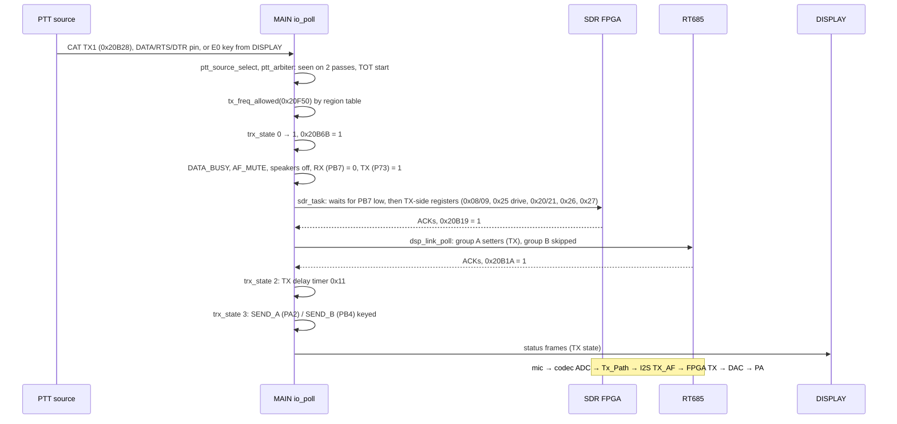

Sources: [main/tx-protection.md](main/tx-protection.md) (PTT sources, arbiter, sequencer) **[fact]**, [main/sdr-link.md](main/sdr-link.md#the-sdr-task-sdr_task-proposed-sdr_task)
and [main/dsp-link.md](main/dsp-link.md#poll-loop-once-per-main_loop-pass) (TX/RX hand-over) **[fact]**, signal path from §2.3. That 0x20B19 /
0x20B1A are the "SDR / DSP reconfigured" acknowledgements the sequencer waits for is **[inference]**. The MIC PTT on the DISPLAY (P10_5, key
code 0x340) reaches MAIN as an `E0` frame and then sets one of the sources 0x20B2A.. **[inference for the flag]**. Points worth knowing:

- `TX1;` bypasses `key_event_filter`, so CAT TX works where front-panel keys are locked; only `ptt_arbiter` and `tx_freq_allowed` stand
  between it and the RF **[fact]**.
- SEND never leads TX: SEND_A/B are forced low while `ETUN_TXINH_REQ` is high or the TX line is low **[fact]**.
- TX→RX runs the same steps in reverse; the RX-only SDR registers (filters, NB, notch, RX NCO) are re-sent once the TX line has dropped
  **[fact]**.

### 6.4 Scope and waterfall data

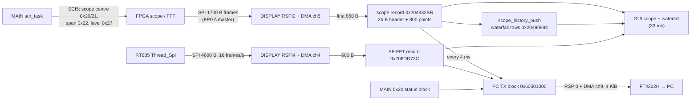

Sources: [display/spi-links.md](display/spi-links.md), [main/sdr-link.md](main/sdr-link.md#sdr-register-map-as-seen-from-main),
[ifdsp/hifi4.md](ifdsp/hifi4.md) **[fact]** for the transfers and buffers. That the 800 points are one byte per screen column and that the
history ring is the waterfall/3DSS is **[inference]**. The scope never passes through MAIN: MAIN only programs centre, span and level, and the
spectrum data goes FPGA → DISPLAY directly **[fact]**. The SDR frame rate is not fixed by any DISPLAY code **[fact]**.

## 7. Where to find X

| Topic | MAIN | DISPLAY | IFDSP | SDR / other |
|---|---|---|---|---|
| Reset, boot, init order | [README](main/README.md#reset-and-boot-flow) | [boot-rtos](display/boot-rtos.md) | [README](ifdsp/README.md#boot-flow), [m33-platform](ifdsp/m33-platform.md) | [sdr README](sdr/README.md#boot--configuration-flow) |
| Task / loop structure | [main_loop](main/README.md#main-loop) | [tasks](display/boot-rtos.md#tasks) | [threads](ifdsp/README.md#task--thread-structure), [hifi4](ifdsp/hifi4.md) | — |
| Memory map | [README](main/README.md#memory-map-summary) | [README](display/README.md#memory-map-summary) | [README](ifdsp/README.md#memory-map-summary) | [memory-maps.md](../memory-maps.md) |
| UART drivers, baud rates | [sci](main/sci.md) | [mainlink §3](display/mainlink.md#3-scif-driver-fact) | [control-link](ifdsp/control-link.md) | — |
| DISPLAY ↔ MAIN frames | [display-link](main/display-link.md) | [mainlink](display/mainlink.md) | — | — |
| FPGA register map | [sdr-link](main/sdr-link.md#sdr-register-map-as-seen-from-main) | [update §8](display/update.md#8-sdr-update-fpga-registers-through-main-data-over-the-sdr-spi) (0x30–0x33) | — | [interfaces](sdr/interfaces.md) |
| DSP register map | [dsp-link](main/dsp-link.md#registers-written) | — | [control-link](ifdsp/control-link.md) | — |
| SPI data links (scope, AF-FFT, REC/PLAY, PC) | — | [spi-links](display/spi-links.md) | [hifi4](ifdsp/hifi4.md) | [interfaces](sdr/interfaces.md#j2002-pin-map) |
| CAT parser, AI | [cat](main/cat.md) | — | — | [cat-commands.md](../cat-commands.md) |
| Keys, encoders, touch | [ui-keys](main/ui-keys.md) | [input](display/input.md) | — | — |
| GUI, screens, bitmaps | (screen frames in [display-link](main/display-link.md#main--display-frames)) | [gui](display/gui.md) | — | — |
| Menu (EX settings) | [menu](main/menu.md) | — | — | — |
| VFO, band, memories, scan | [radio-control](main/radio-control.md) | — | — | — |
| PTT, TX sequencing, protection, meters | [tx-protection](main/tx-protection.md) | — | — | — |
| EEPROM / settings image | [eeprom](main/eeprom.md) | MemList/Menu backups: [update §2](display/update.md#2-sd-card-and-file-system-summary) | — | — |
| GPIO / pin maps | [peripherals](main/peripherals.md#gpio-map-fact-unless-tagged) | [peripherals](display/peripherals.md#2-pin-multiplexing) | [m33-platform](ifdsp/m33-platform.md) | [interfaces](sdr/interfaces.md#j2002-pin-map), [hardware.md](../hardware.md) |
| Clocks | [README step 2](main/README.md#steps-in-detail) | [peripherals](display/peripherals.md) | [m33-platform](ifdsp/m33-platform.md) | [resources](sdr/resources.md#clocking) |
| Audio / codec | DAC beep in [peripherals](main/peripherals.md) | WAV REC/PLAY in [spi-links](display/spi-links.md#link-2-if-dsp-fftrecplay-rspi4), [peripherals](display/peripherals.md) | [hifi4](ifdsp/hifi4.md), codec in [m33-platform](ifdsp/m33-platform.md) | — |
| Firmware update | bridges in [sdr-link](main/sdr-link.md#sdr-update-bridge), [dsp-link](main/dsp-link.md#dsp-firmware-update-bridge) | [update](display/update.md) | ROM ISP, [README](ifdsp/README.md) | [interfaces](sdr/interfaces.md#configuration-and-update-sequence), [sfl-format.md](../sfl-format.md) |
| Debug consoles and hidden modes | CAT `SP` service set ([cat](main/cat.md#extended-and-service-commands-summary)) | USB-keyboard console, `debug_enabled` ([input](display/input.md), [boot-rtos](display/boot-rtos.md#usb-keyboard-handler-chains)) | interactive console `i DB01` ([control-link](ifdsp/control-link.md)) | UART_DBG on J2002 ([interfaces](sdr/interfaces.md)) |
| Inter-core IPC | — | — | [ipc](ifdsp/ipc.md) | — |
| FPGA resources, BRAM tables | — | — | — | [resources](sdr/resources.md), [bram-tables](sdr/bram-tables.md), [bitstream](sdr/bitstream.md) |
| Custom firmware, recovery | — | — | — | [custom-firmware.md](../custom-firmware.md) |

## 8. Contradictions and open questions

"Status" says whether this page settled the point, and how. Points still open name the task or the evidence that would settle them.
The page fixes proposed for C1, C2, C3, C5, C8 and C10–C13, and the C9 note in ifdsp/hifi4.md, have been applied to the pages named in each row (T14).

| # | Topic | What the pages say | Status / resolution |
|---|---|---|---|
| C1 | DISPLAY link baud | [main/display-link.md](main/display-link.md) and [main/sci.md](main/sci.md): MAIN SCI1 = 60 MHz / (16 · 11) = **340 909** bit/s. [display/mainlink.md](display/mainlink.md#1-summary): "345600 baud … on both sides" | **Not a fault, page wording.** The nominal rate is 345600 (DISPLAY `scif_open(0x54600)` and the boot-mode bit-rate command); MAIN's BRR gives 340.9 k, 1.4 % low, well inside async tolerance **[inference]**. Proposed: reword mainlink.md "on both sides" (see the task file). |
| C2 | `F0` hello repeat interval | [main/display-link.md](main/display-link.md#link-control): "every ~50 ms". [display/input.md](display/input.md#boot-key-combinations), [display/mainlink.md](display/mainlink.md#8-how-the-gui-is-driven): "5 ms apart" | **Partly settled.** The loop is `mainlink_send_hello(n); itron_dly_tsk(5)`, 30 times (decomp/display `mainlink_hello_poweron` 0x201165F4) **[fact]**. `itron_dly_tsk` takes ms **[inference, boot-rtos.md]** but the kernel tick is 10 ms, so the real gap is 5–10 ms **[inference]**; "~50 ms" is wrong. Proposed fix for main/display-link.md. |
| C3 | `F0` code 6 | [main/display-link.md](main/display-link.md#f0-boot-codes): code 6 = "link down, no power on … the DISPLAY is going down". [display/mainlink.md](display/mainlink.md#display--main) table: "6 = normal" | **Settled (this page, decomp/display).** Code 6 is sent only by `mainlink_hello_key6` 0x2011668C, called only from `logo_fade_in` 0x2012FD94, which `power_on_request` and `gui_main_loop` call when boot combination 6 (DNR + A/B + QMB) is held. So code 6 = "DISPLAY maintenance/loader screen, keep MAIN off" **[fact for the call path]**; it is also sent by the MAIN-update writer to the new MAIN ([display/update.md §5](display/update.md#5-main-update-rx651-serial-boot-mode)). Neither "normal" nor "going down" fits. Proposed fixes for both pages. |
| C4 | DISPLAY encoder pins | [display/input.md](display/input.md#rotary-encoders-and-pots): encoders 1/2 on MTU2 ch1/ch2, encoder 3 on IRQ4 P3_3/P3_5. [display/peripherals.md](display/peripherals.md#2-pin-multiplexing): ENC0..3 on P10_x / P9_0 / P3_x, "MTU2 phase counting? [guess]" | **Settled, page fixed (peripherals.md).** Two layers, no conflict: schematic ENC*n* = firmware id *n*+1. ENC2 (P3_3/P3_5) = id 3 **[fact: `renc_irq4_isr` reads PPR3 bits 3 and 5]**; ENC0 (P10_0/P10_1) and ENC1 (P9_0/P10_3) are the only encoder pins set to a peripheral function in `pinmux_init`, so they are the MTU2 ch1/ch2 TCLK inputs **[inference]**; ENC3 (P3_1/P3_2) has no handler **[inference]**. Which TCLK pin is which needs the RZ/A1H pin table. |
| C5 | Meaning of frames `E2`, `E6`, `0x40` | MAIN: `E2` meaning unknown, `E6` = beep request, `0x40` "probably scope/waterfall or meter data [guess]". DISPLAY: `E2` = SD card present, `E6` unknown, `0x40` = status + menu list with five 45-byte text slots (also the "FIRMWARE UPDATE" entry) | **Resolved by combining the two ends** **[inference]**: `E2` = SD-card state (DISPLAY sender `mainlink_send_sd_state`), `E6` = a beep request (MAIN handler calls `beep_request`), `0x40` = menu list. The scope never goes over SCI1 (§6.4), so MAIN's `0x40` guess is wrong. Proposed edits for both pages. |
| C6 | How `PS1;` powers the radio on | MAIN: `PS1` only sets 0x20B9C / 0x1B3D0 ("power-on request to DISPLAY") and waits for `F0`. DISPLAY: radio-on flag 0x208003A0 is set by the power key, or by a second `0x60` frame with byte 0xB3 = 1 while off | **Resolved (#57).** The request *is* frame `0x60`. `cat_PS` with `1` sets 0x9DC5 = 1 (the EEPROM-backed "radio on" flag) and calls `power_on_request`: +0x98 (0x20B9C) = 1 enables MAIN's link transmitter (`displink_tx_poll` sends nothing while it is 0, which is the power-off state) and 0x1B3D0 = 1 makes `displink_tx_schedule` send `displink_tx_60_hello` first. Byte 0xB3 of that frame is 0x9DC5. The DISPLAY's link task (0x2015FA40 file) copies every `0x60` to 0x2045FB00 and, if the radio is off (`FUN_2011727C` = 0), this is not the first `0x60` since the DISPLAY started (counter +0x81B0) and byte 0xB3 = 1, calls `FUN_20117288(1)`, which sets the radio-on flag 0x208003A0. The DISPLAY then powers up and sends `F0`; MAIN's `displink_rx_F0_hello` sets 0x20B3A **[fact, both images]**. The "first `0x60`" rule keeps the normal boot exchange from switching the radio on. |
| C7 | SDR flash layout | [sdr/bitstream.md](sdr/bitstream.md) / interfaces.md: the FPGA boots master SPI x4 **from flash address 0** (sync at 0x1030). [display/update.md §8](display/update.md#8-sdr-update-fpga-registers-through-main-data-over-the-sdr-spi): the update writes the bitstream to **0x240000** and its header to **0x480000** | **Open (T15).** Either a golden image at 0 multiboots into 0x240000, or the FPGA maps the update slots itself **[guess]**. Reading the module flash over J2001 would settle it (needs approval). |
| C8 | `SDR_UPDATE` vs. module pin `WP` | sdr/README.md (older text): MAIN "lifts WP" / flash write-protect. main/sdr-link.md and custom-firmware.md: `SDR_UPDATE` is **low** during the update, an update-mode input to the FPGA | **Settled by T10c/T11c/T16** (code levels are fact). sdr/README.md "Key findings" still reads as a plain write-protect; proposed wording fix. |
| C9 | DSP sample rate vs. REC/PLAY PCM | [ifdsp/hifi4.md](ifdsp/hifi4.md): audio blocks at **12 kHz** **[inference, strong]**. [display/spi-links.md](display/spi-links.md#link-2-if-dsp-fftrecplay-rspi4): REC WAV is **16 kHz** stereo, 16 frames/s | **Open.** Consistent only if `Thread_Spi` resamples to 16 kHz or the WAV header is nominal. FC1 buffer spacing 0x1200 (0x200607E0 → 0x200619E0) matches the 0x11F8-byte frame **[fact]**, so the link itself agrees. Needs the HiFi4 `Thread_Spi` packing (T12e follow-up). |
| C10 | J1004 vs. J1005 | hardware.md now says J1004 (fixed by T17). custom-firmware.md summary table still says "(hardware.md says J1005, see below)" | **Settled (J1004).** Proposed: drop the stale parenthesis in custom-firmware.md. |
| C11 | DISPLAY bank written | custom-firmware.md: "updates itself by writing bank 1 at 0x18400000". display/update.md §6: writes the **other** bank (running 1 → 2, else 1) | **Settled by update.md [fact].** Proposed wording fix in custom-firmware.md. |
| C12 | IFDSP update, MAIN side | custom-firmware.md and hardware.md: "MAIN sets `DSP_UPDATE` … [inference for MAIN]". main/dsp-link.md: `dsp_isp_bridge` drives P71/P72 and sends `5A A6` **[fact]** | **Settled [fact, T10d].** Proposed: upgrade the tag in custom-firmware.md and hardware.md. |
| C13 | SDR boot version | sdr/README.md boot figure: "UART5: version query, settings [inference]". main/sdr-link.md: MAIN reads reg 0 and reg 1 after a 1 s wait **[fact]** | **Settled by T10c.** Minor; the SDR figure can cite sdr-link.md. |
| O1 | `boot_error` 0x20B36 | how a missing FPGA (3) or DSP (2) is shown | Open: `displink_build_60` reads it; trace the DISPLAY's use of the `0x60` frame. |
| O2 | DISPLAY → MAIN 0x43/0x44/0x45 and C3/C4/C5 | MAIN thinks SD/memory-list operations; DISPLAY has 'D'/'E' block read/write of a 32000-byte buffer | Open: MemList/Menu backup through the DISPLAY's block buffer is likely **[inference]**; trace `sdmenu_*` against MAIN's 0x43 callers. |
| O3 | Scope frame | 25-byte header, second 850 bytes of each SDR frame, frame rate | Open: needs T15 (FPGA netlist) or a capture on a debug-enabled unit (approval needed). |
| O4 | CM119B audio routing | not traced in the schematic | Open (hardware, service manual p20). |
| O5 | RZ/A1H USB0/USB1 lines through J6002 | where they end up | Open (hardware). |
| O6 | MAIN tasks 10, 11, 13 | `dispreq_e8_task`, `dispreq_e7_task`, `FUN_fffd0582` | Open (MAIN). E7/E8 look like SD-file operation status from the DISPLAY **[inference]**. |
| O7 | ADC sample rate (T19h) | §2.3 and [sdr/README.md](sdr/README.md): "~250 MSPS". [main/sdr-link.md](main/sdr-link.md) reg 0x03: "Nyquist zone of a 125 MSPS ADC". [hardware.md](../hardware.md): 250 MHz clock, "Operating clock 125MHz, Divide 250MHz by 2" (p6) | **Partly settled.** The FPGA fabric runs at **125 MHz** **[inference, high: UART divider 1,086, [sdr/netlist.md §3.2](sdr/netlist.md)]**, and the clock off the MAIN unit is 250 MHz **[fact, p6]**. Whether the ADC samples at 250 MSPS (two samples per fabric clock; its 14 LVDS pairs are captured DDR) or at 125 MSPS (the ADC divides its 250 MHz input by 2) is **open**: the ADC part is not in the manual and the IDDR edge mode is not decoded. **Update 2026-10-28 (owner's reading of p6): 125 MSPS is the most likely rate [inference, strong].** The ADC/FPGA box says "Operating clock 125MHz, Divide 250MHz by 2", and MAIN treats 62.5 MHz = fs/2 as a boundary (reg 0x03 bit 5; the TX scope centre is mirrored about 62.5 MHz, which is second-Nyquist-zone folding). Above 62.5 MHz the receiver then uses the second Nyquist zone, with the 56–75 MHz BPF rejecting the image (70 MHz ↔ 55 MHz). DC4KU's test report (`Manuals/FT-710_Test-Report_DC4KU_english.pdf`) adds that the ADC is a **dual-channel 14-bit** part (the FT-DX10's twin ADC) whose channels the FPGA combines; so the 14 DDR pairs are two 14-bit channels on the two clock edges, not 250 MSPS **[inference, strong]**. **Settled as far as possible without the part number: two ADC channels at 125 MSPS.** Confirm the two-channel combine logic in the netlist, and read the ADC marking for the part. |
| O8 | `DSP_CLK` frequency (T19h) | [ifdsp/m33-platform.md](ifdsp/m33-platform.md): CLKIN = 18.432 MHz. [sdr/netlist.md §3.2](sdr/netlist.md): MMCM clock on pin P14 = ~28.17 MHz, maybe `DSP_CLK` [guess]. [sdr/resources.md](sdr/resources.md#clocking): ~16.6 MHz [guess, T13] | **Open.** 18.432 MHz is what the RT685 code is built for **[fact]**. The 16.6 MHz figure assumed one MMCM and is superseded by T15's cascade. 28.17 MHz needs an out-of-range 1,440 MHz VCO, so one MMCM divider is probably misread; a multiplier of 22.25 instead of 34 would give 18.432 MHz **[guess]**. Settle by re-checking MMCM_X0Y0's CLKFBOUT fields or by measuring J2002 pin 22 (passive probe, owner approval). |
| O9 | DISPLAY window 0x60000000 (T19h) | [memory-maps.md](../memory-maps.md) and [display/gui.md](display/gui.md): frame buffers at 0x60000000..0x602FF2FF and 0x605048A0, `.data_nc` at 0x60500000, all called an "uncached mirror" of RAM 0x20000000 | **Resolved (2026-10-28).** R01UH0403EJ0700 Table 5.5/53.1: 0x60000000–0x609FFFFF is the mirror of the 10 MB on-chip RAM, but **page-interleaved**, not a plain offset. The RAM is 5 pages × 2 banks of 1 MB; the mirror lists them page by page (p0b0 0x6000, p0b1 0x6010, p1b0 0x6020, p1b1 0x6030, …), while the normal space at 0x20000000 puts p0b0, p1b1, p2b0, p3b1, p4b0 at 0x2000..0x2040 and p0b1, p1b0, p2b1, p3b0, p4b1 at 0x2050..0x2090 (5 MB-part compatibility). So `fb_clear_all`'s 0x60000000 + 0x2FF300 is RAM 0x20000000–0x200FFFFF, 0x20500000–0x206FF2FF; `.data_nc`/fb1/scope DMA in 0x605… are 0x207…; none of them touches the image, stacks, `.data/.bss`, `.data2/.bss2` or the kernel pool, and they are exactly the RAM that #119 found no direct reference to. The MMU leaves the 0x60… window strongly ordered, so it is the uncached view for DMA and frame buffers **[fact: manual + image]**. |
