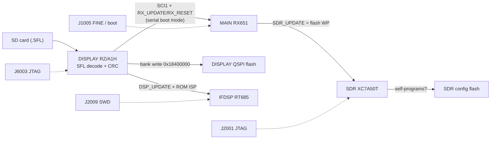

# Custom firmware and HDL: feasibility

Status of what stands between the owner and running their own code (or FPGA logic) on their own FT-710. This page
collects the evidence from T02–T13. Work items are tracked as **T15** (FPGA netlist recovery) and **T16** (custom-firmware
groundwork) on the [task board](tasks/README.md).

Claims are tagged **[fact]** (seen in code or data, with the address or source), **[inference]** or **[guess]**.

> **Ground rule (AGENTS.md):** nothing is written to the radio (flashing, EEPROM writes, untested CAT set-commands, JTAG
> loads) without the owner's explicit approval each time. Everything below is analysis and planning.

## Summary

No fundamental blocker has been found. No image is signed or encrypted, every processor has an on-board debug or boot
header, and free toolchains exist for every core except the HiFi4 DSP.

| Image | CPU / device | Signed / encrypted? | Protection | Recovery / debug path | Free toolchain |
|---|---|---|---|---|---|
| MAIN (`MC`) | Renesas RX651 | No: SFL obfuscation + salted CRC-32 only [fact, T04] | ID-code protection off: the option-setting memory written by the update (0xFE7F5D00, 116 bytes) is all `0xFF` [fact] | J1005 "RX-CPU DEBUG": FINE (E1/E2) + SCI1 serial boot mode [fact for the pins, inference for use; T02] | GCC for RX, LLVM |
| DISPLAY (`PC`) | Renesas RZ/A1H (Cortex-A9) | No [fact, T04/T06] | No secure boot on this part; dual-bank boot loader [fact, T06] | J6003 ARM JTAG [fact, T02] | `arm-none-eabi-gcc` |
| IFDSP (`ID`) | NXP i.MX RT685 (Cortex-M33 + HiFi4) | No: plain image boots from FlexSPI QSPI [fact, T07] | RT685 signed/encrypted boot is set by its OTP fuses, which can't be seen from the image; the plain image suggests it is off [inference] | J2009 SWD + UART (J-Link) [fact]; RT685 ROM serial ISP selected by `DSP_UPDATE` [fact for the strap, inference for use; T02] | `arm-none-eabi-gcc` for the M33; **HiFi4: none** (see below) |
| SDR (`SR`) | Xilinx Artix-7 XC7A50T | No: uncompressed, unencrypted Vivado `.bin` behind a CRC-32/BZIP2 header [fact, T08] | No bitstream encryption configured [fact, T08] | J2001 FPGA JTAG [fact, T02]: a JTAG load is volatile and never touches the config flash | Vivado (free edition supports XC7A50T); openXC7 / F4PGA |

## Update and recovery paths

- **MAIN** is reflashed by DISPLAY through the Renesas serial boot mode over SCI1, using `RX_UPDATE`/`RX_RESET`
  [inference, high; T02, `update_main_cpu` 0x2010EA90, T11].
- **DISPLAY** updates itself by writing bank 1 at 0x18400000 (`display_flash_write_bank` 0x2015F1F0) and picks the bank at
  boot (`boot_select_bank` 0x20100ABC) [fact, T06]. `loader_selfinstall` 0x20110F0C rewrites the loader region
  (0..0x340000) when 0xFCFF400C == 0xAABBCCDD; who sets that value is open [fact for the code; T11].
- **IFDSP** update: `update_dsp` 0x2010D92C on DISPLAY with the RT685 serial ISP [inference; T11/T02].
- **SDR**: the DISPLAY SDR SPI lands on the module's scope-data pins, not on the config flash, and MAIN's `SDR_UPDATE` drives
  the module pin labelled WP. So the FPGA most likely reprograms its own config flash while MAIN lifts write-protect
  [inference; T13, `docs/code/sdr/interfaces.md`]. This revises T08's guess that DISPLAY writes the flash.

## What makes changes easier than expected

- **SFL re-encoding** needs only the known 43-byte subtraction key and the salted CRC-32 (`A6 EC 9E 13`) [fact, T04]. An
  encoder plus a decode/encode round-trip test is part of T16.
- **DSP behaviour can be changed without new DSP code.** MAIN drives the IFDSP over a register-poke console protocol: it
  switches to machine mode with `i DB00\r`, then sends `rAAAACC` / `wAAAADDDDCC` frames with an 8-bit checksum into a
  32K × 16-bit parameter register file at 0x20070000 that the HiFi4 reads directly [fact; T12a, `docs/code/ifdsp/README.md`].
  Many DSP parameters are reachable by changing what MAIN writes, or by injecting writes from a patched MAIN.
- **A hidden DISPLAY debug console already exists.** USB-keyboard input feeds a second handler chain with a firmware-update
  console and a memory monitor (`ADDR`, `ADDR VAL`, `b`/`h ADDR VAL`, `NAME.txt` runs a script from SD). It runs only when
  0x20450000 holds 0xA0B9C8E7. In V01-08 that word is 0 and its only writer `debug_unlock` 0x20107E68 has no caller, so
  enabling it needs a 1-word patch or a RAM write over JTAG [fact for the code, inference for the method; T11a,
  `docs/code/display/README.md`]. Once enabled, it is a ready-made on-target poke/peek tool.
- **Undocumented CAT commands** (22 in the current manual rev 2306-C) may expose service functions without any firmware
  change [fact for the list, from the manual and the firmware tables; T09 (in progress) will document each in `docs/cat-commands.md`].

## Blockers and hard parts

1. **HiFi4 DSP code.** New or patched HiFi4 code needs Cadence's proprietary Xtensa toolchain with the HiFi4 configuration,
   and Ghidra decodes only the base Xtensa ISA, not the FLIX bundles the DSP code uses [fact, T07/T12]. Practical route:
   change DSP behaviour through the register file (above), and put new signal processing on the M33 or in the FPGA.
2. **FPGA headroom is small.** About 26.6k LUTs (82%), about 31.4k flip-flops (48%) and **119 of 120 DSP48E1** blocks are
   used [fact; T13, `docs/code/sdr/resources.md`]. Adding logic to the existing design is tight. A replacement design
   must re-implement the ADC capture, DDC/filters, the scope/FFT data link, TX path and the UART protocol to MAIN.
3. **No HDL source.** The bitstream gives configuration, not a netlist. T15 plans the route: prjxray `bit2fasm` → FASM
   (features) → custom routing walk → gate-level netlist → recognise blocks. Steps 1–2 are tractable; recognising the
   signal chain in ~27k LUTs is the slow part.
4. **Update-loader checks beyond the CRC** (tag, length, version rules, image-specific steps) are not fully read yet.
   That is T11c.
5. **Whole-image replacement** means re-implementing drivers and inter-CPU protocols that T09–T12 are still documenting.
   **Patching** existing binaries (hooks, new CAT commands, menu items, enabling the debug console) is the realistic first
   step.
6. **IFDSP OTP state** (secure boot fuses) is unknown until read from a live device over SWD; reading needs approval.

## Risk and rules

- **Bricking is recoverable in principle** through the headers above, but needs adapters: a Renesas E2 Lite (or a USB-serial
  adapter for boot mode), a J-Link (or CMSIS-DAP) for SWD/JTAG, and a Xilinx-compatible JTAG cable. Test FPGA designs with a
  volatile JTAG load first.
- **Transmit-path changes** (DSP, FPGA TX path, power or band limits) must keep emissions compliant with the owner's licence
  conditions (FCC Part 97 in the US).
- **Distribution:** the repo is private and derived from Yaesu's copyrighted firmware. Patches stay for the owner's radio;
  never publish decoded images, patched images or decompiled code.

## Next steps

- **T16 (custom-firmware groundwork):** SFL encoder with a round-trip test; full map of the update-loader checks (with T11c);
  a first harmless patch (e.g. a version string), verified by decode/re-encode and by diffing the analysis, **not flashed**;
  a plan for enabling the DISPLAY debug console; a JTAG-only "hello" bitstream plan for the FPGA (pin/clock constraints from
  `docs/code/sdr/interfaces.md`).
- **T15 (FPGA netlist recovery):** bitstream → FASM → netlist, then targeted recognition of the UART link to MAIN and the
  ADC/DDC chain.
