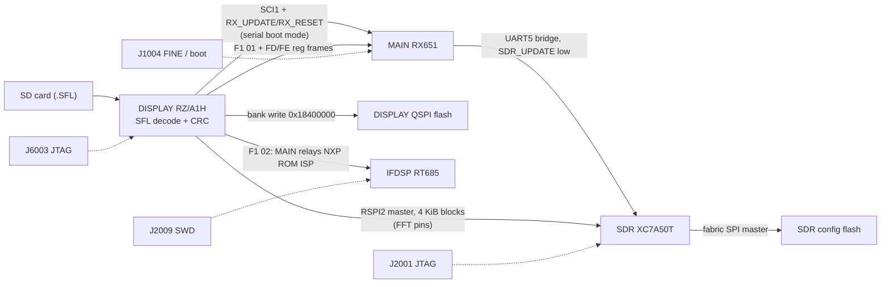

# Custom firmware and HDL: feasibility

Status of what stands between the owner and running their own code (or FPGA logic) on their own FT-710. This page
collects the evidence from T02–T13. Work items are tracked as **T15** (FPGA netlist recovery) and **T16** (custom-firmware
groundwork) on the [task board](tasks/README.md).

Claims are tagged **[fact]** (seen in code or data, with the address or source), **[inference]** or **[guess]**.

> **Ground rule (AGENTS.md):** nothing is written to the radio (flashing, EEPROM writes, untested CAT set-commands, JTAG
> loads) without the owner's explicit approval each time. Everything below is analysis and planning.

## Summary

No fundamental blocker has been found. No image is signed or encrypted, every processor has an on-board debug or boot
header, and free toolchains exist for every core except the HiFi4 DSP.

| Image | CPU / device | Signed / encrypted? | Protection | Recovery / debug path | Free toolchain |
|---|---|---|---|---|---|
| MAIN (`MC`) | Renesas RX651 | No: SFL obfuscation + salted CRC-32 only [fact, T04] | No protection set: the option-setting memory written by the update (0xFE7F5D00, 116 bytes) is all `0xFF` [fact]. Serial programmer allowed with ID 16 × 0xFF, OCD ID the same, no access window, no ROM code or Trusted Memory protection [fact: HWM §7, T18]. **Keep it all 0xFF in patched images**: FAW.FSPR = 0 is permanent, SPCC.SPE = 0 locks out DISPLAY's update path, and control code 0x45 erases the flash after 3 bad IDs | J1004 "RX-CPU DEBUG": FINE (E1/E2) + SCI1 serial boot mode [fact for the pins, inference for use; T02, T16] | GCC for RX, LLVM |
| DISPLAY (`PC`) | Renesas RZ/A1H (Cortex-A9) | No [fact, T04/T06] | No secure boot on this part; dual-bank boot loader [fact, T06] | J6003 ARM JTAG [fact, T02] | `arm-none-eabi-gcc` |
| IFDSP (`ID`) | NXP i.MX RT685 (Cortex-M33 + HiFi4) | No: plain image boots from FlexSPI QSPI [fact, T07] | RT685 signed/encrypted boot is set by its OTP fuses, which can't be seen from the image; the plain image suggests it is off [inference] | J2009 SWD + UART (J-Link) [fact]; RT685 ROM serial ISP selected by `DSP_UPDATE` [fact for the strap, inference for use; T02] | `arm-none-eabi-gcc` for the M33; **HiFi4: none** (see below) |
| SDR (`SR`) | Xilinx Artix-7 XC7A50T | No: uncompressed, unencrypted Vivado `.bin` behind a CRC-32/BZIP2 header [fact, T08] | No bitstream encryption configured [fact, T08] | J2001 FPGA JTAG [fact, T02]: a JTAG load is volatile and never touches the config flash | Vivado (free edition supports XC7A50T); openXC7 / F4PGA |

## Update and recovery paths

- **MAIN** is reflashed by DISPLAY through the Renesas serial boot mode over SCI1, using `RX_UPDATE`/`RX_RESET`
  [inference, high; T02, `update_main_cpu` 0x2010EA90, T11].
- **DISPLAY** updates itself by writing the other bank (running bank 1 → bank 2 at 0x18A00000, else bank 1 at 0x18400000; `display_flash_write_bank` 0x2015F1F0, display/update.md §6) and picks the bank at
  boot (`boot_select_bank` 0x20100ABC) [fact, T06]. `loader_selfinstall` 0x20110F0C rewrites the loader region
  (0..0x340000) when 0xFCFF400C == 0xAABBCCDD; who sets that value is open [fact for the code; T11].
- **IFDSP** update: `dsp_isp_program` (`FUN_2010b81c`) on DISPLAY sends `F1 02` to MAIN, then NXP MCU-bootloader packets
  wrapped in `5A LEN16 payload SUM8` relay frames; MAIN (`dsp_isp_bridge` 0xFFFA0C79) sets `DSP_UPDATE` and forwards them to the RT685 ROM ISP
  [fact for both sides, main/dsp-link.md; T11c, `docs/code/display/update.md` section 7]. (`update_dsp` 0x2010D92C is a dead
  debug path.)
- **SDR** [fact for the DISPLAY side, T11c section 8; MAIN side T10c]: DISPLAY sends `F1 01` to MAIN, and MAIN starts its
  SDR bridge (DSP_RESET low, **`SDR_UPDATE` low**, reg 0x37 = 0xBCC5) and relays DISPLAY's `FD 00` / `FE 00` register frames
  to the FPGA over UART5. The bitstream itself goes from DISPLAY over **RSPI2, switched to master** (about 2 MHz on P8_3..P8_6,
  the pins that normally carry the scope stream into the FPGA's FFT port), in 536 blocks of 4 KiB with a CRC-16 read back
  from FPGA reg 0x33. Blocks go to flash 0x240000 + n·0x1000; the 4 KiB header (CRC-32/BZIP2 word) is written last at
  0x480000. At the end, `F1 81` makes MAIN pulse `SDR_RESET` with `SDR_UPDATE` high. **The FPGA fabric writes its own config
  flash**: the module pin labelled `WP` (J2002 pin 53, `SDR_UPDATE`) is held low during the update, so it acts as an
  **update-mode input to the FPGA**, not as a plain flash write-protect [inference, T11c/T10c]. T16 found that the stock
  bitstream configures the QSPI pins D00 (output), D01–D03 (inputs) and FCS_B (output) as user I/O, i.e. a fabric SPI
  flash master [fact for the IOB features, inference for the use; [fpga-jtag-hello.md](patches/fpga-jtag-hello.md)]. This
  replaces T08's guess that DISPLAY writes the flash.

## What makes changes easier than expected

- **SFL re-encoding** needs only the known 43-byte subtraction key and the salted CRC-32 (`A6 EC 9E 13`) [fact, T04].
  `tools/sfl_encode.py` (T16) is the encoder; `tools/test_sfl_roundtrip.py` re-encodes all four shipped files byte for byte
  [fact]. The radio has the same encoder for its own backups (*sfl_encode* `FUN_201149e0`, *sfl_write_file* 0x2010F370).
- **DSP behaviour can be changed without new DSP code.** MAIN drives the IFDSP over a register-poke console protocol: it
  switches to machine mode with `i DB00\r`, then sends `rAAAACC` / `wAAAADDDDCC` frames with an 8-bit checksum into a
  32K × 16-bit parameter register file at 0x20070000 that the HiFi4 reads directly [fact; T12a, `docs/code/ifdsp/README.md`].
  Many DSP parameters are reachable by changing what MAIN writes, or by injecting writes from a patched MAIN.
- **A hidden DISPLAY debug console already exists.** USB-keyboard input feeds a second handler chain with a firmware-update
  console and a memory monitor (`ADDR`, `ADDR VAL`, `b`/`h ADDR VAL`, `NAME.txt` runs a script from SD). It runs only when
  0x20450000 holds 0xA0B9C8E7. In V01-08 that word is 0 and its only writer `debug_unlock` 0x20107E68 has no caller, so
  enabling it needs a patch or a RAM write over JTAG [fact for the code, inference for the method; T11a,
  `docs/code/display/README.md`]. Once enabled, it is a ready-made on-target poke/peek tool.
  **The gate patch** (T11f option A, [input.md](code/display/input.md)): in `debug_enabled` 0x20111098 change `movne r0,#0`
  at **0x201110AC** (file offset 0x110AC, `00 00 a0 13`) to `movne r0,#1` (`01 00 a0 13`): one byte in uncompressed `.text`.
  T16 built it as an SFL in `build/` and verified it (decode, CRC, loader rules, a 1-instruction listing diff); it is **not
  flashed**. The volatile alternative is a JTAG write of 0xA0B9C8E7 to 0x20450000. Plan, risks and rollback for owner
  approval: [docs/patches/README.md](patches/README.md#plan-for-owner-approval-enabling-the-display-debug-console).
- **Undocumented CAT commands** (22 in the current manual rev 2306-C) may expose service functions without any firmware
  change [fact for the list, from the manual and the firmware tables; T09 (in progress) will document each in `docs/cat-commands.md`].

## Blockers and hard parts

1. **HiFi4 DSP code.** New or patched HiFi4 code needs Cadence's proprietary Xtensa toolchain with the HiFi4 configuration,
   and Ghidra decodes only the base Xtensa ISA, not the FLIX bundles the DSP code uses [fact, T07/T12]. Practical route:
   change DSP behaviour through the register file (above), and put new signal processing on the M33 or in the FPGA.
2. **FPGA headroom is small.** About 26.6k LUTs (82%), about 31.4k flip-flops (48%) and **119 of 120 DSP48E1** blocks are
   used [fact; T13, `docs/code/sdr/resources.md`]. Adding logic to the existing design is tight. A replacement design
   must re-implement the ADC capture, DDC/filters, the scope/FFT data link, TX path and the UART protocol to MAIN.
3. **No HDL source.** The bitstream gives configuration, not a netlist. T15 plans the route: prjxray `bit2fasm` → FASM
   (features) → custom routing walk → gate-level netlist → recognise blocks. Steps 1–2 are tractable; recognising the
   signal chain in ~27k LUTs is the slow part.
4. **Update-loader acceptance rules: resolved (T11c), not a blocker.** The only real content check is the salted CRC. The
   full list [fact, [update.md](code/display/update.md) section 1]:
   - The file is in `I:\FT-710\`, named `FT-710__V` + 4 any characters + `.sfl` (case-insensitive, exact length), with
     the FAT archive bit set; the highest name wins; the 4 characters are shown as the version.
   - Header: 9 × 64-byte blocks are read; the tag line must be 64 characters without NUL; its **3rd token** (≤ 8 hex digits)
     must equal the salted CRC-32 of bytes 0x240..EOF (`sfl_read_header` 0x20114CA0, `sfl_crc` 0x20114A64). The **tag and the
     length field are not checked**. The comment box is not checked, except that `" : #UP0    "` in block 3 of a DISPLAY
     file turns the update into a **loader-region** write when F1 is held on a USB keyboard.
   - Version: only displayed; rows with a higher file version are pre-marked; downgrades are allowed [inference].
   - No signature, model, destination or serial check anywhere.
   - Per image: **MAIN** S-records need valid record checksums, and every area is read back and compared (the
     option-setting area is read but not compared). **DISPLAY** file size ≥ 0x242 and the decoded count must equal
     size − 0x240; there is no limit against the 6 MiB bank. **IFDSP** erase region is fixed at 0x08000000 + 0xA0000.
     **SDR** file size must be exactly 0x43075A (4 392 794) bytes, written as 536 blocks of 4 KiB.
   - Boot never checks an image CRC: a DISPLAY bank flag `{0x11111111, len ≠ 0}` is enough (`boot_select_bank` 0x20100ABC).

   `python3 -I tools/sfl_encode.py --check FILE.SFL` tests all of these (plus our own size limits) on a finished file.
5. **Whole-image replacement** means re-implementing drivers and inter-CPU protocols that T09–T12 are still documenting.
   **Patching** existing binaries (hooks, new CAT commands, menu items, enabling the debug console) is the realistic first
   step.
6. **IFDSP OTP state** (secure boot fuses) is unknown until read from a live device over SWD; reading needs approval.

## Risk and rules

- **Bricking is recoverable in principle** through the headers in the table below. Test FPGA designs with a volatile JTAG
  load first ([fpga-jtag-hello.md](patches/fpga-jtag-hello.md)).
- **DISPLAY dual bank:** an interrupted update leaves the old bank bootable. After a *successful* update only the new bank's
  flag is valid, and the loader jumps to it before any key check and without a CRC check [fact, T11a/T11c]. A DISPLAY image
  that crashes early can therefore only be recovered over J6003 (rewrite or erase the bank flags) [inference].

### Debug adapters per recovery path

| Header | Board / CPU | Pins [fact, hardware.md / parts list p35] | Adapter | Use |
|---|---|---|---|---|
| **J1004** "RX-CPU DEBUG" (08FLT-SM2, P1091201) | MAIN RX651 | 1 GND, 2 `MD_FINE`, 3 `E1_RESET`, 4 `UB`, 5 `DISP_UMOSI` (TXD1), 6 `DISP_UMISO` (RXD1), 7/8 TP1029/TP1030 | Renesas **E2 emulator Lite** (FINE debug, Renesas Flash Programmer); or a **3.3 V USB-UART** (FT232/CP2102) for SCI1 serial boot mode with MD_FINE low at reset | MAIN reflash and debug. SCI1 is shared with the DISPLAY link, so hold DISPLAY in reset (J6003 pin 7) or isolate its TX while an adapter drives the line [inference] |
| **J6003** (08FLT-SM2) | DISPLAY RZ/A1H | 1 3.3 V, 2 TMS, 3 TCK, 4 TDO, 5 TDI, 6 TRST, 7 nRZRST, 8 GND | **SEGGER J-Link** (supports the RZ/A1H) with J-Flash SPI or OpenOCD; any ARM JTAG probe for RAM access | RAM write for the debug gate, SPI-flash bank-flag repair, `loader_selfinstall` factory path |
| **J2009** "DSP_JTAG" (08FLT-SM2) | IFDSP RT685 | 1 RESETn, 2 SWO, 3 SWCLK, 4 SWDIO, 5 UART TX, 6 UART RX, 7 3.3 V out, 8 GND | **J-Link**, NXP **MCU-Link** or CMSIS-DAP (pyOCD, LinkServer); a 3.3 V USB-UART on pins 5/6; NXP `blhost` for the ROM ISP | FlexSPI reflash, OTP read (needs approval), M33 debug |
| **J2001** "SDR JTAG" (06FLT-SM2, P1091255) | SDR XC7A50T | 1 GND, 2 VDD, 3 TCK, 4 TDO, 5 TMS, 6 TDI | Xilinx **Platform Cable USB II** or Digilent **JTAG-HS2/HS3** (Vivado), or an FT2232H/FT232H cable with **openFPGALoader** | volatile bitstream loads; indirect flash programming only with a recovery plan |
| SD card | DISPLAY | — | none | the stock SFL files restore every image as long as DISPLAY runs |

All four headers are FFC/FPC connectors (FLT-SM2 family), so each needs a matching **FFC breakout** and a short flat cable;
measure the pitch before ordering [inference].

**J1004, not J1005.** The parts list (p35) gives J1004 as `08FLT-SM2-TB` P1091201, which is the 8-pin FFC header that
hardware.md describes, and J1005 as `SB20-08WS` P0090615, a wire-to-board connector that the exploded view (p5) shows as a
cable connection ("Connect to J1005 on the MAIN-Unit"). T10c read J1004 on the p17 symbol. So the RX-CPU DEBUG header is
**J1004**, and hardware.md's "J1005" is a mislabel [fact for the parts list and p5; T16].
- **Transmit-path changes** (DSP, FPGA TX path, power or band limits) must keep emissions compliant with the owner's licence
  conditions (FCC Part 97 in the US).
- **Distribution:** the repo is private and derived from Yaesu's copyrighted firmware. Patches stay for the owner's radio;
  never publish decoded images, patched images or decompiled code.

## Next steps

- **T16 (done):** `tools/sfl_encode.py` with a byte-for-byte round-trip test; the acceptance rules (blocker 4); two DISPLAY
  patches built and verified in `build/` only, a version-string change and the debug-console gate, **not flashed**
  ([docs/patches/README.md](patches/README.md)); the FPGA JTAG "hello" plan ([fpga-jtag-hello.md](patches/fpga-jtag-hello.md)),
  which also narrows the FPGA package to CSG324 or FGG484; the adapter table above. Owner decisions pending: debug-console
  step 0 (JTAG RAM write) or step 1 (SD update), FPGA stage 1, and reading the FPGA package marking.
- **T15 (FPGA netlist recovery):** bitstream → FASM → netlist, then targeted recognition of the UART link to MAIN and the
  ADC/DDC chain.
