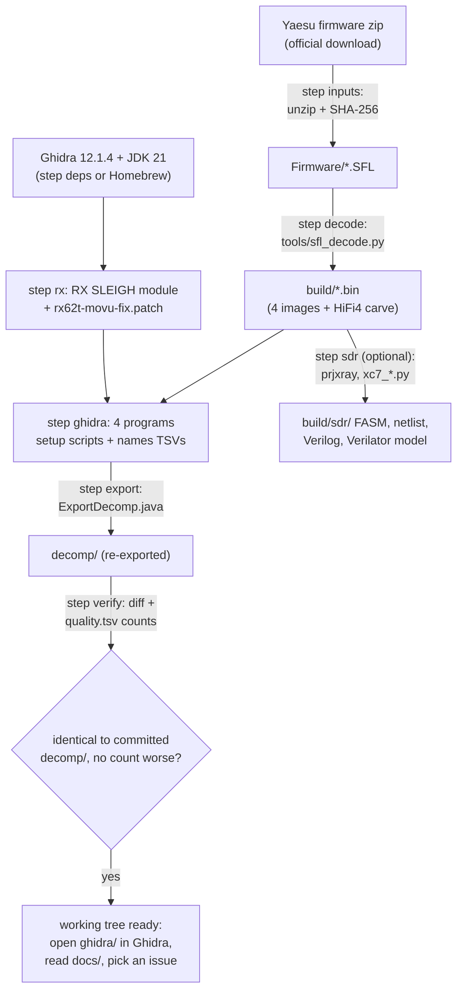

# Getting started

This is the manual for picking the project up and running with it. It takes you from a clean Linux or macOS machine to the same
working state as the owner's: the decoded firmware images, the four Ghidra programs with every name applied, decompiled C identical to
the committed `decomp/`, and (optionally) the SDR FPGA netlist with its Verilator model. Then it shows you around the repo and explains
how to contribute.

If you only want to understand the radio, you don't need any of this: read the **[illustrated guide](guide/README.md)** (also on the
[wiki](https://github.com/Reid-n0rc/FT-710_Firmware/wiki)). Come back here when you want to look at the code yourself.

## The short version

```sh
git clone https://github.com/Reid-n0rc/FT-710_Firmware && cd FT-710_Firmware
# 1. install the prerequisites (below), then put Yaesu's firmware zip into Firmware/
mkdir -p Firmware && curl -fL -o Firmware/FT-710_Firmware_updata_202402.zip \
  https://yaesu.com/Files/BB2B47AE-1018-01AF-FAE48FDCB1919193/FT-710_Firmware_updata_202402.zip
# 2. rebuild everything and check it against the repo (about 5 minutes on 20 cores)
tools/bootstrap.sh
```

The last line of a good run is `IDENTICAL: the re-exported decomps match decomp/ byte for byte`.



## 1. Prerequisites

You need git, Python 3.9 or newer (standard library only), `unzip`, `curl`, `patch`, Ghidra 12.1.4 with JDK 21, and for the optional
SDR step Verilator 5 and Yosys (only for its Xilinx cell models). About 3 GB of disk for Ghidra and the JDK, 1 GB for the build output.
Versions the project was verified with are in [tooling.md](tooling.md).

### Debian / Ubuntu (x86_64)

```sh
sudo apt install git python3 python3-venv unzip curl patch
tools/bootstrap.sh --only deps        # Ghidra 12.1.4 + Temurin JDK 21.0.13+9 into ~/opt, SHA-256 checked
# optional, for the SDR step:
sudo apt install verilator yosys      # Debian bookworm: verilator 5.006, yosys 0.23
```

`--only deps` downloads Ghidra from the NSA GitHub release and the JDK from Adoptium, checks both against pinned SHA-256 values and
unpacks them under `~/opt` (`OPT_DIR` to change). If you already have them elsewhere, skip it and set `GHIDRA_INSTALL_DIR` and
`JAVA_HOME` instead. Ubuntu 22.04's Verilator is 4.x; Verilator 5 is needed for the SDR model, so build it from source or take it from a
newer release there.

### macOS (Homebrew)

```sh
brew install ghidra                   # Ghidra 12.x from homebrew-core; pulls the keg-only openjdk@21
brew install python git
brew install verilator yosys          # optional, for the SDR step
```

`tools/bootstrap.sh` and `tools/ghidra-headless.sh` find the Homebrew Ghidra (`/opt/homebrew/opt/ghidra/libexec`) and `openjdk@21` by
themselves. Don't rely on the system Java: Ghidra 12 needs Java 21 and a headless run hangs on a prompt if it finds an older one.
The project was built with Ghidra **12.1.4**; a different version may decompile slightly differently, in which case `verify` reports a
diff that is not your fault (see section 4).

## 2. Getting the inputs

None of Yaesu's files are in the repo (they are copyrighted; see AGENTS.md). The bootstrap rebuilds everything else from them, byte for
byte, and checks every file against [docs/inputs.sha256](inputs.sha256).

| What | Where it goes | Source |
|---|---|---|
| Firmware package 2024-02 (MAIN V01-12, DISPLAY V01-08, IFDSP V01-01, SDR V01-04; the tested radio reports the same versions over `VE`) | `Firmware/FT-710_Firmware_updata_202402.zip` (the bootstrap unzips it) | https://yaesu.com/Files/BB2B47AE-1018-01AF-FAE48FDCB1919193/FT-710_Firmware_updata_202402.zip |
| Manuals and datasheets (only needed for reading, never by the bootstrap) | `Manuals/` (committed) | the list with links is [manuals.md](manuals.md) |

If yaesu.com refuses the connection from your machine, download the zip in a browser. If the hashes don't match, you have a different
firmware package: the analysis in this repo is for exactly these versions.

## 3. Running the bootstrap

```sh
tools/bootstrap.sh --help             # steps and settings
tools/bootstrap.sh --list             # what it would use on this machine
tools/bootstrap.sh                    # inputs decode rx ghidra export flix verify
tools/bootstrap.sh --only sdr         # the FPGA chain (slow, see below)
tools/bootstrap.sh --only export,verify   # after you change names: re-export and see the diff
```

| Step | What it does | Time (20 cores) |
|---|---|---|
| `deps` | Zephyr SDK RT600 HiFi4 toolchain (Linux and macOS) and Ghidra + JDK (Linux x86_64) downloads, SHA-256 checked; not a default step | network-bound |
| `inputs` | unzip the firmware package if needed, check `Firmware/` against `docs/inputs.sha256` | seconds |
| `decode` | `tools/sfl_decode.py` for the four SFLs, `tools/ifdsp_dsp_images.py` for the HiFi4 images, hash check of `build/*.bin` | seconds |
| `rx` | install the community Renesas RX SLEIGH module (stefan00lpf/rx-proc-ghidra @ `ea4cd204`, six language data files only) into Ghidra, apply the project's fix `tools/ghidra/rx62t-movu-fix.patch`, compile it with Ghidra's `sleigh`. Skipped when already done | 30 s |
| `ghidra` | build `ghidra/FT710_MAIN`, `FT710_DISPLAY` and `FT710_IFDSP` (two programs: Cortex-M33 and HiFi4) with the committed setup, code-discovery and names scripts. In a clone, the committed projects are kept as they are; elsewhere a program is rebuilt only when one of its inputs changed (`FORCE=1` rebuilds) | about 3 min |
| `export` | re-export `decomp/` with `tools/ghidra/ExportDecomp.java` and regenerate `decomp/main/cat_dispatch.tsv` | about 1 min |
| `flix` | the FLIX-aware HiFi4 listing `decomp/ifdsp/hifi4/flix.dis` with the Zephyr SDK objdump (`tools/ifdsp_hifi4_dis.py`). Skipped with a warning when the objdump is missing; `verify` then leaves `flix.dis` out | about 5 s |
| `verify` | compare the export with the committed `decomp/`, and each `decomp/*/quality.tsv` (decompile-quality counts) with the committed one: fails if any count got worse (`tools/decomp_quality.py`) | seconds |
| `sdr` | Project X-Ray checkouts + venv (pinned commits and versions), bitstream → FASM → cell netlist → structural Verilog/XDC → Verilator model of the whole FPGA, and a UART smoke test | netlist about 1 min, Verilator build several minutes |

The exact Ghidra command lines (language, base address, scripts and their order for each program) are in the script itself, which is the
reference: MAIN is `rx62t:LE:32:default` at 0xFFF80000 with `SetupRX651.java` and three `.data` copy-downs; DISPLAY is `ARM:LE:32:v7` at
0x20100000 with `DisplaySetup.java`, two `DisplayFindCode.java` passes and `FixFuncEntries.java`; IFDSP is `ARM:LE:32:v8-m` at 0x08000000
plus `Xtensa:LE:32:default` at 0. Logs go to `<out>/logs/`.

**Settings** are environment variables (all listed by `--help`). The useful ones:

- `BOOTSTRAP_OUT=/some/dir` writes `build/`, `ghidra/`, `decomp/` and `logs/` there instead of the repo, so the committed `decomp/` is
  only compared, never touched. Without it, the export overwrites `decomp/` in place and `verify` uses `git diff`.
- `FIRMWARE_DIR` if the SFLs are somewhere else.
- `JOBS` (default: all cores) is passed to Ghidra as `-max-cpu` and to Verilator; `GHIDRA_HEADLESS_MAXMEM` (default: half the RAM, at most
  8G) is Ghidra's heap. 4G is enough for every program here.
- `GHIDRA_INSTALL_DIR`, `JAVA_HOME`, `OPT_DIR`, `RX_MODULE_DIR` for non-default installs; `FT710_TOOLS`, `PRJXRAY`, `PRJXRAY_DB`,
  `FT710_VENV` for the SDR tools (default `~/.local/share/ft710-tools`).

The `rx` step writes into your Ghidra installation (`Ghidra/Processors/RX/`). On macOS with Homebrew that is the Cellar copy, which a
`brew upgrade ghidra` replaces; rerun `--only rx` after an upgrade. Undo it with `rm -rf "$GHIDRA_INSTALL_DIR/Ghidra/Processors/RX"`.

## 4. What "verified" means

T20 ran the bootstrap from scratch on the owner's Linux machine (Debian bookworm container, x86_64, Ghidra 12.1.4, Temurin 21.0.13+9) into
an empty output directory:

- every decoded image matched `docs/inputs.sha256`;
- the freshly built Ghidra programs re-exported **byte-identical** C for all four programs (MAIN 2268 functions, DISPLAY 2087, IFDSP M33
  426, HiFi4 1148) and an identical `cat_dispatch.tsv`; a second run with `FORCE=1` was identical again, so the export is deterministic;
- the SDR chain reproduced the owner's FASM, `netlist.json`, `ft710_sdr.v`/`.xdc` and primitive files byte for byte.

The expected exceptions: `decomp/*/INDEX.md` and `decomp/sdr/README.md` are hand-written and not compared; the HiFi4 export always has one
decompile failure (`FUN_0020bb74`, the decompiler process dies on it). A different Ghidra version, JDK or RX module commit can change the
output; then the diff (`<out>/decomp.diff`) shows by how much.

## 5. Tour of the repo

| Where | What |
|---|---|
| [AGENTS.md](../AGENTS.md) | the rule book for people and AI agents: goals, ground rules, sources, conventions |
| [CONTRIBUTING.md](../CONTRIBUTING.md) | how a change gets in (issue → branch → PR) |
| [docs/guide/](guide/README.md) | the illustrated guide: the whole radio in plain language, 8 chapters + glossary |
| [docs/code/system.md](code/system.md) | system reference: block diagrams, inter-CPU protocols, power-on, update, CAT, tuning, TX and scope flows; §8 lists the contradictions and open questions |
| `docs/code/{main,display,ifdsp,sdr}/` | one README per image plus one page per subsystem, with function tables and figures |
| [hardware.md](hardware.md), [memory-maps.md](memory-maps.md), [sfl-format.md](sfl-format.md) | boards and chips (from the service manual), memory maps per image, the firmware file format |
| [cat-commands.md](cat-commands.md), [cat-commands-primary.md](cat-commands-primary.md) | every CAT command the firmware accepts, documented or not, with handlers and risk |
| [custom-firmware.md](custom-firmware.md), [patches/](patches/README.md) | what it would take to run your own code, and the first (unflashed) patches |
| [tooling.md](tooling.md), [manuals.md](manuals.md) | every installed tool with version and source; every manual with its source |
| [tasks/](tasks/README.md) | the task board and one file per task (plan, findings, follow-ups): the project's history |
| `decomp/<image>/` | Ghidra's decompiled C, 50 functions per file, `functions.tsv`, and an `INDEX.md` of notable functions |
| `hdl/sdr/` | hand-written Verilog of the SDR FPGA's UART link, with testbenches and the Verilator harness |
| [tools/](../tools/README.md) | every script, catalogued in `tools/README.md` |
| `Manuals/`, `ghidra/FT710_{MAIN,DISPLAY,IFDSP}` | committed (owner decision, 2026-10-28): the manuals and the three canonical Ghidra projects. The bootstrap keeps the committed projects unless you set `FORCE=1` |
| `Firmware/`, `build/`, `ghidra/FT710_*_T*` | gitignored: the firmware download, the decoded images and per-task Ghidra copies. Never commit them |

## 6. Working with Ghidra

Open the projects in the GUI with `ghidraRun` (Homebrew: on your `PATH`; Linux: `~/opt/ghidra_12.1.4_PUBLIC/ghidraRun`), File → Open
Project → `ghidra/FT710_MAIN.gpr` (or the one under `BOOTSTRAP_OUT`). Headless runs always go through `tools/ghidra-headless.sh`, which
sets JDK 21. For quick looks without the GUI:

```sh
tools/ghidra-headless.sh "$PWD/ghidra" FT710_MAIN -process FT-710_MAIN_V0112.bin -noanalysis -readOnly \
  -scriptPath tools/ghidra -postScript DumpListing.java /tmp/l.txt cat_parse:40      # disassembly
tools/ghidra-headless.sh "$PWD/ghidra" FT710_MAIN -process FT-710_MAIN_V0112.bin -noanalysis -readOnly \
  -scriptPath tools/ghidra -postScript DumpFuncs.java /tmp/f.c cat_EX                # decompile a few functions
```

**Names are source files.** The Ghidra projects are rebuilt, never committed, so a name you type in the GUI is lost unless it is in the
committed names file: `tools/ghidra/names_main.tsv`, `names_display.tsv` (+ `entries_display.tsv` for function starts),
`IfdspM33Names.java`, `IfdspHifi4Names.java`. Add the name there, then `tools/bootstrap.sh --only ghidra,export` (with
`BOOTSTRAP_OUT` unset it updates `decomp/` in place), and commit the names file, the new `decomp/` and the pages that use the name together.
`tools/index_refresh.py` fixes the file column in `decomp/*/INDEX.md` afterwards.

Known decompiler limits are listed in each `decomp/*/INDEX.md` (for example RX string instructions shown as loops, and HiFi4 FLIX bundles
that Ghidra cannot decode; use `tools/ifdsp_hifi4_dis.py` with the Zephyr SDK objdump for those, see [tooling.md](tooling.md)).

### Optional: REA (an AI-agent reverse-engineering server)

The owner's AI agents also use REA (`rea-agents`, an MCP server that drives Ghidra and other tools). It is optional: everything in the
repo is reproducible without it. Stock `rea-agents` 6.8.0 cannot load MAIN (Renesas RX), so the owner runs a **fork**
(github.com/Reid-n0rc/rea, branch `feat-ghidra-rx-raw`) that adds a raw-binary `rx` family and a separate `base_address`. Install steps,
the exact `open_binary` arguments for MAIN and its limits are in [tooling.md](tooling.md) ("Linux container setup"). The main limit:
REA re-imports from scratch, so it has none of the project's memory blocks or names; use the bootstrap's projects as the reference and REA
for quick questions.

## 7. Conventions

- **Evidence tags.** Every claim is **[fact]** (seen in code or data, with the address), **[inference]** or **[guess]**.
- **Figures.** Mermaid in Markdown (`flowchart`, `sequenceDiagram`, `stateDiagram-v2`), about 25 nodes or fewer; hand-written SVG in
  `docs/guide/img/` for the guide. Check that a Mermaid block renders (GitHub preview, or `mmdc`) before you commit it.
- **Tools.** Python standard library only where possible; run with `python3 -I`. Derived output goes to `build/`.
- **Large files.** Don't read a whole PDF or a whole decompile dump at once; use `pdftotext -f N -l M` and `grep`.
- **The radio.** Never flash, write EEPROM, send untested CAT set-commands or connect JTAG to anyone's radio without that radio owner's
  explicit approval, each time (chapter 8 of the guide has the risk ladder).

## 8. Contributing

Read [CONTRIBUTING.md](../CONTRIBUTING.md). In short: open an issue first (templates: correction, new analysis or tool, question), work
on a branch or fork, and open a pull request whose description says `Closes #N`. The owner reviews every PR.

**Where to start.** The open questions are GitHub issues, labelled by area (`main`, `display`, `ifdsp`, `sdr`, `cat`), by kind
(`analysis`, `docs`, `tooling`, `hardware`) and `good first issue` for small ones; their source list is
[tasks/T20-open-issues.md](tasks/T20-open-issues.md). Issues labelled `needs-radio` or `needs-owner` wait for the owner. The longer
background for each question is in [system.md §8](code/system.md#8-contradictions-and-open-questions) and in the `## Follow-ups` of the
task files.
