# Inside the Yaesu FT-710: an illustrated guide

This guide explains how the FT-710's firmware works, in plain language and with pictures. It is for anyone who knows what a CPU, a serial
port and an FPGA are and wants to understand what goes on inside the radio. You don't need to read code. It summarises a long
reverse-engineering project on the owner's own radio. The detailed reference pages, with every address and every piece of evidence, live
elsewhere in this repository, and each chapter ends with links to them.

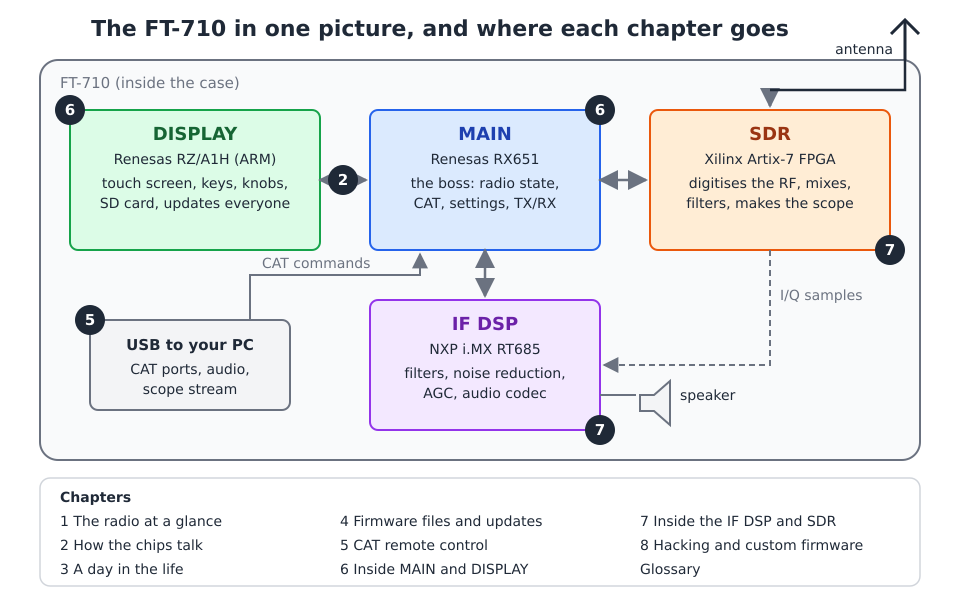

*Figure 0.1 — The radio in one picture. The numbered badges show which chapter covers each part.*

**How to read it.** Chapters 1–3 give the big picture: what is inside, how the chips talk, and what happens when you use the radio. Read
them in order. Chapters 4–8 can be read in any order. The glossary at the end defines every technical term; terms link to it the first
time they appear.

**How sure are we?** Plain statements were seen directly in the firmware or the service manual. Where the guide says *(inference)*, the
claim follows from the evidence but wasn't seen directly. *(guess)* marks an educated guess. Nothing in this guide has been tested on the
radio itself unless the text says so. The project's rule is that nothing is written to the radio without the owner's explicit approval.

**Colours.** Each chip keeps the same colour in every picture: blue for MAIN, green for DISPLAY, purple for the IF DSP,
orange for the SDR FPGA and grey for other hardware. Red marks something dangerous, and amber marks something to be careful with.

## Contents

- **[1. The radio at a glance](#1-the-radio-at-a-glance)**
  - [1.1 The boards and where the chips sit](#11-the-boards-and-where-the-chips-sit)
  - [1.2 Four brains](#12-four-brains)
  - [1.3 Four firmware files](#13-four-firmware-files)
  - [1.4 The receive path](#14-the-receive-path)
  - [1.5 The transmit path](#15-the-transmit-path)
  - [1.6 The USB side](#16-the-usb-side)
  - [1.7 Where to look](#17-where-to-look)
- **[2. How the chips talk](#2-how-the-chips-talk)**
  - [2.1 Who is the boss](#21-who-is-the-boss)
  - [2.2 DISPLAY ↔ MAIN: the front-panel link](#22-display--main-the-front-panel-link)
  - [2.3 MAIN → FPGA and MAIN → DSP: register frames](#23-main--fpga-and-main--dsp-register-frames)
  - [2.4 The shadow-register idea](#24-the-shadow-register-idea)
  - [2.5 The DISPLAY's SPI data links](#25-the-displays-spi-data-links)
  - [2.6 Reset and update wires](#26-reset-and-update-wires)
  - [2.7 When a link is down](#27-when-a-link-is-down)
  - [2.8 Where to look](#28-where-to-look)
- **[3. A day in the life of the radio](#3-a-day-in-the-life-of-the-radio)**
  - [3.1 Switching on](#31-switching-on)
  - [3.2 Switching off](#32-switching-off)
  - [3.3 Turning the knob or pressing a key](#33-turning-the-knob-or-pressing-a-key)
  - [3.4 Changing band or mode, and how the radio remembers](#34-changing-band-or-mode-and-how-the-radio-remembers)
  - [3.5 Transmitting](#35-transmitting)
  - [3.6 The scope and the waterfall](#36-the-scope-and-the-waterfall)
  - [3.7 Audio](#37-audio)
  - [3.8 Where to look](#38-where-to-look)
- **[4. Firmware files and how updates work](#4-firmware-files-and-how-updates-work)**
  - [4.1 What Yaesu ships](#41-what-yaesu-ships)
  - [4.2 Anatomy of an SFL file](#42-anatomy-of-an-sfl-file)
  - [4.3 How we cracked it](#43-how-we-cracked-it)
  - [4.4 What is inside each file](#44-what-is-inside-each-file)
  - [4.5 Updating, from the front panel](#45-updating-from-the-front-panel)
  - [4.6 Behind the screen: one CPU updates them all](#46-behind-the-screen-one-cpu-updates-them-all)
  - [4.7 What the loader really checks](#47-what-the-loader-really-checks)
  - [4.8 Where to look](#48-where-to-look)
- **[5. CAT remote control](#5-cat-remote-control)**
  - [5.1 What CAT is, and the three ways in](#51-what-cat-is-and-the-three-ways-in)
  - [5.2 Anatomy of a command](#52-anatomy-of-a-command)
  - [5.3 The journey of `FA014074000;`](#53-the-journey-of-fa014074000)
  - [5.4 The command map: documented and firmware-only](#54-the-command-map-documented-and-firmware-only)
  - [5.5 The 22 undocumented commands, by risk](#55-the-22-undocumented-commands-by-risk)
  - [5.6 The SP service family](#56-the-sp-service-family)
  - [5.7 The read-only tests on the radio](#57-the-read-only-tests-on-the-radio)
  - [5.8 Menu settings over CAT: the EX command](#58-menu-settings-over-cat-the-ex-command)
  - [5.9 Where to look](#59-where-to-look)
- **[6. Inside MAIN and DISPLAY](#6-inside-main-and-display)**
  - [6.1 Two CPUs, two styles](#61-two-cpus-two-styles)
  - [6.2 MAIN: one loop, sixteen jobs](#62-main-one-loop-sixteen-jobs)
  - [6.3 MAIN's memory and settings](#63-mains-memory-and-settings)
  - [6.4 MAIN's peripherals](#64-mains-peripherals)
  - [6.5 Keys and menus](#65-keys-and-menus)
  - [6.6 DISPLAY: boot and tasks](#66-display-boot-and-tasks)
  - [6.7 DISPLAY: screens, touch, knobs, SD card and the hidden console](#67-display-screens-touch-knobs-sd-card-and-the-hidden-console)
  - [6.8 Where to look](#68-where-to-look)
- **[7. Inside the IF DSP and the SDR FPGA](#7-inside-the-if-dsp-and-the-sdr-fpga)**
  - [7.1 The IF DSP: one chip, two processors](#71-the-if-dsp-one-chip-two-processors)
  - [7.2 How the IF DSP starts up](#72-how-the-if-dsp-starts-up)
  - [7.3 Audio in, audio out](#73-audio-in-audio-out)
  - [7.4 The register file: how MAIN turns the knobs](#74-the-register-file-how-main-turns-the-knobs)
  - [7.5 The SDR FPGA: firmware without a CPU](#75-the-sdr-fpga-firmware-without-a-cpu)
  - [7.6 From bitstream to readable Verilog](#76-from-bitstream-to-readable-verilog)
  - [7.7 What is inside the FPGA](#77-what-is-inside-the-fpga)
  - [7.8 Open questions](#78-open-questions)
  - [7.9 Where to look](#79-where-to-look)
- **[8. Hacking and custom firmware](#8-hacking-and-custom-firmware)**
  - [8.1 Is it possible? A scorecard per chip](#81-is-it-possible-a-scorecard-per-chip)
  - [8.2 The debug headers](#82-the-debug-headers)
  - [8.3 How risky is each step?](#83-how-risky-is-each-step)
  - [8.4 The prepared patches](#84-the-prepared-patches)
  - [8.5 The FPGA "hello"](#85-the-fpga-hello)
  - [8.6 Decisions waiting for the owner](#86-decisions-waiting-for-the-owner)
  - [8.7 Golden rules](#87-golden-rules)
  - [8.8 Where to look](#88-where-to-look)
- **[Glossary](#glossary)**

## 1. The radio at a glance

**In short.** The FT-710 is not one computer but four. A Renesas RX651 on the MAIN unit is the boss: it keeps the radio's state and answers
[CAT](#glossary) commands. A Renesas RZ/A1H on the DISPLAY unit runs the touch screen, the knobs and the SD card. An NXP i.MX RT685 does
the audio [DSP](#glossary). A Xilinx Artix-7 [FPGA](#glossary) on a plug-in [SDR](#glossary) module turns the antenna signal into numbers
and back. Each of the four gets its own firmware file. This chapter shows where these chips sit and what each one does. It then follows a
signal from the antenna to the speaker and from the microphone back to the antenna, and ends with what the PC sees on the USB port.

### 1.1 The boards and where the chips sit

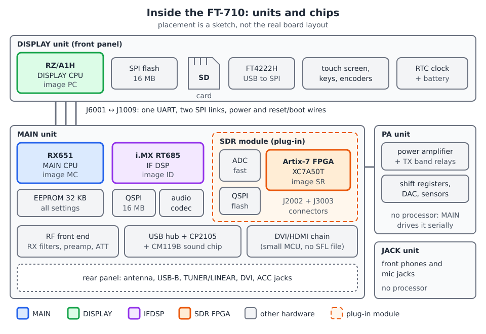

*Figure 1.1 — The units of the FT-710 and the four programmable chips (coloured). The placement is a sketch, not the real board layout.*

Yaesu's service manual lists four boards: **MAIN**, **PA**, **DISPLAY** and **JACK**. A fifth part, the **SDR module**, is a separate
small board mounted **underneath the MAIN unit**. It is screwed to the chassis floor with thermal pads, so the chassis works as its heat
sink. It connects to the MAIN unit through a 60-pin board-to-board connector (J2002) and a 10-pin connector for the RF lines (J3003).
The exploded view also shows a short wire assembly, TT9207967, between the two boards *(inference: the RF lines)*. The manual draws the
SDR module only as a box. None of its parts are in the parts list, so everything we know about its insides comes from its firmware.

- The **DISPLAY unit** is the front panel. It holds the RZ/A1H, a 16 MB [SPI](#glossary) flash with the DISPLAY program, the SD card
  slot, the touch controller, the keys and encoders, a clock chip with a backup battery, and an FT4222H USB bridge.
- The **MAIN unit** holds most of the radio. The RX651 sits here with its settings [EEPROM](#glossary). So do the RT685 with its own
  16 MB [QSPI](#glossary) flash and the audio [codec](#glossary), the receive front end, the USB hub and its chips, and the DVI/HDMI output.
  The SDR module, with its fast ADC, the FPGA and the FPGA's own flash chip, is mounted underneath it.
- The **PA unit** has the power amplifier and no processor. Shift registers, a small DAC and some sensors let the MAIN CPU control it
  over a serial bus.
- The **JACK unit** carries the front phones and mic jacks and has no processor either.

A ribbon cable joins the DISPLAY unit to the MAIN unit. It carries one [UART](#glossary), two SPI links, power and the wires that let the
DISPLAY reset the MAIN CPU and put it into its boot mode (chapter 2).

There is a fifth programmable part: a small controller in the DVI/HDMI chain (EPF021M). None of the four firmware files is for it, so it
probably has fixed firmware *(guess)*.

### 1.2 Four brains

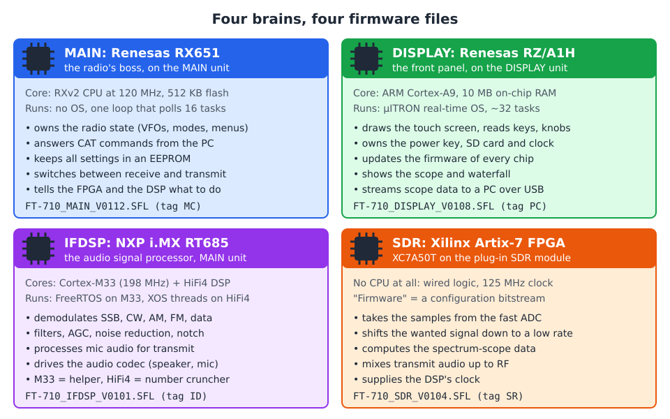

*Figure 1.2 — The four "brains" of the radio: what each chip is, what it runs and what it does.*

The four chips split the work cleanly:

- **MAIN (RX651)** is the control CPU. It runs at 120 MHz from 512 KB of on-chip flash. It has no operating system. One loop calls 16 small
  tasks in turn, over and over. MAIN owns everything that defines "the radio": [VFO](#glossary) frequencies, modes, filters, menus and
  memories. It keeps all settings in a 32 KB EEPROM and answers CAT commands on three serial ports. It also switches the radio between
  receive and transmit, and it tells the FPGA and the DSP what to do. It does not process the radio signal itself.
- **DISPLAY (RZ/A1H)** is an ARM Cortex-A9 with 10 MB of on-chip RAM. It runs a small [real-time OS](#glossary) (µITRON, about 32 tasks). It draws the
  touch screen and reads the keys, the knobs and the power button. It owns the SD card and the real-time clock. Because it has the SD card,
  it is also the chip that **updates the firmware of all four chips**. It switches the MAIN CPU on and off.
- **IFDSP (i.MX RT685)** holds two different processors in one chip. A Cortex-M33 (198 MHz, FreeRTOS) is the helper: it starts the DSP,
  sets up the codec and listens to MAIN on a serial port. A Cadence HiFi4 DSP does the heavy audio maths. It demodulates and filters, and
  it runs the [AGC](#glossary), noise reduction and notch. On transmit it runs the mic EQ and the speech processor. Its clock (18.432 MHz)
  comes from the SDR module.
- **SDR (Artix-7 XC7A50T)** is an FPGA, not a CPU. Its "firmware" is a configuration [bitstream](#glossary) that wires up logic at
  power-on. There is no processor inside it, not even a soft one *(inference, high confidence)*. It takes the samples from the fast ADC,
  picks out the wanted frequency, computes the data for the spectrum scope, and on transmit moves the audio up to the RF frequency. The
  FPGA is nearly full: it uses 119 of its 120 multiplier blocks.

### 1.3 Four firmware files

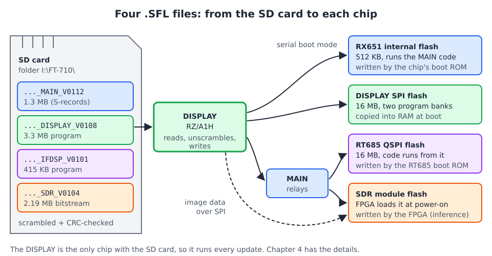

*Figure 1.3 — Each [SFL](#glossary) file feeds one chip. The DISPLAY reads them from the SD card and writes them, sometimes through MAIN.*

Yaesu ships the firmware as four `.SFL` files, one per chip. The two-letter tag in each file's header names the image:

| File | Tag | Chip | Where it lives in the radio |
|---|---|---|---|
| `FT-710_MAIN_V0112.SFL` | MC | RX651 | the CPU's own 512 KB flash |
| `FT-710_DISPLAY_V0108.SFL` | PC | RZ/A1H | 16 MB SPI flash with two program banks, copied into RAM at boot |
| `FT-710_IFDSP_V0101.SFL` | ID | RT685 | 16 MB QSPI flash; the code runs straight from it |
| `FT-710_SDR_V0104.SFL` | SR | XC7A50T | the SDR module's flash; the FPGA loads it at power-on |

The files are lightly scrambled and carry a checksum, nothing more. The MAIN file is a text format (Motorola S-records), which is why it
is about 2.6 times bigger than the 512 KB it fills. The DISPLAY is the only chip with the SD card, so it runs every update. It writes the
MAIN CPU directly through the RX651's serial boot mode, and its own flash itself. For the DSP and the FPGA it goes through MAIN, and the
FPGA data also travels over an SPI link. Chapter 4 tells that story; this chapter only needs the mapping.

### 1.4 The receive path

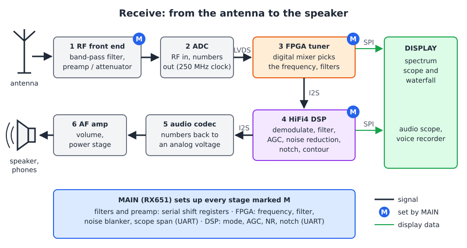

*Figure 1.4 — Receive: the signal goes from left to right on the top row, then right to left on the bottom row. Stages marked M are set up by MAIN.*

Follow a signal from the antenna to your ears:

1. **RF front end.** The signal passes a protection diode, the 6 dB and 12 dB attenuators, the IPO switch, a 1.7 MHz high-pass
   option, one of 15 band-pass filters (0.3–1.7 MHz up to 56–75 MHz), and up to three RF amplifiers, then a final low-pass filter and a
   balun transformer. MAIN picks the filter and switches the preamps and attenuators through a chain of serial shift registers.
   **There is no mixer and no local oscillator anywhere in this chain.** The block diagram labels the line into the SDR module
   "RX-IN 0.03–75MHz": the whole band, from 30 kHz to 75 MHz, goes straight to the ADC. This is a **direct-sampling** receiver. A
   separate "[DITHER](#glossary)" line comes back from the SDR module, where Yaesu's diagram puts a D/A converter that makes it; it is
   high-pass filtered and added to the ADC input. Dither is a small noise signal outside
   the wanted band that makes a direct-sampling ADC's errors behave like noise rather than spurs *(inference for its purpose)*.
2. **ADC.** On the SDR module, Yaesu's receiver diagram shows a **divider** that splits the signal into **two ADC channels**. An
   independent test report by DC4KU identifies the converter as a **dual-channel 14-bit** ADC, the same one as in the FT-DX10. The FPGA
   adds the two channels together, so the receiver overloads later than one channel would.
   A 35.7 MHz oscillator on the MAIN unit feeds a 250 MHz clock into the module, which divides it by 2 ("Operating clock 125MHz,
   Divide 250MHz by 2" on the block diagram). MAIN treats 62.5 MHz, half of 125, as a boundary: it flips an FPGA control bit there and
   mirrors the scope frequency about it. So each channel most likely samples at **125 million samples per second** *(inference, strong;
   the ADC's part number is not in the service manual)*. The FPGA reads the two channels over the same 14 wire pairs, one channel on
   each clock edge. That wiring had first looked like a single, faster ADC.
   Signals above 62.5 MHz, for example the 70 MHz band, are received "folded" from the second [Nyquist zone](#glossary). The 56–75 MHz band-pass
   filter keeps out their mirror image.
3. **FPGA "tuner".** The FPGA multiplies the samples with a digital oscillator ([NCO](#glossary)) set to your frequency. That moves the
   wanted signal down to near zero, where a bank of filters cuts out a narrow slice and drops the sample rate. This is the classic
   digital down-converter ([DDC](#glossary)). The blocks inside the FPGA are recognised from its lookup tables and multiplier use *(inference)*.
   The FPGA also has the noise blanker controls *(inference)* and computes the spectrum-scope data. The scope data goes **straight to the
   DISPLAY** over its own SPI link and never passes through MAIN.
4. **HiFi4 DSP.** The narrow, slow stream reaches the RT685 over [I2S](#glossary), a standard serial audio bus. The HiFi4 demodulates
   (SSB, CW, AM, FM, data) and runs the filters, AGC, noise reduction, notch and contour. It works at a sample rate of about 12 kHz
   *(inference, strong)*. It also sends an audio spectrum ("AF-FFT") and the voice-recorder audio to the DISPLAY over a second SPI link.
5. **Audio codec.** A TI TLV320AIC3204 turns the numbers back into an analog voltage.
6. **AF amplifier and speaker.** The audio is amplified and sent to the speaker or phones.

MAIN does not process the signal. It only programs each stage: frequency, filter, scope span and noise blanker go to the FPGA; mode, AGC,
noise reduction and notch go to the DSP. Chapter 2 shows how it sends those settings.

### 1.5 The transmit path

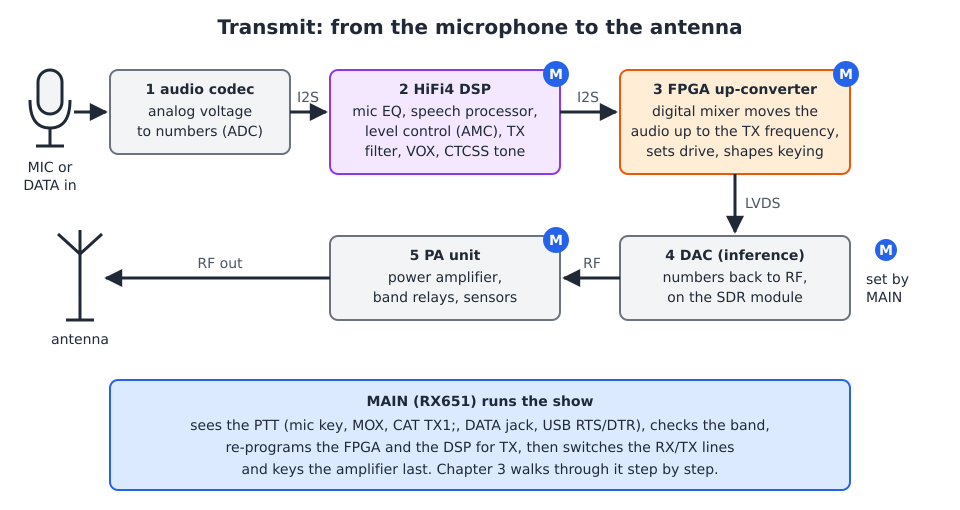

*Figure 1.5 — Transmit: the same chips work in the other direction. Stages marked M are set up by MAIN.*

On transmit the chain runs backwards:

1. **Codec.** Audio from the microphone or the rear DATA input reaches the codec, which turns it into numbers.
2. **HiFi4 DSP.** The DSP applies the mic equaliser, the speech processor, the automatic mic level control (AMC) and the TX filter. It
   also detects VOX and generates CTCSS tones for FM.
3. **FPGA up-converter.** The audio goes back over I2S to the FPGA. A second digital oscillator, set to the transmit frequency, moves it up
   to RF. The FPGA also sets the drive level and shapes the start and end of each CW element with a smooth "raised-cosine" ramp
   *(inference from the FPGA's tables)*.
4. **DAC.** The FPGA drives a fast [LVDS](#glossary) output bus, which most likely feeds a DAC on the SDR module *(inference; the part is unknown)*.
5. **PA unit.** The low-level RF goes to the PA unit. MAIN selects the band relays there and keys the amplifier.

MAIN decides *when* the radio transmits. A [PTT](#glossary) can come from the mic key, the [MOX](#glossary) button, a CAT `TX1;` command, the rear DATA
jack, or the RTS/DTR lines of the USB serial port. MAIN then checks that the frequency is allowed for the radio's region, re-programs the FPGA and
the DSP for transmit, switches the RX/TX lines and keys the amplifier last. Chapter 3 walks through that sequence step by step.

### 1.6 The USB side

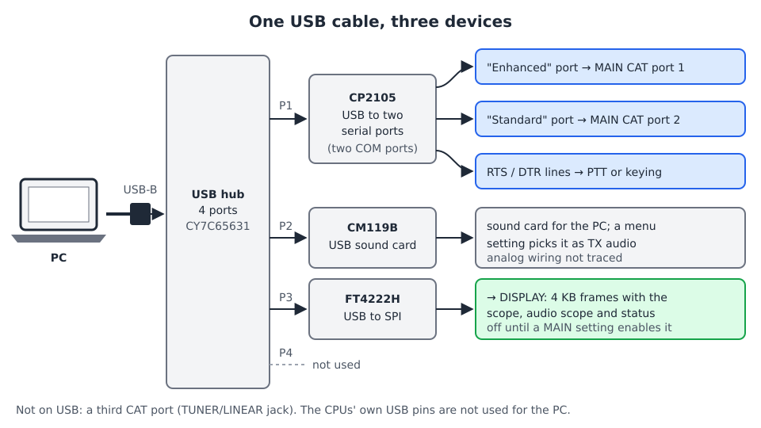

*Figure 1.6 — What the PC sees: a hub with three devices behind it.*

Plug a USB cable into the rear USB-B jack and the PC finds a 4-port hub (Cypress CY7C65631) with three devices behind it:

- **[CP2105](#glossary)**, a dual USB-to-serial bridge. It shows up as **two COM ports**. The "Enhanced" port goes to MAIN's CAT port 1 (38400 baud
  after a reset), the "Standard" port to CAT port 2 (4800 baud after a reset). You can change both rates in the menu. The RTS and DTR lines
  of the Standard port can key the radio (PTT) or key CW/RTTY, if the PC KEYING menu setting says so.
- **CM119B**, a USB sound card. A menu setting (MOD SOURCE) can select USB audio as the transmit audio. How its analog side is wired was
  not traced in the schematic, and no firmware touches the chip.
- **[FT4222H](#glossary)**, a USB-to-SPI bridge on the DISPLAY unit. Through it the DISPLAY streams 4 KB frames to the PC: a copy of the spectrum
  scope, the audio spectrum and a 151-byte status block. The DISPLAY holds the bridge in reset until a setting from MAIN switches it on.
  Which PC program reads this stream is not known.

The fourth hub port is not used. A third CAT port, not on USB, sits on the rear TUNER/LINEAR jack at 5 V logic levels. The RX651 and
the RZ/A1H have USB ports of their own, but neither is used for the PC: the RX651's pins go to test points, and the RZ/A1H's USB host only
serves a USB keyboard or mouse.

### 1.7 Where to look

- Whole-radio overview, block diagrams and the signal path: [../code/system.md](../code/system.md) §1–2.
- Chips, boards, connectors and debug headers from the service manual: [../hardware.md](../hardware.md).
- MAIN's role and peripherals: [../code/main/README.md](../code/main/README.md); the SDR module's pins: [../code/sdr/interfaces.md](../code/sdr/interfaces.md);
  what is inside the FPGA: [../code/sdr/README.md](../code/sdr/README.md).
- The SFL file format: [../sfl-format.md](../sfl-format.md).
- Part numbers used in this chapter: MAIN CPU Q1001 R5F56514ADFB; DISPLAY CPU Q6009 R7S721001VCBG; IF DSP Q2002 MIMXRT685SFVKB; codec
  Q2001 TLV320AIC3204; EEPROM Q1008 BR25G256; USB hub Q2607 CY7C65631; CP2105 Q2614; CM119B Q2624; FT4222HQ Q6020; SDR module on
  J2002/J3003; DVI controller Q1805 EPF021M.
- CAT ports: SCI3 = port 1 (CP2105 Enhanced), SCI0 = port 2 (CP2105 Standard), SCI2 = port 3 (TUNER/LINEAR jack), see
  [../code/main/sci.md](../code/main/sci.md). Front-end and PA control words: `rf_bpf_update`, `pa_relay_update` in
  [../code/main/tx-protection.md](../code/main/tx-protection.md).

## 2. How the chips talk

**In short.** The four chips are joined by three slow serial control links and three fast SPI data links. MAIN is the master of the two
control links to the FPGA and the DSP. It sends short ASCII commands like `r0000` ("read register 0") and `w0022 0064` ("write 0x0064
to register 0x22"), and the other side only answers. The DISPLAY and MAIN talk as equals over a binary link where every frame is
acknowledged. The bulk data (spectrum scope, audio scope, voice recorder audio) goes over SPI straight to the DISPLAY and never passes
through MAIN. A handful of reset and boot-mode wires let the DISPLAY restart MAIN, and MAIN restart the FPGA and the DSP. This chapter
takes each link apart down to the byte. It also shows the trick MAIN uses to keep the other chips in step ([shadow registers](#glossary)) and what
happens when a link breaks.

### 2.1 Who is the boss

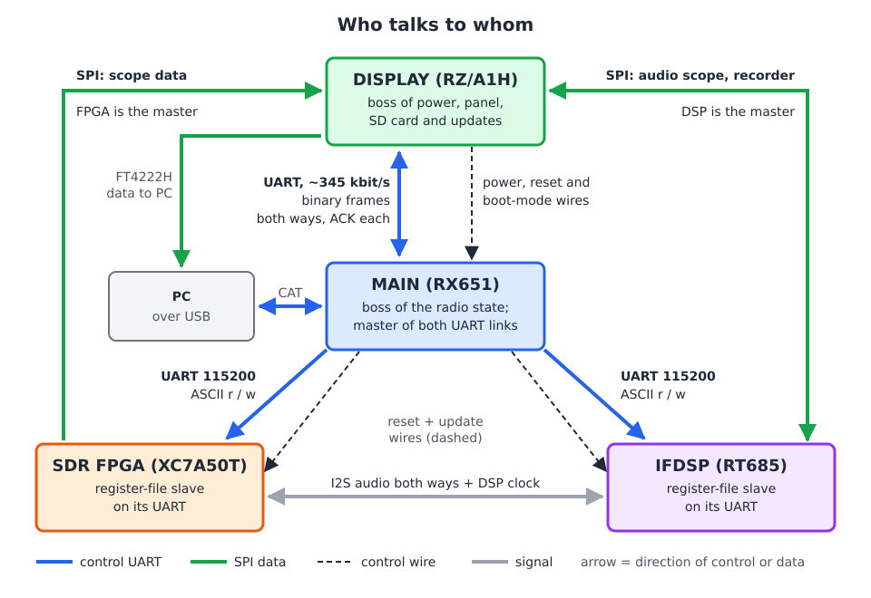

*Figure 2.1 — Every link between the chips. Blue: control UARTs. Green: SPI data links. Dashed: reset and boot-mode wires.*

There are two bosses, each in charge of something different:

- **The DISPLAY is the boss of power and updates.** It sees the power key, switches MAIN's power latch and reset line, and wakes MAIN up
  with a "hello" frame. It owns the SD card, so it is the only chip that can update the others.
- **MAIN is the boss of the radio state.** Everything that tunes, keys or configures the radio goes through MAIN. MAIN pushes that state to
  the FPGA, the DSP and the DISPLAY. It works out what each one should be showing or doing, and sends only what has changed.

The FPGA and the DSP are pure slaves on their control links. Each holds a [register file](#glossary) of 16-bit words that MAIN reads and writes, and neither
ever speaks first. On their SPI data links the roles flip: the FPGA and the DSP drive the clock and push their data into the DISPLAY,
which listens as an SPI slave.

The links, from slow to fast:

| Link | Kind | Speed | Carries |
|---|---|---|---|
| MAIN → FPGA | UART, ASCII | 115,200 bit/s | about 35 FPGA settings (frequency, filters, scope) |
| MAIN → DSP | UART, ASCII | 115,200 bit/s | about 75 DSP settings, 4 status values back |
| DISPLAY ↔ MAIN | UART, binary | ~345,600 bit/s | keys, knobs, clock, SD state up; screen contents down |
| FPGA → DISPLAY | SPI | set by the FPGA | spectrum scope frames |
| DSP ↔ DISPLAY | SPI | 1 MHz | audio spectrum, recorder and playback audio |
| DISPLAY → PC | SPI via FT4222H | set by the PC side | copies of both scopes plus status |

Two more links are on the board but do nothing in this firmware: a MAIN UART called "C4" (SCI7) is set up but never started, and a spare
DISPLAY UART has set-up code that is never called. The CAT ports from the PC are covered in chapter 5.

### 2.2 DISPLAY ↔ MAIN: the front-panel link

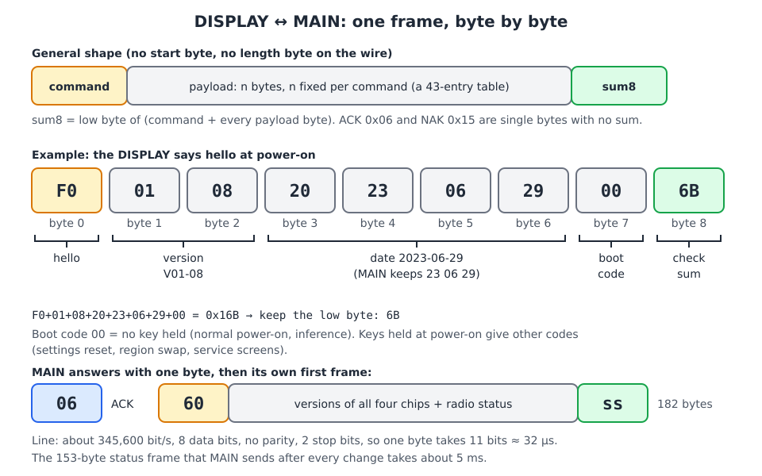

*Figure 2.2 — Anatomy of a DISPLAY ↔ MAIN frame, using the DISPLAY's power-on "hello" as the example.*

This is the busiest control link. It runs at an unusual 345,600 bit/s nominal, 8 data bits, no parity and **two** stop bits ([8N2](#glossary)).
MAIN's clock divider actually lands on 340,900 bit/s, 1.4 % low, which is well within what a UART tolerates.

**Frame format.** A frame is just `command, payload, sum8`. There is no start byte and no length byte. Both sides know from a table how
many payload bytes each command has: 43 commands, from 1 byte up to 574 bytes. The last byte is the low byte of the sum of all the bytes
before it, a [sum8](#glossary) checksum. Two single bytes stand alone: **[ACK](#glossary) = 0x06** and **[NAK](#glossary) = 0x15**. If a frame is cut off, MAIN starts over: a byte that arrives
more than about 10 ms after the previous one is taken as the start of a new frame.

**Worked example.** At power-on the DISPLAY sends `F0 01 08 20 23 06 29 00 6B`: command F0 ("hello"), its own version 01-08, its build
date 2023-06-29, a boot code, and the checksum. The boot code tells MAIN which keys were held at power-on. Some key combinations reset the
settings, swap the region code or open service screens. MAIN answers `06`, then sends frame 0x60 with the versions of all four chips and
the radio status, then frame 0x24 with settings. From then on the link is quiet until something changes.

**Who sends what.** Commands 0x20–0x7F go from MAIN to the DISPLAY. The big one is **0x20, a 153-byte status block** with the VFO frequencies,
the mode and more, and the DISPLAY redraws its screen from it. Other frames carry pop-ups, menu lists, the screen-saver and touch-calibration
screens, an LCD test pattern, the clock and the power-down command. Commands 0xC3–0xF1 go the other way. **E0** is a key or touch event,
**E1** an encoder step, **E2** the SD card state, **E3** the time from the DISPLAY's clock chip, **F0** the hello, and **F1** a system
command (for example "disable CAT" before an update).

**Stop and wait.** Each side sends one frame and then waits for `06` before it sends the next.

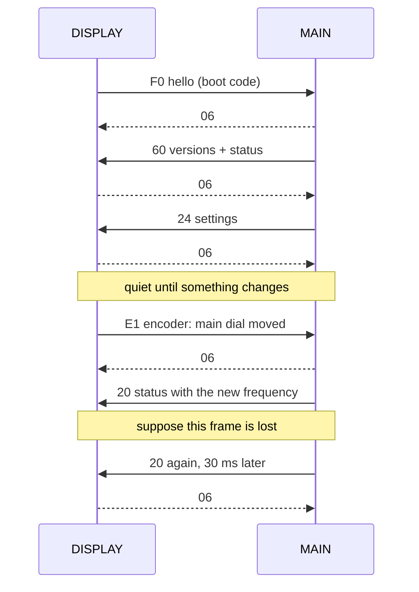

*Figure 2.3 — A typical exchange. Every frame waits for its ACK; a lost frame is sent again.*

A few details make the link robust:

- **MAIN** waits 30 ms for the ACK, retries up to 3 times, then gives up on that frame. It checks every incoming checksum and answers a bad
  one with NAK.
- **The DISPLAY** waits about 10 ms, retries up to 3 times, and resends at once on a NAK. It does **not** check the checksums of MAIN's
  frames; it only checks that the fields are in range.
- **The DISPLAY never loses a dial turn.** While it waits for an ACK, new encoder steps pile up in a queue. When the queue is full, the
  steps are added together. Fast turns get merged, not dropped.
- **MAIN only sends what changed.** It builds each frame in a scratch buffer and sends it only if it differs from the last one sent.
- The DISPLAY keeps its own frames at least ~3 ms apart *(inference)*.

During a firmware update this link also carries tunnel frames: `Z` frames with a 16-bit length for the DSP, and `FD`/`FE` frames for the
FPGA, which MAIN relays. Chapter 4 covers that.

### 2.3 MAIN → FPGA and MAIN → DSP: register frames

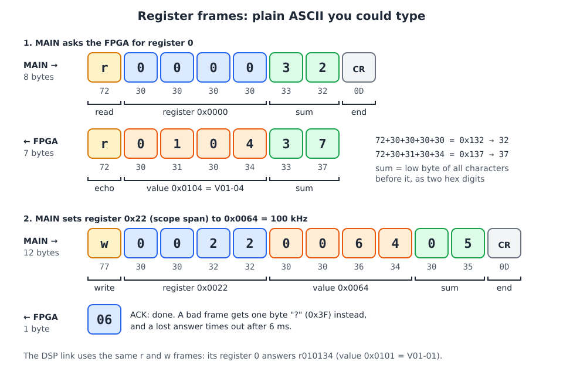

*Figure 2.4 — The register protocol is plain ASCII. Reading FPGA register 0 returns 0x0104, the SDR firmware version V01-04.*

MAIN talks to the FPGA (on its UART number 5) and to the DSP (UART 4) with the same tiny protocol. Both links run at 115,200 bit/s, 8N1.
Every register holds a 16-bit word, and every command is a line of ASCII:

- **Read:** `r` + 4 hex digits of register number + 2 hex digits of checksum + CR, 8 bytes in all.
  The answer is `r` + 4 hex digits of value + 2 hex digits of checksum, 7 bytes and no CR.
- **Write:** `w` + 4 hex digits of register + 4 hex digits of value + checksum + CR, 12 bytes. The answer is the single byte `06`.
- **Checksum:** the low byte of the sum of every character before it, written as two upper-case hex digits.
- Anything the other side does not like (bad checksum, wrong length, unknown letter) gets the single byte `?` (0x3F).

**Worked example: what version is the FPGA?** At power-on MAIN releases the FPGA's reset, waits one second for it to load its
bitstream, and sends `r000032` CR. The checksum is `r` (0x72) + four `0` (0x30 each) = 0x132, so the low byte is 0x32 and the two digits
are `3` `2`. The FPGA answers `r010437`: the value `0104`, and checksum 0x72 + 0x30 + 0x31 + 0x30 + 0x34 = 0x137, so `37`. MAIN turns
0x0104 into the text "V01-04" and shows it as the SDR version. This exact exchange was reproduced by simulating the FPGA's recovered
logic, and MAIN's own code computes the same frame.

**Worked example: change the scope span.** You set the scope to 100 kHz. MAIN's scope-span register is 0x22 and the value is the span in
kHz, so MAIN sends `w0022006405` CR, and the FPGA answers `06`.

Some differences between the two links:

- **The DSP needs a wake-up line first.** The RT685's M33 core runs a small text console on this UART, meant for humans, with echo and
  prompts. MAIN first sends `i DB00` CR, which switches the console into "[machine mode](#glossary)" with no echo and no prompt. After that the frames
  are the same. The DSP's register 0 answers 0x0101 (V01-01). Register 1 bit 0 says "DSP ready".
- **The DSP's registers live in shared memory.** The M33 stores each value in a 32K-word register file in on-chip RAM, and the HiFi4
  reads its settings from there.
- **The FPGA has a second, debug UART** on the module connector. It prints a prompt `[IF]>` and takes typed `r`/`w` commands. MAIN does
  not use it.
- **MAIN reads very little.** From the FPGA it reads only registers 0 and 1, once at boot. From the DSP it reads the version and, during
  steady receive or transmit, status registers 1–4 every 20 ms. Those carry the S-meter level, the compression level, the CW tuning
  offset, VOX and CTCSS detection *(inference for the meanings)*.

The [service CAT commands](#glossary) `SPSR`/`SPSW` (FPGA) and `SPDR`/`SPDW` (DSP) send these same frames from a PC. The write forms change the
radio's hardware settings live, so this guide never sends them; see chapter 5.

### 2.4 The shadow-register idea

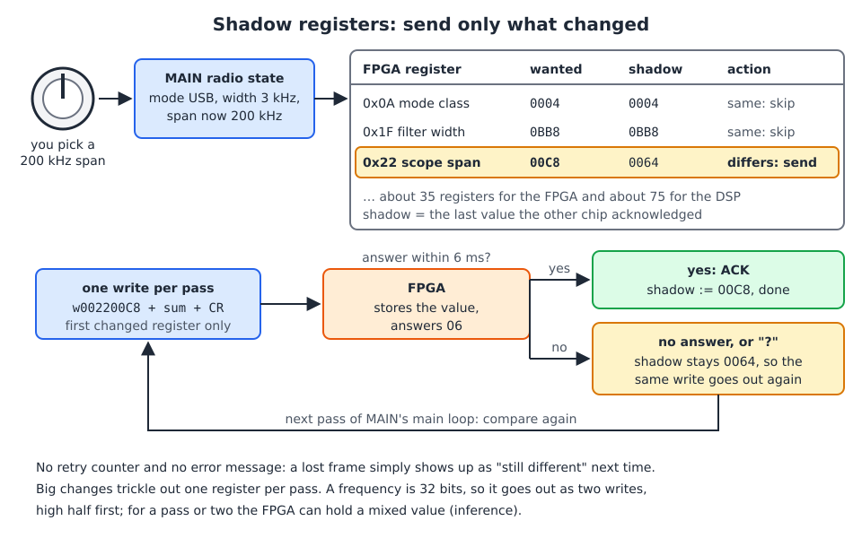

*Figure 2.5 — MAIN keeps a copy of what each remote register should hold and sends a write only where the copy and the wanted value differ.*

How does MAIN keep about 35 FPGA registers and about 75 DSP registers in step with the radio without flooding the links? It keeps a
**shadow copy** of every register it manages: the last value the other chip acknowledged. On every pass of its main loop, MAIN does this
for each link:

1. Walk through the list of registers in a fixed order. For each one, compute the value it *should* hold from the radio state (mode,
   frequency, menu settings).
2. At the first register where that value differs from the shadow, send one write and stop. **At most one frame per link per pass.**
3. On a later pass, look at the answer. `06` → copy the value into the shadow. No answer within 6 ms, or `?` → leave the shadow alone.

Step 3 is the whole error-handling story. A lost write leaves the shadow "still different", so the same write simply goes out again on a
later pass. There is no retry counter and no error message in normal running.

It has some visible side effects:

- A big change, such as a new mode, trickles out **one register per pass**. A CAT command, a dial turn or a mode change reaches the FPGA,
  the DSP and the DISPLAY a few passes later, one register at a time *(inference from the structure)*.
- Frequencies are 32 bits, so they take two writes, high half first. For a pass or two the FPGA can hold a mixed value *(inference)*.
- Some registers are skipped while transmitting, and the switch between receive and transmit waits until the RX/TX lines have settled.
- A value poked in with the `SPSW` service command is not copied into the shadow. It stays only until the radio's own value for that
  register changes and the shadow logic overwrites it *(inference)*.

The DISPLAY link uses the same rule for whole frames: MAIN sends a status frame only when it differs from the last one sent. Nothing ever
arrives unasked from the FPGA or the DSP. Everything MAIN learns from them, it polls.

### 2.5 The DISPLAY's SPI data links

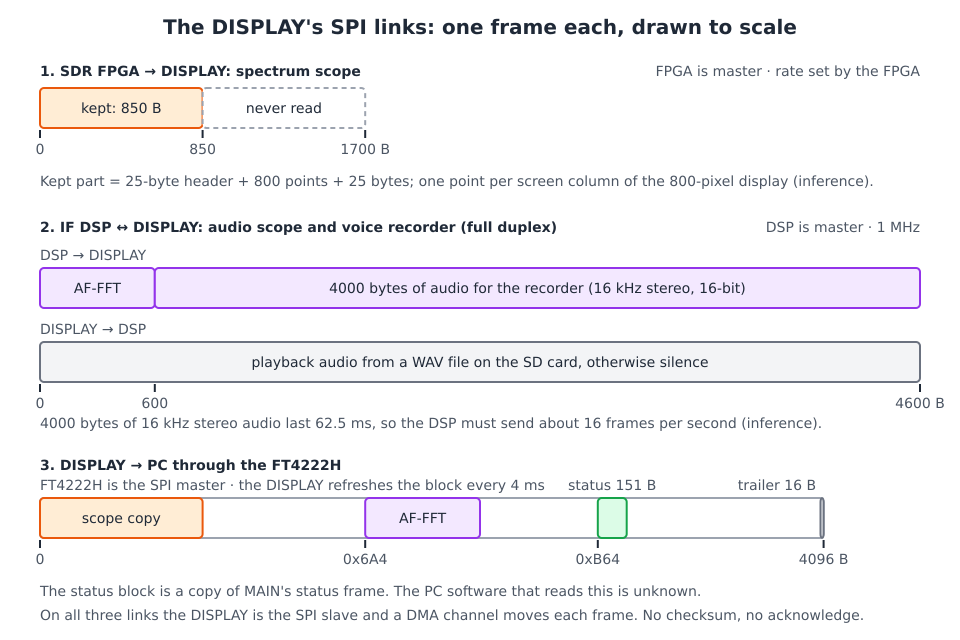

*Figure 2.6 — The three SPI frames the DISPLAY handles, drawn to the same byte scale.*

The control links are slow. The real data travels over SPI, and in normal running the DISPLAY is the **slave** on all three SPI links.
The other side drives the clock and the frame-select line, and the DISPLAY moves each frame into memory with a [DMA](#glossary) channel. There is no
checksum and no acknowledge on any of them.

- **Scope from the FPGA.** The FPGA pushes 1700-byte frames. The DISPLAY keeps the first 850 bytes: a 25-byte header, 800 one-byte
  points and 25 more bytes. That is one point per column of the 800-pixel screen *(inference)*. It never reads the other half. Each point
  row is also pushed into a history ring, which draws the waterfall *(inference)*. MAIN only sets the scope's centre, span and level over
  its UART. The spectrum data itself goes **straight from the FPGA to the DISPLAY**. Nothing in the DISPLAY firmware fixes the frame rate.
- **Audio scope and recorder from the DSP.** The RT685 drives a full-duplex 1 MHz link with 4600-byte frames each way. Towards the DISPLAY:
  a 600-byte audio spectrum (AF-FFT) record plus 4000 bytes of 16 kHz stereo audio for the voice recorder, saved as WAV on the SD card.
  Towards the DSP: playback audio from a WAV file, or silence. At 16 kHz stereo, 4000 bytes last 62.5 ms, so the DSP must send about 16
  frames a second *(inference)*.
- **Copy to the PC.** The [FT4222H](#glossary) USB bridge is the master on this link. Every 4 ms the DISPLAY refreshes a 4096-byte block with copies of
  the scope record, the AF-FFT record and a 151-byte status block, ending in a fixed trailer. The block is not double-buffered, so the PC
  can get a frame that mixes two refreshes *(inference)*.

In one case the DISPLAY becomes a master: during an SDR update it switches the scope link around and sends the new FPGA image to the
module over the same pins, in 4 KB blocks at about 2 MHz (chapter 4).

### 2.6 Reset and update wires

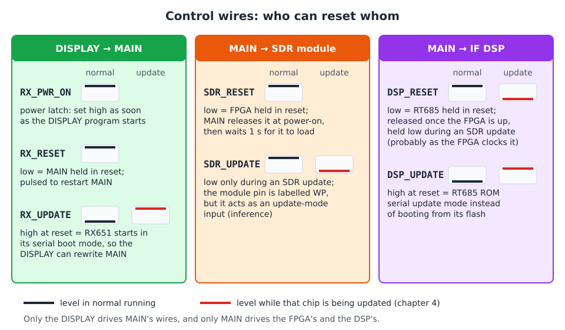

*Figure 2.7 — The reset and boot-mode wires, with their levels in normal running (black) and during an update of that chip (red).*

Next to the data links run a few plain wires. Each chip that can be updated has a **reset** wire and a **boot-mode** wire, and its "boss"
drives both:

- **DISPLAY → MAIN.** `RX_PWR_ON` is MAIN's power latch, set as soon as the DISPLAY program starts. `RX_RESET` holds MAIN in reset while
  low. `RX_UPDATE` high at reset starts the RX651 in its built-in [serial boot mode](#glossary), which is how the DISPLAY rewrites MAIN's flash over the
  same UART they normally talk on.
- **MAIN → FPGA.** `SDR_RESET` holds the FPGA in reset while low. MAIN releases it at power-on and gives the FPGA 1 s to load. `SDR_UPDATE`
  is high in normal running and low only during an SDR update. The module pin it drives is labelled `WP`, but MAIN holds it low exactly
  while the image is written, so it cannot be a plain flash write-protect. It works as an "update mode" input to the FPGA *(inference)*.
- **MAIN → DSP.** `DSP_RESET` holds the RT685 in reset while low. MAIN releases it after the FPGA is up, because the FPGA supplies the
  DSP's clock *(inference for the reason)*. For the same reason MAIN holds the DSP in reset during an SDR update. `DSP_UPDATE` high at
  reset starts the RT685's ROM serial-update mode instead of booting from its flash.

The full power-on order (DISPLAY → MAIN → FPGA → DSP) is in chapter 3, and what each wire does during an update is in chapter 4.

### 2.7 When a link is down

Each link copes with silence in its own way:

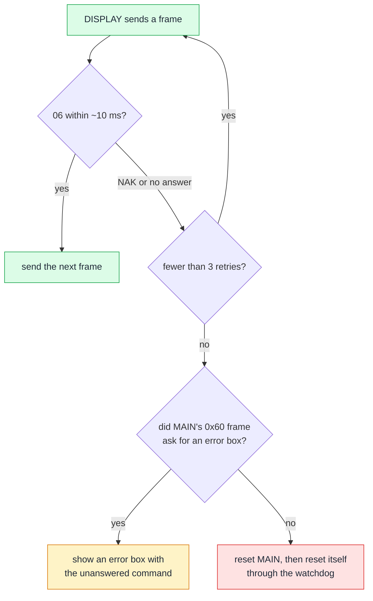

*Figure 2.8 — The DISPLAY's reaction when MAIN stops answering: three retries, then an error box or a full restart.*

- **DISPLAY ↔ MAIN.** The DISPLAY takes it seriously (figure 2.8). After three failed retries it either shows an error box with the
  unanswered command in hex, or resets MAIN and then itself. MAIN is more relaxed. After three retries it drops the frame. If the dropped
  frame was its answer to the hello, it marks the link as down.
- **MAIN → FPGA.** If the FPGA does not answer its two version reads at boot, MAIN records boot error 3 and carries on. How the radio
  shows that error is still open. In normal running there is no error at all: missing ACKs just leave the shadows different, and MAIN keeps
  re-sending.
- **MAIN → DSP.** The same idea. If the DSP does not answer at boot, or its "ready" bit is not set on the first try, MAIN records boot
  error 2 and carries on. The register writes keep running, so the link recovers by itself if the DSP answers later.
- **SPI links.** There is nothing to retry. The scope and DSP links re-arm on every frame-select edge and count overrun errors. The PC link
  re-synchronises after 50 ms of silence. A DISPLAY routine that would restart the scope link exists but is never called.

### 2.8 Where to look

- Overview of all links and the protocol summary table: [../code/system.md](../code/system.md) §2.1, §3.
- DISPLAY ↔ MAIN: MAIN side [../code/main/display-link.md](../code/main/display-link.md) (`displink_task`, frame tables, F0 boot
  codes); DISPLAY side [../code/display/mainlink.md](../code/display/mainlink.md) (`mainlink_submit`, retry rules, command table at
  0x20450074). UART settings: [../code/main/sci.md](../code/main/sci.md) (SCI1 SMR 0x08 / BRR 10).
- MAIN → FPGA: [../code/main/sdr-link.md](../code/main/sdr-link.md) (`sdr_task`, `sdr_send_frame`, register map, `sdr_init`, GPIOs P76/P77);
  FPGA side [../code/sdr/interfaces.md](../code/sdr/interfaces.md) (J2002 pin map) and [../code/sdr/netlist.md](../code/sdr/netlist.md) §5
  (the `r000032` → `r010437` simulation).
- MAIN → DSP: [../code/main/dsp-link.md](../code/main/dsp-link.md) (`dsp_link_poll`, `dsp_link_init`, register tables, status reads);
  DSP side [../code/ifdsp/control-link.md](../code/ifdsp/control-link.md) (`console_rx_char`, machine mode, register file at 0x20070000).
- SPI links: [../code/display/spi-links.md](../code/display/spi-links.md) (RSPI2 scope, RSPI4 DSP, RSPI0 FT4222H).
- Wires: P7_9 `RX_PWR_ON`, P7_10 `RX_RESET`, P4_3 `RX_UPDATE` on the DISPLAY; P77 `SDR_RESET`, P76 `SDR_UPDATE`, P71 `DSP_RESET`,
  P72 `DSP_UPDATE` on MAIN ([../hardware.md](../hardware.md), [../code/main/sdr-link.md](../code/main/sdr-link.md#gpios)).
- Boot errors: `boot_error` at 0x20B36 (3 = FPGA, 2 = DSP).

## 3. A day in the life of the radio

**In short.** This chapter follows the radio through an ordinary day, from switching on to switching off. On the way it shows what each of the
four chips does when you turn the knob, change band, press PTT, look at the scope and listen to audio. Most of the time the same pattern
repeats. The DISPLAY chip reads what you touch and sends it to MAIN. MAIN updates its copy of the radio state. On its next passes through
its loop, MAIN pushes the changed values to the FPGA, the DSP and the DISPLAY, one small message at a time. Two kinds of data skip MAIN
completely: the spectrum for the scope and the audio for recordings. Both travel straight from the FPGA or the DSP to the DISPLAY over SPI.
Chapter 2 explains the links and their frame formats; this chapter only refers to them.

### 3.1 Switching on

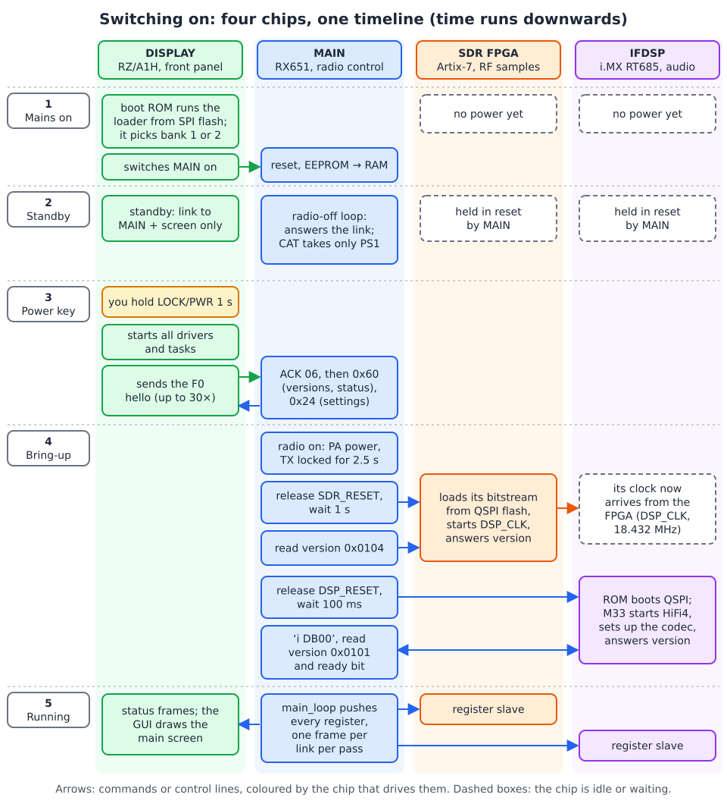

*Figure 3.1 — Power-on as a timeline. The DISPLAY wakes first and switches MAIN on. MAIN waits for the power key, then releases the FPGA and,
one second later, the DSP.*

**Mains on.** When DC power arrives, only the DISPLAY ([RZ/A1H](#glossary)) starts on its own. Its boot ROM runs a small loader from its
SPI flash. The loader checks the flag blocks of the two firmware banks and starts the first one marked valid, bank 1 first (chapter 4
explains why there are two). The DISPLAY firmware then switches MAIN's power on and releases MAIN's reset line.

**Standby.** MAIN ([RX651](#glossary)) starts from reset, sets up its timers and copies the whole settings [EEPROM](#glossary) into RAM
before anything else runs. It then sits in a small "radio off" loop. In that loop it only services the DISPLAY link and the CAT ports, and
the CAT parser accepts nothing but `PS1;`. While it starts, MAIN also holds the FPGA and the DSP in reset. The DISPLAY, meanwhile, runs in
a reduced standby mode: just the link to MAIN and the screen code. That MAIN runs during standby is an *(inference)* from the order of the
pin writes; the code does not say so in words.

**The power key.** Holding LOCK/PWR for about one second wakes the DISPLAY fully. It starts every driver and task (touch panel, SD card,
encoders, SPI links). It then sends MAIN the `F0` "hello" frame, up to 30 times, until MAIN answers with an ACK. The hello carries the
DISPLAY's version. One byte in it reports any key combination held at power-on; those combinations start hidden service modes (chapter 8).
MAIN answers with a `0x60` frame (all four firmware versions and status) and a `0x24` settings frame. Only now does MAIN mark the radio as
"on". The pages assume that the DISPLAY sends the hello only after the power key *(inference)*.

**Bring-up.** MAIN then starts the rest of the radio, in a fixed order:

1. It sets its port outputs for the "on" state, including PA power. It starts a 2.5 s timer; until it runs out, MAIN ignores PTT.
2. It releases the FPGA's reset and waits one second. The FPGA ([XC7A50T](#glossary)) loads its [bitstream](#glossary) from its own QSPI
   flash and starts `DSP_CLK`, an 18.432 MHz clock. MAIN reads the FPGA's version register (0x0104 for V01-04).
3. It releases the DSP's reset and waits 100 ms. The RT685's boot ROM starts the M33 core from QSPI. The M33 sets up the audio
   [codec](#glossary) and starts the HiFi4 DSP core. MAIN sends `i DB00` to switch the DSP console into machine mode, reads the version
   (0x0101) and waits for a "ready" bit.

The FPGA comes first for a reason. The RT685's only clock input is `DSP_CLK` from the FPGA, so the DSP cannot run before the FPGA has
loaded *(inference)*. If either chip does not answer, MAIN records a boot error and carries on. How that error is shown on screen is still
open.

**Running.** MAIN enters `main_loop`, a polled loop of 16 tasks with no operating system. On its first passes it finds every remote
register different from what it wants, so it writes them all: FPGA registers over one UART and DSP registers over another. The DISPLAY
starts receiving `0x20` status frames and draws the main screen.

### 3.2 Switching off

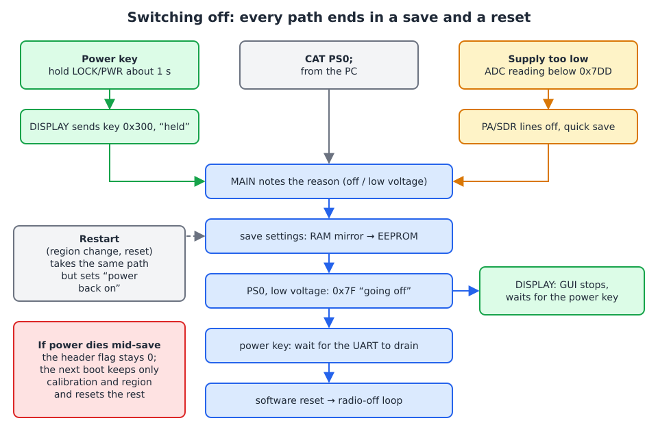

*Figure 3.2 — The three ways to switch off all end in the same place: MAIN saves and resets itself. The `0x7F` "going off" frame to the
DISPLAY is sent on the PS0 and low-voltage paths only; the power-key path skips it.*

There are three ways to switch the radio off:

- **The power key.** Holding LOCK/PWR for about a second reaches MAIN as a "held" key event (key code 0x300). MAIN saves its operating
  state to the EEPROM, waits for the DISPLAY UART to drain and then resets itself.
- **CAT `PS0;`.** MAIN records "power off" as the reason and raises a "shut down" request. On its next pass, the DISPLAY-link sender sees
  the request, sends a `0x7F` frame that tells the DISPLAY why it is going down, saves all settings to the EEPROM and resets.
- **Supply too low.** MAIN measures the 13.8 V supply on one input of its ADC. When the reading drops below a fixed threshold, it switches
  off the PA power and the lines to the SDR module, saves its operating state once, and then raises the same request as `PS0;` with a
  "low voltage" reason. That path sends the `0x7F` frame too, but waits two seconds instead of saving a second time.

The `0x7F` frame makes the DISPLAY's GUI leave its drawing loop and wait for the power key. The power-key path does not send it: the key
press came from the DISPLAY in the first place *(inference for how the DISPLAY copes without it)*. MAIN's "power off" is really a CPU **software reset**. After the reset, MAIN is back in the "radio off" loop of
section 3.1 and waits for the next hello. A **restart** (after a region change, a factory reset and similar) takes the same path. The only
difference is a saved "power back on" flag, so the next hello switches the radio straight back on *(inference for the flag's meaning)*.

> **What if power dies mid-save?** Each save first writes a "write in progress" flag into the EEPROM header and clears it at the end. If a
> boot finds the flag still set, MAIN throws away all user settings and keeps only the factory calibration and the region code. Chapter 6
> has the details.

### 3.3 Turning the knob or pressing a key

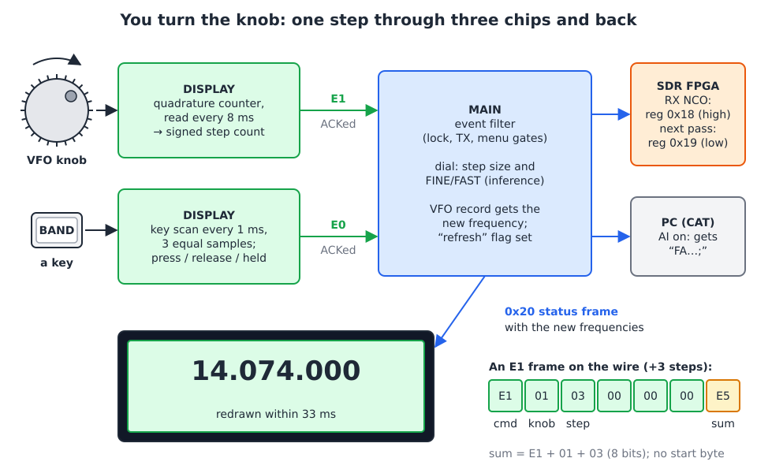

*Figure 3.3 — One step of the VFO knob crosses three chips. The byte strip is an example `E1` frame for +3 steps of the main dial.*

You turn the VFO knob by a few clicks. Here is what happens:

1. **The DISPLAY counts.** The knob is a quadrature encoder wired to a hardware counter in the DISPLAY chip. Every 8 ms a task reads the
   counter and works out the signed change since the last read. The DISPLAY applies no acceleration and no step size. It sends the raw count.
   (A USB mouse wheel on the main screen is sent as its own knob number, and MAIN tunes with it just like the main dial.)
2. **An `E1` frame goes to MAIN.** The frame carries the knob number and the step count. MAIN must ACK it before the DISPLAY sends the next
   one. If you spin the knob while an ACK is still pending, the DISPLAY adds the new steps to a queue and merges them (up to ±127), so no
   steps are lost. They are only combined.
3. **MAIN applies the step.** MAIN passes the event through a filter that can refuse it, for example while keys are locked. It then applies
   the tuning step and the FINE/FAST setting *(inference: this happens in MAIN because the DISPLAY sends raw counts)*. It writes the new
   frequency into the **operating record** of the active VFO and sets a "refresh" flag.
4. **The FPGA is retuned.** On the next pass of `main_loop`, the SDR task compares the wanted RX [NCO](#glossary) value with its shadow copy.
   The value is too wide for one register, so it goes out as two writes, register 0x18 (high half) and then 0x19 (low half), on two separate
   passes. For a pass or two the NCO can hold a mix of old and new halves *(inference for the effect)*. In CENTER scope mode the scope
   centre (registers 0x20/0x21) follows as well.
5. **The screen catches up.** The DISPLAY-link task recomputes MAIN's frequency cache and sends a `0x20` status frame with the new
   frequencies. The DISPLAY keeps the latest frame as a snapshot. Its GUI loop wakes every 33 ms, compares the snapshot with what is on
   screen and redraws what changed.
6. **The PC hears about it.** If a CAT port has Auto Information on, MAIN sends `FA…;` to it (chapter 5).

The DSP is not told the frequency. The only frequency-dependent DSP write is a calibration value that changes when you cross into another
frequency range.

**Pressing a key** works much the same way. A task scans the keys every millisecond. A key counts as pressed after three equal samples. The
DISPLAY sends an `E0` frame with the key code and one of three actions: press, release, or held (after about one second). MAIN's
filter can refuse the key (a refused press gives a short beep). Otherwise `key_task` looks the code up in large handler tables: one each
for press, short press, long press, repeat and release. Only one event waits at a time; a second event that arrives before `key_task` runs
replaces the first. Touching the spectrum on the screen is a key event too: MAIN turns the touch position into a frequency and tunes there
*(inference, high)*.

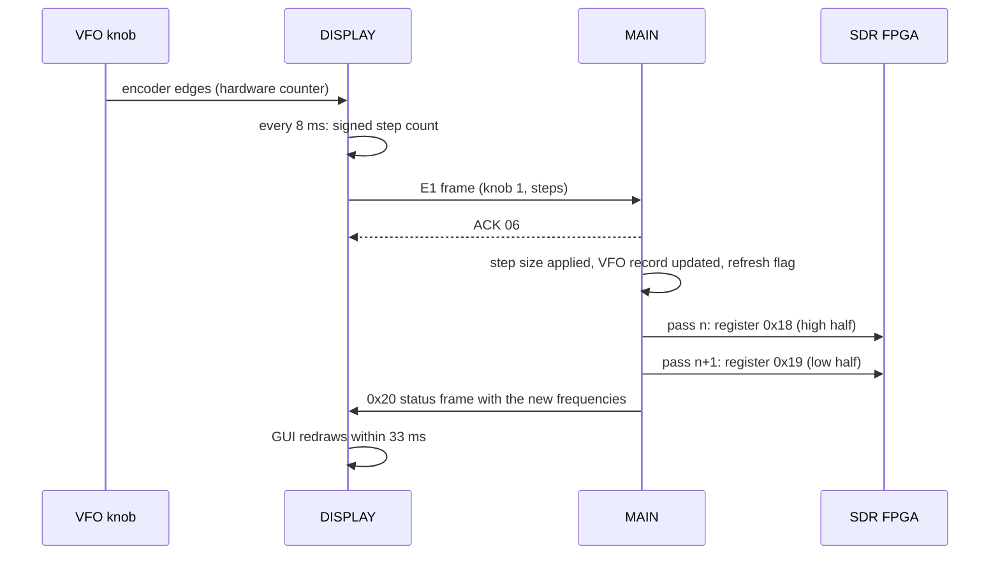

### 3.4 Changing band or mode, and how the radio remembers

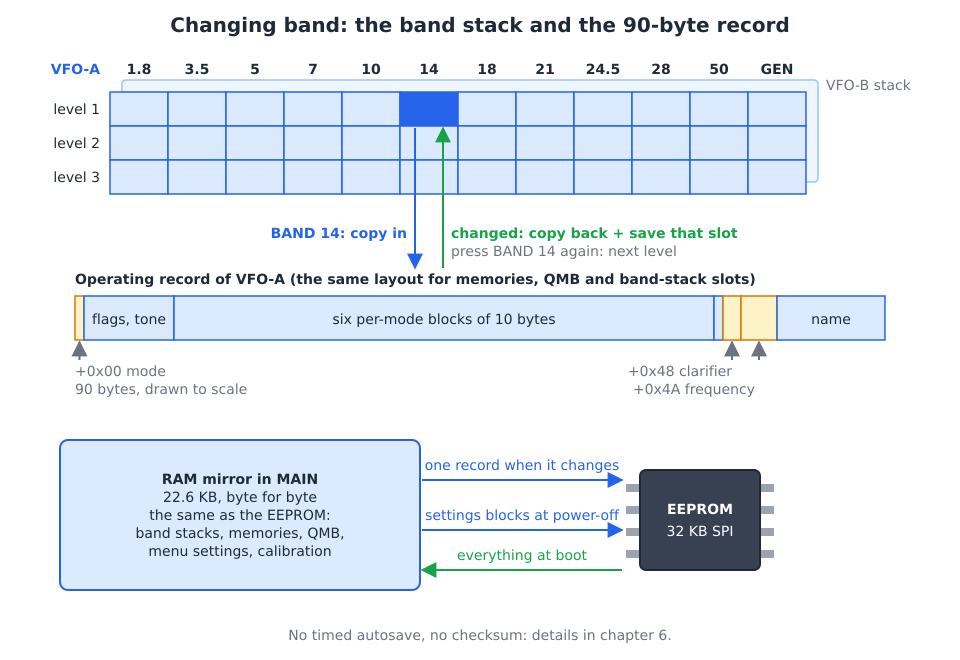

*Figure 3.4 — Each VFO has a band stack of 3 levels × 12 bands. Every cell holds one 90-byte record, the same layout as a memory channel.*

**Everything is a 90-byte record.** Each VFO (A and B) has one **operating record** of 90 bytes. It holds the mode, flags, tone settings,
six blocks of per-mode settings, the clarifier offset, the frequency in Hz and a 12-character name. Memory channels, [QMB](#glossary)
slots and band-stack entries all use the same layout. "Recalling" anything means copying 90 bytes into the operating record, and
"storing" means copying them back out.

**Changing band.** Each VFO has a [band stack](#glossary): 12 bands (1.8 MHz to 50 MHz, plus GEN) with 3 levels each. When you press a
band key, MAIN first writes the current record back into its band-stack slot. It then copies the slot of the new band into the operating
record, checks the frequency against the 30 kHz–75 MHz limits and clears split. If you press the same band key again and the BAND STACK
setting is on, it steps to the next of the three levels *(inference for the menu name)*. Tuning across a band edge also moves the record
into the new band's slot, so the stack follows the VFO by itself.

**Changing mode** is a change to the mode field of the operating record. Many FPGA and DSP registers depend on the mode: the RX NCO offset
(for example ±1500 Hz in SSB, or the CW pitch), the filters, the demodulator and the AGC. Each of these has its own "change detector" in
MAIN's loop. They notice the new mode and send their registers over the next few passes, one per pass per link (system flow in
[../code/system.md](../code/system.md#61-cat-command-round-trip-with-ai)).

**Remembering.** MAIN keeps a byte-for-byte **mirror** of the EEPROM in RAM: about 22.6 KB of settings, band stacks, memories, QMB slots
and the factory calibration. All code works on the RAM copy. The firmware writes to the EEPROM in two situations only:

- **One record when it changes:** a memory channel, a band-stack slot, a QMB slot, a keyer message or a tuner memory.
- **Whole blocks when the radio goes down:** power off, a restart, or a power failure.

There is no timed autosave and no checksum. Chapter 6 describes the EEPROM map and the reset paths.

### 3.5 Transmitting

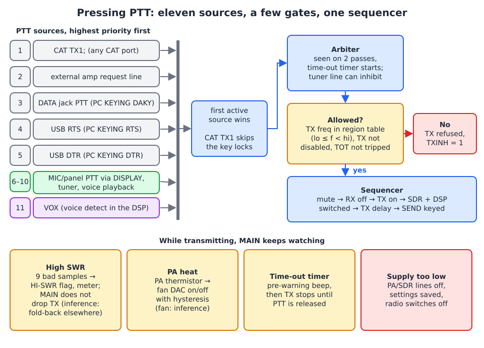

*Figure 3.5 — Many PTT sources, one winner. The request has to pass the arbiter and the "allowed?" check before the sequencer keys the
transmitter. Below: what MAIN watches during TX.*

**PTT sources.** MAIN collects eleven PTT sources into one flag each and picks the first active one in a fixed priority order. CAT `TX1;`
comes first. Next are the external amplifier's request line, the DATA jack PTT and the RTS or DTR line of the USB "Standard" port; the
PC KEYING setting decides which of those three is live. After them come a group set by other code: MIC and front-panel PTT reported by
the DISPLAY, tuner code, and voice-memory playback *(inference for which code owns which flag)*. VOX comes last. It uses a voice-detect
bit that MAIN reads from the DSP. In CW modes the DATA/RTS/DTR line acts as a CW key, not a PTT.

`TX1;` skips the key-lock filter that front-panel keys go through. That is why CAT can transmit even when the panel keys are locked.

**The gates.** The **arbiter** wants to see the source on two passes in a row. It then starts the TX time-out timer (TOT). An external
tuner can hold TX off through its inhibit line. Before the sequencer starts, the **allowed?** check runs. It refuses TX if a "TX
disabled" setting or calibration byte is set, if CAT has been disabled from the DISPLAY, or if the TOT has tripped. Then it looks up the
TX frequency in the **region table** chosen by the radio's destination code. A row allows TX when `lo <= f < hi`. If TX is refused,
MAIN raises the `TXINH` line, and if the radio was transmitting, it starts the switch back to RX.

**The US 60 m quirk.** The US table lists the 60 m channels as single frequencies, rows with `lo == hi`. The figure below shows why such a
row can never pass a `lo <= f < hi` test. The code has an extra check for the 60 m channel memories, but it only runs after a row has
matched, which never happens. As written, **60 m TX in the US table appears never to be allowed** *(inference)*. This needs an on-air test,
and that must not be done without the owner's approval.

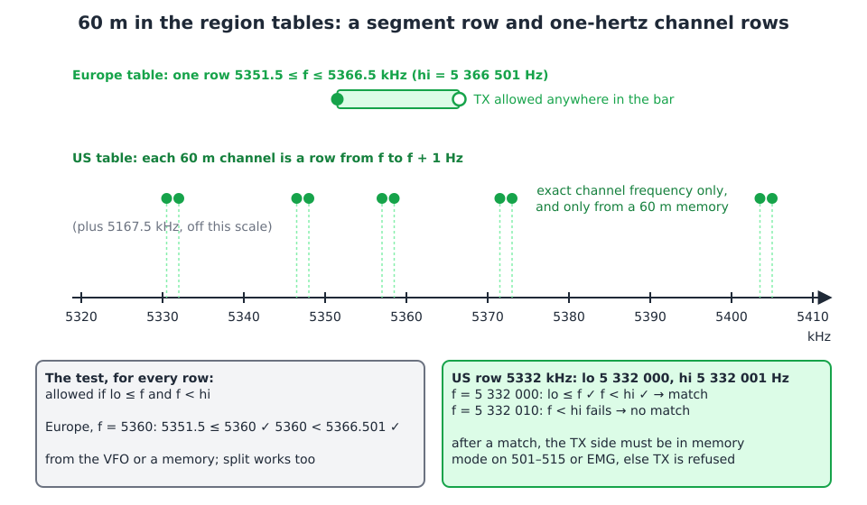

*Figure 3.6 — A range row passes the test; a single-point row cannot, because no f is both ≥ 5332 and < 5332.*

**The sequencer.** Once the request is allowed, the RX/TX sequencer steps through its states. Each step waits for a short soft timer,
a few milliseconds long:

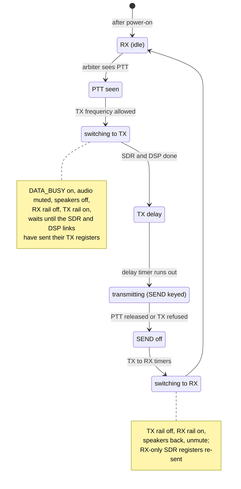

The SEND lines can never come on before the TX rail: SEND is forced low while the TX line is low or the tuner's inhibit line is
high. The links play their part too. While TX is starting, the SDR task writes the TX NCO, drive level, scope and other TX registers, and
the DSP link switches its register group to TX. The sequencer moves on only when both report done (that these are the two flags it waits
for is an *(inference)*). Then the audio path of section 3.7 runs the other way: mic → codec → DSP → FPGA → PA. While transmitting, the
DISPLAY gets status frames with the TX state.

**What MAIN watches during TX.**

- **High SWR.** MAIN samples forward and reflected power every 5 ms. Nine bad samples in a row (SWR outside 1 to 5) set a HI-SWR flag
  that blinks the indicator and is reported over CAT. MAIN itself does **not** drop TX on high SWR. Power fold-back probably happens
  elsewhere, in the DSP or display side or through the [ALC](#glossary) *(inference)*.
- **PA temperature.** A thermistor reading switches a PA-unit DAC channel between a fixed level and zero, with hysteresis. That this channel drives the fan
  is an *(inference)*.
- **Time-out timer.** It gives a warning beep first, then blocks TX until PTT is released.
- **Supply too low.** This is the power-off path of section 3.2.

**Back to RX.** Releasing PTT does not drop TX at once. VOX waits for its hang time, and CW-type sources wait for the break-in delay. Then
the arbiter starts the TX→RX sequence. It runs the same steps in reverse, and once the TX line is down, the RX-only FPGA registers
(filters, noise blanker, notch, RX NCO) are written again.

### 3.6 The scope and the waterfall

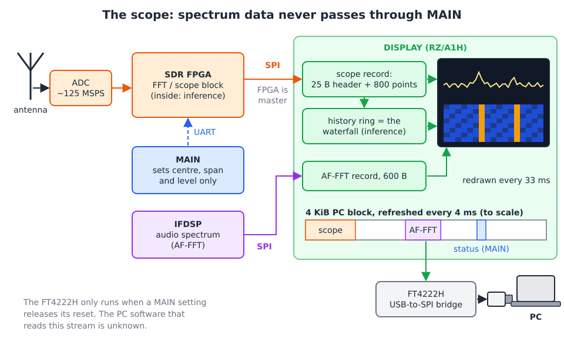

*Figure 3.7 — Spectrum data goes from the FPGA straight to the DISPLAY. MAIN only sets the scope's centre, span and level. The 4 KiB PC
block is drawn to scale.*

The band scope is the clearest case of data that never touches MAIN:

1. **MAIN sets it up.** Over its UART to the FPGA, MAIN writes the scope centre (registers 0x20/0x21), the span and the level. In CENTER
   mode the centre follows the dial; in FIX and CURSOR modes it comes from a stored start frequency per band *(inference for the mode
   names)*. During TX it uses a different value.
2. **The FPGA computes the spectrum** from the ADC samples. Its block RAM holds FFT-style phase and twiddle tables; that this is how the
   scope works inside is an *(inference)*.
3. **The FPGA pushes frames to the DISPLAY over SPI.** Here the FPGA is the SPI master. Each frame is 1700 bytes, and the DISPLAY keeps the
   first 850: a 25-byte header and 800 points. That one point is one screen column is an *(inference)*. No DISPLAY code sets the frame rate.
4. **The DISPLAY draws it.** Each record also goes into a history ring, which is most likely the waterfall *(inference)*. The GUI draws
   the scope and waterfall in its 33 ms loop. The DSP separately sends an audio spectrum (the AF-FFT, 600 bytes) over its own SPI link;
   the GUI draws that too.

**To the PC.** The DISPLAY also feeds an [FT4222H](#glossary) USB-to-SPI bridge, which sits on the radio's internal USB hub. Every 4 ms it
refreshes a 4 KiB block with the scope record, the AF-FFT record and a 151-byte status block from MAIN. The PC reads that block over USB.
The bridge stays in reset until a MAIN setting releases it. The PC software that uses this stream is not known.

### 3.7 Audio


*Figure 3.8 — Receive and transmit audio both pass through the HiFi4 in 24-sample blocks. The REC branch goes to the DISPLAY and the SD
card.*

**Receive.** The FPGA mixes the wanted signal down with its RX NCO and filters it. It passes the result to the RT685 over [I2S](#glossary).
On the RT685, the HiFi4 DSP core runs a few threads:

- **Rx_Path** handles one block of 24 samples at a time and sends audio to the codec's DAC, then to the speaker or phones.
- **Rx_Audio** collects 12 blocks and runs the receive stages that most of the "RX DSP" settings control.
- **Spi** taps blocks to build the audio spectrum and the recording stream for the DISPLAY.

The codec's DAC clock paces the receive path.

**Transmit** runs the other way. Mic or DATA audio enters the codec's ADC. **Tx_Path** processes it one block at a time and hands it over
I2S to the FPGA, which shifts it up to the TX frequency with its TX NCO and shapes the keying with a raised-cosine ramp *(inference for
the blocks inside the FPGA)*. MAIN's MOD SOURCE setting can select USB audio as the TX source.

**The 12 kHz question.** The DSP code uses the constant 1/12000 to turn hertz into normalised frequency, and it limits one frequency field
to just under 6000 Hz. So the DSP almost certainly runs at **12 kHz**: one 24-sample block every 2 ms, and one Rx_Audio batch every 24 ms
*(inference, strong)*. The DISPLAY, however, writes the REC audio it receives over SPI to the SD card as a **16 kHz** stereo WAV file, and the
link carries the right amount of data for 16 kHz (16 frames per second).

> **Open question.** Both observations are solid, so either the DSP's Spi thread resamples the audio from 12 kHz to 16 kHz before sending
> it, or the WAV header's 16 kHz is only nominal. Settling this needs a closer look at how the HiFi4's Spi thread packs its data.

### 3.8 Where to look

| Topic | Reference pages |
|---|---|
| All end-to-end flows in one place: power on/off, CAT, frequency change, TX key-down, scope | [../code/system.md](../code/system.md) §4 and §6 |
| DISPLAY boot, standby and full start (`task_root`, `boot_mode_full`, `power_on_full_init`) | [../code/display/boot-rtos.md](../code/display/boot-rtos.md), [../code/display/README.md](../code/display/README.md) |
| MAIN boot (`app_main`, `eeprom_load_all`, `sdr_init`, `dsp_link_init`), `main_loop`, power states, `sw_reset` | [../code/main/README.md](../code/main/README.md) |
| The power key, key scan, encoders (`task_key`, `task_detect_renc`, `mainlink_send_enc`), boot key combinations | [../code/display/input.md](../code/display/input.md) |
| MAIN side of keys and encoders (`key_event_filter`, `key_task`, `enc_main_dial`, touch tuning) | [../code/main/ui-keys.md](../code/main/ui-keys.md) |
| DISPLAY link handshake, ACK and retries, how the GUI follows MAIN's frames | [../code/display/mainlink.md](../code/display/mainlink.md), [../code/display/gui.md](../code/display/gui.md) |
| Operating records, band stack, frequency cache, SDR registers 0x08/0x09, 0x18/0x19, 0x20/0x21 | [../code/main/radio-control.md](../code/main/radio-control.md) |
| EEPROM mirror, save triggers, interrupted saves, power fail (`supply_undervolt_check`) | [../code/main/eeprom.md](../code/main/eeprom.md), [../code/main/peripherals.md](../code/main/peripherals.md) |
| PTT sources, `ptt_arbiter`, `tx_freq_allowed`, `trx_sequencer`, SWR and temperature, region tables, 60 m | [../code/main/tx-protection.md](../code/main/tx-protection.md) |
| RT685 boot, HiFi4 threads, 12 kHz blocks, open question C9 | [../code/ifdsp/README.md](../code/ifdsp/README.md), [../code/ifdsp/hifi4.md](../code/ifdsp/hifi4.md), [../code/system.md](../code/system.md#8-contradictions-and-open-questions) |
| FPGA configuration from QSPI and its blocks | [../code/sdr/README.md](../code/sdr/README.md) |
| Scope, AF-FFT, REC/PLAY and FT4222H SPI links | [../code/display/spi-links.md](../code/display/spi-links.md) |

## 4. Firmware files and how updates work

**In short.** Yaesu ships FT-710 firmware as four `.SFL` files, one for each programmable chip. Each file is a short text header
followed by the firmware, scrambled with a fixed 43-byte key and protected by a [CRC-32](#glossary) with a secret "salt". Once
we knew the key, all four files decoded cleanly: MAIN is a list of Motorola [S-records](#glossary), DISPLAY and IFDSP are plain
program images, and SDR is an [FPGA](#glossary) [bitstream](#glossary) written out as hex text. On the radio, the DISPLAY CPU
does all of the updating. It reads the SD card, checks each file's CRC, and then programs every chip itself, using a
different route for each one. The CRC is the only thing it checks on the file as a whole: no signature, no model check.
That is what makes custom firmware possible (chapter 8), and it is also why one part of the MAIN image needs great care.

### 4.1 What Yaesu ships

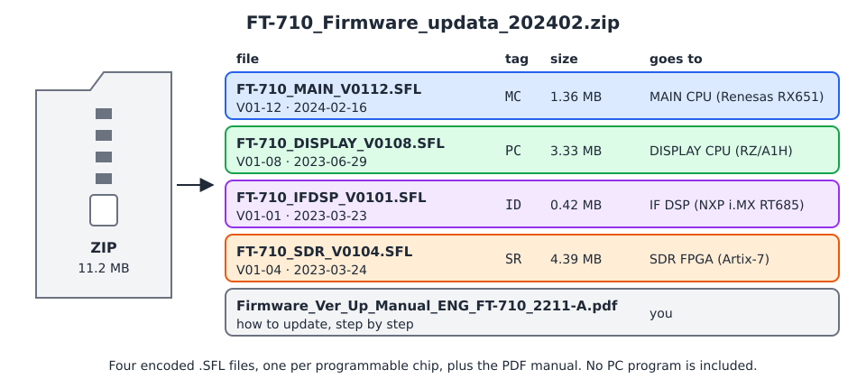

*Figure 4.1 — The 2024-02 update package: one encoded `.SFL` file per chip, plus the update manual.*

The download from yaesu.com is a zip file with five files: four firmware files and a PDF that explains the update steps. There
is no PC program. Everything happens on the radio, from an SD card.

The file names say which chip each file is for, and which version it holds:

- **MAIN** (V01-12) is the control CPU, a Renesas RX651. It handles the radio logic and [CAT](#glossary) commands.
- **DISPLAY** (V01-08) is the front-panel CPU, a Renesas RZ/A1H. It runs the touch screen and the SD card.
- **IFDSP** (V01-01) is the IF signal processor, an NXP i.MX RT685.
- **SDR** (V01-04) is the FPGA on the SDR module, a Xilinx Artix-7.

Inside each file there is also a two-letter tag: `MC`, `PC` ("panel CPU"), `ID` and `SR`. The radio uses the same file format for
the memory-channel and menu backups that it saves to the SD card. Those files carry the tags `MemList` and `Menu`.

### 4.2 Anatomy of an SFL file

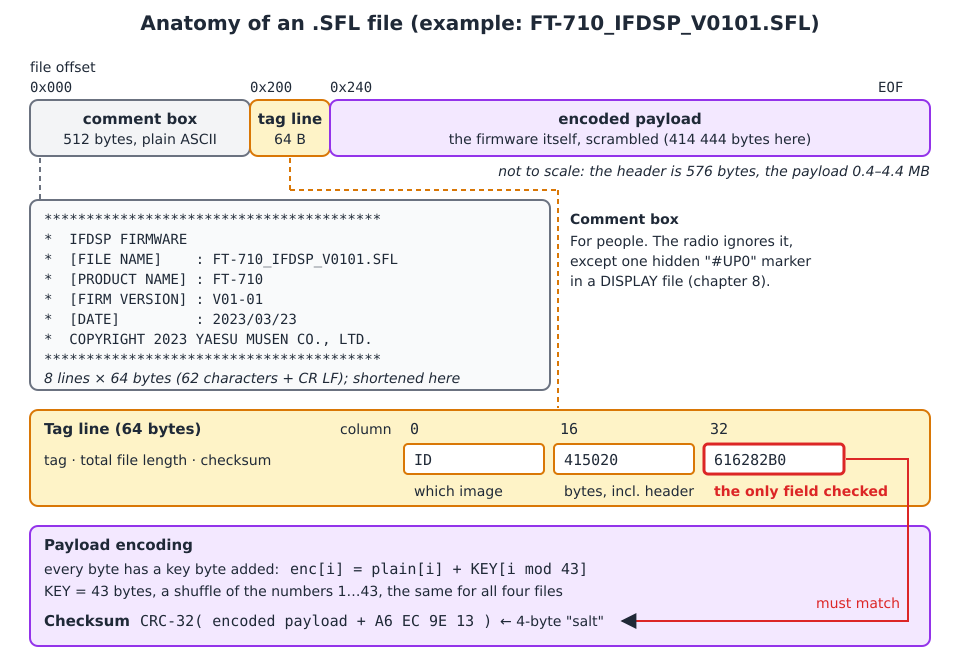

*Figure 4.2 — Every `.SFL` file has the same three parts. Only the checksum in the tag line matters to the radio.*

All four files have the same layout, with fixed sizes, so a program can simply cut them at byte 512 and byte 576:

1. **Comment box** (512 bytes). Eight lines of 62 characters each, framed with `*`. It holds the title, file name, product
   name, version, date and a copyright line. It is plain ASCII, for people to read.
2. **Tag line** (64 bytes). Three fields in fixed columns: the tag (`ID`), the total file length in decimal (`415020`,
   which includes the 576-byte header) and an 8-digit hex checksum (`616282B0`).
3. **Payload** (the rest of the file). This is the firmware, scrambled byte by byte.

The scrambling is simple. Each payload byte has a key byte added to it, and the key repeats every 43 bytes:
`encoded[i] = plain[i] + KEY[i mod 43]` (mod 256). The key is a shuffle of the numbers 1 to 43, and all four files use the
same one. To decode, you subtract.

The checksum is a standard zlib CRC-32, but with a twist. It is computed over the *encoded* payload, and then four extra bytes,
`A6 EC 9E 13`, are fed into the CRC as well. Those four bytes are the [salt](#glossary). Without them, no standard CRC gives
the value in the tag line.

### 4.3 How we cracked it

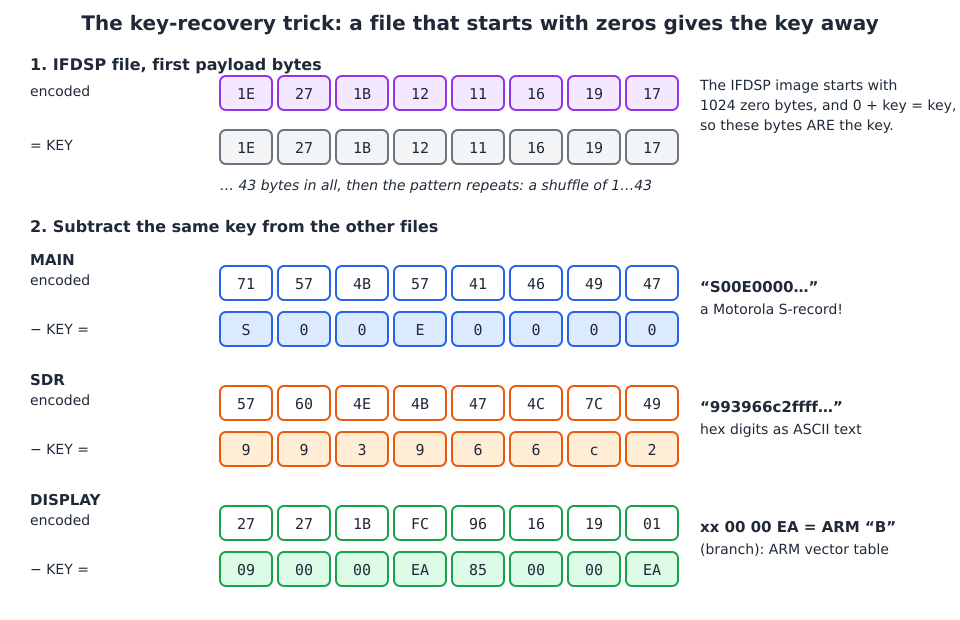

*Figure 4.3 — The key-recovery trick. The IFDSP image begins with zero bytes, so its first 43 encoded bytes are the key itself.*

At first the scrambling looked like a 32-byte pattern, and a long search through CRC variants found nothing that matched the
checksum. The way in was a small hexdump of each payload:

- The **IFDSP** payload started with a run of 43 bytes that repeated. Those 43 bytes were exactly the numbers 1 to 43 in a
  shuffled order. The IFDSP image begins with 1024 zero bytes, and zero plus the key is the key. So the start of the file
  showed the key in the clear.
- The **SDR** file had the same run, shifted up by 0x66 on every byte. 0x66 is the ASCII letter `f`. That showed the key is
  *added* (not XORed), and that the SDR payload is text.
- Subtracting that key from **MAIN** gave `S00E0000…`, the start of a Motorola S-record file. All four files then decoded
  cleanly.

The decoded DISPLAY image held the rest of the answer. Its SD-card loader has a decode routine (the subtraction loop), an
encode routine (the same loop with `+`, used for the backups) and the CRC routine with the 4-byte salt. The 43-byte key is
the first item in its data section. The salt is why the earlier CRC search had failed.

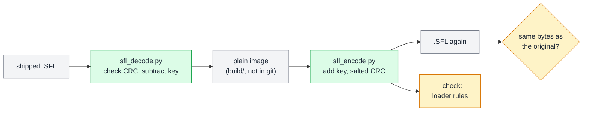

*Figure 4.4 — The tools: decode, encode, and the byte-for-byte round-trip test.*

Three small Python tools in the repo do this work:

- **`tools/sfl_decode.py`** checks the salted CRC (and stops if it is wrong), subtracts the key, and converts each payload into
  something useful: a flat 512 KiB binary for MAIN, the raw image for DISPLAY and IFDSP, and a binary bitstream for SDR.
- **`tools/sfl_encode.py`** does the reverse: it adds the key, writes the tag line and computes the salted CRC. Its `--check`
  option runs a finished file through the same acceptance rules the radio uses (section 4.7).
- **`tools/test_sfl_roundtrip.py`** decodes and re-encodes all four shipped files and checks that the result is identical,
  byte for byte. It passes. So the format is fully understood, with nothing left over.

### 4.4 What is inside each file

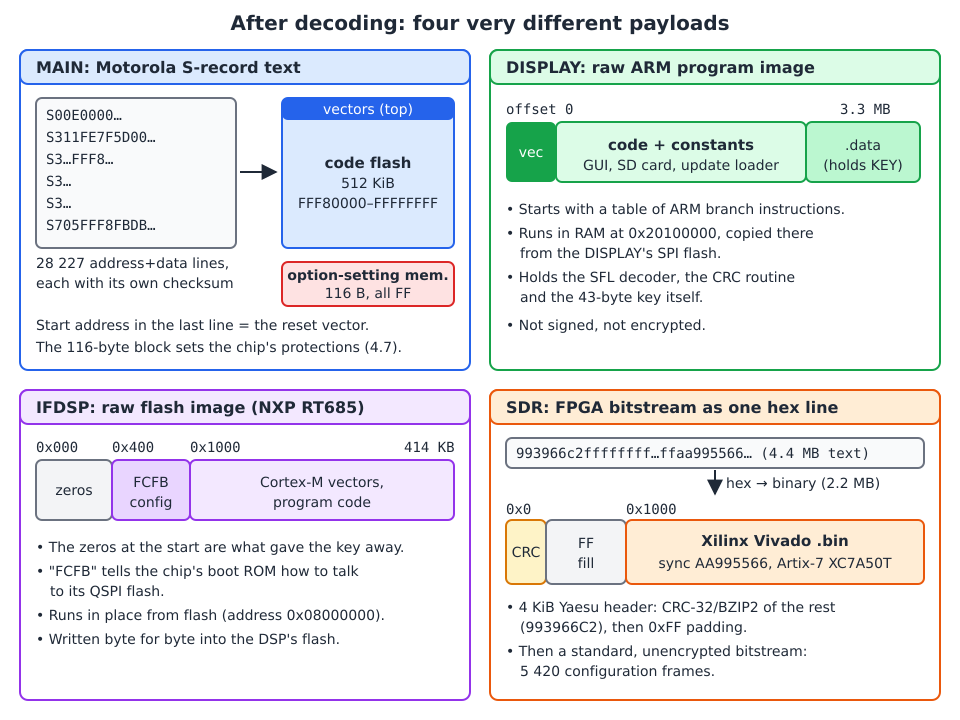

*Figure 4.5 — After decoding, the four payloads are four different formats, each matched to the chip that receives it.*

- **MAIN** is a text file of Motorola S-records: 28 227 data lines, each holding an address, some data bytes and its own checksum.
  They fill the RX651's 512 KiB of code flash, which ends at the CPU's fixed vector table. The last line gives the start
  address, which is the reset vector. There is also one small extra block of 116 bytes, all `FF`, for the chip's
  [option-setting memory](#glossary). That block matters a lot (section 4.7).
- **DISPLAY** is a raw ARM program, 3.3 MB. It starts with a table of ARM branch instructions (the exception vectors). It runs
  in RAM at address 0x20100000, copied there from the DISPLAY's own SPI flash. It contains the whole update machinery
  described in this chapter.
- **IFDSP** is a raw image for the RT685's QSPI flash. It starts with zeros, then a FlexSPI configuration block (marked
  `FCFB`) that tells the chip's boot ROM how to talk to its flash, then the Cortex-M vector table and code. The chip runs it in
  place from flash ([XIP](#glossary)).
- **SDR** is one very long line of lowercase hex digits. Turned into binary it is 2.2 MB: a 4 KiB Yaesu header (a
  CRC-32/BZIP2 of the rest, then `FF` padding), followed by a standard, uncompressed and unencrypted Xilinx Vivado `.bin`
  bitstream for an Artix-7 XC7A50T.

None of the four is signed or encrypted.

### 4.5 Updating, from the front panel

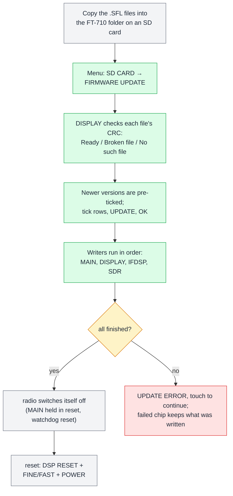

*Figure 4.6 — The update from the user's side, with what the DISPLAY does at each step.*

Yaesu's manual asks you to copy the files to an SD card, put it in the radio, and choose **SD CARD → FIRMWARE UPDATE**. You must
**update DISPLAY first**, then MAIN, DSP and SDR. When the update ends, the radio switches itself off, and the manual asks for a
reset with the key combination DSP RESET + FINE/FAST + POWER.

Behind that screen:

- The DISPLAY looks in the `FT-710` folder for names of the form `FT-710_MAIN_V` plus four characters plus `.sfl` (upper or
  lower case). The four characters become the version shown on screen ("0112" is shown as "01-12"). If there are several
  matching files, the name that sorts highest wins. The file also needs the FAT "archive" attribute, which a PC sets when it
  copies a file.
- For each file it runs the CRC check only and shows **Ready**, **(Broken file)** or **(No such file)**.
- Rows whose file version is higher than the installed one (MAIN reports the installed versions at power-on) are ticked for
  you. You can tick any Ready row, so older versions can probably be installed too *(inference)*.
- The selected writers then run one after another, always in the order MAIN, DISPLAY, IFDSP, SDR. On success each row shows
  "Finished". If any write fails, the screen shows UPDATE ERROR. There is no rollback: the failed chip keeps whatever was
  written, and you simply run the update again.
- At the end the DISPLAY holds MAIN in reset and resets itself with its watchdog. That is the "power off" the manual mentions.

There are two other ways into the update code. If MAIN does not answer at power-on, the DISPLAY shows a two-step recovery
screen that rewrites MAIN first and then DISPLAY *(the trigger meaning is inference)*. And a key held at power-on, together with a
turn of a knob, opens a hidden maintenance screen that can rewrite the DISPLAY's own boot loader. Chapter 8 covers that one.

### 4.6 Behind the screen: one CPU updates them all

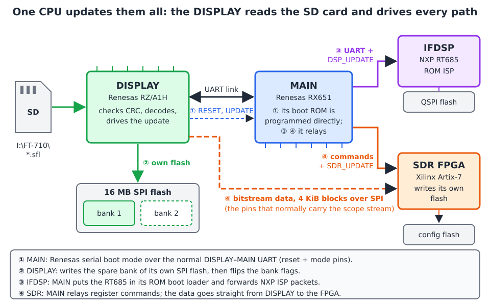

*Figure 4.7 — The DISPLAY owns the SD card, so it drives every update. Only MAIN is reached directly; IFDSP and SDR are
reached through MAIN. That the FPGA writes its own flash is an inference.*

Only the DISPLAY has the SD card, so it is the only chip that can update the others. It has one serial [UART](#glossary) link
to MAIN, plus two control wires into MAIN: a reset line and an "update" line that selects the RX651's boot mode. It has no
direct wire to the IFDSP, so MAIN passes IFDSP traffic along. For the SDR, MAIN passes on the commands, while the bulk data goes
straight from the DISPLAY to the FPGA over an SPI bus. Each chip's update uses that chip's own built-in method.

#### 4.6.1 DISPLAY updates itself

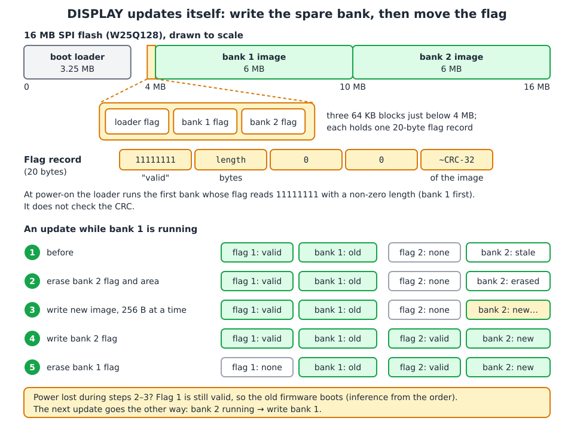

*Figure 4.8 — The DISPLAY keeps two copies of its firmware in its 16 MB SPI flash. An update writes the spare copy and then moves
the "valid" flag across.*

The DISPLAY's 16 MB SPI flash holds a boot loader at the start and two 6 MB **banks**, each big enough for a full firmware image.
Just below the 4 MB mark sit three small flag records, one each for the loader, bank 1 and bank 2. A flag record is 20 bytes:
the magic word `11111111`, the image length, two zero words and the inverted CRC-32 of the decoded image.

At power-on the loader runs the first bank whose flag holds the magic word and a non-zero length, trying bank 1 first. It does
**not** check the CRC.

An update always writes the bank that is *not* running:

1. Erase the spare bank's flag and its image area.
2. Write the decoded image, 256 bytes at a time, with a CRC running over it.
3. Check that the number of bytes written equals the file size minus the 576-byte header.
4. Write the spare bank's flag.
5. Erase the old bank's flag.

After a successful update only the new bank has a valid flag, so the next boot runs it. If the power fails part-way through,
the old flag is still there and the old firmware boots *(inference from the order of steps)*. One weak spot remains: if the new
image is faulty but completely written, its flag is valid and the loader runs it anyway. Recovering from that needs the hidden
maintenance screen or a JTAG probe *(inference)*. Chapter 8 covers both.

Before writing, the DISPLAY sends MAIN the frame `F1 03`, which among other things turns CAT off, and afterwards `F1 83`.

#### 4.6.2 MAIN: Renesas serial boot mode

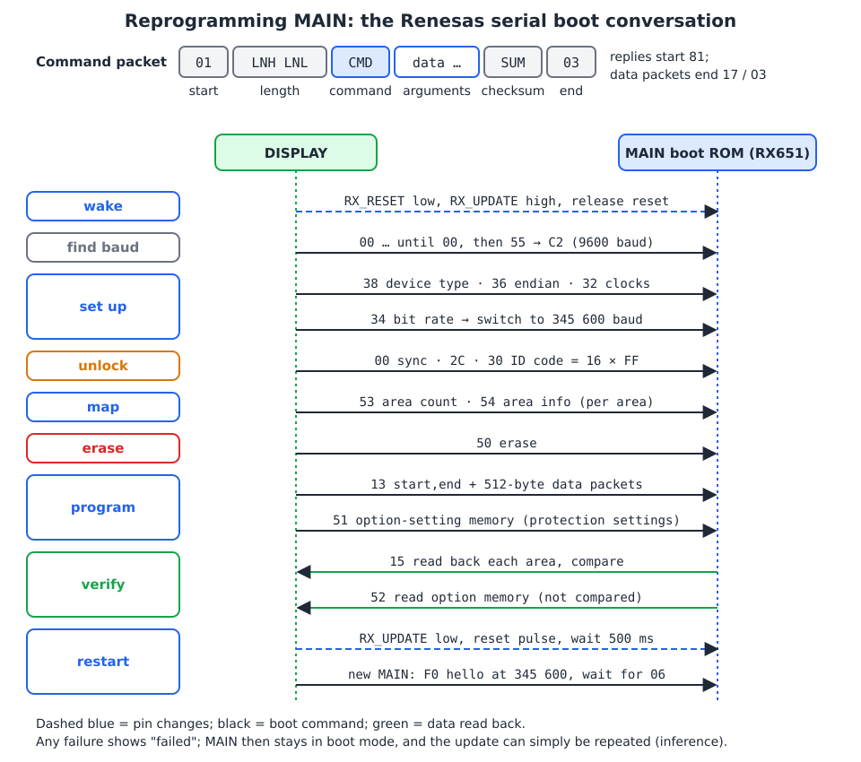

*Figure 4.9 — Reprogramming MAIN. The DISPLAY wakes the RX651 in boot mode and talks to the chip's built-in boot ROM over the
normal DISPLAY–MAIN UART.*

The RX651 has a [boot ROM](#glossary) that can program the chip's flash over a serial port. Renesas documents this protocol,
and the DISPLAY follows it exactly:

1. **Wake into boot mode.** The DISPLAY takes over its UART from the normal link code, pulls MAIN's reset low, sets the update
   line high (boot mode), and releases reset.
2. **Find the baud rate.** At 9600 baud it sends `00` until the chip echoes `00`, then `55` until it answers `C2`.
3. **Set up.** It asks for the device type (`38`), sets the byte order (`36`), tells the chip its clocks (`32`: 16 MHz input,
   120 MHz core), and picks a faster bit rate (`34`). Both sides then switch to 345 600 baud.
4. **Unlock.** A sync (`00`), then the ID-code check (`2C`, `30`). The DISPLAY always sends an ID code of 16 × `FF`. That works
   because the stock MAIN image leaves the chip's ID code at all `FF` (section 4.7).
5. **Map, erase, program.** It asks how the flash is divided (`53`, `54`), erases it (`50`) and writes it in 512-byte data
   packets (`13`). The 116-byte option-setting block is written with its own command (`51`). The DISPLAY reads the S-record
   text from the file as it goes, checking every record's checksum.
6. **Verify.** It reads every area back (`15`) and compares it with the file. The option-setting block is read (`52`) but not
   compared.
7. **Restart.** Update line low, reset pulse, wait half a second, then greet the new MAIN with the normal link "hello" and wait
   for its `06` reply.

Every command travels in the same packet: `01`, a two-byte length, the command byte, its data, a checksum and `03`. Replies
start with `81`. If any step fails, the row shows "failed" and MAIN stays in boot mode until the radio resets. The update can
then be run again *(inference)*.

#### 4.6.3 IFDSP: NXP ISP through MAIN

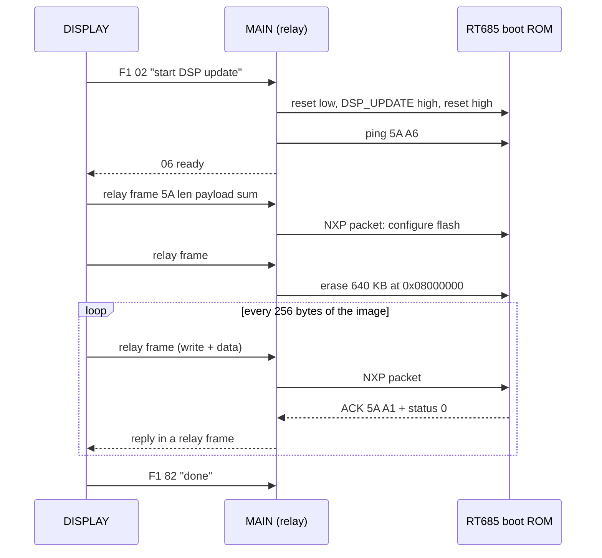

*Figure 4.10 — The IFDSP update. MAIN puts the RT685 in its ROM boot loader and becomes a transparent relay between the DISPLAY
and the DSP.*

The RT685 also has a boot ROM with a serial programming mode ([ISP](#glossary)), selected by a `DSP_UPDATE` pin. That pin and
the DSP's UART are wired to MAIN, not to the DISPLAY. So the DISPLAY first sends MAIN the command `F1 02`. MAIN resets the DSP
with `DSP_UPDATE` high, which starts the ROM loader, and then forwards every packet in both directions.

The packets inside are NXP's standard boot-loader protocol (the one NXP's `blhost` tool speaks). The DISPLAY wraps each one in
a small relay frame, `5A`, a two-byte length, the payload and an 8-bit sum. It configures the QSPI flash, erases a fixed
640 KB region, and writes the decoded image in 256-byte chunks. Each chunk carries its own CRC-16 and is acknowledged by the
ROM. There is no read-back at the end, and the last chunk is always sent as a full 256 bytes. Finally `F1 82` tells MAIN to stop
relaying.

#### 4.6.4 SDR: blocks into the FPGA's flash

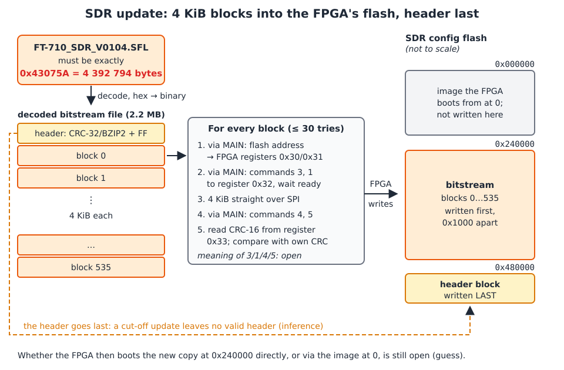

*Figure 4.11 — The SDR update writes the bitstream to a second slot in the FPGA's configuration flash, block by block, and the
header last.*

The FPGA loads its design from its own QSPI configuration flash at power-up. The DISPLAY never touches that flash directly.
Instead, the FPGA's own logic writes it *(inference)*:

- The SDR file must be **exactly 0x43075A (4 392 794) bytes**. Any other size is refused.
- The DISPLAY sends `F1 01` to MAIN. MAIN switches to an update bridge: it holds the FPGA's `SDR_UPDATE` pin low and passes
  register commands from the DISPLAY to the FPGA over its UART.
- For each 4 KiB block, the DISPLAY sets the flash address in two FPGA registers, sends a short command sequence (3, then 1) to a
  control register, pushes the 4 KiB of data straight to the FPGA over SPI, sends commands 4 and 5, and finally reads back a
  CRC-16 of what the FPGA received. A block is retried up to 30 times. What the commands 3, 1, 4 and 5 mean exactly is still
  open.
- The data goes over the SPI pins that normally carry the spectrum-scope stream into the FPGA. During the update the DISPLAY
  switches that port to master mode.
- The bitstream itself goes to flash address 0x240000 and up, 0x1000 bytes apart, 536 blocks in all. The 4 KiB header with the
  CRC-32/BZIP2 is written **last**, as a 537th block at 0x480000. So an update that is cut off leaves no valid header *(inference)*.
- At the end, `F1 81` tells MAIN to restart the FPGA with `SDR_UPDATE` high again.

Because the pin labelled `WP` (write protect) on the SDR module is held low during the update, it acts as an "update mode"
input to the FPGA rather than a plain flash write-protect *(inference)*. Whether the FPGA then boots the new copy at 0x240000
directly, or through the image at address 0, is still open *(guess)*.

### 4.7 What the loader really checks

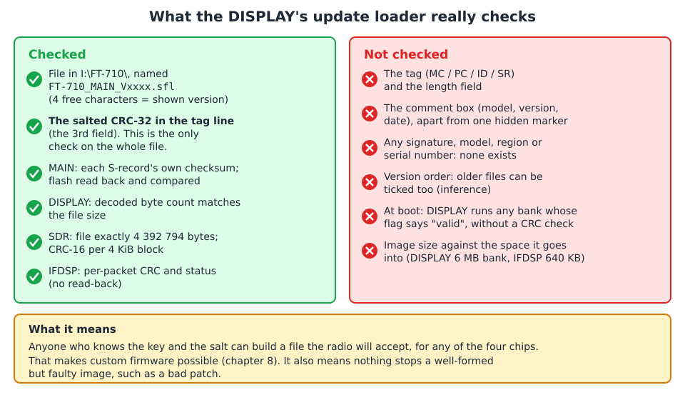

*Figure 4.12 — The salted CRC is the only check on a whole file. Tag, length, model and signature are never looked at.*

The DISPLAY's loader is strict about a few things and ignores the rest:

- **Checked:** the file name and folder; the tag line must be 64 characters, and its third field must equal the salted CRC-32
  of the payload; plus a few per-chip checks (MAIN record checksums and read-back, DISPLAY byte count, SDR exact size,
  IFDSP per-packet CRC).
- **Not checked:** the tag (`MC`, `PC`, …), the length field, the comment box (except for one hidden marker, see chapter 8), any
  signature, model, region or serial number (none exist), whether the image fits the space it is written to, and, at boot, the
  DISPLAY image's CRC.

So anyone with the key and the salt can build a file that the radio accepts. That is the opening for custom firmware, which
chapter 8 covers with the patches, the debug headers and the recovery paths. It also means the radio will not save you from a
mistake in a patched file. One mistake in a MAIN file is worse than all the others:

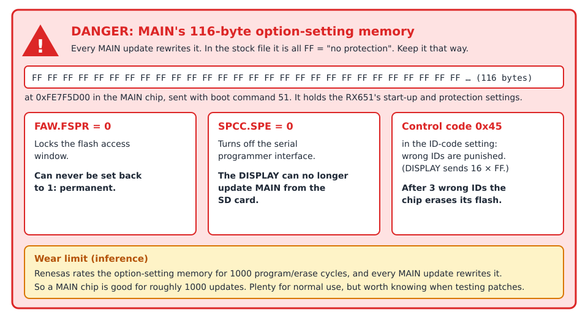

*Figure 4.13 — The 116-byte option-setting block in the MAIN image. Every MAIN update rewrites it; patched images must keep it
all `FF`.*

The option-setting memory is a small, special flash area in the RX651. It holds the chip's start-up settings and its security
settings. In the stock MAIN file all 116 bytes are `FF`, which means: no watchdog auto-start, serial programming allowed, ID code
16 × `FF`, and no flash, ROM-code or Trusted-Memory protection. Because `tools/sfl_encode.py` always writes this block, a patched
MAIN image must keep it exactly as it is. Three settings are particularly dangerous:

- **FAW.FSPR = 0** protects the flash access window, and it can **never** be set back to 1. The change is permanent.
- **SPCC.SPE = 0** turns off the serial programmer. The DISPLAY can then no longer update MAIN, because SD-card updates of MAIN
  *are* serial programming.
- **Control code 0x45** in the ID-code setting makes the chip **erase its flash** after three wrong ID codes.

There is also a wear limit. Renesas rates this memory for 1000 program/erase cycles, and every MAIN update rewrites it, so a
MAIN chip should survive roughly 1000 updates *(inference)*.

### 4.8 Where to look

Reference pages (paths relative to this guide):

- [../sfl-format.md](../sfl-format.md): the container, the key, the salted CRC, how they were found, and the payload formats.
- [../code/display/update.md](../code/display/update.md): the DISPLAY's update code, every check (§1), and the MAIN, DISPLAY,
  IFDSP and SDR writers (§5–§8).
- [../code/main/dsp-link.md](../code/main/dsp-link.md#dsp-firmware-update-bridge): MAIN's side of the IFDSP relay.
- [../code/sdr/bitstream.md](../code/sdr/bitstream.md) and [../memory-maps.md](../memory-maps.md): SDR header and bitstream
  layout, MAIN memory map with the option-setting block.
- [../custom-firmware.md](../custom-firmware.md#update-and-recovery-paths): update and recovery paths, acceptance rules.
- [../tasks/T18-renesas-docs-check.md](../tasks/T18-renesas-docs-check.md): the option-setting memory decoded field by field,
  the boot-mode commands checked against the RX651 manual, and the 1000-cycle note.
- [../patches/README.md](../patches/README.md): how the encoder and the round-trip test are used to build patches.

Tools: `tools/sfl_header.py` (header parser), `tools/sfl_decode.py`, `tools/sfl_encode.py` (with `--check`),
`tools/test_sfl_roundtrip.py`.

Key places in the DISPLAY V01-08 image (load base 0x20100000):

| What | Address / name |
|---|---|
| 43-byte key | first object of `.data`, 0x20428840 |
| decode / encode loop | `sfl_decode` 0x2011497C / `sfl_encode` 0x201149E0 |
| salted CRC, header check | `sfl_crc` 0x20114A64 (salt literal at 0x20114ADC), `sfl_read_header` 0x20114CA0 |
| update task and file scan | `task_fwupdate` 0x2010E1F8, `fwfile_status_text` 0x2010DFD0 |
| per-chip writers | `fwobj_main_run` 0x201605AC → `rx_boot_program` 0x2010D50C; `fwobj_display_run` 0x201607E8; `fwobj_ifdsp_run` 0x201606BC → `dsp_isp_program` 0x2010B81C; `fwobj_sdr_run` 0x201602AC → `sdr_flash_write` 0x20110AB8 |
| bank choice at boot | `boot_select_bank` 0x20100ABC |
| end-of-update reset | `system_reboot` 0x20114DF4 |

On MAIN (V01-12): the IFDSP relay is `dsp_isp_bridge` 0xFFFA0C79, and the option-setting block sits at 0xFE7F5D00..0xFE7F5D73.

## 5. CAT remote control

**In short.** [CAT](#glossary) is the text protocol a PC uses to run the radio: a logger reads the frequency, WSJT-X sets the mode,
a contest program keys the transmitter. Every CAT command is two letters, maybe some digits, and a `;`. All of them end up in one
place: the parser on the [MAIN](#glossary) CPU. This chapter follows a command from the USB plug to the radio and back, takes one
command apart, and then maps the whole command set. MAIN firmware V01-12 knows 114 commands. Yaesu's manual documents 92 of them;
22 are undocumented. Some of those do nothing, some are harmless reads, and a few can reset the radio, change its region or rewrite
its calibration. Nothing in this chapter was sent to the radio: it all comes from reading the firmware.

### 5.1 What CAT is, and the three ways in

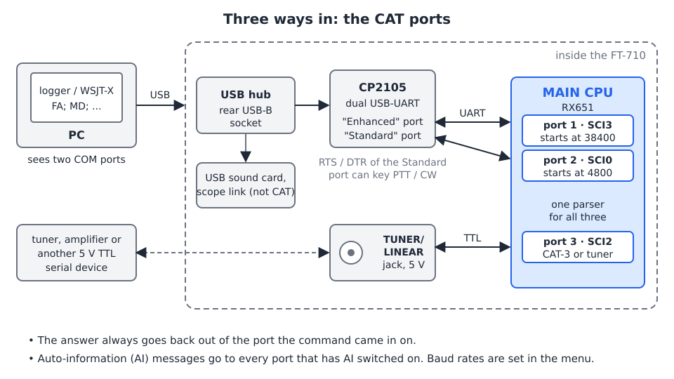

*Figure 5.1 — The three CAT ports. Two arrive over USB through the CP2105, one through the TUNER/LINEAR jack. All three end in the
same parser on MAIN.*

When you plug the FT-710 into a PC with one USB cable, the PC finds a small USB hub inside the radio. Behind the hub sit a USB sound
card, the scope link to the DISPLAY board, and a [CP2105](#glossary), a chip that turns USB into two serial ports. Windows shows those
as two COM ports, called "Enhanced" and "Standard". Each one is wired to a [UART](#glossary) on MAIN:

- **Port 1**, the Enhanced COM port, goes to MAIN's serial channel SCI3. It starts at 38400 baud.
- **Port 2**, the Standard COM port, goes to SCI0. It starts at 4800 baud. Its RTS and DTR lines can also key the transmitter (PTT)
  or send CW/RTTY, if the PC KEYING setting says so.
- **Port 3** is the TUNER/LINEAR jack on the back, a 5 V [TTL](#glossary) serial line into SCI2. The jack normally talks to an
  antenna tuner or an amplifier; the manual calls it CAT-3 when it is set up for CAT in the menu.

The menu sets the baud rate of each port. MAIN tags every command with the port it came from, and the answer goes back out of that
same port. One more kind of traffic goes the other way on its own: [auto information (AI)](#glossary). If a program turns AI on
(`AI1;`), the radio reports changes without being asked: turn the VFO knob and `FA…;` messages stream out. AI is switched on per port.

Two rules hold for every port. While the radio is switched off, MAIN ignores everything except `PS1;` (power on). And while the
DISPLAY board is updating its own firmware, it tells MAIN to stop reading CAT altogether (see
[chapter 4](#4-firmware-files-and-how-updates-work)). Every received command also restarts the auto-power-off timer.

### 5.2 Anatomy of a command

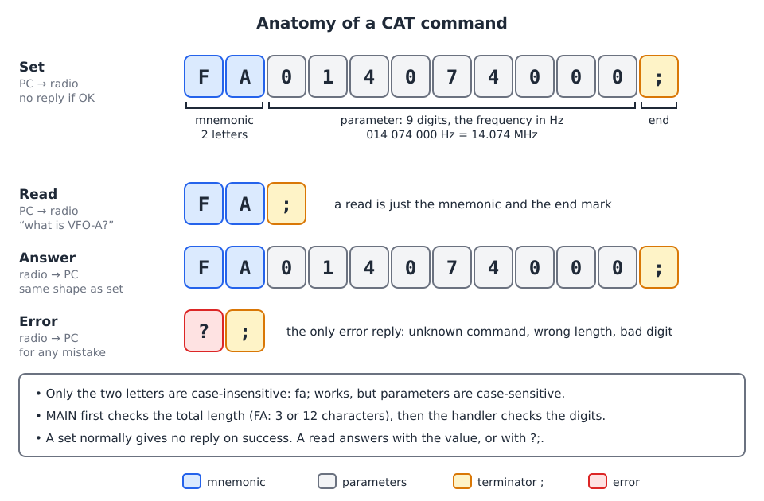

*Figure 5.2 — One command in its four shapes. The frequency set `FA014074000;` is 12 characters; the read `FA;` is 3.*

A CAT command is plain ASCII text:

- **The [mnemonic](#glossary):** two letters that name the command. `FA` is "frequency of VFO-A", `MD` is "mode", `TX` is
  "transmit". Only these two letters are case-insensitive, so `fa;` works too.
- **The parameters:** a fixed number of characters, usually digits. For `FA` it is nine digits, the frequency in hertz:
  `014074000` is 14.074 MHz. Some commands start with a selector digit, for example `VE0;` (version of chip 0).
- **The end mark:** a `;` closes every command and every answer.

The same mnemonic does several jobs, told apart by the length:

| Form | Example | What happens |
|---|---|---|
| **Set** | `FA014074000;` | Changes something. On success there is normally **no reply** at all. |
| **Read** | `FA;` | Asks a question. |
| **Answer** | `FA014074000;` | The radio's reply to a read, shaped like the set. |
| **Error** | `?;` | The only error reply. It covers an unknown command, a wrong length, a bad digit and a refused action. |

MAIN checks the **total length** first (for `FA`: 3 or 12 characters, nothing else). Only then does the command's own code, its
[handler](#glossary), check the digits and the range. A few commands accept more forms than the manual shows; for example `VM0;`
reads a hidden two-digit state code. [cat-commands.md](../cat-commands.md#firmware-vs-manual-differences) lists every difference.

### 5.3 The journey of `FA014074000;`

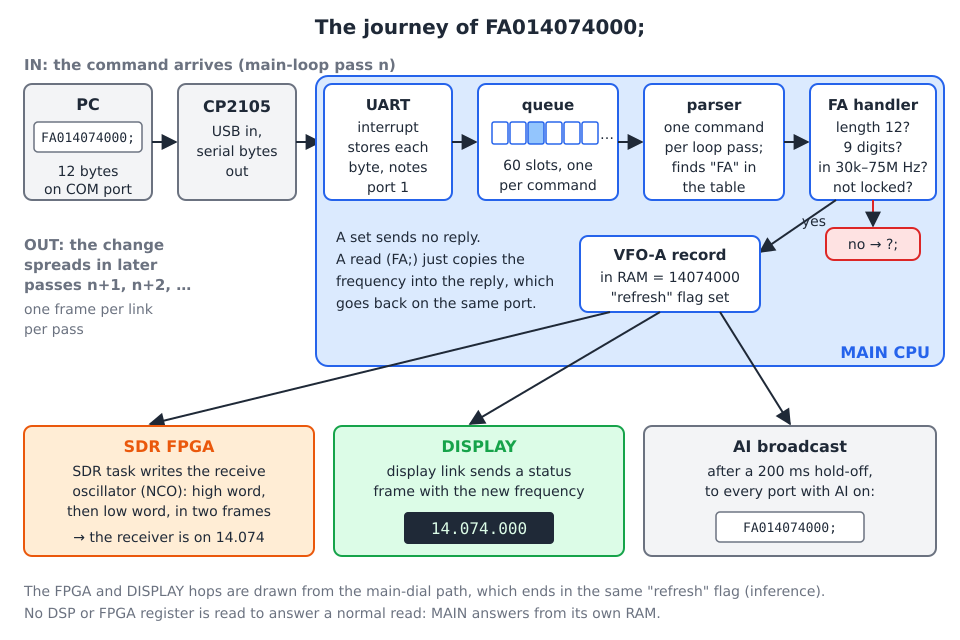

*Figure 5.3 — How a frequency set travels: into a queue, through the parser and the FA handler into the VFO record, and from there
out to the FPGA, the DISPLAY and back to the PC as an AI message.*

Say your logging program wants to QSY to the FT8 frequency on 20 m. It writes `FA014074000;` to COM port 1.

1. **USB to serial.** The CP2105 turns the USB packet into 12 serial bytes on MAIN's SCI3.
2. **Bytes into a queue.** MAIN's UART interrupt stores each byte as it arrives. When the frame is complete, it copies the command,
   tagged "port 1", into a [ring buffer](#glossary) with 60 slots. The interrupt does no parsing; it just queues.
3. **One command per loop pass.** MAIN has no operating system. It runs one big [main loop](#glossary) over and over, and once
   per pass the CAT parser takes **one** command out of the queue. If the queue is full of commands, they are handled one per pass.
4. **Look up the mnemonic.** The parser upper-cases the two letters and looks for `FA` in a table of 104 mnemonics. If it isn't
   there, it tries a second table of 10 more (section 5.4). Then it checks the length (12 means "set") and calls the FA handler.
5. **Check and store.** The FA handler checks that all nine characters are digits, that the frequency is between 30 kHz and
   75 MHz, and that the VFO is not locked (for example on a 60 m channel). If any test fails, the answer is `?;`. Otherwise it writes
   14 074 000 into the VFO-A record in RAM, clears the clarifier offset and raises a "refresh" flag.
6. **No reply.** A successful set answers nothing.
7. **The change spreads.** Other parts of the main loop notice the new value over the next passes. The SDR task writes the new
   receive-oscillator ([NCO](#glossary)) value to the FPGA, the display link sends a status frame to the DISPLAY, and the screen
   shows 14.074.000. These hops are documented for the main dial; that `FA` ends in the same refresh flag is *(inference)*.
8. **AI.** If AI is on for any port, the AI broadcaster sends `FA014074000;` to each of them. After a set it first waits 200 ms (a
   [hold-off](#glossary)).

A read is much shorter: `FA;` only makes the handler copy the VFO-A frequency into the reply buffer, and the reply goes back out of
port 1 in the same pass. Normal reads never ask the FPGA or the DSP; MAIN answers from its own RAM *(inference from the handlers)*.

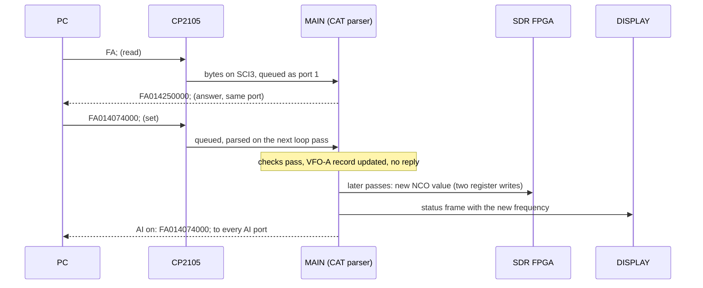

*Figure 5.4 — The same story as a sequence: a read gets an answer at once, a set gets no answer but spreads to the other chips and
comes back as an AI message.*

### 5.4 The command map: documented and firmware-only

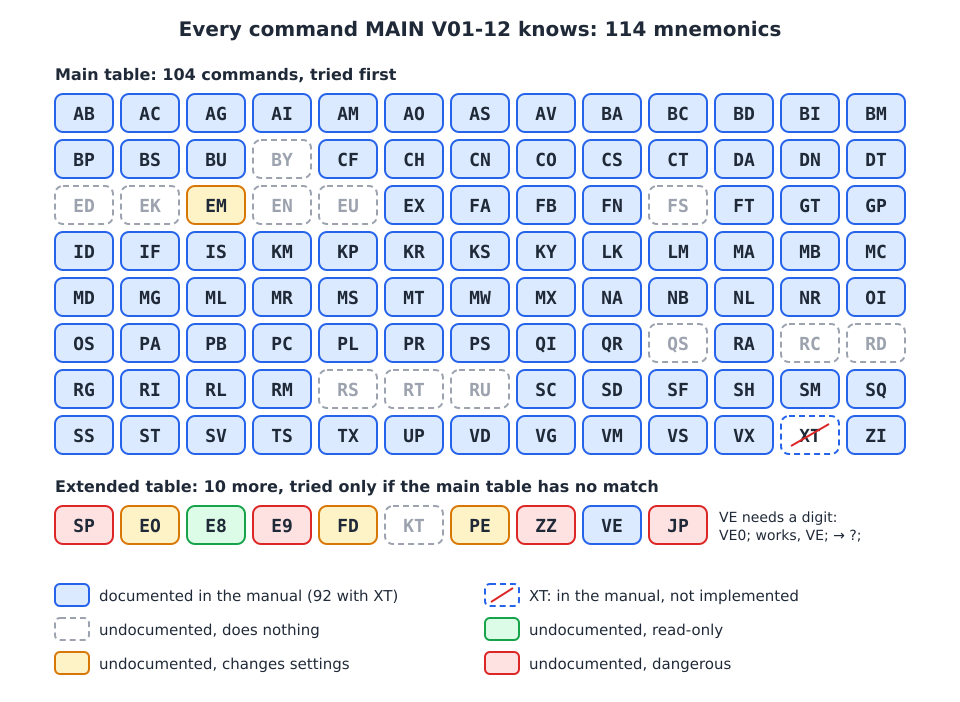

*Figure 5.5 — Every mnemonic MAIN V01-12 accepts, in table order. Blue: in Yaesu's manual. Coloured: undocumented, by risk.*

The firmware holds two tables of mnemonics. The **main table** has 104 entries and is searched first. The **extended table**
has 10 more, searched only when the main table has no match. Together that is 114 mnemonics. Comparing them with the CAT manual
(revision 2306-C) gives:

- **92 documented.** These are the commands in the manual. Two of them behave differently from what the manual says:
  - **`XT` (TX clarifier) is not implemented.** The mnemonic is in the table, but there is no code behind it, so it always answers
    `?;`. The clarifier's TX switch is reached through `CF` instead.
  - **`VE` (firmware version) needs a parameter.** The current manual writes it `VEP1;`, with P1 = 0 MAIN, 1 DISPLAY, 2 SDR,
    3 DSP. The old form from manual 2211-A, `VE;`, answers `?;`. On the owner's radio `VE0;` answers `VE00112;` (V01-12), as the code predicted *(fact, radio check 2026-10-28)*.
- **22 undocumented:** `BY E8 E9 ED EK EM EN EU EO FD FS JP KT PE QS RC RD RS RT RU SP ZZ`. `EO` was still in the older
  manual 2211-A and was dropped in 2306-C. Section 5.5 sorts them by risk.

The manual and the firmware also disagree on smaller points: a few digit counts, ranges and accepted lengths. The full list is in
[cat-commands.md](../cat-commands.md#firmware-vs-manual-differences); for normal operating use of the documented commands, see
[chapter 3](#3-a-day-in-the-life-of-the-radio).

### 5.5 The 22 undocumented commands, by risk

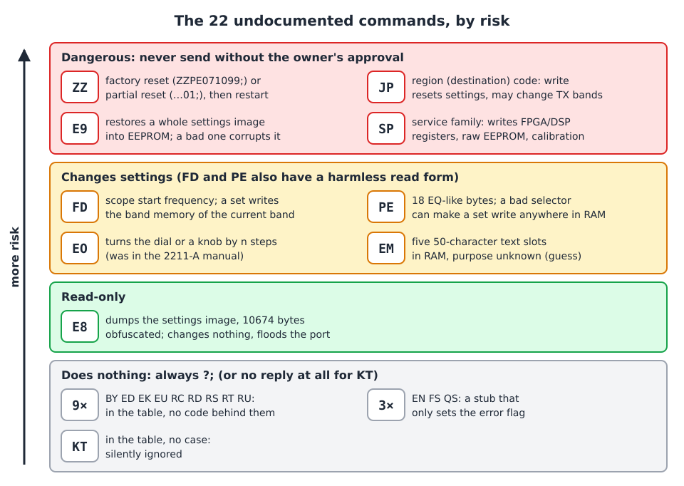

*Figure 5.6 — The 22 undocumented commands on a risk ladder. Only E8 and the read forms are harmless.*

**Does nothing (13).** Nine mnemonics, `BY ED EK EU RC RD RS RT RU`, sit in the main table with no code behind them; they answer
`?;`. Three more, `EN FS QS`, have a stub that only raises the error flag, so they answer `?;` as well. `KT` is in the extended table
but has no code at all, so it gets no reply. They may be leftovers from other Yaesu models *(guess)*.

**Read-only.** `E8` dumps the radio's whole settings and memory image, 10 665 bytes of data, scrambled with a random key byte,
in one 10 674-byte reply. It changes nothing, but it floods the port. It looks like a clone or backup export, the mirror image of `E9`.

**Changes settings (medium risk).**
- `FD` reads the scope start frequencies: `FD000;` the dial, `FD001;` the CURSOR-mode start, `FD002;` the FIX-mode start of the
  current band *(strong inference for "scope start")*. `FD002` plus nine digits writes the band memory. `FD` is also the only
  undocumented command that sends AI messages.
- `PE` reads and writes 18 one-byte values: 2 sets × 3 bands × (frequency, level, bandwidth). That shape matches the 3-band
  parametric microphone EQ, normal and with the processor on *(inference)*. The manual reaches those only through menu items. With an
  invalid selector digit a `PE` set can write to an arbitrary RAM address.
- `EO` turns a knob from the PC: the main dial by ±n Hz, kHz or MHz, or the FUNC or STEP/MCH knob by ±n steps. It was documented in
  manual 2211-A. It also quietly clears several mode flags.
- `EM` reads and writes five 50-character text slots in RAM. No EEPROM write was seen. What they are for is unknown *(guess: user
  messages)*.

**Dangerous (high risk).**
- `ZZ` is a factory reset. `ZZPE071099;` (`0710` is the model number) reloads all defaults, including the calibration table and
  the region code, saves them to [EEPROM](#glossary) and requests a restart *(that the request means a restart is inference)*. `ZZPE071001;` resets VFOs, memories and menus but keeps the
  calibration. `ZZPE071000;` switches on an unexplained mode that blocks some front-panel keys *(guess: a test or demo mode)*.
- `JP` reads and writes the [destination code](#glossary), the region that picks the market version. `JP0710;` reads it; a write
  saves a new code to EEPROM, reloads the defaults and requests a restart. The code most likely sets band limits and TX coverage
  *(inference)*.
- `E9` is the restore side of `E8`: it unscrambles a 10 kB image, checks a signature and a checksum, and writes all settings and
  memory channels to EEPROM. A bad image can corrupt the configuration.
- `SP` is a whole service family; it gets its own section.

### 5.6 The SP service family

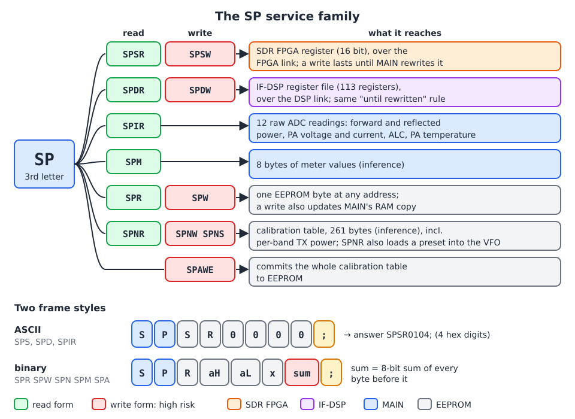

*Figure 5.7 — `SP` sub-commands, by the third letter. Green forms read, red forms write. The target colours are the chips of
chapter 2.*

`SP` looks like a factory service interface *(inference)*. The third letter picks the target and the fourth letter, where there
is one, picks read or write:

- **`SPS` reaches the SDR [FPGA](#glossary).** `SPSRaaaa;` reads 16-bit FPGA register `aaaa` (hex) over MAIN's FPGA link and
  answers `SPSRvvvv;`. `SPSWaaaavvvv;` writes one. MAIN keeps its own copy of what each register should hold, and the write
  bypasses that copy. The written value therefore lasts only until MAIN next rewrites that register for its own reasons
  *(inference)*.
- **`SPD` reaches the IF-DSP.** Same format, but over the DSP link into the DSP's file of 113 registers. Same rule: a write
  sticks until the setting behind that register changes *(inference)*.
- **`SPIR;` reads 12 raw [ADC](#glossary) values:** forward and reflected power, PA supply voltage and current, ALC, the HF PA
  thermistor, the remote-keypad input, the SDR-module detect voltage and one unused input, with the unconverted slots as zero:
  12 × 3 hex digits. It changes nothing.
- **`SPM` reads eight bytes of meter values** *(inference that they are meters)*.
- **`SPR` / `SPW` read and write one EEPROM byte** at any address. The write has no bounds check.
- **`SPN` reaches a 261-byte table** that is most likely the factory alignment and calibration table *(inference)*, including the
  per-band TX power calibration. `W` changes an entry in RAM, `S` re-applies the table half a second later, and `SPAWE` saves the
  whole table to EEPROM. Even the read, `SPNR`, has a side effect: it also loads a preset into the active VFO.

The ASCII forms (`SPS`, `SPD`, `SPIR`) look like any other command. The others are **binary**: after `SP` and the letter come raw
bytes (an address, perhaps a value) and a [checksum](#glossary) byte, the 8-bit sum of every byte before it, then `;`. A wrong sum
answers `?;`. An earlier analysis thought the checksum test was broken, so that these forms could never work; that turned out to be
a bug in the disassembler, now fixed. **They work in V01-12.** That is exactly why they are high risk: they read and write EEPROM
and calibration data directly.

For what these hooks could mean for experiments, see [chapter 8](#8-hacking-and-custom-firmware).

### 5.7 The read-only tests on the radio

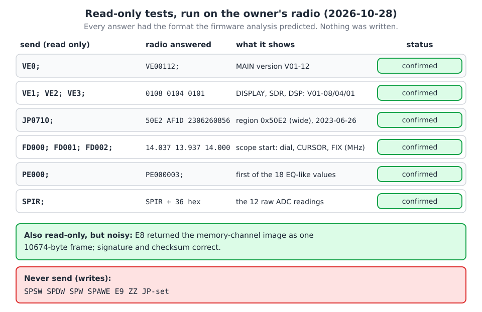

*Figure 5.8 — The first tests on the real radio (2026-10-28). All are reads, and every answer matched the analysis.*

All of the above comes from reading the firmware. The project's rule is that nothing is sent to the radio without the owner's
explicit approval, each time. The CAT analysis proposed a short list of **read-only** commands as safe first tests, and on
2026-10-28 the owner approved them and ran them on their FT-710:

- `VE0;` to `VE3;`: the four firmware versions.
- `JP0710;`: the region code (the read form only).
- `FD000;`, `FD001;`, `FD002;`: the three scope start frequencies.
- `PE000;`: the first EQ-like value.
- `SPIR;`: the 12 ADC readings.

`E8` is also read-only, but its 10 kB answer floods the port. The writes `SPSW`, `SPDW`, `SPW`, `SPAWE`, `E9`, `ZZ` and a `JP` set
are on the "never send" list. **Every answer matched the format decoded from the code.** A few things were learned:

- The radio runs exactly the firmware this project decompiles: MAIN V01-12, DISPLAY V01-08, SDR V01-04, DSP V01-01.
- Its region code is **0x50E2**, the wide (TX-expanded) partner of the US code; the `JP` check bytes really are the complements,
  and the EEPROM header carries the stamp 2023-06-26 08:56, most likely the factory programming *(inference)*.
- `E8` returned the full 10 674-byte frame with a correct signature and checksum.

The raw replies are in [cat-commands.md](../cat-commands.md#radio-checks).

### 5.8 Menu settings over CAT: the EX command

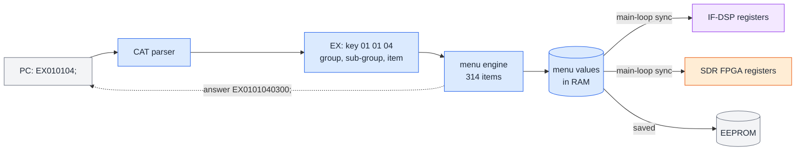

*Figure 5.9 — An `EX` command goes through the same menu engine as the front panel. The engine only writes RAM; other parts of the
main loop carry the value on to the DSP, the FPGA and EEPROM.*

Most of the radio's setup menu is reachable over CAT through one command, `EX`. Its key is three two-digit numbers: the menu group,
the sub-group and the item. `EX010104;` reads item 04 of sub-group 01 in group 01, which is AGC FAST DELAY in the SSB settings, and
the answer `EX0101040300;` means 300. A set is the same key followed by the value, written with exactly as many digits as
the item uses: `EX0101040300;` sets 300, while `EX010104300;` (three digits) is refused.

- The firmware builds **314** menu items at start-up. **296** of them can be reached by `EX`, and they match the manual's menu chart
  one to one.
- The other **18** form the front-panel-only EXTENSION SETTING group (date and time, SD card, software version, calibration, reset,
  certification). `EX` refuses that group.
- The engine only changes the value in RAM. The DSP, FPGA and display code notice the change on their next main-loop pass, the same
  way they notice a front-panel change.
- There are small differences from the manual. One stands out: SSB TX BPF SEL has two values the manual doesn't list. `EX` refuses
  value 5 ("50-4000Hz") but accepts value 6 ("TTBF"), whose effect is unknown *(guess: a wide or flat TX filter)*.

The menu engine and every item are described in [code/main/menu.md](../code/main/menu.md); chapter 6 shows where the engine sits
inside MAIN.

### 5.9 Where to look

| Topic | Reference page | Key names and addresses (MAIN V01-12) |
|---|---|---|
| Every command, documented or not, with risk | [cat-commands.md](../cat-commands.md) | `cat_mnemonics` 0xFFF805EC (104), `cat_ext_mnemonics` 0xFFF806BC (10) |
| Per-command details of the 104 main-table commands | [cat-commands-primary.md](../cat-commands-primary.md) | `cat_FA_FB` 0xFFFA99BD, `freq_in_range`, `vfo_tune_locked` |
| Parser, queue, reply, AI, ports | [code/main/cat.md](../code/main/cat.md) | `cat_rx_complete` 0xFFFB1B50, ring 0x1E14C (60 × 0x6A), `cat_parse` 0xFFFA347C, `cat_dispatch` 0xFFFA3B6E, `cat_reply_error` 0xFFFB0166, `cat_send_reply` 0xFFFB1D12, `cat_ai_poll` 0xFFFDD797, `cat_ai_holdoff` 0xFFFDDB6A |
| Extended and service commands | [cat-commands.md, extended table](../cat-commands.md#extended-table) | `cat_dispatch_ext` 0xFFFA3A2A, `cat_ext_SP` 0xFFFA36F2, `cat_ext_ZZ` 0xFFFA58A1, `cat_ext_JP` 0xFFFA556B, `cat_ext_E8` 0xFFFA53A4, `cat_ext_E9` 0xFFFA5985, `cat_ext_FD` 0xFFFA5A51, `cat_ext_PE` 0xFFFA5FDF, `cat_ext_VE` 0xFFFA54B3 |
| The SP checksum and the old "bug" | [code/main/cat.md](../code/main/cat.md#extended-and-service-commands-summary), [code/main/eeprom.md](../code/main/eeprom.md) | `cat_checksum_ok` 0xFFFB0182, `cfg105` 0x4659 (EEPROM 0x000A) |
| SPIR fields | [code/main/peripherals.md](../code/main/peripherals.md#the-12-spir-fields) | `cat_SP_adc_dump` 0xFFFA4EED |
| UARTs and baud rates | [code/main/sci.md](../code/main/sci.md) | SCI3 port 1, SCI0 port 2, SCI2 port 3 |
| USB wiring and CAT round trip | [code/system.md](../code/system.md) §2.2 and §6.1 | CP2105, CY7C65631 hub |
| EX menu engine | [code/main/menu.md](../code/main/menu.md) | `cat_EX` 0xFFFA9937, `ex_command` 0xFFFE61E7, item table 0x2105C, values 0x9A2A..0x9E85 |
| Open questions and proposed tests | [tasks/T09-cat-commands.md](../tasks/T09-cat-commands.md) (follow-ups), [custom-firmware.md](../custom-firmware.md) | — |

## 6. Inside MAIN and DISPLAY

**In short.** The FT-710 has two Renesas processors that run the radio as you see it. **MAIN**, an RX651, is the boss. It holds the
radio state, answers CAT, stores the settings and switches the RF hardware. It has no screen, no keys and no SD card. Its program is a
single endless loop that calls 16 small jobs in turn, with no operating system. **DISPLAY**, an RZ/A1H, runs the front panel. It owns the
touch screen, the keys and knobs, the SD card and the firmware updates. It runs about 32 tasks under a small real-time kernel. Neither
CPU does the other's job. DISPLAY forwards every key press to MAIN and draws whatever MAIN tells it to draw. This chapter opens both
programs and shows how each one is organised. The wire between them is covered in [chapter 2](#2-how-the-chips-talk), updates in
[chapter 4](#4-firmware-files-and-how-updates-work) and CAT in [chapter 5](#5-cat-remote-control).

### 6.1 Two CPUs, two styles

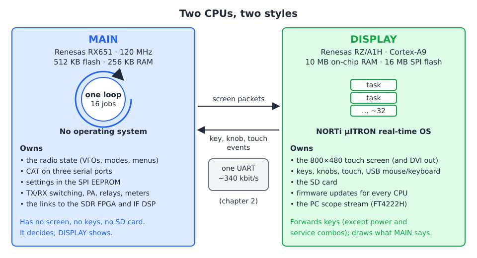

*Figure 6.1 — MAIN decides, DISPLAY shows. One UART carries screen packets one way and input events the other way.*

The two programs are built in opposite styles, and the reason is plain once you see the jobs:

- **MAIN** does many small, steady chores: watch the supply voltage, key the transmitter, push a new frequency to the SDR board, answer a
  CAT command. None of them takes long. A simple loop that visits each chore over and over is enough, and it is easy to reason about.
  MAIN's program is a [super-loop](#glossary) plus a handful of timer [interrupts](#glossary).
- **DISPLAY** does heavy, uneven work: redraw an 800×480 screen, read the SD card, unpack a firmware file, stream the scope to a PC. Those
  jobs can take a long time and must not freeze the knobs. So DISPLAY uses an [RTOS](#glossary) (NORTi, a [µITRON](#glossary) kernel)
  that switches between [tasks](#glossary). A task that waits for the SD card simply sleeps while the key task keeps running.

The split has one big consequence for anyone who wants to change the radio: **almost all of the radio's behaviour lives in MAIN**. The
menu text, the menu logic, the list of what each key does, and even which screen to show are all MAIN's decisions. DISPLAY is a
[thin renderer](#glossary) with an input scanner bolted on.

### 6.2 MAIN: one loop, sixteen jobs

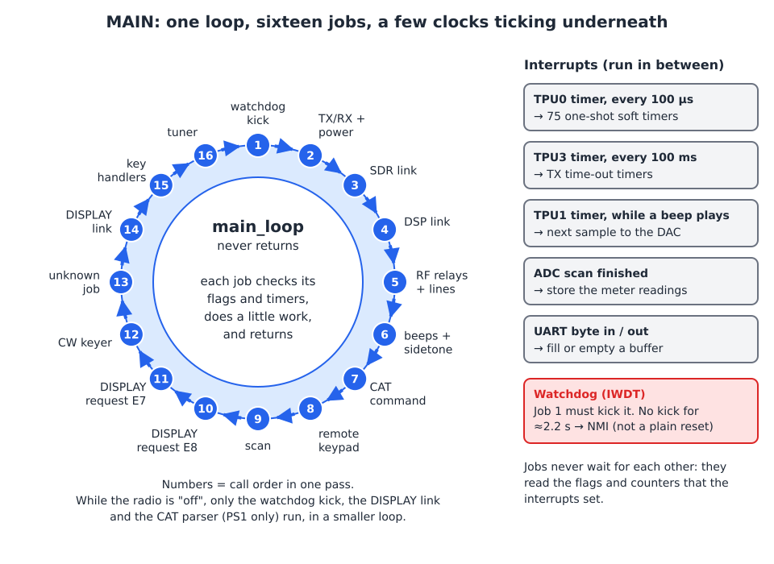

*Figure 6.2 — MAIN's `main_loop` calls the same 16 jobs in the same order, forever. Interrupts keep the clocks and buffers up to date in between.*

After reset, MAIN sets up its clocks and peripherals, loads its settings from the EEPROM (section 6.3), and then enters the loop. The loop
has no logic of its own. It only calls 16 functions, one after the other. Each one looks at a few flags and timers, does a little work if
something changed, and returns *(inference: they are non-blocking by design; the only busy-waits found are the EEPROM writes and the
power-off path)*.

Here is what happens when you turn the VFO knob:

1. DISPLAY counts the knob steps and sends them to MAIN every 8 ms.
2. Job 14 (DISPLAY link) receives the frame. The knob handler changes the frequency in the VFO record in RAM.
3. On its next pass, job 3 (SDR link) compares the frequency registers it wants with the copies it last sent. The frequency has changed,
   so it writes the new value to the SDR [FPGA](#glossary).
4. Job 14 later sends DISPLAY a new screen packet with the new frequency, and DISPLAY redraws the digits.

Nothing *pushes* a change through the radio. Every job that drives hardware keeps a "last sent" copy and polls for differences. The IF DSP
link (job 4) works the same way for DSP settings. This makes the loop simple, at the cost of a little delay: a change waits for the next
pass.

**Time** comes from four on-chip timers:

- A 100 µs tick drives 75 one-shot [soft timers](#glossary). A job says "start timer 0x16 for 100 ms" and later asks "has it expired?".
  Nothing waits.
- A 100 ms tick drives four slow timers, used for the TX time-out timer.
- A third timer runs only while a beep plays and feeds the beep samples to the DAC.
- A fourth makes a short pulse train on a speaker switch, probably to soften the click when the speaker route changes *(inference)*.

**The [watchdog](#glossary)** (IWDT) must be refreshed regularly. Job 1 does this on every pass. If the loop ever hangs for about
2.2 seconds, the watchdog fires an [NMI](#glossary) (a non-maskable interrupt) rather than a plain reset.

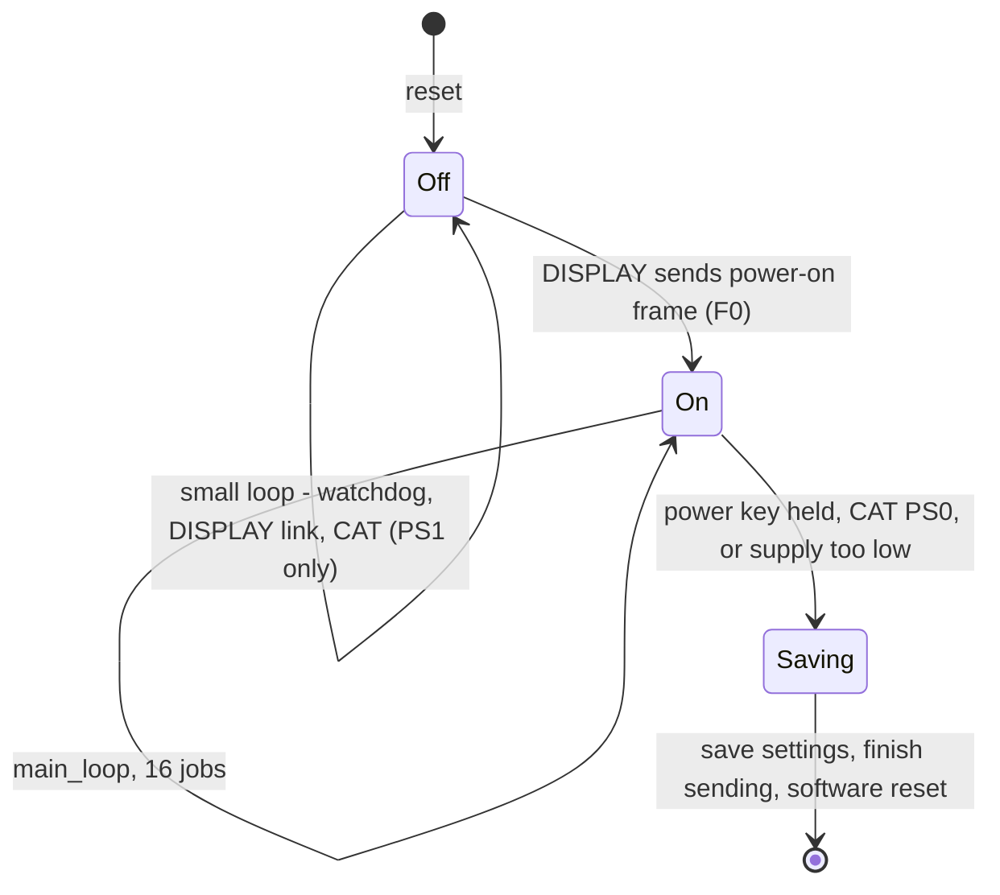

*Figure 6.3 — MAIN's power states. "Off" is a reset CPU waiting in a small loop; switching off ends in a software reset.*

**Power is a handshake.** When the radio is "off", MAIN is actually running. It sits in a small loop that kicks the watchdog, listens
to DISPLAY and accepts only one CAT command, `PS1`. Even `PS1` does not switch the radio on by itself. It only asks DISPLAY, and MAIN
turns on when DISPLAY answers with its power-on frame *(inference for the exact handshake)*. Switching off works the other way round. Holding the power key, sending `PS0` or a
supply voltage that drops too low makes MAIN save its settings, wait until the last frame to DISPLAY has gone out, and **reset itself**.
The CPU then starts again from scratch and waits in the "off" loop. A restart (after a factory reset or a region change, for example) is
the same software reset with a "power straight back on" flag saved first.

### 6.3 MAIN's memory and settings

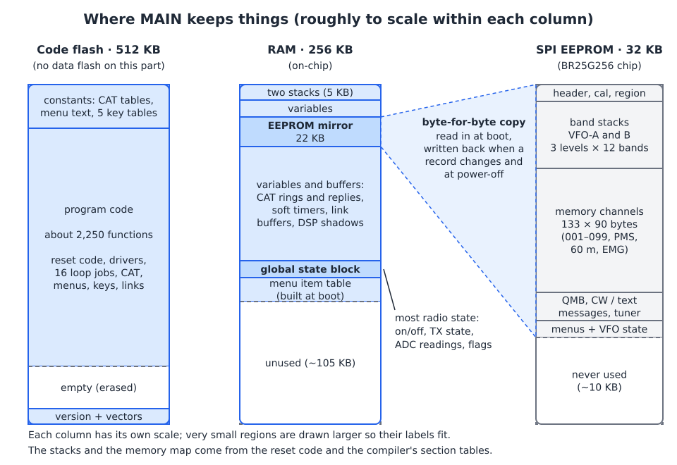

*Figure 6.4 — Where MAIN keeps things. The 22 KB block of RAM that mirrors the EEPROM holds every setting, memory channel and band stack.*

**Flash.** The RX651 in the FT-710 has 512 KB of code flash and, unlike its bigger brothers, **no data flash at all**. The first 64 KB of the
image hold constants: the CAT command tables, menu strings, and the five key-handler tables (section 6.5). The program code follows,
about 2,250 functions. The top of flash holds the version string (`V01-12`) and the reset vectors.

**RAM.** The 256 KB of RAM is less than half used. At the bottom are two small stacks. Most of the rest is ordinary variables and
buffers, with three areas worth naming:

- the **EEPROM mirror**, a 22 KB copy of the settings chip;
- the **global state block**, about 1 KB that holds most of the live radio state: on/off, the TX/RX sequencer state, the latest ADC
  readings and the flags that the DISPLAY link sets;
- the **menu item table**, built in RAM at boot (section 6.5).

**Settings live in an external EEPROM.** The chip is a ROHM BR25G256, a 32 KB [SPI](#glossary) [EEPROM](#glossary). MAIN does not use
an SPI peripheral for it. It [bit-bangs](#glossary) the bus: the code toggles the clock, data and chip-select pins itself. At boot it
reads the first 22.5 KB of the chip into the RAM mirror. From then on the program reads and changes settings only in RAM. A setting's RAM
address is simply a fixed base plus its EEPROM address, so the two copies line up byte for byte.

The mirror is written back in two ways. There is **no timed autosave**:

- **Small records, when they change:** a memory channel when you store it, a band-stack slot when it differs from the VFO, a QMB slot, a
  keyer message, a tuner-memory entry.
- **The whole image, when the radio goes down:** power-off, restart, factory reset, or a power failure.


*Figure 6.5 — What MAIN does with the EEPROM at boot. The only guard is a "save in progress" flag; the image has no checksum.*

The EEPROM image has **no checksum**. Its only protection is a 10-byte header with a save counter and a "clean" flag. Every save clears
the flag first and sets it again when it is done. If the power dies in between, the next boot sees the flag at 0. It then throws away
all user settings and keeps only the factory calibration table and the region ([destination code](#glossary)). A blank chip (all
0xFF) gets full factory defaults, including default calibration. That is worth knowing before you ever replace the EEPROM on a repaired
board *(inference)*. A low supply voltage blocks the small-record saves, so a brown-out cannot corrupt a half-written record
*(inference)*.

What is stored: the factory calibration table, the region code, two band stacks (VFO-A and VFO-B, 3 levels × 12 bands), 133 memory
channels (001–099, the PMS pairs, the 60 m channels and EMG), the QMB, keyer and text messages, the tuner memory, and the block of menu
values and VFO state. The last 10 KB of the chip are never used. Every VFO, memory, band-stack and QMB slot is the same 90-byte
record, so "recall" just copies 90 bytes into the working VFO record, and "store" copies them back.

### 6.4 MAIN's peripherals


*Figure 6.6 — What MAIN is wired to. Six UARTs are busy; two more are set up in code but go nowhere.*

The RX651 runs at 120 MHz from a 24 MHz crystal. Its peripherals do the following:

- **Eight serial ports ([SCI](#glossary)).** Two go to the [CP2105](#glossary) USB bridge, which gives the PC its two CAT COM ports
  ("Standard" and "Enhanced"). One goes to the rear TUNER/LINEAR jack. A menu setting turns that port into an external-tuner link, four
  band-data lines for a linear amplifier, a third CAT port, or four general-purpose outputs. One fast link (about 340 kbit/s) goes to
  DISPLAY. Two run at 115200 baud: one to the SDR FPGA and one to the IF DSP's console. The last two are set up by the start-up code and
  never used: an I²C port whose pins are not connected, and a "C4" UART that is never started.
- **Two 12-bit [ADCs](#glossary).** They measure forward and reflected power, the 13.8 V supply, ALC, PA drain current, two PA
  thermistors, the resistor ladder of the remote keypad, and an SDR-module detect voltage. A job starts a scan every 5 ms. The CAT
  command `SPIR` returns twelve of these readings.
- **One [DAC](#glossary).** It is a beep and sidetone generator. A timer feeds it a 36-sample waveform table at 36 times the tone frequency,
  and the output goes into the audio path. The familiar 880 Hz and 1046.5 Hz key beeps come from here.
- **[GPIO](#glossary) pins.** They drive the TX and RX supply lines, PA power, the speaker and headphone switches, the linear amp's SEND
  lines and the reset and update pins of the SDR and DSP chips. They read the CW key jack, the PTT inputs and the jack-detect switches.
- **A serial [shift-register](#glossary) bus** on GPIO pins. MAIN clocks data into DACs and shift registers on the MAIN and PA boards, for
  example the reference-oscillator trim DAC and the PA-unit control registers.
- **The watchdog** described in section 6.2.

MAIN has no USB of its own in use (its USB pins go only to test points), no display controller and no SD card interface.

### 6.5 Keys and menus


*Figure 6.7 — From a key press to the code that acts on it. DISPLAY only reports the key; MAIN decides what it means.*

**Keys.** MAIN has no key hardware. DISPLAY scans the front panel and sends each event as a small frame: press, release, or "still held
after about one second", plus a 16-bit key code. Physical front-panel keys have codes from 0x300 up. The soft keys drawn on the touch
screen use lower codes *(inference)*. MAIN then:

1. **Filters the event.** Some modes allow only a few keys. A key that is not allowed gives the error beep. Six codes are
   user-assignable: a menu setting swaps them for one of 15 fixed keys before anything else happens.
2. **Parks it in a one-slot mailbox.** There is no queue. If a second event arrives before job 15 runs, it overwrites the first.
3. **Calls a handler.** Job 15 looks the key code up in one of **five tables**, each with 863 entries (one per possible code): *press*,
   *short press*, *long press*, *repeat* and *release*. A small class table says which of them a key uses. Most keys act on press. Some
   do one thing on a short press and another on a long press. A few act on press and again on release. MAIN times the long press itself
   for the soft keys; for the physical keys it waits for DISPLAY's "held" event.

Knobs work the same way but with their own frame. DISPLAY sends raw step counts (main dial, the multi-function knob, the third knob) and
the positions of the two pots, and MAIN turns them into frequency steps or menu changes. Dial acceleration and step sizes must therefore
be MAIN's business *(inference)*.

**Menus.** The setup menu has no table in flash. At boot, one function makes **314 calls in a row**, one per menu item. Each call fills
in a small descriptor (name, group, limits, where the value lives, and functions to draw, step and act on it) and registers it in a RAM
table. 296 of the items are exactly the items that the CAT `EX` command reaches. The other 18 are the front-panel-only EXTENSION SETTING
group (date and time, SD card, software version, calibration, reset, certification).

All menu values sit in one block inside the EEPROM mirror, so they are saved with everything else. Changing a value only writes that RAM
byte. The jobs that care (the DSP link, the SDR link, the radio state) notice the change on their next pass and send it on. DISPLAY never
sees the menu table. It only gets a ready-made menu page in a screen packet: eight rows of text and a cursor.

### 6.6 DISPLAY: boot and tasks


*Figure 6.8 — One 3.3 MB program serves as boot loader and as application. It runs entirely from the RZ/A1H's 10 MB on-chip RAM.*

The DISPLAY CPU is a Renesas RZ/A1H, an ARM Cortex-A9 with 10 MB of RAM on the chip. The board has **no external RAM**. The program is
stored in a 16 MB Winbond [SPI flash](#glossary) and copied into the on-chip RAM at start-up. It is a single 3.3 MB C++ image: about
400 KB of code and 2.8 MB of pictures for the screen.

The same image appears three times in the flash: once at the start as the **boot loader**, and once in each of two **application
[banks](#glossary)**. At power-on (Figure 6.8):

1. The chip's built-in boot ROM runs the loader directly from flash.
2. The loader reads two flag words, one per bank, and jumps to bank 1 if its flag is valid, else to bank 2.
3. The bank copy starts again. It sees that the loader has already run, copies the whole image into RAM and unpacks its initial data.
4. `main` switches on the MMU and caches, sets up all the pins, starts the NORTi kernel and creates the first task, `root`.

If neither bank is valid, the loader stays in charge and shows the "BOOT LOADER" screen, from which you can update from the SD card
*(inference from the screen strings)*. An update always writes the bank that is *not* running, so the working copy stays intact while the new
one is written; the details are in [chapter 4](#4-firmware-files-and-how-updates-work).

**Standby and full start.** The `root` task decides how much to start. If the radio is "off" (the power-key line is idle and no service
key combination is held), it starts only the link to MAIN, a periodic wake-up and the GUI. When you hold the power key, it runs the rest
of the start-up list (USB host, touch, knobs, SD menu, PC link, recorder…) without rebooting the CPU. Holding **DNR + A/B + QMB** at
power-on forces the full start and brings up the boot-loader and update screen *(inference for the purpose)*. Another key combination shows SDR-link test counters.


*Figure 6.9 — DISPLAY's tasks. The update writers, the power task and the MAIN link run at the most urgent priority (3).*

About 32 tasks run under the kernel. A 10 ms system tick keeps time, and a 1 ms wake-up service starts the periodic tasks: every 1 ms
for key scanning, every 8 ms for the knobs, and every 33 ms (about 30 frames per second) for the screen. The rest sleep until an interrupt
or a message wakes them. Grouped by job:

- **Link to MAIN:** receive, dispatch, transmit, retry and pacing tasks. Every frame is acknowledged. After three failed retries,
  DISPLAY shows an error box or resets MAIN and then itself. Its watchdog timer serves only for that kind of deliberate reset; it never
  guards against a hang.
- **Input:** key scanning, the knobs, two pots, the touch panel and the USB mouse.
- **SD card and updates:** the SD driver, the update screens, the MAIN flasher, and the save/load/format menu.
- **PC link:** a task that streams the scope, the audio spectrum and a status block to the PC through the FT4222H USB chip. DISPLAY is
  the SPI slave on that link.
- **Recorder:** despite its name (`audio_codec`), there is no audio codec on the DISPLAY board. This task records and plays WAV files on
  the SD card, and the audio itself travels to and from the IF DSP inside SPI frames.
- **Debug and test:** a memory monitor and other console commands, gated off (section 6.7).
- **Never started:** a second UART link (SCIF4) and an IF-DSP update task are described in the image, but nothing creates them in V01-08.

### 6.7 DISPLAY: screens, touch, knobs, SD card and the hidden console


*Figure 6.10 — The GUI draws what MAIN describes. Both video channels read the same frame buffers, so the DVI jack shows the panel's picture.*

**Screens.** MAIN sends a [screen packet](#glossary) whenever something should change. The first byte says which screen it is (main
operating screen, menu page, memory list, popup, on-screen keyboard and so on), and the rest carries the text, numbers and cursor
positions. Every 33 ms DISPLAY compares the newest packet with the one on screen and redraws only the parts that changed. All graphics
are pre-drawn bitmaps stored in the image (2,240 of them, about 2 MB of pixels). Even the fonts are tables of pre-coloured character
bitmaps. The screen is built from four layers: a background, a main drawing layer, a layer for popups, and a small mouse-cursor layer.
The two middle layers are [double-buffered](#glossary): DISPLAY draws into one copy while the other is shown, then swaps them. The
RZ/A1H's video controller (VDC5) has two channels. One drives the 800×480 TFT. The other drives an LVDS link to the DVI output on the
MAIN board, and both read the same buffers. A few screens have no button: an LCD test pattern (solid colours and colour bars), the touch
calibration crosses, a screen saver with a drifting YAESU logo, and a BMP screenshot to the SD card.

DISPLAY changes screen on its own only at power-on, during a screenshot and in the boot-loader path. At power-on it shows the logo and
waits up to about 5 seconds for MAIN's first status packet. If none comes, it shows an error and offers the boot loader.

**Touch.** A TI TSC2003 touch controller on an I²C bus raises an interrupt when the pen goes down. DISPLAY then reads 12-bit X, Y and
pressure values, drops readings with implausible pressure, and maps them to pixels. A calibration screen asks you to touch five crosses.
DISPLAY fits a correction from them and stores it in its SPI flash.

**Knobs and keys.** The main dial uses a hardware quadrature counter, a second knob uses another counter, and the third knob uses an
interrupt pin. The two front pots are read by the ADC. Every 8 ms DISPLAY sends MAIN the raw count changes; it does no acceleration of
its own. Keys are scanned every 1 ms from a few direct inputs, a 4×4 matrix and two resistor ladders on the microphone connector, with
three equal samples (about 3 ms) needed to accept a change. Only one key is reported at a time. DISPLAY acts on a key itself in only
four cases: the power key, the boot key combinations, touch calibration and the debug console. Holding the power key for about a second
switches the radio on or off; a short press is the LOCK key.

**SD card.** The SD card appears as drive `I:`. Besides firmware files for updates ([chapter 4](#4-firmware-files-and-how-updates-work)), DISPLAY
keeps user files in `I:\FT-710\`: screenshots (BMP), memory-list and menu backups, and voice recordings (WAV). A memory or menu backup is
32,000 bytes of MAIN's settings, exchanged with MAIN over the link and scrambled with the same key as the firmware files, with a CRC. It is not a
text file.

**The hidden debug console.** The DISPLAY firmware contains a debug console for a USB keyboard. It has a memory peek-and-poke monitor
that can also run script files from the SD card, self-update commands, a MAIN-update command and keyboard tests. It is switched off by a
single 32-bit word in RAM that must hold a magic value. The shipped firmware sets it to 0, and the only code that would set it is never
called. So in V01-08 you cannot reach the console without changing the firmware. [Chapter 8](#8-hacking-and-custom-firmware) looks at
what it would take.

### 6.8 Where to look

| Topic | Reference page | Key names and addresses |
|---|---|---|
| MAIN boot, loop, timers, power states | [code/main/README.md](../code/main/README.md) | `PowerON_Reset` 0xFFF8FBDB, `app_main` 0xFFF94AFA, `main_loop` 0xFFF94B8B, `swtimer_start` 0xFFFB237A, `sw_reset` 0xFFFB3E55, global state block 0x20B04 |
| MAIN peripherals, GPIO map, ADC, DAC, watchdog | [code/main/peripherals.md](../code/main/peripherals.md) | `R_Systeminit` 0xFFF8F65E, `R_IWDT_Create` 0xFFF927A9, `tone_set` 0xFFFB2E1E, `power_off_io` 0xFFFB73A6 |
| MAIN UART drivers and channel map | [code/main/sci.md](../code/main/sci.md) | `R_SCI0..7_Create`, `sci_start_all` 0xFFFB1632 |
| EEPROM driver, map, saves, defaults | [code/main/eeprom.md](../code/main/eeprom.md) | `eeprom_load_all` 0xFFFB0229, `eeprom_save_all` 0xFFFB02AF, `eeprom_save_opstate` 0xFFFB02CF, mirror RAM 0x464F = EEPROM 0x0000 |
| Menu engine | [code/main/menu.md](../code/main/menu.md) | `menu_build_all` 0xFFFD4C30, `menu_register` 0xFFFD442F, item table 0x2105C, values 0x9A2A..0x9E85 |
| Key events and handler tables | [code/main/ui-keys.md](../code/main/ui-keys.md) | `key_event_filter` 0xFFFB44F7, `key_task` 0xFFFBBD58, tables 0xFFF89D94 / 0xFFF8AB10 / 0xFFF8B88C / 0xFFF8C608 / 0xFFF8D384 |
| VFO records, band stacks, frequency polling | [code/main/radio-control.md](../code/main/radio-control.md) | VFO-A 0x9D09, VFO-B 0x9D63, `sdr_task` 0xFFFA11ED |
| DISPLAY overview | [code/display/README.md](../code/display/README.md) | image base 0x20100000 |
| DISPLAY boot, banks, tasks, kernel, debug gate | [code/display/boot-rtos.md](../code/display/boot-rtos.md) | `Reset_Handler` 0x2010002C, `boot_select_bank` 0x20100ABC, `main` 0x20117294, `task_root` 0x201170C8, `boot_mode_full` 0x20116E84, `debug_enabled` 0x20111098 (word 0x20450000) |
| GUI, screens, layers | [code/display/gui.md](../code/display/gui.md) | `gui_main_loop` 0x20130188, `gui_screen_update` 0x2012EBB8 |
| Keys, knobs, touch, USB, console | [code/display/input.md](../code/display/input.md) | `task_key` 0x201137F8, `task_detect_renc` 0x20112AD4, `task_tsc2007` 0x20103464 |
| Clocks, pins, RTC, recorder, SD files | [code/display/peripherals.md](../code/display/peripherals.md) | `task_sdmenu` 0x2011010C, `task_audio_codec` 0x201065C4 |
| The link between the two | [code/display/mainlink.md](../code/display/mainlink.md), [code/main/display-link.md](../code/main/display-link.md) | `mainlink_init` 0x201163A0, `displink_task` 0xFFF94D6F |
| Memory maps | [memory-maps.md](../memory-maps.md) | MAIN flash 0xFFF80000, DISPLAY flash banks 0x18400000 / 0x18A00000, flags 0x183E0000 / 0x183F0000 |
| Chips and wiring | [hardware.md](../hardware.md) | Q1001 RX651, Q6009 RZ/A1H, Q1008 BR25G256, Q6018 W25Q128 |

## 7. Inside the IF DSP and the SDR FPGA

**In short.** Two chips do the radio's signal work. The SDR module's FPGA, a Xilinx Artix-7, takes the
digitised antenna signal, mixes it down and filters it, and hands a low-rate stream to the IF DSP. The IF DSP, an NXP i.MX
RT685, turns that stream into audio for the speaker and turns microphone audio into a transmit stream for the FPGA. The IF DSP
has two processors on one chip. A small Arm core manages things: it talks to MAIN, sets up the audio codec and starts the
second core. A HiFi4 DSP core at 594 MHz does the audio processing. MAIN steers both chips by writing numbered registers over
a UART. The FPGA has no processor at all. Its "firmware" is a bitstream, a wiring plan for the chip. We turned that bitstream
back into a circuit that runs in a simulator and found two UARTs inside it, one of them a hidden debug console.

### 7.1 The IF DSP: one chip, two processors


*Figure 7.1 — The IF DSP chip (Q2002). The M33 manages, the HiFi4 processes, and the register file in shared memory joins them.*

The IF DSP chip is an NXP i.MX RT685. One firmware file (`FT-710_IFDSP_V0101.SFL`) holds the programs for both of its cores:

- The **[Cortex-M33](#glossary)** runs at 198 MHz under [FreeRTOS](#glossary). It is the manager. It boots
  from the 16 MB [QSPI](#glossary) flash, copies the DSP programs into place and starts the DSP. It sets up the
  TLV320AIC3204 audio [codec](#glossary), and it runs a small text console on a UART that MAIN uses to control the chip.
  It also turns one register into a PWM output that goes, through an RC filter, to a test point *(inference: an analogue
  meter or test output)*.
- The **[HiFi4](#glossary) DSP** is a Cadence audio DSP core running at 594 MHz under Cadence's small
  [XOS](#glossary) kernel. It is the worker. It moves the audio streams in and out and does all the signal processing,
  in 32-bit floating point.

The two cores share the chip's SRAM. Three areas of it matter:

1. **The register file** at `0x20070000`: 32,768 words of 16 bits. MAIN writes a word through the M33's console, the M33
   stores it there, and the DSP reads it straight from memory. There is no lock and no notification; the DSP just reads the
   current value. This is the real control path (section 7.4).
2. **Audio DMA buffers** at `0x20060000`. Only the DSP uses them. No audio ever crosses from one core to the other.
3. **An rpmsg message window** at `0x20020000`. NXP's [rpmsg-lite](#glossary) message link between the cores is fully set
   up, in the pattern of NXP's RT685 audio examples *(inference)*, but no code ever sends a message on it. It carries no traffic in this
   firmware.

The cores also share two small hardware helpers: the **Messaging Unit** ([MU](#glossary)), which gives each side three
flag bits the other can see, and the **[SEMA42](#glossary)** hardware semaphore. Both are used only once, for the start-up
handshake in the next section.

### 7.2 How the IF DSP starts up


*Figure 7.2 — IF DSP start-up. The M33 does all the preparation, releases the DSP, and only opens its console after the
three-step flag handshake.*

Follow the numbers in the figure:

1. The chip's boot ROM reads a configuration block at the start of the flash, which tells it how to talk to the flash
   (quad SPI), and jumps to the M33 code.
2. The M33 holds the DSP stalled and copies its own program, about 32 KB, from flash into SRAM.
3. It sets up the clocks. The RT685 has no crystal of its own: its reference is the 18.432 MHz `DSP_CLK` signal from
   the SDR module. From that the PLLs make 198 MHz for the M33 and 594 MHz for the DSP.
4. It clears the register file, resets the codec and sends it 67 settings, starts the PWM and sets up the rpmsg link.
5. It copies the three DSP program images out of flash (a plain copy, no checksum) and releases the DSP.
6. The DSP writes its default value into every register it uses, creates its threads and starts the audio.
7. The two cores step their MU flags through 1, 2 and 3, passing SEMA42 gate 0 between them as a token. The point of
   this *(inference)*: when the M33 sees flag 3, the DSP has finished writing its defaults, so nothing MAIN writes later
   can be overwritten by them.
8. The M33 writes the version (register 0 = `0x0101`, meaning V01-01) and sets bit 0 of register 1 ("DSP is up"), then
   starts the console task.
9. MAIN sends `i DB00` to switch the console to machine mode, reads register 0 and waits for bit 0 of register 1.

There are no timeouts in the handshake. If the DSP never reaches flag 3, the M33 waits forever, the console never starts
and MAIN gets no answers. Nothing in the image restarts the DSP once it runs, and no watchdog is started *(inference: only
a reset of the whole chip from MAIN would recover a hung DSP)*.

### 7.3 Audio in, audio out


*Figure 7.3 — The audio path through the HiFi4. Receive runs along the top, transmit along the bottom. The FPGA's role on
the left is inferred (section 7.7).*

The DSP has four [I2S](#glossary) audio ports and one SPI port, all driven by [DMA](#glossary):

| Port | Direction | Carries |
|---|---|---|
| RX IF | SDR FPGA → DSP | the received signal, as stereo pairs *(inference: I and Q)* |
| TX AF | DSP → SDR FPGA | the transmit signal |
| codec in | codec ADC → DSP | microphone (and line) audio |
| codec out | DSP → codec DAC | speaker (and line) audio |
| SPI, 1 MHz | DSP → DISPLAY | spectrum / scope data; the DSP is the SPI master |

On every I2S port the DSP is the clock **slave**: the SDR FPGA clocks the RX IF and TX AF ports, and the codec, which is
the I2S master, clocks its own ports.

**Blocks of 24 samples.** Audio moves in blocks of 24 samples. The sample rate is **12 kHz** *(inference, strong: the
constant 1/12000 converts Hz in about ten places, and a frequency field is clamped just below 6 kHz)*, so one block is
2 ms. Six threads share the work:

- **Rx_Path** runs once per block: RX IF in, the receive chain, out to the codec. The codec's DAC paces it.
- **Tx_Path** runs once per block: codec in, the transmit chain, out to the FPGA. The codec's ADC paces it.
- **Rx_Audio** takes 12 blocks at a time (24 ms) and reads most of the receive-side settings.
- **Spi** takes every 7 blocks, decimates them, builds 128-point spectrum data and sends it to the DISPLAY.
- **Main** wakes every 100 ms: it copies some input pins into a register and, every second, writes each thread's CPU
  load into registers `0x2000`–`0x2007`.
- **Ipc** handles the start-up handshake and would answer rpmsg messages if any came.

Because the codec clocks the two path threads, the SDR side is decoupled by small two-block FIFOs.

**What the DSP algorithms are, as far as we know.** The DSP code was read with a Zephyr toolchain disassembler that
understands the HiFi4's wide instruction bundles, which Ghidra cannot decode. The kernels are listed by call, not yet
worked out one by one. The filter responses below are measured from the coefficient tables; what each filter is for is
inferred from its shape and from the registers that select it:

- **Receive filters.** Four 257-tap FIR low-pass filters with edges at 700 Hz and 1000 Hz, each in a gentle and a sharp
  version, chosen by one register *(inference: CW / narrow filters)*. A sharp 2.8 kHz low-pass for receive audio. A
  notch-or-peak filter whose type and frequency (up to 5,999 Hz) come from register `0x45` *(inference)*.
- **Transmit filters.** Seven voice band-pass filters from about 23–4,137 Hz down to 363–2,766 Hz, chosen by index
  *(inference: the SSB transmit bandwidth menu)*.
- **Tones.** A table of the 50 standard CTCSS tones (67.0–254.1 Hz) used by a decoder and an encoder, with a 316 Hz
  low-pass and ~300 Hz high-pass filters around them *(inference: [CTCSS](#glossary) encode, decode and removal)*.
- **Equalisers.** Three-band parametric EQs for transmit (registers `0x25`–`0x2D`) and receive (`0x48`–`0x50`), and a
  speech-processor switch (`0x2E`) *(inference, from MAIN's formulas)*.
- **Adaptive filter.** A 51-tap normalised [LMS](#glossary) filter *(inference)*; what it is used for is not
  established.
- **Levels.** Two level-control blocks with attack/release-style constants *(inference)*, a keying ramp, and level
  outputs that MAIN reads as meter values.
- **Scope.** FFT twiddle tables and a sharp 1 kHz low-pass in front of the decimate-by-7 scope path *(inference)*.

Noise blanker, noise reduction, AGC and the demodulators themselves are not yet identified in the code.

### 7.4 The register file: how MAIN turns the knobs


*Figure 7.4 — The IF DSP register file at a glance (not to scale). 113 registers are listed, and the scan found code using 98 of them; the rest of
the 32K words are unused.*

Every IF DSP setting is one 16-bit word in the register file. When you turn a knob or change a menu item, MAIN works out
the new register value, compares it with the value it last sent, and if it differs sends one frame to the M33 console:
`r` + 4 hex digits to read, or `w` + 4 + 4 hex digits to write, each followed by a two-digit checksum and CR. The M33
answers a write with ACK (`0x06`) and a read with the value. Chapter 2 shows the frame format byte by byte.

The console has two modes. A person at a terminal gets the **interactive** mode: echo, a `>> ` prompt and the commands
`r`, `w`, `d` (dump 64 words) and `i`. MAIN switches it to the quiet **machine** mode at start-up:


Who uses which registers:

- **MAIN writes 72 registers** and reads only registers 0–4: the version, a flag word (bit 0 = DSP up; other bits are DSP
  flags that MAIN uses for squelch *(inference)*), two level words that MAIN averages into meter values *(inference: S-meter
  and similar)*, and a signed offset that MAIN adds to the VFO in tens of Hz *(inference: CW zero-in)*.
- **Register 6 is the demodulator class**: CW-U 0, CW-L 1, USB-type 2, LSB-type 3, AM 8, FM 9. MAIN derives it from the
  operating mode.
- **The DSP keeps its own tuning constants** around `0x4000`. MAIN never writes most of them, so they keep their
  defaults.
- **Two 4 KB capture blocks** (registers `0x7000` and `0x7800`) exist in the DSP, but no code fills them in this build
  *(inference: a leftover debug capture)*.

The CAT service commands `SPDR` / `SPDW` send the same `r` / `w` frames, so a PC can read and write this register file
directly (chapter 5). `SPDW` changes DSP parameters live and is not to be sent to the radio without the owner's approval.

### 7.5 The SDR FPGA: firmware without a CPU


*Figure 7.5 — The SDR image is a bitstream: configuration bits for every part of the chip, not a list of instructions.
The chip is nearly full.*

The SDR module holds a Xilinx Artix-7 **XC7A50T** [FPGA](#glossary), an ADC, possibly a DAC *(inference)*, and a QSPI
flash. The `FT-710_SDR_V0104.SFL` file has no program in it. It is a [bitstream](#glossary): about 2.2 MB of
configuration bits. Each bit sets one small thing: an entry of a logic lookup table ([LUT](#glossary)), the start value of a
flip-flop, an option of a hardware multiplier ([DSP48](#glossary)), a word of block RAM ([BRAM](#glossary)), or a switch
that joins two wires. At power-on the FPGA reads the bitstream from the QSPI flash, and from then on the hardware just
runs. Nothing is fetched or executed.

The file has a 4 KB header whose first word is a CRC-32 of the rest, then Xilinx's standard configuration commands
(quad-SPI boot, chip ID `7A50T`), then the payload: 5,420 **frames** of 101 words each. Frames 0–4,389 hold the logic and
routing, and frames 4,390–5,419 hold the block-RAM contents. A CRC and a start command finish the file. The bitstream is
neither compressed nor encrypted.

The design nearly fills the chip: 82 % of the LUTs, 48 % of the flip-flops, **119 of the 120 multipliers** and 70 of the 75
block RAMs. A design with nearly every multiplier in use is a signal-processing design *(inference)*. The block RAMs hold only numeric
tables: an exact cosine in 0.5-degree steps, a 720-step raised-cosine ramp, a bank of six symmetric low-pass FIR filters,
a 1,024-tap filter, and phase tables, some copied four times. There is **no soft CPU** (such as a MicroBlaze) in block RAM
*(inference, high: every initialised memory decodes as a smooth table, not code)*.

### 7.6 From bitstream to readable Verilog


*Figure 7.6 — How the bitstream became a circuit we can run and read. Each step has its own tool and check.*

A bitstream is not meant to be read back, but the open-source [Project X-Ray](#glossary) database documents what most of
the XC7A50T's configuration bits mean. With it we rebuilt the circuit in steps:

1. **Decode the file** (the SFL decoder of chapter 4) to get the raw bitstream.
2. **Sort the frames by address.** The rebuilt frame order gives exactly 5,420 frames, the count in the file.
3. **Translate bits into [FASM](#glossary) features**, lines like "this LUT has this truth table" or "this wire switch
   is on": 549,000 lines. Apart from the per-frame error-check bits, only 407 of 2.36 million set bits stay
   unexplained.
4. **Build a cell [netlist](#glossary)**: 63,648 cells (LUTs, flip-flops, carry chains, multipliers, RAMs, clock buffers,
   I/O pins) joined by 127,648 nets, with no net driven twice. The LUT and flip-flop counts match the bitstream counts
   exactly.
5. **Recognise blocks** by tracing clocks, pins and logic equations: the clock tree, the ADC input, the QSPI flash pins
   and two UARTs.
6. **Write structural Verilog**: one module with 63,474 Xilinx primitives. The Yosys synthesis tool reads it without
   errors. As a first check, a cut-out of one UART receiver, fed real serial bytes in a simulator, decoded every byte
   exactly.
7. **Simulate the whole chip** with [Verilator](#glossary), which compiles the design into a fast C++ model (about 15,000
   clocks a second). Fed MAIN's start-up frame `r000032`, it answers `r010437`: register 0 = `0x0104`, version V01-04.
8. **Re-write by hand.** `hdl/sdr/uart_link.v` is a readable re-implementation of MAIN's link. Run side by side with the
   recovered netlist on directed and random traffic, it gives **0 mismatching clocks** on the transmit pin.

Everything built from the bitstream (FASM, netlist, Verilog) stays in the ignored `build/` folder. Only the tools and the
hand-written HDL are in git.

### 7.7 What is inside the FPGA


*Figure 7.7 — Inside the XC7A50T. Solid boxes are seen in the netlist; dashed boxes are inferred from the tables and
resource counts.*

What the netlist shows for certain:

- **One clock for almost everything.** An LVDS clock from the ADC drives every multiplier, the block RAMs and all but about
  300 flip-flops. It runs at **125 MHz** *(inference, high: the UART bit timer divides by 1,086, which is 115,200 baud at
  125 MHz, and the service manual says "Operating clock 125MHz, Divide 250MHz by 2")*. A second LVDS clock from the ADC
  captures 14 data pairs at double data rate ([LVDS](#glossary), [DDR](#glossary)): the two 14-bit channels of the dual ADC, one on
  each clock edge *(inference, from DC4KU's "dual-channel 14-bit ADC")*.
- **Two cascaded clock generators** ([MMCM](#glossary)s) make a clock of about 28 MHz *(inference from the divider
  settings)* that goes straight to one output pin. Its role is open. It may well be `DSP_CLK`, the DSP's 18.432 MHz clock: the
  28 MHz reading needs a clock generator setting outside the chip's legal range, so one divider is probably misread, and one other
  plausible reading gives 18.432 MHz almost exactly *(guess)*.
- **17 LVDS output pairs**, clocked at double data rate *(inference: the transmit DAC)*.
- **A QSPI master on the configuration-flash pins.** The FPGA can read and write its own flash. This is how an update
  rewrites the bitstream (chapter 4) *(inference for the purpose)*.
- **Two identical UARTs at 115,200 baud**, sharing one register bank:
  - **UART B is MAIN's link** (MAIN's UART5). It keeps the last 11 characters in a window and acts on CR, so it accepts
    exactly MAIN's `r` and `w` frames with checksum (chapter 2), answers reads with the value and writes with ACK, and
    answers anything else with `?`. An empty line repeats the previous command.
  - **UART A is a debug console** (`UART_DBG` on the connector; identified by its behaviour). After reset it prints the prompt `[IF]>`. It echoes
    each character and takes `r AAAA` and `w AAAA VVVV` (space or comma) with exactly four hex digits. Anything else
    prints `Err`.
- **Register 0 = `0x0104`** (V01-04, read-only). MAIN reads it at start-up and reports it as the SDR version.
- **The `x` command.** Both UARTs' character tables accept the letter `x`, but every form of `x` that was tried in
  simulation fails (`?` on the link, `Err` on the console). It has no reachable function in this bitstream with the other
  input pins at 0 *(inference: unused, or enabled by an input pin)*.

A short session on the debug console, as the simulation shows it (line breaks simplified):

```text
[IF]>r 0000
0104
[IF]>w 0015 1234
[IF]>r 0015
1234
[IF]>x 0000
Err
[IF]>
```

What is inferred, not seen: the receive path (a mixer driven by the cosine table, then the bank of decimating FIR
filters), the transmit path (the raised-cosine ramp shaping the keying envelope), and a scope/FFT engine using the
four-times-replicated phase tables. The netlist does show several tables feeding multiplier inputs directly, but the
multipliers' exact modes are not decoded yet.

### 7.8 Open questions


*Figure 7.8 — Open questions for the two signal chips.*

- **IF DSP algorithms.** The DSP code is readable as assembly, but the receive and transmit chains are listed by call, not
  yet by algorithm. Register 6's numbering on the DSP side and most receive-side registers still need names.
- **Sample rate.** The DSP code points to 12 kHz, but the DISPLAY saves the recorded audio it gets from the DSP as a 16 kHz
  WAV. Either the scope/record thread resamples, or the WAV header is nominal.
- **Codec clock.** No M33 code selects the codec's master-clock output, so the DSP must do it, or the pin keeps its reset
  setting *(inference)*.
- **ADC.** It is a dual-channel 14-bit converter, most likely at 125 MSPS per channel, but the part number is unknown, and the
  logic that adds the two channels has not been located in the netlist yet.
- **FPGA package.** The bitstream does not record the package. Only the CSG324 and FGG484 packages connect every pin
  the design uses, so the pin-to-ball map, and with it the J2002 pin path, stays open until someone reads the chip marking
  (chapter 8).
- **Remaining pins.** The DISPLAY's scope SPI and the I2S lines to the IF DSP have not yet been matched to FPGA pins. The
  whole-chip simulation can do it by driving candidate pins and watching the outputs.
- **Arithmetic.** The multipliers' operating modes are not decoded, so the receive and transmit maths is read from the
  tables, not from the circuit.
- **Small mysteries.** The `x` command, the ~28 MHz clock, the meaning of the update commands written to register `0x32`, and whether the FPGA boots
  the updated image directly or through a fall-back image. A console RTL to match `uart_link.v` is not written yet.

Plans for loading a test bitstream over JTAG, and for custom DSP or FPGA code, are in chapter 8.

### 7.9 Where to look

IF DSP reference pages:

- [IF DSP overview](../code/ifdsp/README.md): block diagram, boot flow, memory map, key numbers.
- [Control link](../code/ifdsp/control-link.md): console grammar, the full register map, the codec set-up table.
  Functions: `console_rx_char` 0x00081430, `regfile_write` 0x00080C4C, `aic3204_init` 0x00080BD0,
  `sct0_pwm_callback` 0x00081164. MAIN side: frame builder `dsp_send_frame` 0xFFFA0B4C, `SPDR`/`SPDW` via `cat_SP_dev4_reg`
  0xFFFA4E8F.
- [IPC](../code/ifdsp/ipc.md): MU flags, SEMA42 gate 0, the idle rpmsg-lite link (shared memory 0x20020000, endpoints
  0x28 and 0x1E). M33 `app_main` 0x0008106C, DSP `Thread_Ipc_entry` 0x0021C3B4.
- [M33 platform](../code/ifdsp/m33-platform.md): flash layout, clock tree, pin mux, the DSP loader `BOARD_DSP_Init`
  0x00084AD8, FreeRTOS tasks.
- [HiFi4](../code/ifdsp/hifi4.md): threads (`xos_create_main_ipc_threads` 0x0021C498, `Thread_Rx_Path_entry` 0x002262FC,
  `Thread_Tx_Path_entry` 0x0022647C), I2S/DMA set-up, register use, coefficient tables, `nlms_51tap_update` 0x00223250.
- [Memory maps](../memory-maps.md), IFDSP section: flash image layout and the shared SRAM areas.

SDR reference pages:

- [SDR overview](../code/sdr/README.md) and [bitstream layout](../code/sdr/bitstream.md): header CRC, frame map.
- [Resources](../code/sdr/resources.md) and [block-RAM tables](../code/sdr/bram-tables.md): utilisation, MMCMs, I/O
  counts, the table catalogue and the MicroBlaze verdict.
- [Interfaces](../code/sdr/interfaces.md): the J2002 connector pin map and the update sequence.
- [Netlist](../code/sdr/netlist.md): the recovery steps, clocks, pin map by bank, UART links, simulation results.
- [`hdl/sdr/`](../../hdl/sdr/README.md): `uart_rx.v`, `uart_link.v`, the testbenches and the Verilator harness.
- Tools: `tools/xc7_db.py`, `tools/xc7_fasm.py`, `tools/xc7_netlist.py`, `tools/xc7_blocks.py`,
  `tools/xc7_netlist_verilog.py`, `tools/sdr_uart_sim.py`. Task notes: [T15](../tasks/T15-fpga-netlist.md),
  [T15e](../tasks/T15e-fpga-uart-rtl.md).

## 8. Hacking and custom firmware

**In short.** Can the owner run their own code on the FT-710? As far as the analysis can tell, yes. None of the four
images is signed, none is encrypted, the MAIN CPU has no lock bits set, the FPGA bitstream is not encrypted, and every
chip has a debug or boot header on the board. Free compilers exist for everything except the HiFi4 audio DSP core. The
project has already built two small DISPLAY patches and planned a first FPGA test. **None of them has been applied to
the radio.** Every write to the radio waits for the owner's approval. This chapter shows what is possible, which cable
goes where, how risky each kind of experiment is, and what is waiting for a decision. How an update file is built and
loaded is covered in [chapter 4](#4-firmware-files-and-how-updates-work); this chapter only points there.

### 8.1 Is it possible? A scorecard per chip


*Figure 8.1 — What stands between the owner and their own code, chip by chip. White means nothing in the way.*

Locked-down products usually stop you in one of three ways: a signature check, encryption, or lock bits that close
the debug port. The FT-710 uses none of them.

- **No signatures.** The update files ([SFL](#glossary)) are only scrambled with a fixed 43-byte key and protected by
  a CRC-32 with a fixed salt. The project's own encoder rebuilds all four shipped files byte for byte, so it can also
  build changed ones. The radio's update loader checks the CRC and the file name, and nothing else: no signature, no
  model, no serial number (details in [chapter 4](#4-firmware-files-and-how-updates-work)).
- **No encryption.** The DISPLAY and IFDSP images are plain ARM code. The FPGA bitstream is an ordinary, uncompressed
  Vivado file with no encryption set.
- **No lock bits on MAIN.** The Renesas RX651 keeps its protection settings in a 116-byte
  [option-setting memory](#glossary). In the shipped image every byte is `0xFF`. Checked against the Renesas hardware
  manual, that means: no ID-code protection (the ID is sixteen `0xFF` bytes), serial programming allowed, no access
  window, no ROM-code or Trusted Memory protection. That is good news, but it is also a trap: see
  [8.7](#87-golden-rules).
- **Two "maybe" cells.** The IFDSP's RT685 can enforce secure boot through one-time-programmable
  [OTP](#glossary) fuses. They cannot be seen from the image. The plain image suggests secure boot is off
  *(inference)*; only reading the fuses over the debug port would tell, and that needs approval.
- **One hard part.** The RT685's HiFi4 audio DSP core needs Cadence's proprietary Xtensa toolchain, and Ghidra cannot
  decode its bundled instructions. The practical way round: change DSP behaviour through the parameter registers that
  MAIN already writes (see [chapter 7](#7-inside-the-if-dsp-and-the-sdr-fpga)), and put new signal processing on the M33 core or in
  the FPGA.

The FPGA has a different limit: room. The stock design already uses about 82 % of the logic and 119 of the 120 DSP
blocks, and there is no HDL source, only a netlist recovered from the bitstream. Adding to the stock design is tight;
a replacement must redo the ADC capture, filters, scope link, TX path and the UART to MAIN.

The realistic first step is therefore **patching** the existing images (small hooks, a new CAT command, a menu item,
switching on a hidden debug console) rather than writing whole new firmware.

### 8.2 The debug headers


*Figure 8.2 — The four debug headers, their pins, and the adapter each one needs.*

Each processor has a small header on the board. All four are flat-flex ([FFC](#glossary)) sockets of the FLT-SM2
family, so you need a matching FFC breakout board and a short flat cable; the pitch should be measured before ordering
*(inference)*.

- **J1004 "RX-CPU DEBUG" → MAIN (RX651).** Carries the mode pin, reset, the `UB` boot pin and the SCI1 serial port.
  With a **Renesas E2 emulator Lite** it gives [FINE](#glossary) debugging and flash programming. With a plain 3.3 V
  USB-UART and the mode pin held low at reset, the RX651 starts its built-in [serial boot mode](#glossary), the same
  route DISPLAY uses to update MAIN. Pins 1–6 are known; pins 7 and 8 only go to test points. One catch: the serial
  pins are shared with the MAIN–DISPLAY link, so DISPLAY has to be held in reset (J6003 pin 7) or its transmit line
  isolated while an adapter drives them *(inference)*.
  An older version of the hardware notes called this header J1005; the parts list shows it is J1004.
- **J6003 → DISPLAY (RZ/A1H).** Plain ARM [JTAG](#glossary). A **SEGGER J-Link** (or another ARM JTAG probe with
  OpenOCD) can halt the Cortex-A9, write RAM, and reach the SPI flash. This is the header for the debug-console RAM
  write ([8.4](#84-the-prepared-patches)) and for repairing DISPLAY's boot flags if a patched image will not boot.
- **J2009 "DSP_JTAG" → IFDSP (RT685).** ARM [SWD](#glossary) plus a UART. A J-Link, NXP MCU-Link or any CMSIS-DAP probe
  works; a 3.3 V USB-UART fits pins 5 and 6. Reading the OTP fuses would go through here (approval needed).
- **J2001 "SDR JTAG" → SDR (XC7A50T).** Plain FPGA JTAG. A Xilinx Platform Cable USB II, a Digilent JTAG-HS2/HS3, or an
  FT2232H cable with openFPGALoader. A JTAG load goes into the FPGA's configuration RAM only and never touches its
  flash ([8.5](#85-the-fpga-hello)).

The fifth "recovery header" needs no cable at all: the **SD card**. As long as DISPLAY boots, the stock update files
restore every image.

### 8.3 How risky is each step?


*Figure 8.3 — The risk ladder. Climb one rung at a time; every rung from 1 upward needs the owner's approval.*

Experiments differ a lot in what can go wrong and how you get back.

- **Rung 0, paper and simulation.** Reading the docs, working in Ghidra, and running the recovered FPGA netlist in the
  [Verilator](#glossary) model. The radio is not involved.
- **Rung 1, read-only CAT queries.** Sending a query such as `VE0;` over the USB serial port. Nothing is written, but it
  still talks to the radio, so it still needs approval. Set commands are a different matter: some of the undocumented
  ones rewrite EEPROM, calibration or the region code ([chapter 5](#5-cat-remote-control)).
- **Rung 2, volatile JTAG.** A RAM write on DISPLAY, or loading a test design into the FPGA over JTAG. The change lives
  in RAM only; **a power cycle removes it** *(inference)*. While an FPGA test design is loaded the radio is deaf, but
  that also ends at the power cycle.
- **Rung 3, SD-card patch of DISPLAY.** A patched DISPLAY file installed through the normal update menu. It stays after
  power-off. The way back is to install the stock file the same way. DISPLAY keeps two flash banks, but don't count on
  the old bank: after a *successful* update only the new bank is marked bootable, and the old one is usable only if
  the update was interrupted. If a patched DISPLAY crashed early in boot, the panel could not help, because the boot
  loader jumps to the bank before it looks at any key. Then the only way back is J6003 *(inference)*.
- **Rung 4, MAIN reflash.** A patched MAIN image, through the SD card (DISPLAY drives MAIN's serial boot mode) or
  through J1004. Recoverable in principle the same two ways, as long as DISPLAY still runs. Each MAIN update also rewrites the
  option-setting memory, which Renesas rates for 1000 program/erase cycles, so that is the practical limit on MAIN
  updates *(inference)*.
- **Rung 5, the option-setting memory.** Never change it. Some of its settings cannot be undone, ever ([8.7](#87-golden-rules)).

### 8.4 The prepared patches


*Figure 8.4 — The two DISPLAY patches and the RAM-only alternative. All are built or planned; none has been applied to the radio.*

The project built two DISPLAY patches as finished update files. They exist only in the project's local `build/`
folder, which is never committed. **Neither has been flashed.** Both were checked the same way: decode the file again, check the CRC, run every
rule of the update loader, and compare a full disassembly of the old and new image.

**Patch 1, "banner"**, is a harmless first test. It changes the title of DISPLAY's power-on maintenance screen from
`YAESU FT-710 BOOT LOADER V01-02` to `... T16-01`. Four bytes differ, the length stays the same, and no code compares
this string. Reaching that screen puts the GUI into loader mode, so look at the title and leave without starting an
update.

**Patch 2, "debug gate"**, switches on a hidden console. DISPLAY contains a ready-made debug console driven from a
USB keyboard: a memory monitor (read or write any address), scripts run from the SD card, debug overlays on the F-keys,
a link logger, and some self-flash and reset commands. It only runs when a magic word, `0xA0B9C8E7`, sits at one RAM
address. In V01-08 nothing ever writes that word, so the console is dormant. A tiny check function compares the word
and returns "yes" or "no". The patch changes the "no" instruction (`movne r0,#0`) into "yes" (`movne r0,#1`). That is
one byte in the whole image.

**The RAM-only alternative** does the same without touching flash. With a JTAG probe on J6003, halt the DISPLAY CPU
after boot, write `0xA0B9C8E7` to address `0x20450000`, and let it run. The console works until the next reset
*(inference)*. This is the recommended "step 0" if a probe is at hand.


*Figure 8.5 — The written plan for the debug console: a volatile test first, then the SD-card patch, with a way back at each step.*

The plan names the risks honestly. The console listens to **every** keyboard report, whatever field has focus, so
typing `up0` and Enter while naming a memory channel would start rewriting DISPLAY's boot-loader region from a file on
the SD card. Keep no such files on the card and plug the keyboard in only when you use the console. The F-keys gain a
second meaning (F11, for example, replaces live scope data with test tables). Careless writes from the memory monitor
can crash the CPU, which a power cycle fixes. The console has no text output: results show on the overlay or land in
RAM.

### 8.5 The FPGA "hello"


*Figure 8.6 — The planned stage-1 FPGA test: proof that a self-built design loads and runs, without driving a single pin. Plan only.*

The first FPGA experiment is designed to prove one thing: that a design built by the owner loads and runs on this
FPGA. It is a **plan, not done**.

- **No pins.** The test design has no inputs or outputs at all, so it cannot drive anything on the board. That also
  means it doesn't need to know the FPGA's package or pin map, which are not fully known yet.
- **Its own clock.** It uses the FPGA's internal configuration oscillator (about 65 MHz) and a 32-bit counter.
- **Read back over JTAG.** A JTAG user register (`BSCANE2`) returns the text `HELO` plus the counter. A counter that
  changes between two reads proves the fabric runs. A custom [USERCODE](#glossary) (`0x7E570001`) proves it is *our*
  design that is loaded.
- **The flash is safe.** The flash clock pin is left undriven (tristated), and the load is told to go to SRAM only. Never use a
  "write flash" option or a flash-programming helper design.

The procedure: radio on the bench with a dummy load, no transmit, current-limited supply. First read only (the chain,
the ID `0x0362C093`, the stock USERCODE). Then load the test design, check the USERCODE and the counter, and power
cycle. While it runs, the radio is deaf: the FPGA also supplies the IFDSP's only clock, the receive audio, the scope
data and MAIN's replies, so expect silence, a frozen scope and error messages. All of it should clear with the power
cycle, because every CPU restarts *(inference)*.

A later **stage 2** would drive one harmless output, the FPGA's debug UART, and send `HELLO`. The plan waits for the
pin to be mapped. Since then, the netlist work has found, by simulating the recovered design, that the stock design
already has a debug console on that UART, with the prompt `[IF]>` (see [chapter 7](#7-inside-the-if-dsp-and-the-sdr-fpga)).

Writing the FPGA's flash for good is out of scope until there is a working replacement design and a recovery plan.

### 8.6 Decisions waiting for the owner


*Figure 8.7 — The open decisions. Only the read-only CAT tests have been done.*

- **Read-only CAT tests (done, 2026-10-28).** The owner ran `VE0;`…`VE3;`, `JP0710;`, `FD000;`…`FD002;`, `PE000;`,
  `SPIR;` and `E8;`; every answer matched the analysis ([section 5.7](#57-the-read-only-tests-on-the-radio)). The set forms
  that rewrite EEPROM, calibration or the region were not sent and stay off the list.
- **Debug console, step 0 or step 1.** The JTAG RAM write first (needs a probe), or straight to the SD-card patch.
- **FPGA stage 1.** The no-pin test design over J2001.
- **Read the FPGA package marking.** The pin usage fits only two packages, CSG324 or FGG484, and the chip ID doesn't
  tell which. The marking under the SDR module's shield must be read before any design that drives a pin.
- **A possible US 60 m transmit check.** In MAIN's US band table the 60 m channels are single-frequency rows, and the
  compare can never match a row whose start equals its end. So, as written, 60 m transmit in the US table appears
  never to be allowed *(inference)*. Only an on-air test would confirm it, and that keys the transmitter. It needs a radio with
  the US code 0x315B; the owner's radio has the wide code 0x50E2, whose table covers 60 m as an ordinary range.

Some open questions don't need the radio at all. Two of the project's open contradictions, how `PS1;` powers the radio
on and the 12 kHz vs 16 kHz audio rate, are code questions. A third, the SDR flash layout (the FPGA boots from flash
address 0, but the update writes to `0x240000`), could be settled by reading the module flash over J2001. That read
would still need approval.

### 8.7 Golden rules


*Figure 8.8 — The three golden rules, and why the MAIN option bytes must never change.*

1. **Ask first.** Nothing is written to the radio without the owner's explicit approval, each time: flashing, EEPROM
   writes, JTAG loads, or untested CAT set commands.
2. **Keep the option-setting memory all `0xFF`.** The encoder always writes MAIN's 116-byte option area into a MAIN
   update, so a patched image must copy it unchanged. Three settings in it are one-way doors: once the access window's
   protect bit is cleared it can never be set again; turning the serial programmer off locks out the very boot mode
   DISPLAY uses to update MAIN; and control code `0x45` makes the chip erase its flash after three wrong IDs.
3. **DISPLAY first.** DISPLAY reads the SD card and updates every other chip, and Yaesu's own update manual says to
   update DISPLAY first. As long as DISPLAY boots, the stock files bring everything else back. Keep DISPLAY healthy,
   and test DISPLAY changes in RAM before you flash them.

Two more rules sit beside these. Transmit-path changes (DSP, FPGA TX path, power or band limits) must keep the radio
within the owner's licence conditions (FCC Part 97 in the US). Patched and decoded images come from Yaesu's
copyrighted firmware: they stay on the owner's machine and radio and are never committed or published.

### 8.8 Where to look

| Topic | Reference page |
|---|---|
| Feasibility, protections, recovery paths, adapter table | [custom-firmware.md](../custom-firmware.md) |
| The two patches, verification, debug-console plan, risks, rollback | [patches/README.md](../patches/README.md) |
| FPGA "hello" plan, package fit, stage 2 | [patches/fpga-jtag-hello.md](../patches/fpga-jtag-hello.md) |
| Debug header pinouts (J1004, J6003, J2009, J2001) | [hardware.md](../hardware.md) |
| Option-setting memory decoded, boot modes (Renesas manuals) | [tasks/T18-renesas-docs-check.md](../tasks/T18-renesas-docs-check.md) |
| Groundwork task: encoder, patches, plans | [tasks/T16-custom-firmware.md](../tasks/T16-custom-firmware.md) |
| Hidden DISPLAY console and its commands | [code/display/input.md](../code/display/input.md) |
| Storage and debug access table; open contradictions C6, C7, C9 | [code/system.md](../code/system.md#24-storage-and-debug-access) |
| US band table and the 60 m single-point rows | [code/main/tx-protection.md](../code/main/tx-protection.md) |
| Candidate read-only CAT queries | [tasks/T09-cat-commands.md](../tasks/T09-cat-commands.md), [cat-commands.md](../cat-commands.md) |
| FPGA debug console `[IF]>` | [code/sdr/netlist.md](../code/sdr/netlist.md) |

Key numbers for people who go hands-on:

- Debug gate patch: DISPLAY `debug_enabled` at `0x20111098`; the patched instruction is at `0x201110AC` (file offset
  `0x110AC`), `00 00 a0 13` → `01 00 a0 13`. Patched file CRC `D79669B5`.
- RAM alternative: write `0xA0B9C8E7` to `0x20450000`; the only writer in the firmware, `debug_unlock` `0x20107E68`,
  has no caller.
- Banner patch: VMA `0x204280D5` (file offset `0x3280D5`), `V01-02` → `T16-01`; patched file CRC `A2C6D222`.
- MAIN option-setting memory: `0xFE7F5D00`, 116 bytes, all `0xFF`.
- DISPLAY bank flags: SPI flash `0x3E0000` and `0x3F0000`; bank selection in `boot_select_bank` `0x20100ABC`.
- FPGA: IDCODE `0x0362C093`; hello USERCODE `0x7E570001`; USER1 readout `0x48454C4F` ("HELO") + counter.
- Tools: `tools/sfl_encode.py` (with `--check`), `tools/test_sfl_roundtrip.py`, `tools/t16_patches.py`,
  `tools/xc7_package_fit.py`.

## Glossary

Short definitions of the terms used in this guide, in alphabetical order.

- **8N2**: UART line format: 8 data bits, no parity, 2 stop bits.
- **ACK / NAK**: Single-byte "received OK" (0x06) and "received bad" (0x15) answers on the serial links.
- **ADC / DAC**: Analogue-to-digital / digital-to-analogue converter.
- **AF-FFT**: The audio-frequency spectrum the DSP computes and sends to the DISPLAY.
- **AGC**: Automatic gain control: keeps the audio level steady as the signal strength changes.
- **ALC**: Automatic level control of the transmitter drive.
- **Archive attribute**: FAT file flag set when a file is written; the update loader requires it.
- **Auto information (AI)**: CAT mode in which the radio sends changed values to the PC without being asked; switched on per port with `AI1;`.
- **Band stack**: Per VFO, three stored records for each of the 12 bands, recalled with the band keys.
- **bit-banging**: Driving a serial bus by toggling GPIO pins in software instead of using a hardware peripheral.
- **Bitstream**: The configuration file of an FPGA: the bits that set every logic table, memory and wire switch.
- **Boot ROM**: Fixed code inside a chip that runs at reset and can program the chip's flash over a serial port.
- **BRAM**: Block RAM; on-chip 18/36 Kbit memories of an FPGA, which can be pre-loaded with tables.
- **BSCANE2**: A Xilinx primitive that lets the FPGA design add its own registers to the JTAG chain.
- **Calibration table (`cfg105`)**: 261-byte factory alignment table in EEPROM, reached by `SPN` (inference for its meaning).
- **CAT**: Computer Aided Transceiver: Yaesu's text command protocol for controlling the radio from a PC (`FA…;`, `MD…;`).
- **Checksum**: Here an 8-bit sum of the frame bytes, used by the binary `SP` sub-commands.
- **codec**: A chip with both an ADC and a DAC for audio; here the TI TLV320AIC3204 between the DSP and the speaker/mic.
- **COM port**: The PC's name for a serial port, here a virtual one provided over USB.
- **Cortex-M33**: Arm's 32-bit microcontroller core; the IF DSP chip's control processor (198 MHz).
- **CP2105**: Silicon Labs dual USB-to-UART bridge that gives the PC its two CAT COM ports.
- **CRC-32**: 32-bit cyclic redundancy check used to detect corrupted data (zlib variant here).
- **CTCSS**: Sub-audible tone (67-254 Hz) sent with FM speech to open a receiver's squelch.
- **DDC**: Digital down-converter: mixes a sampled RF signal down to near zero and filters it to a narrow, slower stream.
- **DDR**: Double data rate; one bit on each clock edge.
- **Destination code / region table**: The stored region code and the table of TX frequency ranges it selects.
- **Dither**: A small noise signal, outside the wanted band, added to an ADC's input so that its conversion errors turn into harmless noise instead of spurs.
- **DMA**: Direct memory access: hardware that copies data between a peripheral and memory without the CPU.
- **double buffering**: Drawing into a hidden copy of a frame buffer and then swapping it with the visible one, to avoid flicker.
- **DSP**: Digital signal processor; here the HiFi4 core in the i.MX RT685 (the "IFDSP").
- **DSP48**: Xilinx's hard multiply-accumulate block inside 7-series FPGAs.
- **DSP_CLK**: The clock the FPGA generates for the RT685. The IF DSP code assumes 18.432 MHz; the FPGA pages estimate other values, so this is still open.
- **EEPROM**: Electrically erasable memory that keeps data without power; MAIN keeps all settings in a 32 KB SPI EEPROM.
- **EX command**: The CAT command that reads and writes setup-menu items by group, sub-group and item number.
- **FASM**: FPGA assembly: a text list of the features (switches, tables, options) a bitstream turns on.
- **FFC**: Flat flexible cable; the debug headers are FFC sockets that need a breakout board.
- **FINE**: Renesas' one-wire debug interface used by the E1/E2 emulators.
- **Flash bank / bank flag**: DISPLAY keeps two firmware copies (banks) in its SPI flash and boots the one whose 20-byte flag record is valid; an update writes the other bank.
- **FPGA**: Field-programmable gate array: a chip of configurable logic; here a Xilinx Artix-7 XC7A50T.
- **FreeRTOS**: Small open-source real-time operating system; runs the M33's tasks.
- **FT4222H**: FTDI's USB-to-SPI bridge chip that lets a PC read the scope and status data.
- **GPIO**: General-purpose input/output pin controlled directly by software.
- **Handler**: The firmware function that carries out one CAT command after the parser has found it.
- **HiFi4**: The Cadence DSP core inside the RT685 that runs the receive and transmit audio threads.
- **Hold-off**: A short wait (200 ms for CAT AI) before the next automatic message is sent.
- **I2S**: Three-wire serial bus (bit clock, frame clock, data) for streaming audio samples.
- **IFDSP / RT685**: The NXP i.MX RT685 (Cortex-M33 + HiFi4 DSP core) that does the audio-frequency signal processing.
- **interrupt**: A hardware signal that briefly stops the running code to run a short handler (for example a timer tick).
- **ISP (in-system programming)**: Programming a chip's flash in the finished product through its boot ROM, here NXP's serial ISP on the RT685.
- **µITRON**: A Japanese standard API for small real-time kernels; NORTi (from MiSPO) is the implementation used on DISPLAY.
- **JTAG**: The standard 4/5-wire test and debug port used to halt CPUs, read and write memory, and load FPGAs.
- **LMS**: Least-mean-squares adaptive filter that adjusts its own coefficients while it runs.
- **LUT**: Lookup table; the FPGA's basic logic cell, a small truth table with up to six inputs.
- **LVDS**: Low-voltage differential signalling: fast pairs of wires used between the ADC/DAC and the FPGA.
- **machine mode**: The RT685 console mode (entered with `i DB00`) without echo or prompts, used by MAIN.
- **Main loop**: MAIN's single endless loop that runs every task in turn; MAIN has no operating system.
- **MMCM**: Xilinx clock generator (mixed-mode clock manager) that multiplies and divides clocks.
- **Mnemonic**: The two-letter name at the start of every CAT command, such as `FA` or `MD`.
- **MOX**: Manual transmit: a front-panel button that keys the transmitter.
- **MU (Messaging Unit)**: RT685 hardware block that gives each core flag bits and mailbox registers the other core can see.
- **NCO**: Numerically controlled oscillator: the digital local oscillator inside the FPGA that sets the receive or transmit frequency.
- **Netlist**: A list of circuit cells and the wires (nets) between them.
- **NMI**: Non-maskable interrupt, an interrupt that software cannot switch off; MAIN's watchdog raises one instead of resetting.
- **Nyquist zone**: A slice of frequencies half a sample rate wide. At 125 MSPS the first zone is 0–62.5 MHz; signals in the second zone (62.5–125 MHz) appear mirrored into the first.
- **Operating record**: The 90-byte record per VFO that holds mode, settings, clarifier, frequency and name; memories use the same layout.
- **Option-setting memory**: 116 bytes in the RX651 flash that hold its protection and start-up settings (ID code, lock bits, watchdog start).
- **OTP fuses**: One-time-programmable bits in the RT685 that can enable signed or encrypted boot.
- **Project X-Ray**: Open-source database that documents the meaning of Xilinx 7-series configuration bits.
- **PTT**: Push-to-talk: any input that puts the radio into transmit.
- **QMB**: Quick Memory Bank: a small set of quick-store memory slots.
- **QSPI flash**: Serial NOR flash on a 4-bit SPI bus, used to store firmware or an FPGA bitstream.
- **RAM mirror**: MAIN's byte-for-byte copy of the EEPROM in RAM; all code works on it and writes back selectively.
- **register file**: A block of numbered 16-bit values in the FPGA or DSP that MAIN reads and writes over its UART.
- **Ring buffer**: A fixed set of slots used as a queue that wraps around; MAIN's CAT queue has 60 slots.
- **rpmsg-lite**: NXP's library for passing messages between two cores through shared memory.
- **RTOS**: Real-time operating system: a small kernel that switches between tasks and wakes them on events or timers.
- **RX651**: The Renesas RX microcontroller on the MAIN board that owns the radio state, CAT and TX/RX switching.
- **RZ/A1H**: The Renesas ARM chip on the DISPLAY board: touch screen, keys, knobs, SD card, firmware updates.
- **Salt**: Extra bytes mixed into a checksum so that a standard algorithm on the data alone does not reproduce it (here `A6 EC 9E 13`).
- **SCI**: Renesas name for the RX651's serial interface (UART); SCIF is the RZ/A1H's FIFO UART.
- **screen packet**: A frame from MAIN whose first byte names the screen and whose rest carries the content to draw.
- **SDR**: Software-defined radio: a radio that digitises the RF early and does mixing and filtering in logic or software.
- **SEMA42**: RT685 hardware semaphore block; a gate that only one core can hold at a time.
- **Serial boot mode**: RX651 start-up mode, selected by a pin at reset, in which the boot ROM accepts programming commands over SCI1.
- **service CAT commands**: The undocumented `SP…` CAT family (`SPSR/SPSW`, `SPDR/SPDW`) that reads and writes FPGA/DSP registers directly.
- **Settings image**: The 10 665-byte block of settings and memory channels dumped by `E8` and restored by `E9`.
- **SFL**: Yaesu's firmware file container: 512-byte comment box, 64-byte tag line, payload scrambled with a 43-byte additive key.
- **shadow register**: MAIN's copy of the last value a remote register acknowledged; a write is sent only when the wanted value differs.
- **shift register**: A chip that takes bits in serially and presents them on parallel outputs; MAIN uses a chain of them to reach the PA board.
- **soft timer**: A counter in RAM, advanced by a timer interrupt, that code can start and later check for expiry without waiting.
- **SPI**: A simple synchronous serial bus (clock, data out, data in, chip select) used for flash, EEPROM and fast links.
- **SPI flash**: A serial NOR flash chip; DISPLAY boots from a 16 MB Winbond W25Q128.
- **S-record (Motorola)**: Text format for firmware: each line holds an address, data bytes and a checksum.
- **sum8**: Checksum = low byte of the sum of all bytes before it.
- **super-loop**: A program with no operating system that calls the same list of functions over and over in an endless loop.
- **SWD**: ARM's two-wire Serial Wire Debug, a slimmer alternative to JTAG for Cortex-M chips.
- **SWR**: Standing-wave ratio, computed by MAIN from forward and reflected power.
- **task**: One independent thread of work under an RTOS, with its own stack and priority.
- **thin renderer**: A display processor that only draws what another processor describes and holds no logic of its own.
- **TOT**: Time-out timer that limits the length of one transmission.
- **TTL**: Logic-level serial signalling (0/5 V here) rather than RS-232 voltage levels.
- **UART**: Asynchronous serial port (start bit, data bits, stop bits), the RX651 calls them SCI.
- **USERCODE**: A 32-bit value stored in an FPGA bitstream and readable over JTAG; identifies which design is loaded.
- **Verilator**: An open-source simulator that turns Verilog into a fast C++ model; used for the recovered FPGA netlist.
- **VFO**: Variable frequency oscillator: the radio's tuning "slot" (VFO A/B) holding frequency and mode.
- **VOX**: Voice-operated transmit, triggered by a voice-detect bit from the DSP.
- **watchdog**: A hardware timer that must be refreshed regularly; if the program hangs, it fires and forces a recovery action.
- **Waterfall**: The scrolling history display of the spectrum over time.
- **XC7A50T**: The Xilinx Artix-7 FPGA on the SDR module that digitises, mixes and filters the RF.
- **XIP (execute in place)**: Running code directly from external flash instead of copying it to RAM first.
- **XOS**: Cadence's small real-time kernel for Xtensa/HiFi cores; runs the DSP's threads.
