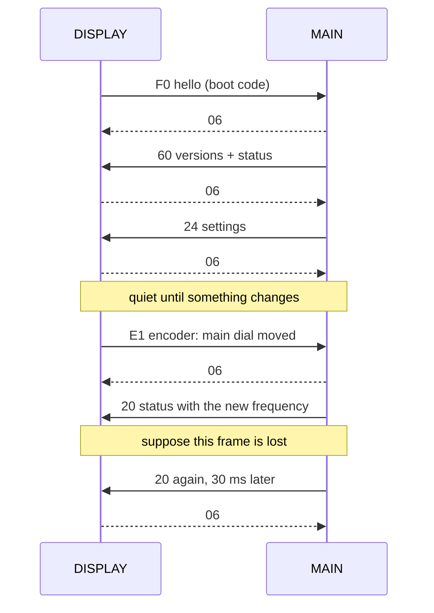
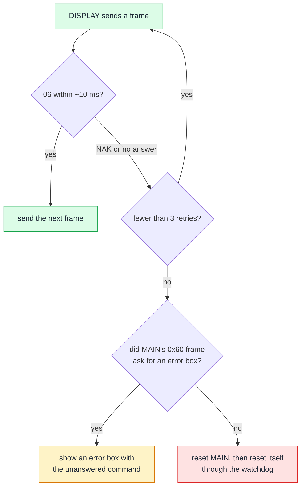

## 2. How the chips talk

**In short.** The four chips are joined by three slow serial control links and three fast SPI data links. MAIN is the master of the two
control links to the FPGA and the DSP. It sends short ASCII commands like `r0000` ("read register 0") and `w0022 0064` ("write 0x0064
to register 0x22"), and the other side only answers. The DISPLAY and MAIN talk as equals over a binary link where every frame is
acknowledged. The bulk data (spectrum scope, audio scope, voice recorder audio) goes over SPI straight to the DISPLAY and never passes
through MAIN. A handful of reset and boot-mode wires let the DISPLAY restart MAIN, and MAIN restart the FPGA and the DSP. This chapter
takes each link apart down to the byte. It also shows the trick MAIN uses to keep the other chips in step ([shadow registers](#glossary)) and what
happens when a link breaks.

### 2.1 Who is the boss

*Figure 2.1 — Every link between the chips. Blue: control UARTs. Green: SPI data links. Dashed: reset and boot-mode wires.*

There are two bosses, each in charge of something different:

- **The DISPLAY is the boss of power and updates.** It sees the power key, switches MAIN's power latch and reset line, and wakes MAIN up
  with a "hello" frame. It owns the SD card, so it is the only chip that can update the others.
- **MAIN is the boss of the radio state.** Everything that tunes, keys or configures the radio goes through MAIN. MAIN pushes that state to
  the FPGA, the DSP and the DISPLAY. It works out what each one should be showing or doing, and sends only what has changed.

The FPGA and the DSP are pure slaves on their control links. Each holds a [register file](#glossary) of 16-bit words that MAIN reads and writes, and neither
ever speaks first. On their SPI data links the roles flip: the FPGA and the DSP drive the clock and push their data into the DISPLAY,
which listens as an SPI slave.

The links, from slow to fast:

| Link | Kind | Speed | Carries |
|---|---|---|---|
| MAIN → FPGA | UART, ASCII | 115,200 bit/s | about 35 FPGA settings (frequency, filters, scope) |
| MAIN → DSP | UART, ASCII | 115,200 bit/s | about 75 DSP settings, 4 status values back |
| DISPLAY ↔ MAIN | UART, binary | ~345,600 bit/s | keys, knobs, clock, SD state up; screen contents down |
| FPGA → DISPLAY | SPI | set by the FPGA | spectrum scope frames |
| DSP ↔ DISPLAY | SPI | 1 MHz | audio spectrum, recorder and playback audio |
| DISPLAY → PC | SPI via FT4222H | set by the PC side | copies of both scopes plus status |

Two more links are on the board but do nothing in this firmware: a MAIN UART called "C4" (SCI7) is set up but never started, and a spare
DISPLAY UART has set-up code that is never called. The CAT ports from the PC are covered in chapter 5.

### 2.2 DISPLAY ↔ MAIN: the front-panel link

*Figure 2.2 — Anatomy of a DISPLAY ↔ MAIN frame, using the DISPLAY's power-on "hello" as the example.*

This is the busiest control link. It runs at an unusual 345,600 bit/s nominal, 8 data bits, no parity and **two** stop bits ([8N2](#glossary)).
MAIN's clock divider actually lands on 340,900 bit/s, 1.4 % low, which is well within what a UART tolerates.

**Frame format.** A frame is just `command, payload, sum8`. There is no start byte and no length byte. Both sides know from a table how
many payload bytes each command has: 43 commands, from 1 byte up to 574 bytes. The last byte is the low byte of the sum of all the bytes
before it, a [sum8](#glossary) checksum. Two single bytes stand alone: **[ACK](#glossary) = 0x06** and **[NAK](#glossary) = 0x15**. If a frame is cut off, MAIN starts over: a byte that arrives
more than about 10 ms after the previous one is taken as the start of a new frame.

**Worked example.** At power-on the DISPLAY sends `F0 01 08 20 23 06 29 00 6B`: command F0 ("hello"), its own version 01-08, its build
date 2023-06-29, a boot code, and the checksum. The boot code tells MAIN which keys were held at power-on. Some key combinations reset the
settings, swap the region code or open service screens. MAIN answers `06`, then sends frame 0x60 with the versions of all four chips and
the radio status, then frame 0x24 with settings. From then on the link is quiet until something changes.

**Who sends what.** Commands 0x20–0x7F go from MAIN to the DISPLAY. The big one is **0x20, a 153-byte status block** with the VFO frequencies,
the mode and more, and the DISPLAY redraws its screen from it. Other frames carry pop-ups, menu lists, the screen-saver and touch-calibration
screens, an LCD test pattern, the clock and the power-down command. Commands 0xC3–0xF1 go the other way. **E0** is a key or touch event,
**E1** an encoder step, **E2** the SD card state, **E3** the time from the DISPLAY's clock chip, **F0** the hello, and **F1** a system
command (for example "disable CAT" before an update).

**Stop and wait.** Each side sends one frame and then waits for `06` before it sends the next.

*Figure 2.3 — A typical exchange. Every frame waits for its ACK; a lost frame is sent again.*

A few details make the link robust:

- **MAIN** waits 30 ms for the ACK, retries up to 3 times, then gives up on that frame. It checks every incoming checksum and answers a bad
  one with NAK.
- **The DISPLAY** waits about 10 ms, retries up to 3 times, and resends at once on a NAK. It does **not** check the checksums of MAIN's
  frames; it only checks that the fields are in range.
- **The DISPLAY never loses a dial turn.** While it waits for an ACK, new encoder steps pile up in a queue. When the queue is full, the
  steps are added together. Fast turns get merged, not dropped.
- **MAIN only sends what changed.** It builds each frame in a scratch buffer and sends it only if it differs from the last one sent.
- The DISPLAY keeps its own frames at least ~3 ms apart *(inference)*.

During a firmware update this link also carries tunnel frames: `Z` frames with a 16-bit length for the DSP, and `FD`/`FE` frames for the
FPGA, which MAIN relays. Chapter 4 covers that.

### 2.3 MAIN → FPGA and MAIN → DSP: register frames

*Figure 2.4 — The register protocol is plain ASCII. Reading FPGA register 0 returns 0x0104, the SDR firmware version V01-04.*

MAIN talks to the FPGA (on its UART number 5) and to the DSP (UART 4) with the same tiny protocol. Both links run at 115,200 bit/s, 8N1.
Every register holds a 16-bit word, and every command is a line of ASCII:

- **Read:** `r` + 4 hex digits of register number + 2 hex digits of checksum + CR, 8 bytes in all.
  The answer is `r` + 4 hex digits of value + 2 hex digits of checksum, 7 bytes and no CR.
- **Write:** `w` + 4 hex digits of register + 4 hex digits of value + checksum + CR, 12 bytes. The answer is the single byte `06`.
- **Checksum:** the low byte of the sum of every character before it, written as two upper-case hex digits.
- Anything the other side does not like (bad checksum, wrong length, unknown letter) gets the single byte `?` (0x3F).

**Worked example: what version is the FPGA?** At power-on MAIN releases the FPGA's reset, waits one second for it to load its
bitstream, and sends `r000032` CR. The checksum is `r` (0x72) + four `0` (0x30 each) = 0x132, so the low byte is 0x32 and the two digits
are `3` `2`. The FPGA answers `r010437`: the value `0104`, and checksum 0x72 + 0x30 + 0x31 + 0x30 + 0x34 = 0x137, so `37`. MAIN turns
0x0104 into the text "V01-04" and shows it as the SDR version. This exact exchange was reproduced by simulating the FPGA's recovered
logic, and MAIN's own code computes the same frame.

**Worked example: change the scope span.** You set the scope to 100 kHz. MAIN's scope-span register is 0x22 and the value is the span in
kHz, so MAIN sends `w0022006405` CR, and the FPGA answers `06`.

Some differences between the two links:

- **The DSP needs a wake-up line first.** The RT685's M33 core runs a small text console on this UART, meant for humans, with echo and
  prompts. MAIN first sends `i DB00` CR, which switches the console into "[machine mode](#glossary)" with no echo and no prompt. After that the frames
  are the same. The DSP's register 0 answers 0x0101 (V01-01). Register 1 bit 0 says "DSP ready".
- **The DSP's registers live in shared memory.** The M33 stores each value in a 32K-word register file in on-chip RAM, and the HiFi4
  reads its settings from there.
- **The FPGA has a second, debug UART** on the module connector. It prints a prompt `[IF]>` and takes typed `r`/`w` commands. MAIN does
  not use it.
- **MAIN reads very little.** From the FPGA it reads only registers 0 and 1, once at boot. From the DSP it reads the version and, during
  steady receive or transmit, status registers 1–4 every 20 ms. Those carry the S-meter level, the compression level, the CW tuning
  offset, VOX and CTCSS detection *(inference for the meanings)*.

The [service CAT commands](#glossary) `SPSR`/`SPSW` (FPGA) and `SPDR`/`SPDW` (DSP) send these same frames from a PC. The write forms change the
radio's hardware settings live, so this guide never sends them; see chapter 5.

### 2.4 The shadow-register idea

*Figure 2.5 — MAIN keeps a copy of what each remote register should hold and sends a write only where the copy and the wanted value differ.*

How does MAIN keep about 35 FPGA registers and about 75 DSP registers in step with the radio without flooding the links? It keeps a
**shadow copy** of every register it manages: the last value the other chip acknowledged. On every pass of its main loop, MAIN does this
for each link:

1. Walk through the list of registers in a fixed order. For each one, compute the value it *should* hold from the radio state (mode,
   frequency, menu settings).
2. At the first register where that value differs from the shadow, send one write and stop. **At most one frame per link per pass.**
3. On a later pass, look at the answer. `06` → copy the value into the shadow. No answer within 6 ms, or `?` → leave the shadow alone.

Step 3 is the whole error-handling story. A lost write leaves the shadow "still different", so the same write simply goes out again on a
later pass. There is no retry counter and no error message in normal running.

It has some visible side effects:

- A big change, such as a new mode, trickles out **one register per pass**. A CAT command, a dial turn or a mode change reaches the FPGA,
  the DSP and the DISPLAY a few passes later, one register at a time *(inference from the structure)*.
- Frequencies are 32 bits, so they take two writes, high half first. For a pass or two the FPGA can hold a mixed value *(inference)*.
- Some registers are skipped while transmitting, and the switch between receive and transmit waits until the RX/TX lines have settled.
- A value poked in with the `SPSW` service command is not copied into the shadow. It stays only until the radio's own value for that
  register changes and the shadow logic overwrites it *(inference)*.

The DISPLAY link uses the same rule for whole frames: MAIN sends a status frame only when it differs from the last one sent. Nothing ever
arrives unasked from the FPGA or the DSP. Everything MAIN learns from them, it polls.

### 2.5 The DISPLAY's SPI data links

*Figure 2.6 — The three SPI frames the DISPLAY handles, drawn to the same byte scale.*

The control links are slow. The real data travels over SPI, and in normal running the DISPLAY is the **slave** on all three SPI links.
The other side drives the clock and the frame-select line, and the DISPLAY moves each frame into memory with a [DMA](#glossary) channel. There is no
checksum and no acknowledge on any of them.

- **Scope from the FPGA.** The FPGA pushes 1700-byte frames. The DISPLAY keeps the first 850 bytes: a 25-byte header, 800 one-byte
  points and 25 more bytes. That is one point per column of the 800-pixel screen *(inference)*. It never reads the other half. Each point
  row is also pushed into a history ring, which draws the waterfall *(inference)*. MAIN only sets the scope's centre, span and level over
  its UART. The spectrum data itself goes **straight from the FPGA to the DISPLAY**. Nothing in the DISPLAY firmware fixes the frame rate.
- **Audio scope and recorder from the DSP.** The RT685 drives a full-duplex 1 MHz link with 4600-byte frames each way. Towards the DISPLAY:
  a 600-byte audio spectrum (AF-FFT) record plus 4000 bytes of 16 kHz stereo audio for the voice recorder, saved as WAV on the SD card.
  Towards the DSP: playback audio from a WAV file, or silence. At 16 kHz stereo, 4000 bytes last 62.5 ms, so the DSP must send about 16
  frames a second *(inference)*.
- **Copy to the PC.** The [FT4222H](#glossary) USB bridge is the master on this link. Every 4 ms the DISPLAY refreshes a 4096-byte block with copies of
  the scope record, the AF-FFT record and a 151-byte status block, ending in a fixed trailer. The block is not double-buffered, so the PC
  can get a frame that mixes two refreshes *(inference)*.

In one case the DISPLAY becomes a master: during an SDR update it switches the scope link around and sends the new FPGA image to the
module over the same pins, in 4 KB blocks at about 2 MHz (chapter 4).

### 2.6 Reset and update wires

*Figure 2.7 — The reset and boot-mode wires, with their levels in normal running (black) and during an update of that chip (red).*

Next to the data links run a few plain wires. Each chip that can be updated has a **reset** wire and a **boot-mode** wire, and its "boss"
drives both:

- **DISPLAY → MAIN.** `RX_PWR_ON` is MAIN's power latch, set as soon as the DISPLAY program starts. `RX_RESET` holds MAIN in reset while
  low. `RX_UPDATE` high at reset starts the RX651 in its built-in [serial boot mode](#glossary), which is how the DISPLAY rewrites MAIN's flash over the
  same UART they normally talk on.
- **MAIN → FPGA.** `SDR_RESET` holds the FPGA in reset while low. MAIN releases it at power-on and gives the FPGA 1 s to load. `SDR_UPDATE`
  is high in normal running and low only during an SDR update. The module pin it drives is labelled `WP`, but MAIN holds it low exactly
  while the image is written, so it cannot be a plain flash write-protect. It works as an "update mode" input to the FPGA *(inference)*.
- **MAIN → DSP.** `DSP_RESET` holds the RT685 in reset while low. MAIN releases it after the FPGA is up, because the FPGA supplies the
  DSP's clock *(inference for the reason)*. For the same reason MAIN holds the DSP in reset during an SDR update. `DSP_UPDATE` high at
  reset starts the RT685's ROM serial-update mode instead of booting from its flash.

The full power-on order (DISPLAY → MAIN → FPGA → DSP) is in chapter 3, and what each wire does during an update is in chapter 4.

### 2.7 When a link is down

Each link copes with silence in its own way:

*Figure 2.8 — The DISPLAY's reaction when MAIN stops answering: three retries, then an error box or a full restart.*

- **DISPLAY ↔ MAIN.** The DISPLAY takes it seriously (figure 2.8). After three failed retries it either shows an error box with the
  unanswered command in hex, or resets MAIN and then itself. MAIN is more relaxed. After three retries it drops the frame. If the dropped
  frame was its answer to the hello, it marks the link as down.
- **MAIN → FPGA.** If the FPGA does not answer its two version reads at boot, MAIN records boot error 3 and carries on. How the radio
  shows that error is still open. In normal running there is no error at all: missing ACKs just leave the shadows different, and MAIN keeps
  re-sending.
- **MAIN → DSP.** The same idea. If the DSP does not answer at boot, or its "ready" bit is not set on the first try, MAIN records boot
  error 2 and carries on. The register writes keep running, so the link recovers by itself if the DSP answers later.
- **SPI links.** There is nothing to retry. The scope and DSP links re-arm on every frame-select edge and count overrun errors. The PC link
  re-synchronises after 50 ms of silence. A DISPLAY routine that would restart the scope link exists but is never called.

### 2.8 Where to look

- Overview of all links and the protocol summary table: [../code/system.md](../code/system.md) §2.1, §3.
- DISPLAY ↔ MAIN: MAIN side [../code/main/display-link.md](../code/main/display-link.md) (`displink_task`, frame tables, F0 boot
  codes); DISPLAY side [../code/display/mainlink.md](../code/display/mainlink.md) (`mainlink_submit`, retry rules, command table at
  0x20450074). UART settings: [../code/main/sci.md](../code/main/sci.md) (SCI1 SMR 0x08 / BRR 10).
- MAIN → FPGA: [../code/main/sdr-link.md](../code/main/sdr-link.md) (`sdr_task`, `sdr_send_frame`, register map, `sdr_init`, GPIOs P76/P77);
  FPGA side [../code/sdr/interfaces.md](../code/sdr/interfaces.md) (J2002 pin map) and [../code/sdr/netlist.md](../code/sdr/netlist.md) §5
  (the `r000032` → `r010437` simulation).
- MAIN → DSP: [../code/main/dsp-link.md](../code/main/dsp-link.md) (`dsp_link_poll`, `dsp_link_init`, register tables, status reads);
  DSP side [../code/ifdsp/control-link.md](../code/ifdsp/control-link.md) (`console_rx_char`, machine mode, register file at 0x20070000).
- SPI links: [../code/display/spi-links.md](../code/display/spi-links.md) (RSPI2 scope, RSPI4 DSP, RSPI0 FT4222H).
- Wires: P7_9 `RX_PWR_ON`, P7_10 `RX_RESET`, P4_3 `RX_UPDATE` on the DISPLAY; P77 `SDR_RESET`, P76 `SDR_UPDATE`, P71 `DSP_RESET`,
  P72 `DSP_UPDATE` on MAIN ([../hardware.md](../hardware.md), [../code/main/sdr-link.md](../code/main/sdr-link.md#gpios)).
- Boot errors: `boot_error` at 0x20B36 (3 = FPGA, 2 = DSP).
