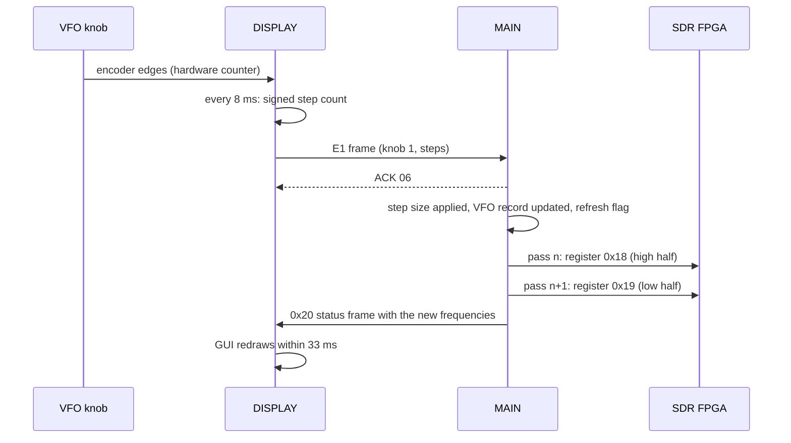
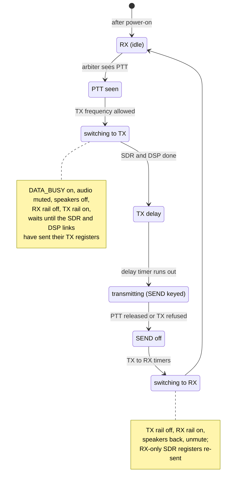

## 3. A day in the life of the radio

**In short.** This chapter follows the radio through an ordinary day, from switching on to switching off. On the way it shows what each of the
four chips does when you turn the knob, change band, press PTT, look at the scope and listen to audio. Most of the time the same pattern
repeats. The DISPLAY chip reads what you touch and sends it to MAIN. MAIN updates its copy of the radio state. On its next passes through
its loop, MAIN pushes the changed values to the FPGA, the DSP and the DISPLAY, one small message at a time. Two kinds of data skip MAIN
completely: the spectrum for the scope and the audio for recordings. Both travel straight from the FPGA or the DSP to the DISPLAY over SPI.
Chapter 2 explains the links and their frame formats; this chapter only refers to them.

### 3.1 Switching on

*Figure 3.1 — Power-on as a timeline. The DISPLAY wakes first and switches MAIN on. MAIN waits for the power key, then releases the FPGA and,
one second later, the DSP.*

**Mains on.** When DC power arrives, only the DISPLAY ([RZ/A1H](#glossary)) starts on its own. Its boot ROM runs a small loader from its
SPI flash. The loader checks the flag blocks of the two firmware banks and starts the first one marked valid, bank 1 first (chapter 4
explains why there are two). The DISPLAY firmware then switches MAIN's power on and releases MAIN's reset line.

**Standby.** MAIN ([RX651](#glossary)) starts from reset, sets up its timers and copies the whole settings [EEPROM](#glossary) into RAM
before anything else runs. It then sits in a small "radio off" loop. In that loop it only services the DISPLAY link and the CAT ports, and
the CAT parser accepts nothing but `PS1;`. While it starts, MAIN also holds the FPGA and the DSP in reset. The DISPLAY, meanwhile, runs in
a reduced standby mode: just the link to MAIN and the screen code. That MAIN runs during standby is an *(inference)* from the order of the
pin writes; the code does not say so in words.

**The power key.** Holding LOCK/PWR for about one second wakes the DISPLAY fully. It starts every driver and task (touch panel, SD card,
encoders, SPI links). It then sends MAIN the `F0` "hello" frame, up to 30 times, until MAIN answers with an ACK. The hello carries the
DISPLAY's version. One byte in it reports any key combination held at power-on; those combinations start hidden service modes (chapter 8).
MAIN answers with a `0x60` frame (all four firmware versions and status) and a `0x24` settings frame. Only now does MAIN mark the radio as
"on". The pages assume that the DISPLAY sends the hello only after the power key *(inference)*.

**Bring-up.** MAIN then starts the rest of the radio, in a fixed order:

1. It sets its port outputs for the "on" state, including PA power. It starts a 2.5 s timer; until it runs out, MAIN ignores PTT.
2. It releases the FPGA's reset and waits one second. The FPGA ([XC7A50T](#glossary)) loads its [bitstream](#glossary) from its own QSPI
   flash and starts `DSP_CLK`, an 18.432 MHz clock. MAIN reads the FPGA's version register (0x0104 for V01-04).
3. It releases the DSP's reset and waits 100 ms. The RT685's boot ROM starts the M33 core from QSPI. The M33 sets up the audio
   [codec](#glossary) and starts the HiFi4 DSP core. MAIN sends `i DB00` to switch the DSP console into machine mode, reads the version
   (0x0101) and waits for a "ready" bit.

The FPGA comes first for a reason. The RT685's only clock input is `DSP_CLK` from the FPGA, so the DSP cannot run before the FPGA has
loaded *(inference)*. If either chip does not answer, MAIN records a boot error and carries on. How that error is shown on screen is still
open.

**Running.** MAIN enters `main_loop`, a polled loop of 16 tasks with no operating system. On its first passes it finds every remote
register different from what it wants, so it writes them all: FPGA registers over one UART and DSP registers over another. The DISPLAY
starts receiving `0x20` status frames and draws the main screen.

### 3.2 Switching off

*Figure 3.2 — The three ways to switch off all end in the same place: MAIN saves, tells the DISPLAY and resets itself. The exact order of
the save and the `0x7F` frame on the power-key path is an inference.*

There are three ways to switch the radio off:

- **The power key.** Holding LOCK/PWR for about a second reaches MAIN as a "held" key event (key code 0x300). MAIN saves its operating
  state to the EEPROM, waits for the DISPLAY UART to drain and then resets itself.
- **CAT `PS0;`.** MAIN records "power off" as the reason, saves its settings and resets.
- **Supply too low.** MAIN measures the supply with its ADC. When the reading drops below a fixed threshold, it switches off the PA power
  and the lines to the SDR module, saves its operating state once, and then follows the same path with a "low voltage" reason.

In each case MAIN sends a `0x7F` frame that tells the DISPLAY why it is going down. The DISPLAY's GUI then leaves its drawing loop and waits
for the power key. MAIN's "power off" is really a CPU **software reset**. After the reset, MAIN is back in the "radio off" loop of
section 3.1 and waits for the next hello. A **restart** (after a region change, a factory reset and similar) takes the same path. The only
difference is a saved "power back on" flag, so the next hello switches the radio straight back on *(inference for the flag's meaning)*.

> **What if power dies mid-save?** Each save first writes a "write in progress" flag into the EEPROM header and clears it at the end. If a
> boot finds the flag still set, MAIN throws away all user settings and keeps only the factory calibration and the region code. Chapter 6
> has the details.

### 3.3 Turning the knob or pressing a key

*Figure 3.3 — One step of the VFO knob crosses three chips. The byte strip is an example `E1` frame for +3 steps of the main dial.*

You turn the VFO knob by a few clicks. Here is what happens:

1. **The DISPLAY counts.** The knob is a quadrature encoder wired to a hardware counter in the DISPLAY chip. Every 8 ms a task reads the
   counter and works out the signed change since the last read. The DISPLAY applies no acceleration and no step size. It sends the raw count.
2. **An `E1` frame goes to MAIN.** The frame carries the knob number and the step count. MAIN must ACK it before the DISPLAY sends the next
   one. If you spin the knob while an ACK is still pending, the DISPLAY adds the new steps to a queue and merges them (up to ±127), so no
   steps are lost. They are only combined.
3. **MAIN applies the step.** MAIN passes the event through a filter that can refuse it, for example while keys are locked. It then applies
   the tuning step and the FINE/FAST setting *(inference: this happens in MAIN because the DISPLAY sends raw counts)*. It writes the new
   frequency into the **operating record** of the active VFO and sets a "refresh" flag.
4. **The FPGA is retuned.** On the next pass of `main_loop`, the SDR task compares the wanted RX [NCO](#glossary) value with its shadow copy.
   The value is too wide for one register, so it goes out as two writes, register 0x18 (high half) and then 0x19 (low half), on two separate
   passes. For a pass or two the NCO can hold a mix of old and new halves *(inference for the effect)*. In CENTER scope mode the scope
   centre (registers 0x20/0x21) follows as well.
5. **The screen catches up.** The DISPLAY-link task recomputes MAIN's frequency cache and sends a `0x20` status frame with the new
   frequencies. The DISPLAY keeps the latest frame as a snapshot. Its GUI loop wakes every 33 ms, compares the snapshot with what is on
   screen and redraws what changed.
6. **The PC hears about it.** If a CAT port has Auto Information on, MAIN sends `FA…;` to it (chapter 5).

The DSP is not told the frequency. The only frequency-dependent DSP write is a calibration value that changes when you cross into another
frequency range.

**Pressing a key** works much the same way. A task scans the keys every millisecond. A key counts as pressed after three equal samples. The
DISPLAY sends an `E0` frame with the key code and one of three actions: press, release, or held (after about one second). MAIN's
filter can refuse the key (a refused press gives a short beep). Otherwise `key_task` looks the code up in large handler tables: one each
for press, short press, long press, repeat and release. Only one event waits at a time; a second event that arrives before `key_task` runs
replaces the first. Touching the spectrum on the screen is a key event too: MAIN turns the touch position into a frequency and tunes there
*(inference, high)*.

### 3.4 Changing band or mode, and how the radio remembers

*Figure 3.4 — Each VFO has a band stack of 3 levels × 12 bands. Every cell holds one 90-byte record, the same layout as a memory channel.*

**Everything is a 90-byte record.** Each VFO (A and B) has one **operating record** of 90 bytes. It holds the mode, flags, tone settings,
six blocks of per-mode settings, the clarifier offset, the frequency in Hz and a 12-character name. Memory channels, [QMB](#glossary)
slots and band-stack entries all use the same layout. "Recalling" anything means copying 90 bytes into the operating record, and
"storing" means copying them back out.

**Changing band.** Each VFO has a [band stack](#glossary): 12 bands (1.8 MHz to 50 MHz, plus GEN) with 3 levels each. When you press a
band key, MAIN first writes the current record back into its band-stack slot. It then copies the slot of the new band into the operating
record, checks the frequency against the 30 kHz–75 MHz limits and clears split. If you press the same band key again and the BAND STACK
setting is on, it steps to the next of the three levels *(inference for the menu name)*. Tuning across a band edge also moves the record
into the new band's slot, so the stack follows the VFO by itself.

**Changing mode** is a change to the mode field of the operating record. Many FPGA and DSP registers depend on the mode: the RX NCO offset
(for example ±1500 Hz in SSB, or the CW pitch), the filters, the demodulator and the AGC. Each of these has its own "change detector" in
MAIN's loop. They notice the new mode and send their registers over the next few passes, one per pass per link (system flow in
[../code/system.md](../code/system.md#61-cat-command-round-trip-with-ai)).

**Remembering.** MAIN keeps a byte-for-byte **mirror** of the EEPROM in RAM: about 22.6 KB of settings, band stacks, memories, QMB slots
and the factory calibration. All code works on the RAM copy. The firmware writes to the EEPROM in two situations only:

- **One record when it changes:** a memory channel, a band-stack slot, a QMB slot, a keyer message or a tuner memory.
- **Whole blocks when the radio goes down:** power off, a restart, or a power failure.

There is no timed autosave and no checksum. Chapter 6 describes the EEPROM map and the reset paths.

### 3.5 Transmitting

*Figure 3.5 — Many PTT sources, one winner. The request has to pass the arbiter and the "allowed?" check before the sequencer keys the
transmitter. Below: what MAIN watches during TX.*

**PTT sources.** MAIN collects eleven PTT sources into one flag each and picks the first active one in a fixed priority order. CAT `TX1;`
comes first. Next are the external amplifier's request line, the DATA jack PTT and the RTS or DTR line of the USB "Standard" port; the
PC KEYING setting decides which of those three is live. After them come a group set by other code: MIC and front-panel PTT reported by
the DISPLAY, tuner code, and voice-memory playback *(inference for which code owns which flag)*. VOX comes last. It uses a voice-detect
bit that MAIN reads from the DSP. In CW modes the DATA/RTS/DTR line acts as a CW key, not a PTT.

`TX1;` skips the key-lock filter that front-panel keys go through. That is why CAT can transmit even when the panel keys are locked.

**The gates.** The **arbiter** wants to see the source on two passes in a row. It then starts the TX time-out timer (TOT). An external
tuner can hold TX off through its inhibit line. Before the sequencer starts, the **allowed?** check runs. It refuses TX if a "TX
disabled" setting or calibration byte is set, if CAT has been disabled from the DISPLAY, or if the TOT has tripped. Then it looks up the
TX frequency in the **region table** chosen by the radio's destination code. A row allows TX when `lo <= f < hi`. If TX is refused,
MAIN raises the `TXINH` line, and if the radio was transmitting, it starts the switch back to RX.

**The US 60 m quirk.** The US table lists the 60 m channels as single frequencies, rows with `lo == hi`. The figure below shows why such a
row can never pass a `lo <= f < hi` test. The code has an extra check for the 60 m channel memories, but it only runs after a row has
matched, which never happens. As written, **60 m TX in the US table appears never to be allowed** *(inference)*. This needs an on-air test,
and that must not be done without the owner's approval.

*Figure 3.6 — A range row passes the test; a single-point row cannot, because no f is both ≥ 5332 and < 5332.*

**The sequencer.** Once the request is allowed, the RX/TX sequencer steps through its states. Each step waits for a short soft timer,
a few milliseconds long:

The SEND lines can never come on before the TX rail: SEND is forced low while the TX line is low or the tuner's inhibit line is
high. The links play their part too. While TX is starting, the SDR task writes the TX NCO, drive level, scope and other TX registers, and
the DSP link switches its register group to TX. The sequencer moves on only when both report done (that these are the two flags it waits
for is an *(inference)*). Then the audio path of section 3.7 runs the other way: mic → codec → DSP → FPGA → PA. While transmitting, the
DISPLAY gets status frames with the TX state.

**What MAIN watches during TX.**

- **High SWR.** MAIN samples forward and reflected power every 5 ms. Nine bad samples in a row (SWR outside 1 to 5) set a HI-SWR flag
  that blinks the indicator and is reported over CAT. MAIN itself does **not** drop TX on high SWR. Power fold-back probably happens
  elsewhere, in the DSP or display side or through the [ALC](#glossary) *(inference)*.
- **PA temperature.** A thermistor reading switches a PA-unit DAC channel between a fixed level and zero, with hysteresis. That this channel drives the fan
  is an *(inference)*.
- **Time-out timer.** It gives a warning beep first, then blocks TX until PTT is released.
- **Supply too low.** This is the power-off path of section 3.2.

**Back to RX.** Releasing PTT does not drop TX at once. VOX waits for its hang time, and CW-type sources wait for the break-in delay. Then
the arbiter starts the TX→RX sequence. It runs the same steps in reverse, and once the TX line is down, the RX-only FPGA registers
(filters, noise blanker, notch, RX NCO) are written again.

### 3.6 The scope and the waterfall

*Figure 3.7 — Spectrum data goes from the FPGA straight to the DISPLAY. MAIN only sets the scope's centre, span and level. The 4 KiB PC
block is drawn to scale.*

The band scope is the clearest case of data that never touches MAIN:

1. **MAIN sets it up.** Over its UART to the FPGA, MAIN writes the scope centre (registers 0x20/0x21), the span and the level. In CENTER
   mode the centre follows the dial; in FIX and CURSOR modes it comes from a stored start frequency per band *(inference for the mode
   names)*. During TX it uses a different value.
2. **The FPGA computes the spectrum** from the ADC samples. Its block RAM holds FFT-style phase and twiddle tables; that this is how the
   scope works inside is an *(inference)*.
3. **The FPGA pushes frames to the DISPLAY over SPI.** Here the FPGA is the SPI master. Each frame is 1700 bytes, and the DISPLAY keeps the
   first 850: a 25-byte header and 800 points. That one point is one screen column is an *(inference)*. No DISPLAY code sets the frame rate.
4. **The DISPLAY draws it.** Each record also goes into a history ring, which is most likely the waterfall *(inference)*. The GUI draws
   the scope and waterfall in its 33 ms loop. The DSP separately sends an audio spectrum (the AF-FFT, 600 bytes) over its own SPI link;
   the GUI draws that too.

**To the PC.** The DISPLAY also feeds an [FT4222H](#glossary) USB-to-SPI bridge, which sits on the radio's internal USB hub. Every 4 ms it
refreshes a 4 KiB block with the scope record, the AF-FFT record and a 151-byte status block from MAIN. The PC reads that block over USB.
The bridge stays in reset until a MAIN setting releases it. The PC software that uses this stream is not known.

### 3.7 Audio

*Figure 3.8 — Receive and transmit audio both pass through the HiFi4 in 24-sample blocks. The REC branch goes to the DISPLAY and the SD
card.*

**Receive.** The FPGA mixes the wanted signal down with its RX NCO and filters it. It passes the result to the RT685 over [I2S](#glossary).
On the RT685, the HiFi4 DSP core runs a few threads:

- **Rx_Path** handles one block of 24 samples at a time and sends audio to the codec's DAC, then to the speaker or phones.
- **Rx_Audio** collects 12 blocks and runs the receive stages that most of the "RX DSP" settings control.
- **Spi** taps blocks to build the audio spectrum and the recording stream for the DISPLAY.

The codec's DAC clock paces the receive path.

**Transmit** runs the other way. Mic or DATA audio enters the codec's ADC. **Tx_Path** processes it one block at a time and hands it over
I2S to the FPGA, which shifts it up to the TX frequency with its TX NCO and shapes the keying with a raised-cosine ramp *(inference for
the blocks inside the FPGA)*. MAIN's MOD SOURCE setting can select USB audio as the TX source.

**The 12 kHz question.** The DSP code uses the constant 1/12000 to turn hertz into normalised frequency, and it limits one frequency field
to just under 6000 Hz. So the DSP almost certainly runs at **12 kHz**: one 24-sample block every 2 ms, and one Rx_Audio batch every 24 ms
*(inference, strong)*. The DISPLAY, however, writes the REC audio it receives over SPI to the SD card as a **16 kHz** stereo WAV file, and the
link carries the right amount of data for 16 kHz (16 frames per second).

> **Open question.** Both observations are solid, so either the DSP's Spi thread resamples the audio from 12 kHz to 16 kHz before sending
> it, or the WAV header's 16 kHz is only nominal. Settling this needs a closer look at how the HiFi4's Spi thread packs its data.

### 3.8 Where to look

| Topic | Reference pages |
|---|---|
| All end-to-end flows in one place: power on/off, CAT, frequency change, TX key-down, scope | [../code/system.md](../code/system.md) §4 and §6 |
| DISPLAY boot, standby and full start (`task_root`, `boot_mode_full`, `power_on_full_init`) | [../code/display/boot-rtos.md](../code/display/boot-rtos.md), [../code/display/README.md](../code/display/README.md) |
| MAIN boot (`app_main`, `eeprom_load_all`, `sdr_init`, `dsp_link_init`), `main_loop`, power states, `sw_reset` | [../code/main/README.md](../code/main/README.md) |
| The power key, key scan, encoders (`task_key`, `task_detect_renc`, `mainlink_send_enc`), boot key combinations | [../code/display/input.md](../code/display/input.md) |
| MAIN side of keys and encoders (`key_event_filter`, `key_task`, `enc_main_dial`, touch tuning) | [../code/main/ui-keys.md](../code/main/ui-keys.md) |
| DISPLAY link handshake, ACK and retries, how the GUI follows MAIN's frames | [../code/display/mainlink.md](../code/display/mainlink.md), [../code/display/gui.md](../code/display/gui.md) |
| Operating records, band stack, frequency cache, SDR registers 0x08/0x09, 0x18/0x19, 0x20/0x21 | [../code/main/radio-control.md](../code/main/radio-control.md) |
| EEPROM mirror, save triggers, interrupted saves, power fail (`supply_undervolt_check`) | [../code/main/eeprom.md](../code/main/eeprom.md), [../code/main/peripherals.md](../code/main/peripherals.md) |
| PTT sources, `ptt_arbiter`, `tx_freq_allowed`, `trx_sequencer`, SWR and temperature, region tables, 60 m | [../code/main/tx-protection.md](../code/main/tx-protection.md) |
| RT685 boot, HiFi4 threads, 12 kHz blocks, open question C9 | [../code/ifdsp/README.md](../code/ifdsp/README.md), [../code/ifdsp/hifi4.md](../code/ifdsp/hifi4.md), [../code/system.md](../code/system.md#8-contradictions-and-open-questions) |
| FPGA configuration from QSPI and its blocks | [../code/sdr/README.md](../code/sdr/README.md) |
| Scope, AF-FFT, REC/PLAY and FT4222H SPI links | [../code/display/spi-links.md](../code/display/spi-links.md) |
