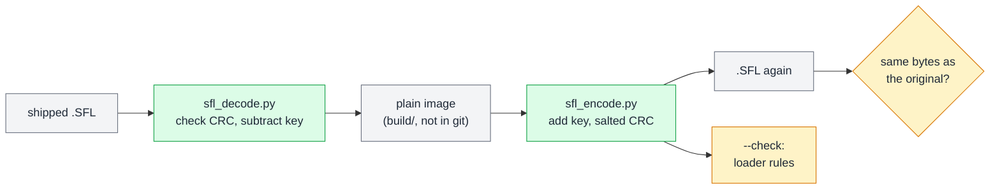
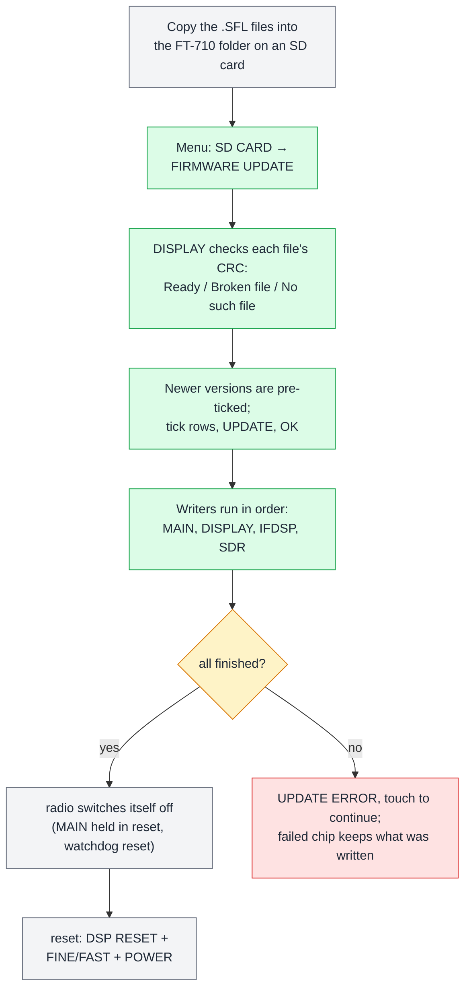
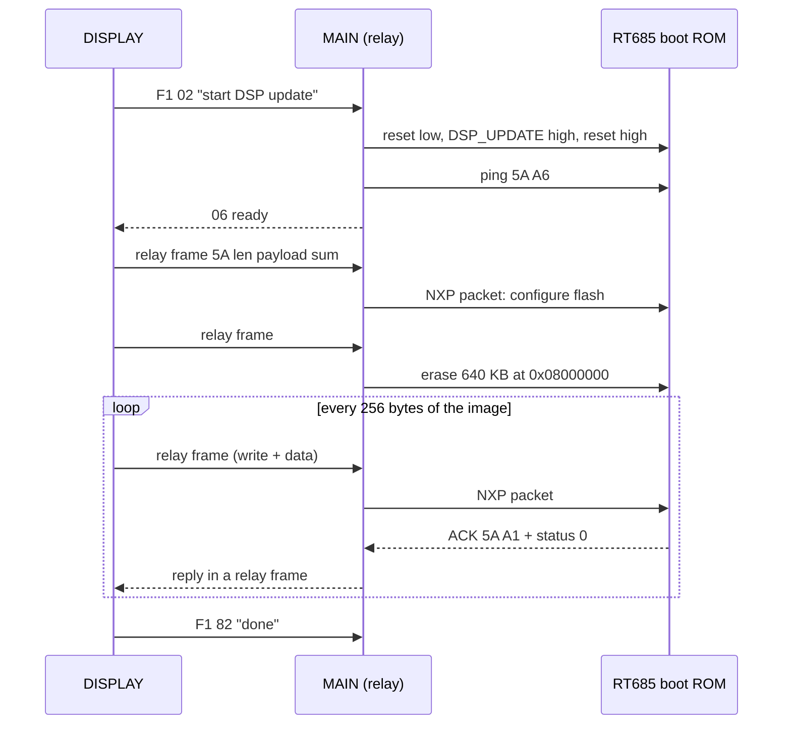

## 4. Firmware files and how updates work

**In short.** Yaesu ships FT-710 firmware as four `.SFL` files, one for each programmable chip. Each file is a short text header
followed by the firmware, scrambled with a fixed 43-byte key and protected by a [CRC-32](#glossary) with a secret "salt". Once
we knew the key, all four files decoded cleanly: MAIN is a list of Motorola [S-records](#glossary), DISPLAY and IFDSP are plain
program images, and SDR is an [FPGA](#glossary) [bitstream](#glossary) written out as hex text. On the radio, the DISPLAY CPU
does all of the updating. It reads the SD card, checks each file's CRC, and then programs every chip itself, using a
different route for each one. The CRC is the only thing it checks on the file as a whole: no signature, no model check.
That is what makes custom firmware possible (chapter 8), and it is also why one part of the MAIN image needs great care.

### 4.1 What Yaesu ships

*Figure 4.1 — The 2024-02 update package: one encoded `.SFL` file per chip, plus the update manual.*

The download from yaesu.com is a zip file with five files: four firmware files and a PDF that explains the update steps. There
is no PC program. Everything happens on the radio, from an SD card.

The file names say which chip each file is for, and which version it holds:

- **MAIN** (V01-12) is the control CPU, a Renesas RX651. It handles the radio logic and [CAT](#glossary) commands.
- **DISPLAY** (V01-08) is the front-panel CPU, a Renesas RZ/A1H. It runs the touch screen and the SD card.
- **IFDSP** (V01-01) is the IF signal processor, an NXP i.MX RT685.
- **SDR** (V01-04) is the FPGA on the SDR module, a Xilinx Artix-7.

Inside each file there is also a two-letter tag: `MC`, `PC` ("panel CPU"), `ID` and `SR`. The radio uses the same file format for
the memory-channel and menu backups that it saves to the SD card. Those files carry the tags `MemList` and `Menu`.

### 4.2 Anatomy of an SFL file

*Figure 4.2 — Every `.SFL` file has the same three parts. Only the checksum in the tag line matters to the radio.*

All four files have the same layout, with fixed sizes, so a program can simply cut them at byte 512 and byte 576:

1. **Comment box** (512 bytes). Eight lines of 62 characters each, framed with `*`. It holds the title, file name, product
   name, version, date and a copyright line. It is plain ASCII, for people to read.
2. **Tag line** (64 bytes). Three fields in fixed columns: the tag (`ID`), the total file length in decimal (`415020`,
   which includes the 576-byte header) and an 8-digit hex checksum (`616282B0`).
3. **Payload** (the rest of the file). This is the firmware, scrambled byte by byte.

The scrambling is simple. Each payload byte has a key byte added to it, and the key repeats every 43 bytes:
`encoded[i] = plain[i] + KEY[i mod 43]` (mod 256). The key is a shuffle of the numbers 1 to 43, and all four files use the
same one. To decode, you subtract.

The checksum is a standard zlib CRC-32, but with a twist. It is computed over the *encoded* payload, and then four extra bytes,
`A6 EC 9E 13`, are fed into the CRC as well. Those four bytes are the [salt](#glossary). Without them, no standard CRC gives
the value in the tag line.

### 4.3 How we cracked it

*Figure 4.3 — The key-recovery trick. The IFDSP image begins with zero bytes, so its first 43 encoded bytes are the key itself.*

At first the scrambling looked like a 32-byte pattern, and a long search through CRC variants found nothing that matched the
checksum. The way in was a small hexdump of each payload:

- The **IFDSP** payload started with a run of 43 bytes that repeated. Those 43 bytes were exactly the numbers 1 to 43 in a
  shuffled order. The IFDSP image begins with 1024 zero bytes, and zero plus the key is the key. So the start of the file
  showed the key in the clear.
- The **SDR** file had the same run, shifted up by 0x66 on every byte. 0x66 is the ASCII letter `f`. That showed the key is
  *added* (not XORed), and that the SDR payload is text.
- Subtracting that key from **MAIN** gave `S00E0000…`, the start of a Motorola S-record file. All four files then decoded
  cleanly.

The decoded DISPLAY image held the rest of the answer. Its SD-card loader has a decode routine (the subtraction loop), an
encode routine (the same loop with `+`, used for the backups) and the CRC routine with the 4-byte salt. The 43-byte key is
the first item in its data section. The salt is why the earlier CRC search had failed.

*Figure 4.4 — The tools: decode, encode, and the byte-for-byte round-trip test.*

Three small Python tools in the repo do this work:

- **`tools/sfl_decode.py`** checks the salted CRC (and stops if it is wrong), subtracts the key, and converts each payload into
  something useful: a flat 512 KiB binary for MAIN, the raw image for DISPLAY and IFDSP, and a binary bitstream for SDR.
- **`tools/sfl_encode.py`** does the reverse: it adds the key, writes the tag line and computes the salted CRC. Its `--check`
  option runs a finished file through the same acceptance rules the radio uses (section 4.7).
- **`tools/test_sfl_roundtrip.py`** decodes and re-encodes all four shipped files and checks that the result is identical,
  byte for byte. It passes. So the format is fully understood, with nothing left over.

### 4.4 What is inside each file

*Figure 4.5 — After decoding, the four payloads are four different formats, each matched to the chip that receives it.*

- **MAIN** is a text file of Motorola S-records: 28 227 data lines, each holding an address, some data bytes and its own checksum.
  They fill the RX651's 512 KiB of code flash, which ends at the CPU's fixed vector table. The last line gives the start
  address, which is the reset vector. There is also one small extra block of 116 bytes, all `FF`, for the chip's
  [option-setting memory](#glossary). That block matters a lot (section 4.7).
- **DISPLAY** is a raw ARM program, 3.3 MB. It starts with a table of ARM branch instructions (the exception vectors). It runs
  in RAM at address 0x20100000, copied there from the DISPLAY's own SPI flash. It contains the whole update machinery
  described in this chapter.
- **IFDSP** is a raw image for the RT685's QSPI flash. It starts with zeros, then a FlexSPI configuration block (marked
  `FCFB`) that tells the chip's boot ROM how to talk to its flash, then the Cortex-M vector table and code. The chip runs it in
  place from flash ([XIP](#glossary)).
- **SDR** is one very long line of lowercase hex digits. Turned into binary it is 2.2 MB: a 4 KiB Yaesu header (a
  CRC-32/BZIP2 of the rest, then `FF` padding), followed by a standard, uncompressed and unencrypted Xilinx Vivado `.bin`
  bitstream for an Artix-7 XC7A50T.

None of the four is signed or encrypted.

### 4.5 Updating, from the front panel

*Figure 4.6 — The update from the user's side, with what the DISPLAY does at each step.*

Yaesu's manual asks you to copy the files to an SD card, put it in the radio, and choose **SD CARD → FIRMWARE UPDATE**. You must
**update DISPLAY first**, then MAIN, DSP and SDR. When the update ends, the radio switches itself off, and the manual asks for a
reset with the key combination DSP RESET + FINE/FAST + POWER.

Behind that screen:

- The DISPLAY looks in the `FT-710` folder for names of the form `FT-710_MAIN_V` plus four characters plus `.sfl` (upper or
  lower case). The four characters become the version shown on screen ("0112" is shown as "01-12"). If there are several
  matching files, the name that sorts highest wins. The file also needs the FAT "archive" attribute, which a PC sets when it
  copies a file.
- For each file it runs the CRC check only and shows **Ready**, **(Broken file)** or **(No such file)**.
- Rows whose file version is higher than the installed one (MAIN reports the installed versions at power-on) are ticked for
  you. You can tick any Ready row, so older versions can probably be installed too *(inference)*.
- The selected writers then run one after another, always in the order MAIN, DISPLAY, IFDSP, SDR. On success each row shows
  "Finished". If any write fails, the screen shows UPDATE ERROR. There is no rollback: the failed chip keeps whatever was
  written, and you simply run the update again.
- At the end the DISPLAY holds MAIN in reset and resets itself with its watchdog. That is the "power off" the manual mentions.

There are two other ways into the update code. If MAIN does not answer at power-on, the DISPLAY shows a two-step recovery
screen that rewrites MAIN first and then DISPLAY *(the trigger meaning is inference)*. And a key held at power-on, together with a
turn of a knob, opens a hidden maintenance screen that can rewrite the DISPLAY's own boot loader. Chapter 8 covers that one.

### 4.6 Behind the screen: one CPU updates them all

*Figure 4.7 — The DISPLAY owns the SD card, so it drives every update. Only MAIN is reached directly; IFDSP and SDR are
reached through MAIN. That the FPGA writes its own flash is an inference.*

Only the DISPLAY has the SD card, so it is the only chip that can update the others. It has one serial [UART](#glossary) link
to MAIN, plus two control wires into MAIN: a reset line and an "update" line that selects the RX651's boot mode. It has no
direct wire to the IFDSP, so MAIN passes IFDSP traffic along. For the SDR, MAIN passes on the commands, while the bulk data goes
straight from the DISPLAY to the FPGA over an SPI bus. Each chip's update uses that chip's own built-in method.

#### 4.6.1 DISPLAY updates itself

*Figure 4.8 — The DISPLAY keeps two copies of its firmware in its 16 MB SPI flash. An update writes the spare copy and then moves
the "valid" flag across.*

The DISPLAY's 16 MB SPI flash holds a boot loader at the start and two 6 MB **banks**, each big enough for a full firmware image.
Just below the 4 MB mark sit three small flag records, one each for the loader, bank 1 and bank 2. A flag record is 20 bytes:
the magic word `11111111`, the image length, two zero words and the inverted CRC-32 of the decoded image.

At power-on the loader runs the first bank whose flag holds the magic word and a non-zero length, trying bank 1 first. It does
**not** check the CRC.

An update always writes the bank that is *not* running:

1. Erase the spare bank's flag and its image area.
2. Write the decoded image, 256 bytes at a time, with a CRC running over it.
3. Check that the number of bytes written equals the file size minus the 576-byte header.
4. Write the spare bank's flag.
5. Erase the old bank's flag.

After a successful update only the new bank has a valid flag, so the next boot runs it. If the power fails part-way through,
the old flag is still there and the old firmware boots *(inference from the order of steps)*. One weak spot remains: if the new
image is faulty but completely written, its flag is valid and the loader runs it anyway. Recovering from that needs the hidden
maintenance screen or a JTAG probe *(inference)*. Chapter 8 covers both.

Before writing, the DISPLAY sends MAIN the frame `F1 03`, which among other things turns CAT off, and afterwards `F1 83`.

#### 4.6.2 MAIN: Renesas serial boot mode

*Figure 4.9 — Reprogramming MAIN. The DISPLAY wakes the RX651 in boot mode and talks to the chip's built-in boot ROM over the
normal DISPLAY–MAIN UART.*

The RX651 has a [boot ROM](#glossary) that can program the chip's flash over a serial port. Renesas documents this protocol,
and the DISPLAY follows it exactly:

1. **Wake into boot mode.** The DISPLAY takes over its UART from the normal link code, pulls MAIN's reset low, sets the update
   line high (boot mode), and releases reset.
2. **Find the baud rate.** At 9600 baud it sends `00` until the chip echoes `00`, then `55` until it answers `C2`.
3. **Set up.** It asks for the device type (`38`), sets the byte order (`36`), tells the chip its clocks (`32`: 16 MHz input,
   120 MHz core), and picks a faster bit rate (`34`). Both sides then switch to 345 600 baud.
4. **Unlock.** A sync (`00`), then the ID-code check (`2C`, `30`). The DISPLAY always sends an ID code of 16 × `FF`. That works
   because the stock MAIN image leaves the chip's ID code at all `FF` (section 4.7).
5. **Map, erase, program.** It asks how the flash is divided (`53`, `54`), erases it (`50`) and writes it in 512-byte data
   packets (`13`). The 116-byte option-setting block is written with its own command (`51`). The DISPLAY reads the S-record
   text from the file as it goes, checking every record's checksum.
6. **Verify.** It reads every area back (`15`) and compares it with the file. The option-setting block is read (`52`) but not
   compared.
7. **Restart.** Update line low, reset pulse, wait half a second, then greet the new MAIN with the normal link "hello" and wait
   for its `06` reply.

Every command travels in the same packet: `01`, a two-byte length, the command byte, its data, a checksum and `03`. Replies
start with `81`. If any step fails, the row shows "failed" and MAIN stays in boot mode until the radio resets. The update can
then be run again *(inference)*.

#### 4.6.3 IFDSP: NXP ISP through MAIN

*Figure 4.10 — The IFDSP update. MAIN puts the RT685 in its ROM boot loader and becomes a transparent relay between the DISPLAY
and the DSP.*

The RT685 also has a boot ROM with a serial programming mode ([ISP](#glossary)), selected by a `DSP_UPDATE` pin. That pin and
the DSP's UART are wired to MAIN, not to the DISPLAY. So the DISPLAY first sends MAIN the command `F1 02`. MAIN resets the DSP
with `DSP_UPDATE` high, which starts the ROM loader, and then forwards every packet in both directions.

The packets inside are NXP's standard boot-loader protocol (the one NXP's `blhost` tool speaks). The DISPLAY wraps each one in
a small relay frame, `5A`, a two-byte length, the payload and an 8-bit sum. It configures the QSPI flash, erases a fixed
640 KB region, and writes the decoded image in 256-byte chunks. Each chunk carries its own CRC-16 and is acknowledged by the
ROM. There is no read-back at the end, and the last chunk is always sent as a full 256 bytes. Finally `F1 82` tells MAIN to stop
relaying.

#### 4.6.4 SDR: blocks into the FPGA's flash

*Figure 4.11 — The SDR update writes the bitstream to a second slot in the FPGA's configuration flash, block by block, and the
header last.*

The FPGA loads its design from its own QSPI configuration flash at power-up. The DISPLAY never touches that flash directly.
Instead, the FPGA's own logic writes it *(inference)*:

- The SDR file must be **exactly 0x43075A (4 392 794) bytes**. Any other size is refused.
- The DISPLAY sends `F1 01` to MAIN. MAIN switches to an update bridge: it holds the FPGA's `SDR_UPDATE` pin low and passes
  register commands from the DISPLAY to the FPGA over its UART.
- For each 4 KiB block, the DISPLAY sets the flash address in two FPGA registers, sends a short command sequence (3, then 1) to a
  control register, pushes the 4 KiB of data straight to the FPGA over SPI, sends commands 4 and 5, and finally reads back a
  CRC-16 of what the FPGA received. A block is retried up to 30 times. What the commands 3, 1, 4 and 5 mean exactly is still
  open.
- The data goes over the SPI pins that normally carry the spectrum-scope stream into the FPGA. During the update the DISPLAY
  switches that port to master mode.
- The bitstream itself goes to flash address 0x240000 and up, 0x1000 bytes apart. The 4 KiB header with the CRC-32/BZIP2 is
  written **last**, at 0x480000. So an update that is cut off leaves no valid header *(inference)*.
- At the end, `F1 81` tells MAIN to restart the FPGA with `SDR_UPDATE` high again.

Because the pin labelled `WP` (write protect) on the SDR module is held low during the update, it acts as an "update mode"
input to the FPGA rather than a plain flash write-protect *(inference)*. Whether the FPGA then boots the new copy at 0x240000
directly, or through the image at address 0, is still open *(guess)*.

### 4.7 What the loader really checks

*Figure 4.12 — The salted CRC is the only check on a whole file. Tag, length, model and signature are never looked at.*

The DISPLAY's loader is strict about a few things and ignores the rest:

- **Checked:** the file name and folder; the tag line must be 64 characters, and its third field must equal the salted CRC-32
  of the payload; plus a few per-chip checks (MAIN record checksums and read-back, DISPLAY byte count, SDR exact size,
  IFDSP per-packet CRC).
- **Not checked:** the tag (`MC`, `PC`, …), the length field, the comment box (except for one hidden marker, see chapter 8), any
  signature, model, region or serial number (none exist), whether the image fits the space it is written to, and, at boot, the
  DISPLAY image's CRC.

So anyone with the key and the salt can build a file that the radio accepts. That is the opening for custom firmware, which
chapter 8 covers with the patches, the debug headers and the recovery paths. It also means the radio will not save you from a
mistake in a patched file. One mistake in a MAIN file is worse than all the others:

*Figure 4.13 — The 116-byte option-setting block in the MAIN image. Every MAIN update rewrites it; patched images must keep it
all `FF`.*

The option-setting memory is a small, special flash area in the RX651. It holds the chip's start-up settings and its security
settings. In the stock MAIN file all 116 bytes are `FF`, which means: no watchdog auto-start, serial programming allowed, ID code
16 × `FF`, and no flash, ROM-code or Trusted-Memory protection. Because `tools/sfl_encode.py` always writes this block, a patched
MAIN image must keep it exactly as it is. Three settings are particularly dangerous:

- **FAW.FSPR = 0** protects the flash access window, and it can **never** be set back to 1. The change is permanent.
- **SPCC.SPE = 0** turns off the serial programmer. The DISPLAY can then no longer update MAIN, because SD-card updates of MAIN
  *are* serial programming.
- **Control code 0x45** in the ID-code setting makes the chip **erase its flash** after three wrong ID codes.

There is also a wear limit. Renesas rates this memory for 1000 program/erase cycles, and every MAIN update rewrites it, so a
MAIN chip should survive roughly 1000 updates *(inference)*.

### 4.8 Where to look

Reference pages (paths relative to this guide):

- [../sfl-format.md](../sfl-format.md): the container, the key, the salted CRC, how they were found, and the payload formats.
- [../code/display/update.md](../code/display/update.md): the DISPLAY's update code, every check (§1), and the MAIN, DISPLAY,
  IFDSP and SDR writers (§5–§8).
- [../code/main/dsp-link.md](../code/main/dsp-link.md#dsp-firmware-update-bridge): MAIN's side of the IFDSP relay.
- [../code/sdr/bitstream.md](../code/sdr/bitstream.md) and [../memory-maps.md](../memory-maps.md): SDR header and bitstream
  layout, MAIN memory map with the option-setting block.
- [../custom-firmware.md](../custom-firmware.md#update-and-recovery-paths): update and recovery paths, acceptance rules.
- [../tasks/T18-renesas-docs-check.md](../tasks/T18-renesas-docs-check.md): the option-setting memory decoded field by field,
  the boot-mode commands checked against the RX651 manual, and the 1000-cycle note.
- [../patches/README.md](../patches/README.md): how the encoder and the round-trip test are used to build patches.

Tools: `tools/sfl_header.py` (header parser), `tools/sfl_decode.py`, `tools/sfl_encode.py` (with `--check`),
`tools/test_sfl_roundtrip.py`.

Key places in the DISPLAY V01-08 image (load base 0x20100000):

| What | Address / name |
|---|---|
| 43-byte key | first object of `.data`, 0x20428840 |
| decode / encode loop | `sfl_decode` 0x2011497C / `sfl_encode` 0x201149E0 |
| salted CRC, header check | `sfl_crc` 0x20114A64 (salt literal at 0x20114ADC), `sfl_read_header` 0x20114CA0 |
| update task and file scan | `task_fwupdate` 0x2010E1F8, `fwfile_status_text` 0x2010DFD0 |
| per-chip writers | `fwobj_main_run` 0x201605AC → `rx_boot_program` 0x2010D50C; `fwobj_display_run` 0x201607E8; `fwobj_ifdsp_run` 0x201606BC → `dsp_isp_program` 0x2010B81C; `fwobj_sdr_run` 0x201602AC → `sdr_flash_write` 0x20110AB8 |
| bank choice at boot | `boot_select_bank` 0x20100ABC |
| end-of-update reset | `system_reboot` 0x20114DF4 |

On MAIN (V01-12): the IFDSP relay is `dsp_isp_bridge` 0xFFFA0C79, and the option-setting block sits at 0xFE7F5D00..0xFE7F5D73.
