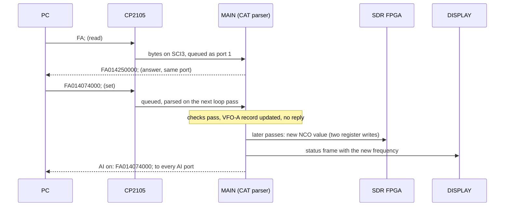
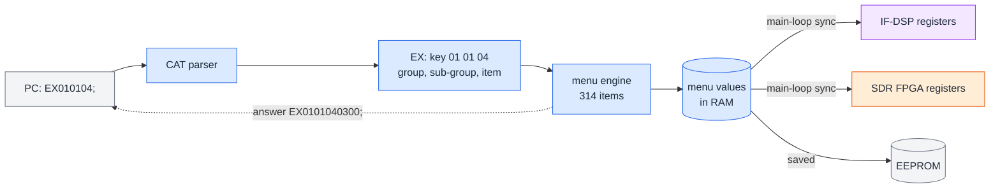

## 5. CAT remote control

**In short.** [CAT](#glossary) is the text protocol a PC uses to run the radio: a logger reads the frequency, WSJT-X sets the mode,
a contest program keys the transmitter. Every CAT command is two letters, maybe some digits, and a `;`. All of them end up in one
place: the parser on the [MAIN](#glossary) CPU. This chapter follows a command from the USB plug to the radio and back, takes one
command apart, and then maps the whole command set. MAIN firmware V01-12 knows 114 commands. Yaesu's manual documents 92 of them;
22 are undocumented. Some of those do nothing, some are harmless reads, and a few can reset the radio, change its region or rewrite
its calibration. Nothing in this chapter was sent to the radio: it all comes from reading the firmware.

### 5.1 What CAT is, and the three ways in

*Figure 5.1 — The three CAT ports. Two arrive over USB through the CP2105, one through the TUNER/LINEAR jack. All three end in the
same parser on MAIN.*

When you plug the FT-710 into a PC with one USB cable, the PC finds a small USB hub inside the radio. Behind the hub sit a USB sound
card, the scope link to the DISPLAY board, and a [CP2105](#glossary), a chip that turns USB into two serial ports. Windows shows those
as two COM ports, called "Enhanced" and "Standard". Each one is wired to a [UART](#glossary) on MAIN:

- **Port 1**, the Enhanced COM port, goes to MAIN's serial channel SCI3. It starts at 38400 baud.
- **Port 2**, the Standard COM port, goes to SCI0. It starts at 4800 baud. Its RTS and DTR lines can also key the transmitter (PTT)
  or send CW/RTTY, if the PC KEYING setting says so.
- **Port 3** is the TUNER/LINEAR jack on the back, a 5 V [TTL](#glossary) serial line into SCI2. The jack normally talks to an
  antenna tuner or an amplifier; the manual calls it CAT-3 when it is set up for CAT in the menu.

The menu sets the baud rate of each port. MAIN tags every command with the port it came from, and the answer goes back out of that
same port. One more kind of traffic goes the other way on its own: [auto information (AI)](#glossary). If a program turns AI on
(`AI1;`), the radio reports changes without being asked: turn the VFO knob and `FA…;` messages stream out. AI is switched on per port.

Two rules hold for every port. While the radio is switched off, MAIN ignores everything except `PS1;` (power on). And while the
DISPLAY board is updating its own firmware, it tells MAIN to stop reading CAT altogether (see
[chapter 4](#4-firmware-files-and-updates)). Every received command also restarts the auto-power-off timer.

### 5.2 Anatomy of a command

*Figure 5.2 — One command in its four shapes. The frequency set `FA014074000;` is 12 characters; the read `FA;` is 3.*

A CAT command is plain ASCII text:

- **The [mnemonic](#glossary):** two letters that name the command. `FA` is "frequency of VFO-A", `MD` is "mode", `TX` is
  "transmit". Only these two letters are case-insensitive, so `fa;` works too.
- **The parameters:** a fixed number of characters, usually digits. For `FA` it is nine digits, the frequency in hertz:
  `014074000` is 14.074 MHz. Some commands start with a selector digit, for example `VE0;` (version of chip 0).
- **The end mark:** a `;` closes every command and every answer.

The same mnemonic does several jobs, told apart by the length:

| Form | Example | What happens |
|---|---|---|
| **Set** | `FA014074000;` | Changes something. On success there is normally **no reply** at all. |
| **Read** | `FA;` | Asks a question. |
| **Answer** | `FA014074000;` | The radio's reply to a read, shaped like the set. |
| **Error** | `?;` | The only error reply. It covers an unknown command, a wrong length, a bad digit and a refused action. |

MAIN checks the **total length** first (for `FA`: 3 or 12 characters, nothing else). Only then does the command's own code, its
[handler](#glossary), check the digits and the range. A few commands accept more forms than the manual shows; for example `VM0;`
reads a hidden two-digit state code. [cat-commands.md](../cat-commands.md#firmware-vs-manual-differences) lists every difference.

### 5.3 The journey of `FA014074000;`

*Figure 5.3 — How a frequency set travels: into a queue, through the parser and the FA handler into the VFO record, and from there
out to the FPGA, the DISPLAY and back to the PC as an AI message.*

Say your logging program wants to QSY to the FT8 frequency on 20 m. It writes `FA014074000;` to COM port 1.

1. **USB to serial.** The CP2105 turns the USB packet into 12 serial bytes on MAIN's SCI3.
2. **Bytes into a queue.** MAIN's UART interrupt stores each byte as it arrives. When the frame is complete, it copies the command,
   tagged "port 1", into a [ring buffer](#glossary) with 60 slots. The interrupt does no parsing; it just queues.
3. **One command per loop pass.** MAIN has no operating system. It runs one big [main loop](#glossary) over and over, and once
   per pass the CAT parser takes **one** command out of the queue. If the queue is full of commands, they are handled one per pass.
4. **Look up the mnemonic.** The parser upper-cases the two letters and looks for `FA` in a table of 104 mnemonics. If it isn't
   there, it tries a second table of 10 more (section 5.4). Then it checks the length (12 means "set") and calls the FA handler.
5. **Check and store.** The FA handler checks that all nine characters are digits, that the frequency is between 30 kHz and
   75 MHz, and that the VFO is not locked (for example on a 60 m channel). If any test fails, the answer is `?;`. Otherwise it writes
   14 074 000 into the VFO-A record in RAM, clears the clarifier offset and raises a "refresh" flag.
6. **No reply.** A successful set answers nothing.
7. **The change spreads.** Other parts of the main loop notice the new value over the next passes. The SDR task writes the new
   receive-oscillator ([NCO](#glossary)) value to the FPGA, the display link sends a status frame to the DISPLAY, and the screen
   shows 14.074.000. These hops are documented for the main dial; that `FA` ends in the same refresh flag is *(inference)*.
8. **AI.** If AI is on for any port, the AI broadcaster sends `FA014074000;` to each of them. After a set it first waits 200 ms (a
   [hold-off](#glossary)).

A read is much shorter: `FA;` only makes the handler copy the VFO-A frequency into the reply buffer, and the reply goes back out of
port 1 in the same pass. Normal reads never ask the FPGA or the DSP; MAIN answers from its own RAM *(inference from the handlers)*.

*Figure 5.4 — The same story as a sequence: a read gets an answer at once, a set gets no answer but spreads to the other chips and
comes back as an AI message.*

### 5.4 The command map: documented and firmware-only

*Figure 5.5 — Every mnemonic MAIN V01-12 accepts, in table order. Blue: in Yaesu's manual. Coloured: undocumented, by risk.*

The firmware holds two tables of mnemonics. The **main table** has 104 entries and is searched first. The **extended table**
has 10 more, searched only when the main table has no match. Together that is 114 mnemonics. Comparing them with the CAT manual
(revision 2306-C) gives:

- **92 documented.** These are the commands in the manual. Two of them behave differently from what the manual says:
  - **`XT` (TX clarifier) is not implemented.** The mnemonic is in the table, but there is no code behind it, so it always answers
    `?;`. The clarifier's TX switch is reached through `CF` instead.
  - **`VE` (firmware version) needs a parameter.** The current manual writes it `VEP1;`, with P1 = 0 MAIN, 1 DISPLAY, 2 SDR,
    3 DSP. The old form from manual 2211-A, `VE;`, answers `?;`. `VE0;` should answer `VE00112;` for V01-12 *(inference)*.
- **22 undocumented:** `BY E8 E9 ED EK EM EN EU EO FD FS JP KT PE QS RC RD RS RT RU SP ZZ`. `EO` was still in the older
  manual 2211-A and was dropped in 2306-C. Section 5.5 sorts them by risk.

The manual and the firmware also disagree on smaller points: a few digit counts, ranges and accepted lengths. The full list is in
[cat-commands.md](../cat-commands.md#firmware-vs-manual-differences); for normal operating use of the documented commands, see
[chapter 3](#3-a-day-in-the-life).

### 5.5 The 22 undocumented commands, by risk

*Figure 5.6 — The 22 undocumented commands on a risk ladder. Only E8 and the read forms are harmless.*

**Does nothing (13).** Nine mnemonics, `BY ED EK EU RC RD RS RT RU`, sit in the main table with no code behind them; they answer
`?;`. Three more, `EN FS QS`, have a stub that only raises the error flag, so they answer `?;` as well. `KT` is in the extended table
but has no code at all, so it gets no reply. They may be leftovers from other Yaesu models *(guess)*.

**Read-only.** `E8` dumps the radio's whole settings and memory image, 10 665 bytes of data, scrambled with a random key byte,
in one 10 674-byte reply. It changes nothing, but it floods the port. It looks like a clone or backup export, the mirror image of `E9`.

**Changes settings (medium risk).**
- `FD` reads the scope start frequencies: `FD000;` the dial, `FD001;` the CURSOR-mode start, `FD002;` the FIX-mode start of the
  current band *(strong inference for "scope start")*. `FD002` plus nine digits writes the band memory. `FD` is also the only
  undocumented command that sends AI messages.
- `PE` reads and writes 18 one-byte values: 2 sets × 3 bands × (frequency, level, bandwidth). That shape matches the 3-band
  parametric microphone EQ, normal and with the processor on *(inference)*. The manual reaches those only through menu items. With an
  invalid selector digit a `PE` set can write to an arbitrary RAM address.
- `EO` turns a knob from the PC: the main dial by ±n Hz, kHz or MHz, or the FUNC or STEP/MCH knob by ±n steps. It was documented in
  manual 2211-A. It also quietly clears several mode flags.
- `EM` reads and writes five 50-character text slots in RAM. No EEPROM write was seen. What they are for is unknown *(guess: user
  messages)*.

**Dangerous (high risk).**
- `ZZ` is a factory reset. `ZZPE071099;` (`0710` is the model number) reloads all defaults, including the calibration table and
  the region code, saves them to [EEPROM](#glossary) and requests a restart *(that the request means a restart is inference)*. `ZZPE071001;` resets VFOs, memories and menus but keeps the
  calibration. `ZZPE071000;` switches on an unexplained mode that blocks some front-panel keys *(guess: a test or demo mode)*.
- `JP` reads and writes the [destination code](#glossary), the region that picks the market version. `JP0710;` reads it; a write
  saves a new code to EEPROM, reloads the defaults and requests a restart. The code most likely sets band limits and TX coverage
  *(inference)*.
- `E9` is the restore side of `E8`: it unscrambles a 10 kB image, checks a signature and a checksum, and writes all settings and
  memory channels to EEPROM. A bad image can corrupt the configuration.
- `SP` is a whole service family; it gets its own section.

### 5.6 The SP service family

*Figure 5.7 — `SP` sub-commands, by the third letter. Green forms read, red forms write. The target colours are the chips of
chapter 2.*

`SP` looks like a factory service interface *(inference)*. The third letter picks the target and the fourth letter, where there
is one, picks read or write:

- **`SPS` reaches the SDR [FPGA](#glossary).** `SPSRaaaa;` reads 16-bit FPGA register `aaaa` (hex) over MAIN's FPGA link and
  answers `SPSRvvvv;`. `SPSWaaaavvvv;` writes one. MAIN keeps its own copy of what each register should hold, and the write
  bypasses that copy. The written value therefore lasts only until MAIN next rewrites that register for its own reasons
  *(inference)*.
- **`SPD` reaches the IF-DSP.** Same format, but over the DSP link into the DSP's file of 113 registers. Same rule: a write
  sticks until the setting behind that register changes *(inference)*.
- **`SPIR;` reads 12 raw [ADC](#glossary) values:** forward and reflected power, PA supply voltage and current, ALC, the HF PA
  thermistor, the remote-keypad input, the SDR-module detect voltage and one unused input, with the unconverted slots as zero:
  12 × 3 hex digits. It changes nothing.
- **`SPM` reads eight bytes of meter values** *(inference that they are meters)*.
- **`SPR` / `SPW` read and write one EEPROM byte** at any address. The write has no bounds check.
- **`SPN` reaches a 261-byte table** that is most likely the factory alignment and calibration table *(inference)*, including the
  per-band TX power calibration. `W` changes an entry in RAM, `S` re-applies the table half a second later, and `SPAWE` saves the
  whole table to EEPROM. Even the read, `SPNR`, has a side effect: it also loads a preset into the active VFO.

The ASCII forms (`SPS`, `SPD`, `SPIR`) look like any other command. The others are **binary**: after `SP` and the letter come raw
bytes (an address, perhaps a value) and a [checksum](#glossary) byte, the 8-bit sum of every byte before it, then `;`. A wrong sum
answers `?;`. An earlier analysis thought the checksum test was broken, so that these forms could never work; that turned out to be
a bug in the disassembler, now fixed. **They work in V01-12.** That is exactly why they are high risk: they read and write EEPROM
and calibration data directly.

For what these hooks could mean for experiments, see [chapter 8](#8-hacking-and-custom-firmware).

### 5.7 Tests waiting for the owner's approval

*Figure 5.8 — The proposed first tests on the real radio. All are reads; none has been sent yet.*

All of the above comes from reading the firmware. The project's rule is that nothing is sent to the radio without the owner's
explicit approval, each time. The CAT analysis proposed a short list of **read-only** commands as safe first tests:

- `VE0;` to `VE3;`: the four firmware versions.
- `JP0710;`: the region code (the read form only).
- `FD000;`, `FD001;`, `FD002;`: the three scope start frequencies.
- `PE000;`: the first EQ-like value.
- `SPIR;`: the 12 ADC readings.

`E8` is also read-only, but its 10 kB answer floods the port. The writes `SPSW`, `SPDW`, `SPW`, `SPAWE`, `E9`, `ZZ` and a `JP` set
are on the "never send" list. **None of these commands has been tested on the radio yet.** The expected answers in the figure are
predictions from the code.

### 5.8 Menu settings over CAT: the EX command

*Figure 5.9 — An `EX` command goes through the same menu engine as the front panel. The engine only writes RAM; other parts of the
main loop carry the value on to the DSP, the FPGA and EEPROM.*

Most of the radio's setup menu is reachable over CAT through one command, `EX`. Its key is three two-digit numbers: the menu group,
the sub-group and the item. `EX010104;` reads item 04 of sub-group 01 in group 01, which is AGC FAST DELAY in the SSB settings, and
the answer `EX0101040300;` means 300. A set is the same key followed by the value.

- The firmware builds **314** menu items at start-up. **296** of them can be reached by `EX`, and they match the manual's menu chart
  one to one.
- The other **18** form the front-panel-only EXTENSION SETTING group (date and time, SD card, software version, calibration, reset,
  certification). `EX` refuses that group.
- The engine only changes the value in RAM. The DSP, FPGA and display code notice the change on their next main-loop pass, the same
  way they notice a front-panel change.
- There are small differences from the manual. One stands out: SSB TX BPF SEL has two values the manual doesn't list. `EX` refuses
  value 5 ("50-4000Hz") but accepts value 6 ("TTBF"), whose effect is unknown *(guess: a wide or flat TX filter)*.

The menu engine and every item are described in [code/main/menu.md](../code/main/menu.md); chapter 6 shows where the engine sits
inside MAIN.

### 5.9 Where to look

| Topic | Reference page | Key names and addresses (MAIN V01-12) |
|---|---|---|
| Every command, documented or not, with risk | [cat-commands.md](../cat-commands.md) | `cat_mnemonics` 0xFFF805EC (104), `cat_ext_mnemonics` 0xFFF806BC (10) |
| Per-command details of the 104 main-table commands | [cat-commands-primary.md](../cat-commands-primary.md) | `cat_FA_FB` 0xFFFA99BD, `freq_in_range`, `vfo_tune_locked` |
| Parser, queue, reply, AI, ports | [code/main/cat.md](../code/main/cat.md) | `cat_rx_complete` 0xFFFB1B50, ring 0x1E14C (60 × 0x6A), `cat_parse` 0xFFFA347C, `cat_dispatch` 0xFFFA3B6E, `cat_reply_error` 0xFFFB0166, `cat_send_reply` 0xFFFB1D12, `cat_ai_poll` 0xFFFDD797, `cat_ai_holdoff` 0xFFFDDB6A |
| Extended and service commands | [cat-commands.md, extended table](../cat-commands.md#extended-table) | `cat_dispatch_ext` 0xFFFA3A2A, `cat_ext_SP` 0xFFFA36F2, `cat_ext_ZZ` 0xFFFA58A1, `cat_ext_JP` 0xFFFA556B, `cat_ext_E8` 0xFFFA53A4, `cat_ext_E9` 0xFFFA5985, `cat_ext_FD` 0xFFFA5A51, `cat_ext_PE` 0xFFFA5FDF, `cat_ext_VE` 0xFFFA54B3 |
| The SP checksum and the old "bug" | [code/main/cat.md](../code/main/cat.md#extended-and-service-commands-summary), [code/main/eeprom.md](../code/main/eeprom.md) | `cat_checksum_ok` 0xFFFB0182, `cfg105` 0x4659 (EEPROM 0x000A) |
| SPIR fields | [code/main/peripherals.md](../code/main/peripherals.md#the-12-spir-fields) | `cat_SP_adc_dump` 0xFFFA4EED |
| UARTs and baud rates | [code/main/sci.md](../code/main/sci.md) | SCI3 port 1, SCI0 port 2, SCI2 port 3 |
| USB wiring and CAT round trip | [code/system.md](../code/system.md) §2.2 and §6.1 | CP2105, CY7C65631 hub |
| EX menu engine | [code/main/menu.md](../code/main/menu.md) | `cat_EX` 0xFFFA9937, `ex_command` 0xFFFE61E7, item table 0x2105C, values 0x9A2A..0x9E85 |
| Open questions and proposed tests | [tasks/T09-cat-commands.md](../tasks/T09-cat-commands.md) (follow-ups), [custom-firmware.md](../custom-firmware.md) | — |
