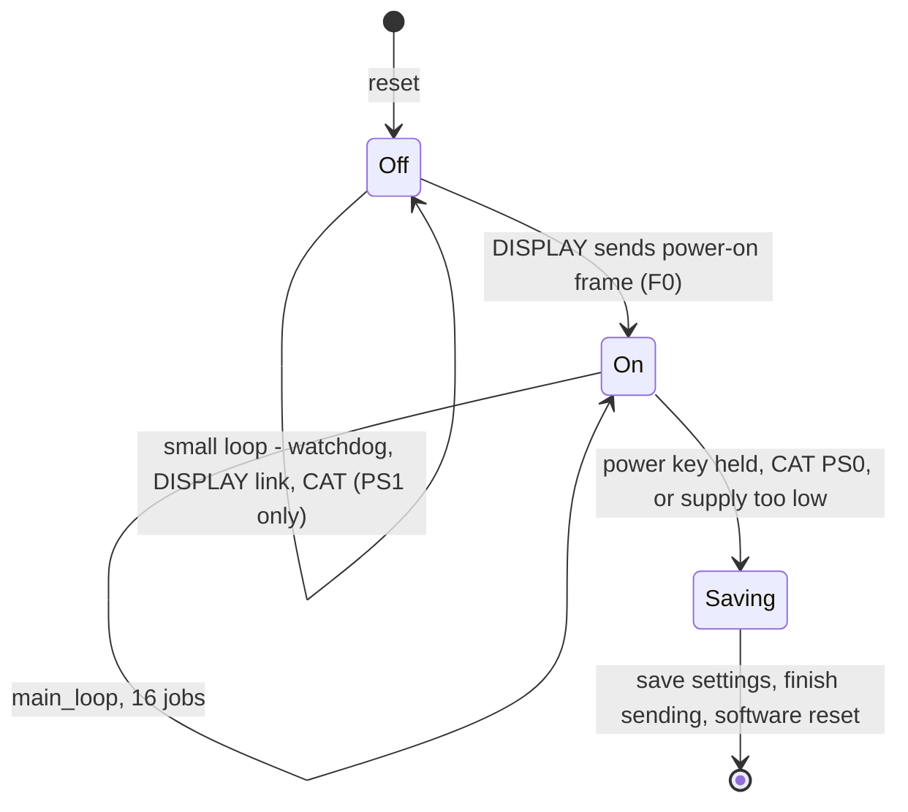
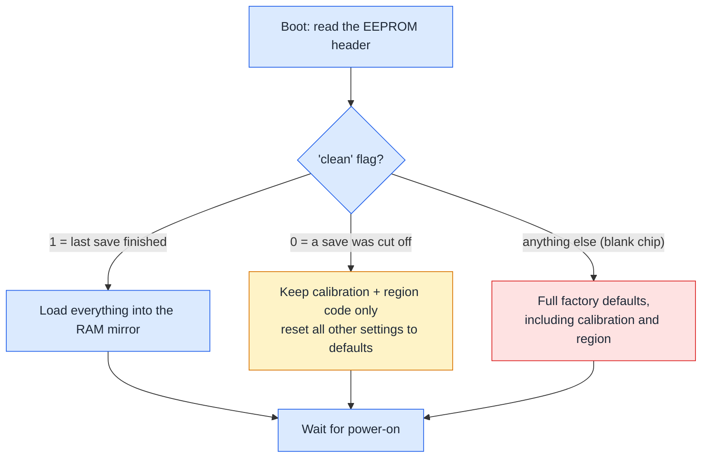
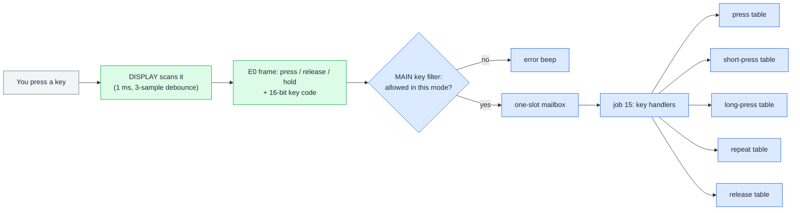

## 6. Inside MAIN and DISPLAY

**In short.** The FT-710 has two Renesas processors that run the radio as you see it. **MAIN**, an RX651, is the boss. It holds the
radio state, answers CAT, stores the settings and switches the RF hardware. It has no screen, no keys and no SD card. Its program is a
single endless loop that calls 16 small jobs in turn, with no operating system. **DISPLAY**, an RZ/A1H, runs the front panel. It owns the
touch screen, the keys and knobs, the SD card and the firmware updates. It runs about 32 tasks under a small real-time kernel. Neither
CPU does the other's job. DISPLAY forwards every key press to MAIN and draws whatever MAIN tells it to draw. This chapter opens both
programs and shows how each one is organised. The wire between them is covered in [chapter 2](#2-how-the-chips-talk), updates in
[chapter 4](#4-firmware-files-and-updates) and CAT in [chapter 5](#5-cat-remote-control).

### 6.1 Two CPUs, two styles

*Figure 6.1 — MAIN decides, DISPLAY shows. One UART carries screen packets one way and input events the other way.*

The two programs are built in opposite styles, and the reason is plain once you see the jobs:

- **MAIN** does many small, steady chores: watch the supply voltage, key the transmitter, push a new frequency to the SDR board, answer a
  CAT command. None of them takes long. A simple loop that visits each chore over and over is enough, and it is easy to reason about.
  MAIN's program is a [super-loop](#glossary) plus a handful of timer [interrupts](#glossary).
- **DISPLAY** does heavy, uneven work: redraw an 800×480 screen, read the SD card, unpack a firmware file, stream the scope to a PC. Those
  jobs can take a long time and must not freeze the knobs. So DISPLAY uses an [RTOS](#glossary) (NORTi, a [µITRON](#glossary) kernel)
  that switches between [tasks](#glossary). A task that waits for the SD card simply sleeps while the key task keeps running.

The split has one big consequence for anyone who wants to change the radio: **almost all of the radio's behaviour lives in MAIN**. The
menu text, the menu logic, the list of what each key does, and even which screen to show are all MAIN's decisions. DISPLAY is a
[thin renderer](#glossary) with an input scanner bolted on.

### 6.2 MAIN: one loop, sixteen jobs

*Figure 6.2 — MAIN's `main_loop` calls the same 16 jobs in the same order, forever. Interrupts keep the clocks and buffers up to date in between.*

After reset, MAIN sets up its clocks and peripherals, loads its settings from the EEPROM (section 6.3), and then enters the loop. The loop
has no logic of its own. It only calls 16 functions, one after the other. Each one looks at a few flags and timers, does a little work if
something changed, and returns *(inference: they are non-blocking by design; the only busy-waits found are the EEPROM writes and the
power-off path)*.

Here is what happens when you turn the VFO knob:

1. DISPLAY counts the knob steps and sends them to MAIN every 8 ms.
2. Job 14 (DISPLAY link) receives the frame. The knob handler changes the frequency in the VFO record in RAM.
3. On its next pass, job 3 (SDR link) compares the frequency registers it wants with the copies it last sent. The frequency has changed,
   so it writes the new value to the SDR [FPGA](#glossary).
4. Job 14 later sends DISPLAY a new screen packet with the new frequency, and DISPLAY redraws the digits.

Nothing *pushes* a change through the radio. Every job that drives hardware keeps a "last sent" copy and polls for differences. The IF DSP
link (job 4) works the same way for DSP settings. This makes the loop simple, at the cost of a little delay: a change waits for the next
pass.

**Time** comes from four on-chip timers:

- A 100 µs tick drives 75 one-shot [soft timers](#glossary). A job says "start timer 0x16 for 100 ms" and later asks "has it expired?".
  Nothing waits.
- A 100 ms tick drives four slow timers, used for the TX time-out timer.
- A third timer runs only while a beep plays and feeds the beep samples to the DAC.
- A fourth makes a short pulse train on a speaker switch, probably to soften the click when the speaker route changes *(inference)*.

**The [watchdog](#glossary)** (IWDT) must be refreshed regularly. Job 1 does this on every pass. If the loop ever hangs for about
2.2 seconds, the watchdog fires an [NMI](#glossary) (a non-maskable interrupt) rather than a plain reset.

*Figure 6.3 — MAIN's power states. "Off" is a reset CPU waiting in a small loop; switching off ends in a software reset.*

**Power is a handshake.** When the radio is "off", MAIN is actually running. It sits in a small loop that kicks the watchdog, listens
to DISPLAY and accepts only one CAT command, `PS1`. Even `PS1` does not switch the radio on by itself. It only asks DISPLAY, and MAIN
turns on when DISPLAY answers with its power-on frame *(inference for the exact handshake)*. Switching off works the other way round. Holding the power key, sending `PS0` or a
supply voltage that drops too low makes MAIN save its settings, wait until the last frame to DISPLAY has gone out, and **reset itself**.
The CPU then starts again from scratch and waits in the "off" loop. A restart (after a factory reset or a region change, for example) is
the same software reset with a "power straight back on" flag saved first.

### 6.3 MAIN's memory and settings

*Figure 6.4 — Where MAIN keeps things. The 22 KB block of RAM that mirrors the EEPROM holds every setting, memory channel and band stack.*

**Flash.** The RX651 in the FT-710 has 512 KB of code flash and, unlike its bigger brothers, **no data flash at all**. The first 64 KB of the
image hold constants: the CAT command tables, menu strings, and the five key-handler tables (section 6.5). The program code follows,
about 2,250 functions. The top of flash holds the version string (`V01-12`) and the reset vectors.

**RAM.** The 256 KB of RAM is less than half used. At the bottom are two small stacks. Most of the rest is ordinary variables and
buffers, with three areas worth naming:

- the **EEPROM mirror**, a 22 KB copy of the settings chip;
- the **global state block**, about 1 KB that holds most of the live radio state: on/off, the TX/RX sequencer state, the latest ADC
  readings and the flags that the DISPLAY link sets;
- the **menu item table**, built in RAM at boot (section 6.5).

**Settings live in an external EEPROM.** The chip is a ROHM BR25G256, a 32 KB [SPI](#glossary) [EEPROM](#glossary). MAIN does not use
an SPI peripheral for it. It [bit-bangs](#glossary) the bus: the code toggles the clock, data and chip-select pins itself. At boot it
reads the first 22.5 KB of the chip into the RAM mirror. From then on the program reads and changes settings only in RAM. A setting's RAM
address is simply a fixed base plus its EEPROM address, so the two copies line up byte for byte.

The mirror is written back in two ways. There is **no timed autosave**:

- **Small records, when they change:** a memory channel when you store it, a band-stack slot when it differs from the VFO, a QMB slot, a
  keyer message, a tuner-memory entry.
- **The whole image, when the radio goes down:** power-off, restart, factory reset, or a power failure.

*Figure 6.5 — What MAIN does with the EEPROM at boot. The only guard is a "save in progress" flag; the image has no checksum.*

The EEPROM image has **no checksum**. Its only protection is a 10-byte header with a save counter and a "clean" flag. Every save clears
the flag first and sets it again when it is done. If the power dies in between, the next boot sees the flag at 0. It then throws away
all user settings and keeps only the factory calibration table and the region ([destination code](#glossary)). A blank chip (all
0xFF) gets full factory defaults, including default calibration. That is worth knowing before you ever replace the EEPROM on a repaired
board *(inference)*. A low supply voltage blocks the small-record saves, so a brown-out cannot corrupt a half-written record
*(inference)*.

What is stored: the factory calibration table, the region code, two band stacks (VFO-A and VFO-B, 3 levels × 12 bands), 133 memory
channels (001–099, the PMS pairs, the 60 m channels and EMG), the QMB, keyer and text messages, the tuner memory, and the block of menu
values and VFO state. The last 10 KB of the chip are never used. Every VFO, memory, band-stack and QMB slot is the same 90-byte
record, so "recall" just copies 90 bytes into the working VFO record, and "store" copies them back.

### 6.4 MAIN's peripherals

*Figure 6.6 — What MAIN is wired to. Six UARTs are busy; two more are set up in code but go nowhere.*

The RX651 runs at 120 MHz from a 24 MHz crystal. Its peripherals do the following:

- **Eight serial ports ([SCI](#glossary)).** Two go to the [CP2105](#glossary) USB bridge, which gives the PC its two CAT COM ports
  ("Standard" and "Enhanced"). One goes to the rear TUNER/LINEAR jack. A menu setting turns that port into an external-tuner link, four
  band-data lines for a linear amplifier, a third CAT port, or four general-purpose outputs. One fast link (about 340 kbit/s) goes to
  DISPLAY. Two run at 115200 baud: one to the SDR FPGA and one to the IF DSP's console. The last two are set up by the start-up code and
  never used: an I²C port whose pins are not connected, and a "C4" UART that is never started.
- **Two 12-bit [ADCs](#glossary).** They measure forward and reflected power, the 13.8 V supply, ALC, PA drain current, two PA
  thermistors, the resistor ladder of the remote keypad, and an SDR-module detect voltage. A job starts a scan every 5 ms. The CAT
  command `SPIR` returns twelve of these readings.
- **One [DAC](#glossary).** It is a beep and sidetone generator. A timer feeds it a 36-sample waveform table at 36 times the tone frequency,
  and the output goes into the audio path. The familiar 880 Hz and 1046.5 Hz key beeps come from here.
- **[GPIO](#glossary) pins.** They drive the TX and RX supply lines, PA power, the speaker and headphone switches, the linear amp's SEND
  lines and the reset and update pins of the SDR and DSP chips. They read the CW key jack, the PTT inputs and the jack-detect switches.
- **A serial [shift-register](#glossary) bus** on GPIO pins. MAIN clocks data into DACs and shift registers on the MAIN and PA boards, for
  example the reference-oscillator trim DAC and the PA-unit control registers.
- **The watchdog** described in section 6.2.

MAIN has no USB of its own in use (its USB pins go only to test points), no display controller and no SD card interface.

### 6.5 Keys and menus

*Figure 6.7 — From a key press to the code that acts on it. DISPLAY only reports the key; MAIN decides what it means.*

**Keys.** MAIN has no key hardware. DISPLAY scans the front panel and sends each event as a small frame: press, release, or "still held
after about one second", plus a 16-bit key code. Physical front-panel keys have codes from 0x300 up. The soft keys drawn on the touch
screen use lower codes *(inference)*. MAIN then:

1. **Filters the event.** Some modes allow only a few keys. A key that is not allowed gives the error beep. Six codes are
   user-assignable: a menu setting swaps them for one of 15 fixed keys before anything else happens.
2. **Parks it in a one-slot mailbox.** There is no queue. If a second event arrives before job 15 runs, it overwrites the first.
3. **Calls a handler.** Job 15 looks the key code up in one of **five tables**, each with 863 entries (one per possible code): *press*,
   *short press*, *long press*, *repeat* and *release*. A small class table says which of them a key uses. Most keys act on press. Some
   do one thing on a short press and another on a long press. A few act on press and again on release. MAIN times the long press itself
   for the soft keys; for the physical keys it waits for DISPLAY's "held" event.

Knobs work the same way but with their own frame. DISPLAY sends raw step counts (main dial, the multi-function knob, the third knob) and
the positions of the two pots, and MAIN turns them into frequency steps or menu changes. Dial acceleration and step sizes must therefore
be MAIN's business *(inference)*.

**Menus.** The setup menu has no table in flash. At boot, one function makes **314 calls in a row**, one per menu item. Each call fills
in a small descriptor (name, group, limits, where the value lives, and functions to draw, step and act on it) and registers it in a RAM
table. 296 of the items are exactly the items that the CAT `EX` command reaches. The other 18 are the front-panel-only EXTENSION SETTING
group (date and time, SD card, software version, calibration, reset, certification).

All menu values sit in one block inside the EEPROM mirror, so they are saved with everything else. Changing a value only writes that RAM
byte. The jobs that care (the DSP link, the SDR link, the radio state) notice the change on their next pass and send it on. DISPLAY never
sees the menu table. It only gets a ready-made menu page in a screen packet: eight rows of text and a cursor.

### 6.6 DISPLAY: boot and tasks

*Figure 6.8 — One 3.3 MB program serves as boot loader and as application. It runs entirely from the RZ/A1H's 10 MB on-chip RAM.*

The DISPLAY CPU is a Renesas RZ/A1H, an ARM Cortex-A9 with 10 MB of RAM on the chip. The board has **no external RAM**. The program is
stored in a 16 MB Winbond [SPI flash](#glossary) and copied into the on-chip RAM at start-up. It is a single 3.3 MB C++ image: about
400 KB of code and 2.8 MB of pictures for the screen.

The same image appears three times in the flash: once at the start as the **boot loader**, and once in each of two **application
[banks](#glossary)**. At power-on (Figure 6.8):

1. The chip's built-in boot ROM runs the loader directly from flash.
2. The loader reads two flag words, one per bank, and jumps to bank 1 if its flag is valid, else to bank 2.
3. The bank copy starts again. It sees that the loader has already run, copies the whole image into RAM and unpacks its initial data.
4. `main` switches on the MMU and caches, sets up all the pins, starts the NORTi kernel and creates the first task, `root`.

If neither bank is valid, the loader stays in charge and shows the "BOOT LOADER" screen, from which you can update from the SD card
*(inference from the screen strings)*. An update always writes the bank that is *not* running, so the working copy stays intact while the new
one is written; the details are in [chapter 4](#4-firmware-files-and-updates).

**Standby and full start.** The `root` task decides how much to start. If the radio is "off" (the power-key line is idle and no service
key combination is held), it starts only the link to MAIN, a periodic wake-up and the GUI. When you hold the power key, it runs the rest
of the start-up list (USB host, touch, knobs, SD menu, PC link, recorder…) without rebooting the CPU. Holding **DNR + A/B + QMB** at
power-on forces the full start and brings up the boot-loader and update screen *(inference for the purpose)*. Another key combination shows SDR-link test counters.

*Figure 6.9 — DISPLAY's tasks. The update writers, the power task and the MAIN link run at the most urgent priority (3).*

About 32 tasks run under the kernel. A 10 ms system tick keeps time, and a 1 ms wake-up service starts the periodic tasks: every 1 ms
for key scanning, every 8 ms for the knobs, and every 33 ms (about 30 frames per second) for the screen. The rest sleep until an interrupt
or a message wakes them. Grouped by job:

- **Link to MAIN:** receive, dispatch, transmit, retry and pacing tasks. Every frame is acknowledged. After three failed retries,
  DISPLAY shows an error box or resets MAIN and then itself. Its watchdog timer serves only for that kind of deliberate reset; it never
  guards against a hang.
- **Input:** key scanning, the knobs, two pots, the touch panel and the USB mouse.
- **SD card and updates:** the SD driver, the update screens, the MAIN flasher, and the save/load/format menu.
- **PC link:** a task that streams the scope, the audio spectrum and a status block to the PC through the FT4222H USB chip. DISPLAY is
  the SPI slave on that link.
- **Recorder:** despite its name (`audio_codec`), there is no audio codec on the DISPLAY board. This task records and plays WAV files on
  the SD card, and the audio itself travels to and from the IF DSP inside SPI frames.
- **Debug and test:** a memory monitor and other console commands, gated off (section 6.7).
- **Never started:** a second UART link (SCIF4) and an IF-DSP update task are described in the image, but nothing creates them in V01-08.

### 6.7 DISPLAY: screens, touch, knobs, SD card and the hidden console

*Figure 6.10 — The GUI draws what MAIN describes. Both video channels read the same frame buffers, so the DVI jack shows the panel's picture.*

**Screens.** MAIN sends a [screen packet](#glossary) whenever something should change. The first byte says which screen it is (main
operating screen, menu page, memory list, popup, on-screen keyboard and so on), and the rest carries the text, numbers and cursor
positions. Every 33 ms DISPLAY compares the newest packet with the one on screen and redraws only the parts that changed. All graphics
are pre-drawn bitmaps stored in the image (2,240 of them, about 2 MB of pixels). Even the fonts are tables of pre-coloured character
bitmaps. The screen is built from four layers: a background, a main drawing layer, a layer for popups, and a small mouse-cursor layer.
The two middle layers are [double-buffered](#glossary): DISPLAY draws into one copy while the other is shown, then swaps them. The
RZ/A1H's video controller (VDC5) has two channels. One drives the 800×480 TFT. The other drives an LVDS link to the DVI output on the
MAIN board, and both read the same buffers. A few screens have no button: an LCD test pattern (solid colours and colour bars), the touch
calibration crosses, a screen saver with a drifting YAESU logo, and a BMP screenshot to the SD card.

DISPLAY changes screen on its own only at power-on, during a screenshot and in the boot-loader path. At power-on it shows the logo and
waits up to about 5 seconds for MAIN's first status packet. If none comes, it shows an error and offers the boot loader.

**Touch.** A TI TSC2003 touch controller on an I²C bus raises an interrupt when the pen goes down. DISPLAY then reads 12-bit X, Y and
pressure values, drops readings with implausible pressure, and maps them to pixels. A calibration screen asks you to touch five crosses.
DISPLAY fits a correction from them and stores it in its SPI flash.

**Knobs and keys.** The main dial uses a hardware quadrature counter, a second knob uses another counter, and the third knob uses an
interrupt pin. The two front pots are read by the ADC. Every 8 ms DISPLAY sends MAIN the raw count changes; it does no acceleration of
its own. Keys are scanned every 1 ms from a few direct inputs, a 4×4 matrix and two resistor ladders on the microphone connector, with
three equal samples (about 3 ms) needed to accept a change. Only one key is reported at a time. DISPLAY acts on a key itself in only
four cases: the power key, the boot key combinations, touch calibration and the debug console. Holding the power key for about a second
switches the radio on or off; a short press is the LOCK key.

**SD card.** The SD card appears as drive `I:`. Besides firmware files for updates ([chapter 4](#4-firmware-files-and-updates)), DISPLAY
keeps user files in `I:\FT-710\`: screenshots (BMP), memory-list and menu backups, and voice recordings (WAV). A memory or menu backup is
32,000 bytes of MAIN's settings, exchanged with MAIN over the link and scrambled with the same key as the firmware files, with a CRC. It is not a
text file.

**The hidden debug console.** The DISPLAY firmware contains a debug console for a USB keyboard. It has a memory peek-and-poke monitor
that can also run script files from the SD card, self-update commands, a MAIN-update command and keyboard tests. It is switched off by a
single 32-bit word in RAM that must hold a magic value. The shipped firmware sets it to 0, and the only code that would set it is never
called. So in V01-08 you cannot reach the console without changing the firmware. [Chapter 8](#8-hacking-and-custom-firmware) looks at
what it would take.

### 6.8 Where to look

| Topic | Reference page | Key names and addresses |
|---|---|---|
| MAIN boot, loop, timers, power states | [code/main/README.md](../code/main/README.md) | `PowerON_Reset` 0xFFF8FBDB, `app_main` 0xFFF94AFA, `main_loop` 0xFFF94B8B, `swtimer_start` 0xFFFB237A, `sw_reset` 0xFFFB3E55, global state block 0x20B04 |
| MAIN peripherals, GPIO map, ADC, DAC, watchdog | [code/main/peripherals.md](../code/main/peripherals.md) | `R_Systeminit` 0xFFF8F65E, `R_IWDT_Create` 0xFFF927A9, `tone_set` 0xFFFB2E1E, `power_off_io` 0xFFFB73A6 |
| MAIN UART drivers and channel map | [code/main/sci.md](../code/main/sci.md) | `R_SCI0..7_Create`, `sci_start_all` 0xFFFB1632 |
| EEPROM driver, map, saves, defaults | [code/main/eeprom.md](../code/main/eeprom.md) | `eeprom_load_all` 0xFFFB0229, `eeprom_save_all` 0xFFFB02AF, `eeprom_save_opstate` 0xFFFB02CF, mirror RAM 0x464F = EEPROM 0x0000 |
| Menu engine | [code/main/menu.md](../code/main/menu.md) | `menu_build_all` 0xFFFD4C30, `menu_register` 0xFFFD442F, item table 0x2105C, values 0x9A2A..0x9E85 |
| Key events and handler tables | [code/main/ui-keys.md](../code/main/ui-keys.md) | `key_event_filter` 0xFFFB44F7, `key_task` 0xFFFBBD58, tables 0xFFF89D94 / 0xFFF8AB10 / 0xFFF8B88C / 0xFFF8C608 / 0xFFF8D384 |
| VFO records, band stacks, frequency polling | [code/main/radio-control.md](../code/main/radio-control.md) | VFO-A 0x9D09, VFO-B 0x9D63, `sdr_task` 0xFFFA11ED |
| DISPLAY overview | [code/display/README.md](../code/display/README.md) | image base 0x20100000 |
| DISPLAY boot, banks, tasks, kernel, debug gate | [code/display/boot-rtos.md](../code/display/boot-rtos.md) | `Reset_Handler` 0x2010002C, `boot_select_bank` 0x20100ABC, `main` 0x20117294, `task_root` 0x201170C8, `boot_mode_full` 0x20116E84, `debug_enabled` 0x20111098 (word 0x20450000) |
| GUI, screens, layers | [code/display/gui.md](../code/display/gui.md) | `gui_main_loop` 0x20130188, `gui_screen_update` 0x2012EBB8 |
| Keys, knobs, touch, USB, console | [code/display/input.md](../code/display/input.md) | `task_key` 0x201137F8, `task_detect_renc` 0x20112AD4, `task_tsc2007` 0x20103464 |
| Clocks, pins, RTC, recorder, SD files | [code/display/peripherals.md](../code/display/peripherals.md) | `task_sdmenu` 0x2011010C, `task_audio_codec` 0x201065C4 |
| The link between the two | [code/display/mainlink.md](../code/display/mainlink.md), [code/main/display-link.md](../code/main/display-link.md) | `mainlink_init` 0x201163A0, `displink_task` 0xFFF94D6F |
| Memory maps | [memory-maps.md](../memory-maps.md) | MAIN flash 0xFFF80000, DISPLAY flash banks 0x18400000 / 0x18A00000, flags 0x183E0000 / 0x183F0000 |
| Chips and wiring | [hardware.md](../hardware.md) | Q1001 RX651, Q6009 RZ/A1H, Q1008 BR25G256, Q6018 W25Q128 |
