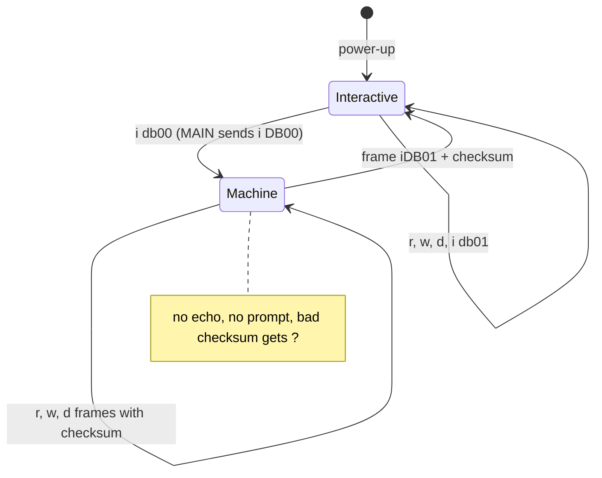
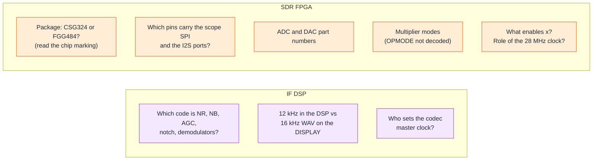

## 7. Inside the IF DSP and the SDR FPGA

**In short.** Two chips do the radio's signal work. The SDR module's FPGA, a Xilinx Artix-7, takes the
digitised antenna signal, mixes it down and filters it, and hands a low-rate stream to the IF DSP. The IF DSP, an NXP i.MX
RT685, turns that stream into audio for the speaker and turns microphone audio into a transmit stream for the FPGA. The IF DSP
has two processors on one chip. A small Arm core manages things: it talks to MAIN, sets up the audio codec and starts the
second core. A HiFi4 DSP core at 594 MHz does the audio processing. MAIN steers both chips by writing numbered registers over
a UART. The FPGA has no processor at all. Its "firmware" is a bitstream, a wiring plan for the chip. We turned that bitstream
back into a circuit that runs in a simulator and found two UARTs inside it, one of them a hidden debug console.

### 7.1 The IF DSP: one chip, two processors


*Figure 7.1 — The IF DSP chip (Q2002). The M33 manages, the HiFi4 processes, and the register file in shared memory joins them.*

The IF DSP chip is an NXP i.MX RT685. One firmware file (`FT-710_IFDSP_V0101.SFL`) holds the programs for both of its cores:

- The **[Cortex-M33](#glossary)** runs at 198 MHz under [FreeRTOS](#glossary). It is the manager. It boots
  from the 16 MB [QSPI](#glossary) flash, copies the DSP programs into place and starts the DSP. It sets up the
  TLV320AIC3204 audio [codec](#glossary), and it runs a small text console on a UART that MAIN uses to control the chip.
  It also turns one register into a PWM output that goes, through an RC filter, to a test point *(inference: an analogue
  meter or test output)*.
- The **[HiFi4](#glossary) DSP** is a Cadence audio DSP core running at 594 MHz under Cadence's small
  [XOS](#glossary) kernel. It is the worker. It moves the audio streams in and out and does all the signal processing,
  in 32-bit floating point.

The two cores share the chip's SRAM. Three areas of it matter:

1. **The register file** at `0x20070000`: 32,768 words of 16 bits. MAIN writes a word through the M33's console, the M33
   stores it there, and the DSP reads it straight from memory. There is no lock and no notification; the DSP just reads the
   current value. This is the real control path (section 7.4).
2. **Audio DMA buffers** at `0x20060000`. Only the DSP uses them. No audio ever crosses from one core to the other.
3. **An rpmsg message window** at `0x20020000`. NXP's [rpmsg-lite](#glossary) message link between the cores is fully set
   up, in the pattern of NXP's RT685 audio examples *(inference)*, but no code ever sends a message on it. It carries no traffic in this
   firmware.

The cores also share two small hardware helpers: the **Messaging Unit** ([MU](#glossary)), which gives each side three
flag bits the other can see, and the **[SEMA42](#glossary)** hardware semaphore. Both are used only once, for the start-up
handshake in the next section.

### 7.2 How the IF DSP starts up


*Figure 7.2 — IF DSP start-up. The M33 does all the preparation, releases the DSP, and only opens its console after the
three-step flag handshake.*

Follow the numbers in the figure:

1. The chip's boot ROM reads a configuration block at the start of the flash, which tells it how to talk to the flash
   (quad SPI), and jumps to the M33 code.
2. The M33 holds the DSP stalled and copies its own program, about 32 KB, from flash into SRAM.
3. It sets up the clocks. The RT685 has no crystal of its own: its reference is the 18.432 MHz `DSP_CLK` signal from
   the SDR module. From that the PLLs make 198 MHz for the M33 and 594 MHz for the DSP.
4. It clears the register file, resets the codec and sends it 67 settings, starts the PWM and sets up the rpmsg link.
5. It copies the three DSP program images out of flash (a plain copy, no checksum) and releases the DSP.
6. The DSP writes its default value into every register it uses, creates its threads and starts the audio.
7. The two cores step their MU flags through 1, 2 and 3, passing SEMA42 gate 0 between them as a token. The point of
   this *(inference)*: when the M33 sees flag 3, the DSP has finished writing its defaults, so nothing MAIN writes later
   can be overwritten by them.
8. The M33 writes the version (register 0 = `0x0101`, meaning V01-01) and sets bit 0 of register 1 ("DSP is up"), then
   starts the console task.
9. MAIN sends `i DB00` to switch the console to machine mode, reads register 0 and waits for bit 0 of register 1.

There are no timeouts in the handshake. If the DSP never reaches flag 3, the M33 waits forever, the console never starts
and MAIN gets no answers. Nothing in the image restarts the DSP once it runs, and no watchdog is started *(inference: only
a reset of the whole chip from MAIN would recover a hung DSP)*.

### 7.3 Audio in, audio out


*Figure 7.3 — The audio path through the HiFi4. Receive runs along the top, transmit along the bottom. The FPGA's role on
the left is inferred (section 7.7).*

The DSP has four [I2S](#glossary) audio ports and one SPI port, all driven by [DMA](#glossary):

| Port | Direction | Carries |
|---|---|---|
| RX IF | SDR FPGA → DSP | the received signal, as stereo pairs *(inference: I and Q)* |
| TX AF | DSP → SDR FPGA | the transmit signal |
| codec in | codec ADC → DSP | microphone (and line) audio |
| codec out | DSP → codec DAC | speaker (and line) audio |
| SPI, 1 MHz | DSP → DISPLAY | spectrum / scope data; the DSP is the SPI master |

On every I2S port the DSP is the clock **slave**: the SDR FPGA clocks the RX IF and TX AF ports, and the codec, which is
the I2S master, clocks its own ports.

**Blocks of 24 samples.** Audio moves in blocks of 24 samples. The sample rate is **12 kHz** *(inference, strong: the
constant 1/12000 converts Hz in about ten places, and a frequency field is clamped just below 6 kHz)*, so one block is
2 ms. Six threads share the work:

- **Rx_Path** runs once per block: RX IF in, the receive chain, out to the codec. The codec's DAC paces it.
- **Tx_Path** runs once per block: codec in, the transmit chain, out to the FPGA. The codec's ADC paces it.
- **Rx_Audio** takes 12 blocks at a time (24 ms) and reads most of the receive-side settings.
- **Spi** takes every 7 blocks, decimates them, builds 128-point spectrum data and sends it to the DISPLAY.
- **Main** wakes every 100 ms: it copies some input pins into a register and, every second, writes each thread's CPU
  load into registers `0x2000`–`0x2007`.
- **Ipc** handles the start-up handshake and would answer rpmsg messages if any came.

Because the codec clocks the two path threads, the SDR side is decoupled by small two-block FIFOs.

**What the DSP algorithms are, as far as we know.** The DSP code was read with a Zephyr toolchain disassembler that
understands the HiFi4's wide instruction bundles, which Ghidra cannot decode. The kernels are listed by call, not yet
worked out one by one. The filter responses below are measured from the coefficient tables; what each filter is for is
inferred from its shape and from the registers that select it:

- **Receive filters.** Four 257-tap FIR low-pass filters with edges at 700 Hz and 1000 Hz, each in a gentle and a sharp
  version, chosen by one register *(inference: CW / narrow filters)*. A sharp 2.8 kHz low-pass for receive audio. A
  notch-or-peak filter whose type and frequency (up to 5,999 Hz) come from register `0x45` *(inference)*.
- **Transmit filters.** Seven voice band-pass filters from about 23–4,137 Hz down to 363–2,766 Hz, chosen by index
  *(inference: the SSB transmit bandwidth menu)*.
- **Tones.** A table of the 50 standard CTCSS tones (67.0–254.1 Hz) used by a decoder and an encoder, with a 316 Hz
  low-pass and ~300 Hz high-pass filters around them *(inference: [CTCSS](#glossary) encode, decode and removal)*.
- **Equalisers.** Three-band parametric EQs for transmit (registers `0x25`–`0x2D`) and receive (`0x48`–`0x50`), and a
  speech-processor switch (`0x2E`) *(inference, from MAIN's formulas)*.
- **Adaptive filter.** A 51-tap normalised [LMS](#glossary) filter *(inference)*; what it is used for is not
  established.
- **Levels.** Two level-control blocks with attack/release-style constants *(inference)*, a keying ramp, and level
  outputs that MAIN reads as meter values.
- **Scope.** FFT twiddle tables and a sharp 1 kHz low-pass in front of the decimate-by-7 scope path *(inference)*.

Noise blanker, noise reduction, AGC and the demodulators themselves are not yet identified in the code.

### 7.4 The register file: how MAIN turns the knobs


*Figure 7.4 — The IF DSP register file at a glance (not to scale). About 110 registers are live; the rest of the 32K words
are unused.*

Every IF DSP setting is one 16-bit word in the register file. When you turn a knob or change a menu item, MAIN works out
the new register value, compares it with the value it last sent, and if it differs sends one frame to the M33 console:
`r` + 4 hex digits to read, or `w` + 4 + 4 hex digits to write, each followed by a two-digit checksum and CR. The M33
answers a write with ACK (`0x06`) and a read with the value. Chapter 2 shows the frame format byte by byte.

The console has two modes. A person at a terminal gets the **interactive** mode: echo, a `>> ` prompt and the commands
`r`, `w`, `d` (dump 64 words) and `i`. MAIN switches it to the quiet **machine** mode at start-up:



Who uses which registers:

- **MAIN writes 72 registers** and reads only registers 0–4: the version, a flag word (bit 0 = DSP up; other bits are DSP
  flags that MAIN uses for squelch *(inference)*), two level words that MAIN averages into meter values *(inference: S-meter
  and similar)*, and a signed offset that MAIN adds to the VFO in tens of Hz *(inference: CW zero-in)*.
- **Register 6 is the demodulator class**: CW-U 0, CW-L 1, USB-type 2, LSB-type 3, AM 8, FM 9. MAIN derives it from the
  operating mode.
- **The DSP keeps its own tuning constants** around `0x4000`. MAIN never writes most of them, so they keep their
  defaults.
- **Two 4 KB capture blocks** (registers `0x7000` and `0x7800`) exist in the DSP, but no code fills them in this build
  *(inference: a leftover debug capture)*.

The CAT service commands `SPDR` / `SPDW` send the same `r` / `w` frames, so a PC can read and write this register file
directly (chapter 5). `SPDW` changes DSP parameters live and is not to be sent to the radio without the owner's approval.

### 7.5 The SDR FPGA: firmware without a CPU


*Figure 7.5 — The SDR image is a bitstream: configuration bits for every part of the chip, not a list of instructions.
The chip is nearly full.*

The SDR module holds a Xilinx Artix-7 **XC7A50T** [FPGA](#glossary), an ADC, possibly a DAC *(inference)*, and a QSPI
flash. The `FT-710_SDR_V0104.SFL` file has no program in it. It is a [bitstream](#glossary): about 2.2 MB of
configuration bits. Each bit sets one small thing: an entry of a logic lookup table ([LUT](#glossary)), the start value of a
flip-flop, an option of a hardware multiplier ([DSP48](#glossary)), a word of block RAM ([BRAM](#glossary)), or a switch
that joins two wires. At power-on the FPGA reads the bitstream from the QSPI flash, and from then on the hardware just
runs. Nothing is fetched or executed.

The file has a 4 KB header whose first word is a CRC-32 of the rest, then Xilinx's standard configuration commands
(quad-SPI boot, chip ID `7A50T`), then the payload: 5,420 **frames** of 101 words each. Frames 0–4,389 hold the logic and
routing, and frames 4,390–5,419 hold the block-RAM contents. A CRC and a start command finish the file. The bitstream is
neither compressed nor encrypted.

The design nearly fills the chip: 82 % of the LUTs, 48 % of the flip-flops, **119 of the 120 multipliers** and 70 of the 75
block RAMs. A design with nearly every multiplier in use is a signal-processing design *(inference)*. The block RAMs hold only numeric
tables: an exact cosine in 0.5-degree steps, a 720-step raised-cosine ramp, a bank of six symmetric low-pass FIR filters,
a 1,024-tap filter, and phase tables, some copied four times. There is **no soft CPU** (such as a MicroBlaze) in block RAM
*(inference, high: every initialised memory decodes as a smooth table, not code)*.

### 7.6 From bitstream to readable Verilog


*Figure 7.6 — How the bitstream became a circuit we can run and read. Each step has its own tool and check.*

A bitstream is not meant to be read back, but the open-source [Project X-Ray](#glossary) database documents what most of
the XC7A50T's configuration bits mean. With it we rebuilt the circuit in steps:

1. **Decode the file** (the SFL decoder of chapter 4) to get the raw bitstream.
2. **Sort the frames by address.** The rebuilt frame order gives exactly 5,420 frames, the count in the file.
3. **Translate bits into [FASM](#glossary) features**, lines like "this LUT has this truth table" or "this wire switch
   is on": 549,000 lines. Apart from the per-frame error-check bits, only 407 of 2.36 million set bits stay
   unexplained.
4. **Build a cell [netlist](#glossary)**: 63,648 cells (LUTs, flip-flops, carry chains, multipliers, RAMs, clock buffers,
   I/O pins) joined by 127,648 nets, with no net driven twice. The LUT and flip-flop counts match the bitstream counts
   exactly.
5. **Recognise blocks** by tracing clocks, pins and logic equations: the clock tree, the ADC input, the QSPI flash pins
   and two UARTs.
6. **Write structural Verilog**: one module with 63,474 Xilinx primitives. The Yosys synthesis tool reads it without
   errors. As a first check, a cut-out of one UART receiver, fed real serial bytes in a simulator, decoded every byte
   exactly.
7. **Simulate the whole chip** with [Verilator](#glossary), which compiles the design into a fast C++ model (about 15,000
   clocks a second). Fed MAIN's start-up frame `r000032`, it answers `r010437`: register 0 = `0x0104`, version V01-04.
8. **Re-write by hand.** `hdl/sdr/uart_link.v` is a readable re-implementation of MAIN's link. Run side by side with the
   recovered netlist on directed and random traffic, it gives **0 mismatching clocks** on the transmit pin.

Everything built from the bitstream (FASM, netlist, Verilog) stays in the ignored `build/` folder. Only the tools and the
hand-written HDL are in git.

### 7.7 What is inside the FPGA


*Figure 7.7 — Inside the XC7A50T. Solid boxes are seen in the netlist; dashed boxes are inferred from the tables and
resource counts.*

What the netlist shows for certain:

- **One clock for almost everything.** An LVDS clock from the ADC drives every multiplier, the block RAMs and all but about
  300 flip-flops. It runs at **125 MHz** *(inference, high: the UART bit timer divides by 1,086, which is 115,200 baud at
  125 MHz, and the service manual says "Operating clock 125MHz, Divide 250MHz by 2")*. A second LVDS clock from the ADC
  captures 14 data pairs at double data rate ([LVDS](#glossary), [DDR](#glossary)).
- **Two cascaded clock generators** ([MMCM](#glossary)s) make a clock of about 28 MHz *(inference from the divider
  settings)* that goes straight to one output pin. Its role is open.
- **17 LVDS output pairs**, clocked at double data rate *(inference: the transmit DAC)*.
- **A QSPI master on the configuration-flash pins.** The FPGA can read and write its own flash. This is how an update
  rewrites the bitstream (chapter 4) *(inference for the purpose)*.
- **Two identical UARTs at 115,200 baud**, sharing one register bank:
  - **UART B is MAIN's link** (MAIN's UART5). It keeps the last 11 characters in a window and acts on CR, so it accepts
    exactly MAIN's `r` and `w` frames with checksum (chapter 2), answers reads with the value and writes with ACK, and
    answers anything else with `?`. An empty line repeats the previous command.
  - **UART A is a debug console** (`UART_DBG` on the connector; identified by its behaviour). After reset it prints the prompt `[IF]>`. It echoes
    each character and takes `r AAAA` and `w AAAA VVVV` (space or comma) with exactly four hex digits. Anything else
    prints `Err`.
- **Register 0 = `0x0104`** (V01-04, read-only). MAIN reads it at start-up and reports it as the SDR version.
- **The `x` command.** Both UARTs' character tables accept the letter `x`, but every form of `x` that was tried in
  simulation fails (`?` on the link, `Err` on the console). It has no reachable function in this bitstream with the other
  input pins at 0 *(inference: unused, or enabled by an input pin)*.

A short session on the debug console, as the simulation shows it (line breaks simplified):

```text
[IF]>r 0000
0104
[IF]>w 0015 1234
[IF]>r 0015
1234
[IF]>x 0000
Err
[IF]>
```

What is inferred, not seen: the receive path (a mixer driven by the cosine table, then the bank of decimating FIR
filters), the transmit path (the raised-cosine ramp shaping the keying envelope), and a scope/FFT engine using the
four-times-replicated phase tables. The netlist does show several tables feeding multiplier inputs directly, but the
multipliers' exact modes are not decoded yet.

### 7.8 Open questions



*Figure 7.8 — Open questions for the two signal chips.*

- **IF DSP algorithms.** The DSP code is readable as assembly, but the receive and transmit chains are listed by call, not
  yet by algorithm. Register 6's numbering on the DSP side and most receive-side registers still need names.
- **Sample rate.** The DSP code points to 12 kHz, but the DISPLAY saves the recorded audio it gets from the DSP as a 16 kHz
  WAV. Either the scope/record thread resamples, or the WAV header is nominal.
- **Codec clock.** No M33 code selects the codec's master-clock output, so the DSP must do it, or the pin keeps its reset
  setting *(inference)*.
- **FPGA package.** The bitstream does not record the package. Only the CSG324 and FGG484 packages connect every pin
  the design uses, so the pin-to-ball map, and with it the J2002 pin path, stays open until someone reads the chip marking
  (chapter 8).
- **Remaining pins.** The DISPLAY's scope SPI and the I2S lines to the IF DSP have not yet been matched to FPGA pins. The
  whole-chip simulation can do it by driving candidate pins and watching the outputs.
- **Arithmetic.** The multipliers' operating modes are not decoded, so the receive and transmit maths is read from the
  tables, not from the circuit.
- **Small mysteries.** The `x` command, the ~28 MHz clock, the meaning of the update commands written to register `0x32`, and whether the FPGA boots
  the updated image directly or through a fall-back image. A console RTL to match `uart_link.v` is not written yet.

Plans for loading a test bitstream over JTAG, and for custom DSP or FPGA code, are in chapter 8.

### 7.9 Where to look

IF DSP reference pages:

- [IF DSP overview](../code/ifdsp/README.md): block diagram, boot flow, memory map, key numbers.
- [Control link](../code/ifdsp/control-link.md): console grammar, the full register map, the codec set-up table.
  Functions: `console_rx_char` 0x00081430, `regfile_write` 0x00080C4C, `aic3204_init` 0x00080BD0,
  `sct0_pwm_callback` 0x00081164. MAIN side: frame builder `FUN_fffa0b4c`, `SPDR`/`SPDW` via `cat_SP_dev4_reg`
  0xFFFA4E8F.
- [IPC](../code/ifdsp/ipc.md): MU flags, SEMA42 gate 0, the idle rpmsg-lite link (shared memory 0x20020000, endpoints
  0x28 and 0x1E). M33 `app_main` 0x0008106C, DSP `Thread_Ipc_entry` 0x0021C3B4.
- [M33 platform](../code/ifdsp/m33-platform.md): flash layout, clock tree, pin mux, the DSP loader `BOARD_DSP_Init`
  0x00084AD8, FreeRTOS tasks.
- [HiFi4](../code/ifdsp/hifi4.md): threads (`xos_create_main_ipc_threads` 0x0021C498, `Thread_Rx_Path_entry` 0x002262FC,
  `Thread_Tx_Path_entry` 0x0022647C), I2S/DMA set-up, register use, coefficient tables, `nlms_51tap_update` 0x00223250.
- [Memory maps](../memory-maps.md), IFDSP section: flash image layout and the shared SRAM areas.

SDR reference pages:

- [SDR overview](../code/sdr/README.md) and [bitstream layout](../code/sdr/bitstream.md): header CRC, frame map.
- [Resources](../code/sdr/resources.md) and [block-RAM tables](../code/sdr/bram-tables.md): utilisation, MMCMs, I/O
  counts, the table catalogue and the MicroBlaze verdict.
- [Interfaces](../code/sdr/interfaces.md): the J2002 connector pin map and the update sequence.
- [Netlist](../code/sdr/netlist.md): the recovery steps, clocks, pin map by bank, UART links, simulation results.
- [`hdl/sdr/`](../../hdl/sdr/README.md): `uart_rx.v`, `uart_link.v`, the testbenches and the Verilator harness.
- Tools: `tools/xc7_db.py`, `tools/xc7_fasm.py`, `tools/xc7_netlist.py`, `tools/xc7_blocks.py`,
  `tools/xc7_netlist_verilog.py`, `tools/sdr_uart_sim.py`. Task notes: [T15](../tasks/T15-fpga-netlist.md),
  [T15e](../tasks/T15e-fpga-uart-rtl.md).
