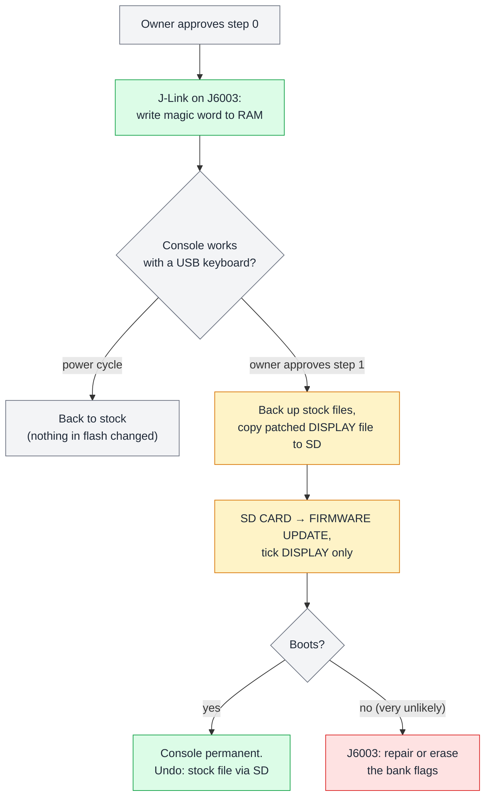

## 8. Hacking and custom firmware

**In short.** Can the owner run their own code on the FT-710? As far as the analysis can tell, yes. None of the four
images is signed, none is encrypted, the MAIN CPU has no lock bits set, the FPGA bitstream is not encrypted, and every
chip has a debug or boot header on the board. Free compilers exist for everything except the HiFi4 audio DSP core. The
project has already built two small DISPLAY patches and planned a first FPGA test. **None of them has been applied to
the radio.** Every write to the radio waits for the owner's approval. This chapter shows what is possible, which cable
goes where, how risky each kind of experiment is, and what is waiting for a decision. How an update file is built and
loaded is covered in [chapter 4](#4-firmware-files-and-updates); this chapter only points there.

### 8.1 Is it possible? A scorecard per chip

*Figure 8.1 — What stands between the owner and their own code, chip by chip. White means nothing in the way.*

Locked-down products usually stop you in one of three ways: a signature check, encryption, or lock bits that close
the debug port. The FT-710 uses none of them.

- **No signatures.** The update files ([SFL](#glossary)) are only scrambled with a fixed 43-byte key and protected by
  a CRC-32 with a fixed salt. The project's own encoder rebuilds all four shipped files byte for byte, so it can also
  build changed ones. The radio's update loader checks the CRC and the file name, and nothing else: no signature, no
  model, no serial number (details in [chapter 4](#4-firmware-files-and-updates)).
- **No encryption.** The DISPLAY and IFDSP images are plain ARM code. The FPGA bitstream is an ordinary, uncompressed
  Vivado file with no encryption set.
- **No lock bits on MAIN.** The Renesas RX651 keeps its protection settings in a 116-byte
  [option-setting memory](#glossary). In the shipped image every byte is `0xFF`. Checked against the Renesas hardware
  manual, that means: no ID-code protection (the ID is sixteen `0xFF` bytes), serial programming allowed, no access
  window, no ROM-code or Trusted Memory protection. That is good news, but it is also a trap: see
  [8.7](#87-golden-rules).
- **Two "maybe" cells.** The IFDSP's RT685 can enforce secure boot through one-time-programmable
  [OTP](#glossary) fuses. They cannot be seen from the image. The plain image suggests secure boot is off
  *(inference)*; only reading the fuses over the debug port would tell, and that needs approval.
- **One hard part.** The RT685's HiFi4 audio DSP core needs Cadence's proprietary Xtensa toolchain, and Ghidra cannot
  decode its bundled instructions. The practical way round: change DSP behaviour through the parameter registers that
  MAIN already writes (see [chapter 7](#7-inside-ifdsp-and-sdr)), and put new signal processing on the M33 core or in
  the FPGA.

The FPGA has a different limit: room. The stock design already uses about 82 % of the logic and 119 of the 120 DSP
blocks, and there is no HDL source, only a netlist recovered from the bitstream. Adding to the stock design is tight;
a replacement must redo the ADC capture, filters, scope link, TX path and the UART to MAIN.

The realistic first step is therefore **patching** the existing images (small hooks, a new CAT command, a menu item,
switching on a hidden debug console) rather than writing whole new firmware.

### 8.2 The debug headers

*Figure 8.2 — The four debug headers, their pins, and the adapter each one needs.*

Each processor has a small header on the board. All four are flat-flex ([FFC](#glossary)) sockets of the FLT-SM2
family, so you need a matching FFC breakout board and a short flat cable; the pitch should be measured before ordering
*(inference)*.

- **J1004 "RX-CPU DEBUG" → MAIN (RX651).** Carries the mode pin, reset, the `UB` boot pin and the SCI1 serial port.
  With a **Renesas E2 emulator Lite** it gives [FINE](#glossary) debugging and flash programming. With a plain 3.3 V
  USB-UART and the mode pin held low at reset, the RX651 starts its built-in [serial boot mode](#glossary), the same
  route DISPLAY uses to update MAIN. Pins 1–6 are known; pins 7 and 8 only go to test points. One catch: the serial
  pins are shared with the MAIN–DISPLAY link, so DISPLAY has to be held in reset (J6003 pin 7) or its transmit line
  isolated while an adapter drives them *(inference)*.
  An older version of the hardware notes called this header J1005; the parts list shows it is J1004.
- **J6003 → DISPLAY (RZ/A1H).** Plain ARM [JTAG](#glossary). A **SEGGER J-Link** (or another ARM JTAG probe with
  OpenOCD) can halt the Cortex-A9, write RAM, and reach the SPI flash. This is the header for the debug-console RAM
  write ([8.4](#84-the-prepared-patches)) and for repairing DISPLAY's boot flags if a patched image will not boot.
- **J2009 "DSP_JTAG" → IFDSP (RT685).** ARM [SWD](#glossary) plus a UART. A J-Link, NXP MCU-Link or any CMSIS-DAP probe
  works; a 3.3 V USB-UART fits pins 5 and 6. Reading the OTP fuses would go through here (approval needed).
- **J2001 "SDR JTAG" → SDR (XC7A50T).** Plain FPGA JTAG. A Xilinx Platform Cable USB II, a Digilent JTAG-HS2/HS3, or an
  FT2232H cable with openFPGALoader. A JTAG load goes into the FPGA's configuration RAM only and never touches its
  flash ([8.5](#85-the-fpga-hello)).

The fifth "recovery header" needs no cable at all: the **SD card**. As long as DISPLAY boots, the stock update files
restore every image.

### 8.3 How risky is each step?

*Figure 8.3 — The risk ladder. Climb one rung at a time; every rung from 1 upward needs the owner's approval.*

Experiments differ a lot in what can go wrong and how you get back.

- **Rung 0, paper and simulation.** Reading the docs, working in Ghidra, and running the recovered FPGA netlist in the
  [Verilator](#glossary) model. The radio is not involved.
- **Rung 1, read-only CAT queries.** Sending a query such as `VE0;` over the USB serial port. Nothing is written, but it
  still talks to the radio, so it still needs approval. Set commands are a different matter: some of the undocumented
  ones rewrite EEPROM, calibration or the region code ([chapter 5](#5-cat-remote-control)).
- **Rung 2, volatile JTAG.** A RAM write on DISPLAY, or loading a test design into the FPGA over JTAG. The change lives
  in RAM only; **a power cycle removes it** *(inference)*. While an FPGA test design is loaded the radio is deaf, but
  that also ends at the power cycle.
- **Rung 3, SD-card patch of DISPLAY.** A patched DISPLAY file installed through the normal update menu. It stays after
  power-off. The way back is to install the stock file the same way. DISPLAY keeps two flash banks, but don't count on
  the old bank: after a *successful* update only the new bank is marked bootable, and the old one is usable only if
  the update was interrupted. If a patched DISPLAY crashed early in boot, the panel could not help, because the boot
  loader jumps to the bank before it looks at any key. Then the only way back is J6003 *(inference)*.
- **Rung 4, MAIN reflash.** A patched MAIN image, through the SD card (DISPLAY drives MAIN's serial boot mode) or
  through J1004. Recoverable in principle the same two ways, as long as DISPLAY still runs. Each MAIN update also rewrites the
  option-setting memory, which Renesas rates for 1000 program/erase cycles, so that is the practical limit on MAIN
  updates *(inference)*.
- **Rung 5, the option-setting memory.** Never change it. Some of its settings cannot be undone, ever ([8.7](#87-golden-rules)).

### 8.4 The prepared patches

*Figure 8.4 — The two DISPLAY patches and the RAM-only alternative. All are built or planned; none has been applied to the radio.*

The project built two DISPLAY patches as finished update files. They exist only in the project's private `build/`
folder. **Neither has been flashed.** Both were checked the same way: decode the file again, check the CRC, run every
rule of the update loader, and compare a full disassembly of the old and new image.

**Patch 1, "banner"**, is a harmless first test. It changes the title of DISPLAY's power-on maintenance screen from
`YAESU FT-710 BOOT LOADER V01-02` to `... T16-01`. Four bytes differ, the length stays the same, and no code compares
this string. Reaching that screen puts the GUI into loader mode, so look at the title and leave without starting an
update.

**Patch 2, "debug gate"**, switches on a hidden console. DISPLAY contains a ready-made debug console driven from a
USB keyboard: a memory monitor (read or write any address), scripts run from the SD card, debug overlays on the F-keys,
a link logger, and some self-flash and reset commands. It only runs when a magic word, `0xA0B9C8E7`, sits at one RAM
address. In V01-08 nothing ever writes that word, so the console is dormant. A tiny check function compares the word
and returns "yes" or "no". The patch changes the "no" instruction (`movne r0,#0`) into "yes" (`movne r0,#1`). That is
one byte in the whole image.

**The RAM-only alternative** does the same without touching flash. With a JTAG probe on J6003, halt the DISPLAY CPU
after boot, write `0xA0B9C8E7` to address `0x20450000`, and let it run. The console works until the next reset
*(inference)*. This is the recommended "step 0" if a probe is at hand.

*Figure 8.5 — The written plan for the debug console: a volatile test first, then the SD-card patch, with a way back at each step.*

The plan names the risks honestly. The console listens to **every** keyboard report, whatever field has focus, so
typing `up0` and Enter while naming a memory channel would start rewriting DISPLAY's boot-loader region from a file on
the SD card. Keep no such files on the card and plug the keyboard in only when you use the console. The F-keys gain a
second meaning (F11, for example, replaces live scope data with test tables). Careless writes from the memory monitor
can crash the CPU, which a power cycle fixes. The console has no text output: results show on the overlay or land in
RAM.

### 8.5 The FPGA "hello"

*Figure 8.6 — The planned stage-1 FPGA test: proof that a self-built design loads and runs, without driving a single pin. Plan only.*

The first FPGA experiment is designed to prove one thing: that a design built by the owner loads and runs on this
FPGA. It is a **plan, not done**.

- **No pins.** The test design has no inputs or outputs at all, so it cannot drive anything on the board. That also
  means it doesn't need to know the FPGA's package or pin map, which are not fully known yet.
- **Its own clock.** It uses the FPGA's internal configuration oscillator (about 65 MHz) and a 32-bit counter.
- **Read back over JTAG.** A JTAG user register (`BSCANE2`) returns the text `HELO` plus the counter. A counter that
  changes between two reads proves the fabric runs. A custom [USERCODE](#glossary) (`0x7E570001`) proves it is *our*
  design that is loaded.
- **The flash is safe.** The flash clock pin is left undriven (tristated), and the load is told to go to SRAM only. Never use a
  "write flash" option or a flash-programming helper design.

The procedure: radio on the bench with a dummy load, no transmit, current-limited supply. First read only (the chain,
the ID `0x0362C093`, the stock USERCODE). Then load the test design, check the USERCODE and the counter, and power
cycle. While it runs, the radio is deaf: the FPGA also supplies the IFDSP's only clock, the receive audio, the scope
data and MAIN's replies, so expect silence, a frozen scope and error messages. All of it should clear with the power
cycle, because every CPU restarts *(inference)*.

A later **stage 2** would drive one harmless output, the FPGA's debug UART, and send `HELLO`. The plan waits for the
pin to be mapped. Since then, the netlist work has found, by simulating the recovered design, that the stock design
already has a debug console on that UART, with the prompt `[IF]>` (see [chapter 7](#7-inside-ifdsp-and-sdr)).

Writing the FPGA's flash for good is out of scope until there is a working replacement design and a recovery plan.

### 8.6 Decisions waiting for the owner

*Figure 8.7 — The open decisions. Nothing on this list has been done yet.*

- **Read-only CAT tests.** Which undocumented query forms may be sent? The suggested candidates are `VE0;`…`VE3;`,
  `JP0710;`, `FD000;`…`FD002;`, `PE000;` and `SPIR;`. `E8` is read-only too but returns about 10 kB. The set forms
  that rewrite EEPROM, calibration or the region are never on this list.
- **Debug console, step 0 or step 1.** The JTAG RAM write first (needs a probe), or straight to the SD-card patch.
- **FPGA stage 1.** The no-pin test design over J2001.
- **Read the FPGA package marking.** The pin usage fits only two packages, CSG324 or FGG484, and the chip ID doesn't
  tell which. The marking under the SDR module's shield must be read before any design that drives a pin.
- **A possible US 60 m transmit check.** In MAIN's US band table the 60 m channels are single-frequency rows, and the
  compare can never match a row whose start equals its end. So, as written, 60 m transmit in the US table appears
  never to be allowed *(inference)*. Only an on-air test would confirm it, and that keys the transmitter.

Some open questions don't need the radio at all. Two of the project's open contradictions, how `PS1;` powers the radio
on and the 12 kHz vs 16 kHz audio rate, are code questions. A third, the SDR flash layout (the FPGA boots from flash
address 0, but the update writes to `0x240000`), could be settled by reading the module flash over J2001. That read
would still need approval.

### 8.7 Golden rules

*Figure 8.8 — The three golden rules, and why the MAIN option bytes must never change.*

1. **Ask first.** Nothing is written to the radio without the owner's explicit approval, each time: flashing, EEPROM
   writes, JTAG loads, or untested CAT set commands.
2. **Keep the option-setting memory all `0xFF`.** The encoder always writes MAIN's 116-byte option area into a MAIN
   update, so a patched image must copy it unchanged. Three settings in it are one-way doors: once the access window's
   protect bit is cleared it can never be set again; turning the serial programmer off locks out the very boot mode
   DISPLAY uses to update MAIN; and control code `0x45` makes the chip erase its flash after three wrong IDs.
3. **DISPLAY first.** DISPLAY reads the SD card and updates every other chip, and Yaesu's own update manual says to
   update DISPLAY first. As long as DISPLAY boots, the stock files bring everything else back. Keep DISPLAY healthy,
   and test DISPLAY changes in RAM before you flash them.

Two more rules sit beside these. Transmit-path changes (DSP, FPGA TX path, power or band limits) must keep the radio
within the owner's licence conditions (FCC Part 97 in the US). Patched and decoded images come from Yaesu's
copyrighted firmware: they stay with the owner's radio and the private repository and are never published.

### 8.8 Where to look

| Topic | Reference page |
|---|---|
| Feasibility, protections, recovery paths, adapter table | [custom-firmware.md](../custom-firmware.md) |
| The two patches, verification, debug-console plan, risks, rollback | [patches/README.md](../patches/README.md) |
| FPGA "hello" plan, package fit, stage 2 | [patches/fpga-jtag-hello.md](../patches/fpga-jtag-hello.md) |
| Debug header pinouts (J1004, J6003, J2009, J2001) | [hardware.md](../hardware.md) |
| Option-setting memory decoded, boot modes (Renesas manuals) | [tasks/T18-renesas-docs-check.md](../tasks/T18-renesas-docs-check.md) |
| Groundwork task: encoder, patches, plans | [tasks/T16-custom-firmware.md](../tasks/T16-custom-firmware.md) |
| Hidden DISPLAY console and its commands | [code/display/input.md](../code/display/input.md) |
| Storage and debug access table; open contradictions C6, C7, C9 | [code/system.md](../code/system.md#24-storage-and-debug-access) |
| US band table and the 60 m single-point rows | [code/main/tx-protection.md](../code/main/tx-protection.md) |
| Candidate read-only CAT queries | [tasks/T09-cat-commands.md](../tasks/T09-cat-commands.md), [cat-commands.md](../cat-commands.md) |
| FPGA debug console `[IF]>` | [code/sdr/netlist.md](../code/sdr/netlist.md) |

Key numbers for people who go hands-on:

- Debug gate patch: DISPLAY `debug_enabled` at `0x20111098`; the patched instruction is at `0x201110AC` (file offset
  `0x110AC`), `00 00 a0 13` → `01 00 a0 13`. Patched file CRC `D79669B5`.
- RAM alternative: write `0xA0B9C8E7` to `0x20450000`; the only writer in the firmware, `debug_unlock` `0x20107E68`,
  has no caller.
- Banner patch: VMA `0x204280D5` (file offset `0x3280D5`), `V01-02` → `T16-01`; patched file CRC `A2C6D222`.
- MAIN option-setting memory: `0xFE7F5D00`, 116 bytes, all `0xFF`.
- DISPLAY bank flags: SPI flash `0x3E0000` and `0x3F0000`; bank selection in `boot_select_bank` `0x20100ABC`.
- FPGA: IDCODE `0x0362C093`; hello USERCODE `0x7E570001`; USER1 readout `0x48454C4F` ("HELO") + counter.
- Tools: `tools/sfl_encode.py` (with `--check`), `tools/test_sfl_roundtrip.py`, `tools/t16_patches.py`,
  `tools/xc7_package_fit.py`.
