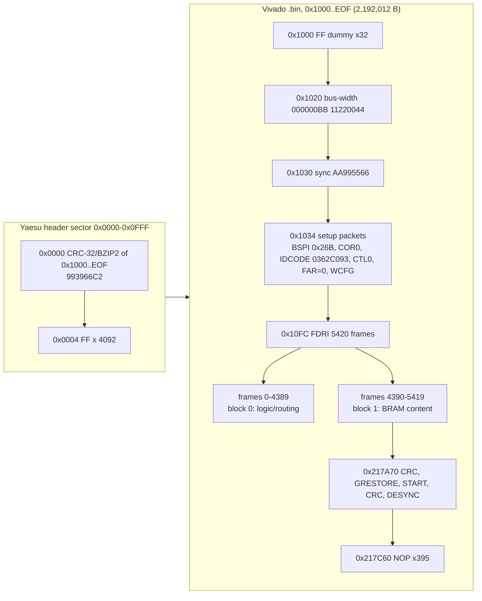

# Memory maps

Load addresses and internal layouts per firmware image. Each task owns its own section.

## SDR (SR image, `FT-710_SDR_V0104.SFL`) — T08

The decoded image (`build/FT-710_SDR_V0104.bin`, 2,196,108 bytes, produced by `tools/sfl_decode.py` from one line of ASCII hex)
is **not CPU code**. It is a 4 KiB Yaesu header sector followed by a standard, uncompressed, unencrypted Vivado `.bin`
bitstream for a **Xilinx Artix-7 XC7A50T**. There is no load address: the FPGA reads it from its own SPI config flash
(master-SPI x4 mode). Parse it with `python3 -I tools/xbit_parse.py build/FT-710_SDR_V0104.bin [--frames|--bram|--lead]`.

### Image layout

| File offset | Size (bytes) | Contents | Evidence |
|---|---|---|---|
| 0x000000 | 4 | `99 39 66 C2` = big-endian **CRC-32/BZIP2** (poly 0x04C11DB7, MSB-first, init and xorout 0xFFFFFFFF) of file[0x1000:EOF], i.e. of the whole Vivado `.bin` | **[fact]** recomputed by `xbit_parse.py --lead` |
| 0x000004 | 4,092 | 0xFF fill (pads the header to one 4 KiB flash sector) | **[fact]** |
| 0x001000 | 32 | 8 x `FFFFFFFF` dummy words (start of the standard Vivado `.bin`) | **[fact]** |
| 0x001020 | 8 | Bus-width detect `000000BB 11220044` | **[fact]** |
| 0x001028 | 8 | 2 x `FFFFFFFF` dummy | **[fact]** |
| 0x001030 | 4 | Sync word `AA995566` | **[fact]** |
| 0x001034 | 0xC8 (200) | Setup packets: BSPI = 0x26B + CMD BSPI_READ, TIMER = 0, WBSTAR = 0, CMD RCRC, COR0 = 0x02423FE5, COR1 = 0, **IDCODE = 0x0362C093**, CMD SWITCH, MASK/CTL0 = 0x501, CTL1 = 0, FAR = 0, CMD WCFG | **[fact]** |
| 0x0010FC | 4 + 2,189,680 | Type-2 **FDRI** write: 547,420 words = **5,420 frames** x 101 words (data from 0x001100) | **[fact]** |
| 0x001100 | 4390 x 404 = 1,773,560 | Frames 0-4389: block type 0 (CLB / IO / CLK interconnect and logic) | **[inference]** from the frame structure (see below) |
| 0x1B20F8 | 1030 x 404 = 416,120 | Frames 4390-5419: block type 1 (**BRAM content**): 3 FAR rows of 3, 2 and 3 BRAM columns (128 frames each), each row followed by 2 all-zero pad frames | **[inference, high]**: the 128-frame/2-pad-frame pattern lines up exactly |
| 0x217A70 | 0x1F0 | Trailer: CRC = 0x671F766B (verified), GRESTORE, DGHIGH, 100 NOPs, START, FAR = 0x03BE0000, MASK/CTL0 = 0x501, CRC = 0xE3AD7EA5 (verified), DESYNC | **[fact]** |
| 0x217C60 | 0x62C (1,580) | 395 type-1 NOP words (`20000000`) to EOF 0x21828C | **[fact]** |

Total from 0x1000 to EOF = 2,192,012 bytes = 17,536,096 bits, which is exactly the UG470 "configuration bitstream length" for
the XC7A35T/XC7A50T die. The IDCODE (0x0362C093) picks the XC7A50T. A 7A35T would be 0x0362D093, and the FPGA refuses an IDCODE mismatch.

## DISPLAY (PC image, `FT-710_DISPLAY_V0108.SFL`) — T06

CPU: Renesas RZ/A1H (R7S721001), Cortex-A9. Input: `build/FT-710_DISPLAY_V0108.bin` (3,324,944 bytes, raw).

- **Ghidra language:** `ARM:LE:32:v7` (default compiler spec). The code is mostly A32 with some Thumb-2: the armcc
  runtime (`__scatterload` and friends at 0x20100BC8–0x20100CFF, libc around 0x20154000–0x20156FFF, fplib at 0x2016488C–0x20165177).
- **Load base: 0x20100000** (on-chip RAM). File offset 0 = 0x20100000, and the file ends at 0x2042BC0F. **[fact]** Literal pools resolve there, and
  `Reset_Handler` compares PC with the link address 0x20100050.
- **Toolchain: ARM Compiler (armcc) with C++.** **[fact]** The evidence is `__main`→`__scatterload` with a `Region$$Table`, the armcc LZ `__decompress`,
  and the string `SIGPVFN: Pure virtual fn called`.
- Import and set up with `tools/ghidra/DisplaySetup.java` (preScript), then run the extra code pass `tools/ghidra/DisplayFindCode.java`,
  apply the names with `ApplyNames.java tools/ghidra/names_display.tsv`, and export with `ExportDecomp.java`. The commands are in each script's header and in `docs/tasks/T06-decomp-display.md`.

### Boot flow (how the regions were derived)
1. Vector table at 0x20100000 (8 × `B`). `initial_sp` literal at 0x20100028 = **0x2044C000**. **[fact]**
2. `Reset_Handler` (0x2010002C): if it is not running at its link address (for example XIP from the SPI flash window 0x18000000), it copies
   0x20100000–0x20100BBF to RAM and jumps to `reset_in_ram` (0x20100080). That routine runs `spibsc0_init` (SPIBSC0 regs 0x3FEFA0xx) and
   `boot_select_bank` (below), then copies the rest of the image up to 0x2043FFFF. **[fact]**
3. MMU/cache attribute calls (0x20100E24(addr,size)): 0x20100000/4 MB and 0x20800000/2 MB. The calls for 0x60000000/3 MB, 0x60500000/1 MB and 0x60600000/1 MB
   are present but branched over. **[fact for the calls, inference that they set cacheability]**
4. `__scatterload` reads the **Region$$Table at 0x204286A8** (5 × {load, exec, size, handler}). Three regions are LZ-compressed
   (`__decompress` 0x20100BFC) and two are zero-init (`__scatterload_zeroinit` 0x20100C60). `DisplaySetup.java` re-implements the
   decompressor. Each compressed stream ends exactly at the next stream's start or the file end, which shows the decoder is correct. **[fact]**
5. `__rt_entry` → `main` (0x20117294).

### Regions (Ghidra blocks)
| Block | Range | Kind | Derivation |
|---|---|---|---|
| `spi_flash` | 0x18000000–0x18FFFFFF | uninit, r | SPIBSC0 window. W25Q128 = 16 MB (hardware.md). Code reads flags at 0x183E0000/0x183F0000 and jumps to 0x18400000 / 0x18A00000 |
| `ram_lo` | 0x20000000–0x200FFFFF | uninit | Below the image. `boot_select_bank` keeps a 0x60-byte boot-info block at 0x20000000 (magic 0xBBBB, bank table) |
| `.text` | 0x20100000–0x20165177 | file, r-x | Code + literal pools. The end was found from code density and the last Thumb fplib routine |
| `.rodata` | 0x20165178–0x204286A7 | file, r (not exec) | Constant tables, GUI bitmaps and fonts (see below), and UI strings near 0x20427ED4–0x204286A0 |
| `scatter_init` | 0x204286A8–0x2042BC0F | file, r | Region$$Table (0x50 B) + three LZ streams (0x2042886C, 0x20428960, 0x20428A40) |
| `ram_stack` | 0x2042BC10–0x2044FFFF | uninit | Mode stacks: SP 0x2044C000 for SVC/FIQ/ABT/UND, then IRQ = SP−0x40 and SYS = IRQ−0x240 |
| `.data` | 0x20450000–0x2045028F | init (decompressed from 0x2042886C) | Region 1 |
| `.bss` | 0x20450290–0x204FC5F3 | uninit | Region 4 (zero-init, 0xAC364 B) |
| `ram_mid` | 0x204FC5F4–0x207FFFFF | uninit | Unassigned RAM. 0x20500000+ is used through the uncached mirror (`.data_nc`, frame buffers) |
| `.data2` | 0x20800000–0x20808BCF | init (from 0x20428A40) | Region 3 (includes the GPIO port pointer table at 0x20800000) |
| `.bss2` | 0x20808BD0–0x2091D56F | uninit | Region 5 (zero-init, 0x1149A0 B). Holds the kernel TCB table 0x208DBBA0 and the UART objects 0x208DA1E0/0x208DAA30/0x208DB280 |
| `ram_hi` | 0x2091D570–0x209FFFFF | uninit | End of the 10 MB RAM. The literal 0x20980000 at 0x2010022C may be a heap limit **[guess]** |
| `ram_nc_lo` | 0x60000000–0x604FFFFF | uninit | Uncached mirror of RAM. **Frame buffers**: `fb_get_layer_addr` returns 0x60000000 + {0, 0xBB800, 0x177000, 0x232800, 0x2EE000} and 0x605048A0, each 800×480 RGB565 (0xBB800 B) |
| `.data_nc` | 0x60500000–0x6050489F | init (from 0x20428960) | Region 2: RW data placed in the uncached mirror (aliases 0x20500000) |
| `ram_nc_hi` | 0x605048A0–0x609FFFFF | uninit | Uncached mirror (frame buffer 1 starts at 0x605048A0) |
| `io_3FE` | 0x3FE00000–0x3FFFFFFF | volatile | RZ/A1H I/O: SPIBSC0 0x3FEFA000, SPIBSC1 0x3FEFB000 (its 0x3FEFB018 reg is used as a "loader already ran" marker), PL310 0x3FFFF000 |
| `io_E800` | 0xE8000000–0xE82FFFFF | volatile | ADC 0xE8005800, SCIF3/4/5 0xE8008800/0xE8009000/0xE8009800, RSPI0–4 0xE800C800–0xE800E800, USB0 0xE8010000, SDHI 0xE804E000, DMAC 0xE8200000, GIC 0xE8201000/0xE8202000, USB1 0xE8207000 |
| `io_FCFE` | 0xFCFE0000–0xFCFFFFFF | volatile | WDT 0xFCFE0000, CPG/STBCR 0xFCFE04xx, GPIO 0xFCFE3000, OSTM 0xFCFEC000, RIIC0–3 0xFCFEE000–0xFCFEEC00, INTC 0xFCFEF800, MTU2 0xFCFF0000, VDC5 0xFCFF7400/0xFCFF9400 |

The peripheral ranges cover every I/O page the analysis referenced (88 pages, see `tools/ghidra/DisplayReport.java`). The peripheral names come from the RZ/A1H
address map **[inference from the datasheet map; base addresses were cross-checked against code use]**.

### Dual-bank boot (one image = loader + application) **[fact for the code, inference for the purpose]**
`boot_select_bank` (0x20100ABC) runs only while SPIBSC1 reg 0x3FEFB018 is 0 (first stage). It sets that register, builds a boot-info block at 0x20000000
(bank 1: flag 0x3E0000, image 0x400000; bank 2: flag 0x3F0000, image 0xA00000), checks the words at 0x183E0000 / 0x183F0000 for 0x11111111
plus a non-zero valid word, and calls 0x18400000 (bank 1) or 0x18A00000 (bank 2). The same binary therefore serves as the boot loader at the
start of flash ("YAESU FT-710 BOOT LOADER V01-02", "FIRMWARE BOOT ERROR") and as the application in a bank. `display_flash_write_bank` writes new images to 0x18400000.

### GUI assets in `.rodata` (not disassembled)
- **0x20165178–~0x20167400:** constant tables (UART names, jump/pointer tables, scatter of small structs).
- **~0x20167400–~0x20427F00 (~2.7 MB):** RGB565 bitmaps. Sprites start with a u16 0 / u16 count header and then pixels (0xFFFF white backgrounds are common).
  Descriptor tables are interleaved, for example 0x2016DD04 = {u16 w=90, u16 h=22, u32 n, ptr[14]} → sprites at 0x2026676E… **[inference]**.
  Other pointer tables: 0x2016D338, 0x2016DF94, 0x2016E64C, 0x2016E7E0, 0x2016EABC, 0x2016ECB8, 0x2016ED30, 0x202CA42C, 0x203D9A54/0x203D9ABC,
  and code-pointer tables at 0x20420090, 0x20420544 and 0x20427FAC. No distinct font table has been isolated yet. Glyphs are probably among these bitmaps **[guess]**.
- **0x20427ED4–0x204286A0:** UI and update-screen strings (`YAESU FT-710 BOOT LOADER V01-02`, `INSERT FIRMWARE SD CARD.`, …).
- `.rodata` is a non-executable block, and the `DisplayReport.java` check finds 1 stray instruction there (at 0x20165178) and none elsewhere.
