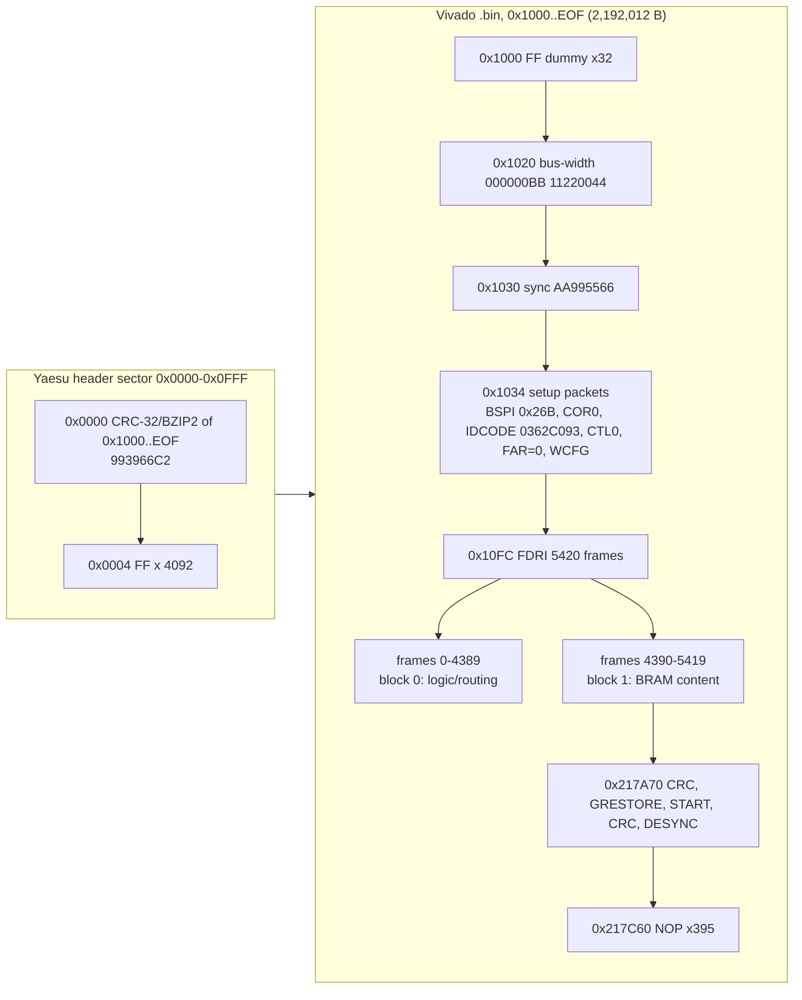

# Memory maps

Load addresses and internal layouts per firmware image. Each task owns its own section.

## SDR (SR image, `FT-710_SDR_V0104.SFL`) — T08

The decoded image (`build/FT-710_SDR_V0104.bin`, 2,196,108 bytes, produced by `tools/sfl_decode.py` from one line of ASCII hex)
is **not CPU code**. It is a 4 KiB Yaesu header sector followed by a standard, uncompressed, unencrypted Vivado `.bin`
bitstream for a **Xilinx Artix-7 XC7A50T**. There is no load address: the FPGA reads it from its own SPI config flash
(master-SPI x4 mode). Parse it with `python3 -I tools/xbit_parse.py build/FT-710_SDR_V0104.bin [--frames|--bram|--lead]`.

### Image layout

| File offset | Size (bytes) | Contents | Evidence |
|---|---|---|---|
| 0x000000 | 4 | `99 39 66 C2` = big-endian **CRC-32/BZIP2** (poly 0x04C11DB7, MSB-first, init and xorout 0xFFFFFFFF) of file[0x1000:EOF], i.e. of the whole Vivado `.bin` | **[fact]** recomputed by `xbit_parse.py --lead` |
| 0x000004 | 4,092 | 0xFF fill (pads the header to one 4 KiB flash sector) | **[fact]** |
| 0x001000 | 32 | 8 x `FFFFFFFF` dummy words (start of the standard Vivado `.bin`) | **[fact]** |
| 0x001020 | 8 | Bus-width detect `000000BB 11220044` | **[fact]** |
| 0x001028 | 8 | 2 x `FFFFFFFF` dummy | **[fact]** |
| 0x001030 | 4 | Sync word `AA995566` | **[fact]** |
| 0x001034 | 0xC8 (200) | Setup packets: BSPI = 0x26B + CMD BSPI_READ, TIMER = 0, WBSTAR = 0, CMD RCRC, COR0 = 0x02423FE5, COR1 = 0, **IDCODE = 0x0362C093**, CMD SWITCH, MASK/CTL0 = 0x501, CTL1 = 0, FAR = 0, CMD WCFG | **[fact]** |
| 0x0010FC | 4 + 2,189,680 | Type-2 **FDRI** write: 547,420 words = **5,420 frames** x 101 words (data from 0x001100) | **[fact]** |
| 0x001100 | 4390 x 404 = 1,773,560 | Frames 0-4389: block type 0 (CLB / IO / CLK interconnect and logic) | **[inference]** from the frame structure (see below) |
| 0x1B20F8 | 1030 x 404 = 416,120 | Frames 4390-5419: block type 1 (**BRAM content**): 3 FAR rows of 3, 2 and 3 BRAM columns (128 frames each), each row followed by 2 all-zero pad frames | **[inference, high]**: the 128-frame/2-pad-frame pattern lines up exactly |
| 0x217A70 | 0x1F0 | Trailer: CRC = 0x671F766B (verified), GRESTORE, DGHIGH, 100 NOPs, START, FAR = 0x03BE0000, MASK/CTL0 = 0x501, CRC = 0xE3AD7EA5 (verified), DESYNC | **[fact]** |
| 0x217C60 | 0x62C (1,580) | 395 type-1 NOP words (`20000000`) to EOF 0x21828C | **[fact]** |

Total from 0x1000 to EOF = 2,192,012 bytes = 17,536,096 bits, which is exactly the UG470 "configuration bitstream length" for
the XC7A35T/XC7A50T die. The IDCODE (0x0362C093) picks the XC7A50T. A 7A35T would be 0x0362D093, and the FPGA refuses an IDCODE mismatch.

## DISPLAY (PC image, `FT-710_DISPLAY_V0108.SFL`) — T06

CPU: Renesas RZ/A1H (R7S721001), Cortex-A9. Input: `build/FT-710_DISPLAY_V0108.bin` (3,324,944 bytes, raw).

- **Ghidra language:** `ARM:LE:32:v7` (default compiler spec). The code is mostly A32 with some Thumb-2: the armcc
  runtime (`__scatterload` and friends at 0x20100BC8–0x20100CFF, libc around 0x20154000–0x20156FFF, fplib at 0x2016488C–0x20165177).
- **Load base: 0x20100000** (on-chip RAM). File offset 0 = 0x20100000, and the file ends at 0x2042BC0F. **[fact]** Literal pools resolve there, and
  `Reset_Handler` compares PC with the link address 0x20100050.
- **Toolchain: ARM Compiler (armcc) with C++.** **[fact]** The evidence is `__main`→`__scatterload` with a `Region$$Table`, the armcc LZ `__decompress`,
  and the string `SIGPVFN: Pure virtual fn called`.
- Import and set up with `tools/ghidra/DisplaySetup.java` (preScript), then run the extra code pass `tools/ghidra/DisplayFindCode.java`,
  apply the names with `ApplyNames.java tools/ghidra/names_display.tsv`, and export with `ExportDecomp.java`. The commands are in each script's header and in `docs/tasks/T06-decomp-display.md`.

### Boot flow (how the regions were derived)
1. Vector table at 0x20100000 (8 × `B`). `initial_sp` literal at 0x20100028 = **0x2044C000**. **[fact]**
2. `Reset_Handler` (0x2010002C): if it is not running at its link address (for example XIP from the SPI flash window 0x18000000), it copies
   0x20100000–0x20100BBF to RAM and jumps to `reset_in_ram` (0x20100080). That routine runs `spibsc0_init` (SPIBSC0 regs 0x3FEFA0xx) and
   `boot_select_bank` (below), then copies the rest of the image up to 0x2043FFFF. **[fact]**
3. MMU/cache attribute calls (0x20100E24(addr,size)): 0x20100000/4 MB and 0x20800000/2 MB. The calls for 0x60000000/3 MB, 0x60500000/1 MB and 0x60600000/1 MB
   are present but branched over. **[fact for the calls, inference that they set cacheability]**
4. `__scatterload` reads the **Region$$Table at 0x204286A8** (5 × {load, exec, size, handler}). Three regions are LZ-compressed
   (`__decompress` 0x20100BFC) and two are zero-init (`__scatterload_zeroinit` 0x20100C60). `DisplaySetup.java` re-implements the
   decompressor. Each compressed stream ends exactly at the next stream's start or the file end, which shows the decoder is correct. **[fact]**
5. `__rt_entry` → `main` (0x20117294).

### Regions (Ghidra blocks)
| Block | Range | Kind | Derivation |
|---|---|---|---|
| `spi_flash` | 0x18000000–0x18FFFFFF | uninit, r | SPIBSC0 window. W25Q128 = 16 MB (hardware.md). Code reads flags at 0x183E0000/0x183F0000 and jumps to 0x18400000 / 0x18A00000 |
| `ram_lo` | 0x20000000–0x200FFFFF | uninit | Below the image. `boot_select_bank` keeps a 0x60-byte boot-info block at 0x20000000 (magic 0xBBBB, bank table) |
| `.text` | 0x20100000–0x20165177 | file, r-x | Code + literal pools. The end was found from code density and the last Thumb fplib routine |
| `.rodata` | 0x20165178–0x204286A7 | file, r (not exec) | Constant tables, GUI bitmaps and fonts (see below), and UI strings near 0x20427ED4–0x204286A0 |
| `scatter_init` | 0x204286A8–0x2042BC0F | file, r | Region$$Table (0x50 B) + three LZ streams (0x2042886C, 0x20428960, 0x20428A40) |
| `ram_stack` | 0x2042BC10–0x2044FFFF | uninit | Mode stacks: SP 0x2044C000 for SVC/FIQ/ABT/UND, then IRQ = SP−0x40 and SYS = IRQ−0x240 |
| `.data` | 0x20450000–0x2045028F | init (decompressed from 0x2042886C) | Region 1 |
| `.bss` | 0x20450290–0x204FC5F3 | uninit | Region 4 (zero-init, 0xAC364 B) |
| `ram_mid` | 0x204FC5F4–0x207FFFFF | uninit | Unassigned RAM. 0x20500000+ is used through the uncached mirror (`.data_nc`, frame buffers) |
| `.data2` | 0x20800000–0x20808BCF | init (from 0x20428A40) | Region 3 (includes the GPIO port pointer table at 0x20800000) |
| `.bss2` | 0x20808BD0–0x2091D56F | uninit | Region 5 (zero-init, 0x1149A0 B). Holds the kernel TCB table 0x208DBBA0, the UART objects 0x208DA1E0/0x208DAA30/0x208DB280, the GIC handler table 0x208DC1E0 and the recorder audio slots 0x208F4DE0 (see below) |
| `ram_hi` | 0x2091D570–0x209FFFFF | uninit | End of the 10 MB RAM. The literal 0x20980000 at 0x2010022C may be a heap limit **[guess]** |
| `ram_nc_lo` | 0x60000000–0x604FFFFF | uninit | Uncached mirror of RAM **[guess; see the T19h note below the table]**. **Frame buffers**: `fb_get_layer_addr` maps index 0–5 to fb0 0x600BB800, fb1 0x605048A0, fb2 0x60177000, fb3 0x60000000, fb4 0x60232800, fb5 0x602EE000 (fb0–fb4 800×480 RGB565 = 0xBB800 B each; fb5 is the mouse-cursor layer). See [code/display/gui.md](code/display/gui.md) |
| `.data_nc` | 0x60500000–0x6050489F | init (from 0x20428960) | Region 2: RW data placed in the uncached mirror (aliases 0x20500000). 0x60500000–0x60503FFF holds SPI DMA buffers (FT4222H RX 0x60500000, PC TX frame 0x60501000, …) |
| `ram_nc_hi` | 0x605048A0–0x609FFFFF | uninit | Uncached mirror (frame buffer 1 starts at 0x605048A0). SDR scope DMA buffer 0x605C00A0 (0x6A4 B) and its header copy 0x605C0780 |
| `io_3FE` | 0x3FE00000–0x3FFFFFFF | volatile | RZ/A1H I/O: SPIBSC0 0x3FEFA000, SPIBSC1 0x3FEFB000 (its 0x3FEFB018 reg is used as a "loader already ran" marker), PL310 0x3FFFF000 |
| `io_E800` | 0xE8000000–0xE82FFFFF | volatile | ADC 0xE8005800, SCIF3/4/5 0xE8008800/0xE8009000/0xE8009800, RSPI0–4 0xE800C800–0xE800E800, USB0 0xE8010000, SDHI 0xE804E000, DMAC 0xE8200000, GIC 0xE8201000/0xE8202000, USB1 0xE8207000 |
| `io_FCFE` | 0xFCFE0000–0xFCFFFFFF | volatile | WDT 0xFCFE0000, CPG/STBCR 0xFCFE04xx, GPIO 0xFCFE3000, OSTM 0xFCFEC000, RIIC0–3 0xFCFEE000–0xFCFEEC00, INTC 0xFCFEF800, MTU2 0xFCFF0000, VDC5 0xFCFF7400/0xFCFF9400 |

**T19h note on 0x60000000:** the frame-buffer window 0x60000000–0x602FF2FF cannot be a plain alias of 0x20000000–0x202FF2FF: `task_root` 0x201170C8 calls `fb_clear_all`, which zeroes 0x60000000 + 0x2FF300 (`__aeabi_memclr` with literals 0x60000000 / 0x2FF300 at 0x20132B30 / 0x20132FD0), while the code it runs from sits at 0x20100000+ in RAM; and the MMU table at 0x2044C000 is flat (VA = PA, filled by 0x20100D48, never remapped) **[fact for the code, inference for the conclusion]**. What the RZ/A1H decodes at 0x60000000 is therefore **open**; it needs the RZ/A1H hardware manual's address map (not in `Manuals/`). See [code/system.md O9](code/system.md#8-contradictions-and-open-questions).

Other DISPLAY RAM structures found by T11 **[fact]**:

| Address | Contents | Page |
|---|---|---|
| 0x208DC1E0 | GIC handler table, 587 entries (filled with `gic_default_handler` by `gic_init`, 39 sources registered). IDs used: SCIF5 RXI/TXI 0xF3/0xF4 (MAIN link), SCIF4 0xEF/0xF0, IRQ3 = 35 (touch), IRQ4 = 0x24 (encoder 3), IRQ5 = 37 (power key) | [peripherals.md](code/display/peripherals.md#3-interrupts-gic), [mainlink.md](code/display/mainlink.md) |
| 0x60500000–0x60503FFF, 0x605C00A0, 0x605C0780 | uncached SPI DMA buffers (RSPI0 FT4222H RX/TX, RSPI2 SDR scope) | [spi-links.md](code/display/spi-links.md#dma-channels) |
| 0x208F4DE0 | recorder/player audio slots, 16 × 0x11F8 (4600 B) | [peripherals.md](code/display/peripherals.md) |
| 0x183D0000 (SPI flash) | 48-byte settings record (magic 0xA5C30001, CRC-32; probably touch calibration **[guess]**) | [peripherals.md](code/display/peripherals.md) |

The peripheral ranges cover every I/O page the analysis referenced (88 pages, see `tools/ghidra/DisplayReport.java`). The peripheral names come from the RZ/A1H
address map **[inference from the datasheet map; base addresses were cross-checked against code use]**.

### Dual-bank boot (one image = loader + application) **[fact for the code, inference for the purpose]**
`boot_select_bank` (0x20100ABC) runs only while SPIBSC1 reg 0x3FEFB018 is 0 (first stage). It sets that register, builds a boot-info block at 0x20000000
(bank 1: flag 0x3E0000, image 0x400000; bank 2: flag 0x3F0000, image 0xA00000), checks the words at 0x183E0000 / 0x183F0000 for 0x11111111
plus a non-zero valid word, and calls 0x18400000 (bank 1) or 0x18A00000 (bank 2). The same binary therefore serves as the boot loader at the
start of flash ("YAESU FT-710 BOOT LOADER V01-02", "FIRMWARE BOOT ERROR") and as the application in a bank. `fwdbg_verify_bank1` (debug `fw1chk`) compares bank 1
(0x18400000) with an image file on the SD card; it does not write (T11c, [code/display/update.md](code/display/update.md#6-display-self-update-spi-flash-banks)).

### GUI assets in `.rodata` (not disassembled)
- **0x20165178–~0x20167400:** constant tables (UART names, jump/pointer tables, scatter of small structs).
- **~0x20167400–~0x20427F00 (~2.7 MB):** RGB565 **run sprites** (T11e) **[fact]**. Each sprite has a 16-byte descriptor
  {u16 w, u16 h, u32 nruns, runs*, pix*}; runs are {u16 start, u16 count} with start = y·w + x, and the pixels follow the runs
  (pix = runs + 4·nruns). Pixels outside the runs are transparent. V01-08 has 2243 sprites (2240 here, 3 in `.data2`).
  **Fonts** are pointer tables of pre-coloured glyph sprites, indexed through the 256-byte character map at **0x2080173C**.
  The T06 note "0x2016DD04 = {w, h, n, ptr[14]}" was a run sprite followed by more descriptors. List and preview them with
  `tools/display_assets.py`; formats in [code/display/gui.md](code/display/gui.md#asset-formats).
- **0x20427ED4–0x204286A0:** UI and update-screen strings (`YAESU FT-710 BOOT LOADER V01-02`, `INSERT FIRMWARE SD CARD.`, …).
- `.rodata` is a non-executable block, and the `DisplayReport.java` check finds 1 stray instruction there (at 0x20165178) and none elsewhere.
  That instruction is a linker long-branch veneer, Thumb `b.w 0x20155D0A`, reached from `beq.w` at 0x20100C7E (T22b) **[fact]**:
  the code really ends at 0x2016517C.

## MAIN (MC image, `FT-710_MAIN_V0112.SFL`) — T05

CPU: Q1001 Renesas **RX651** R5F56514ADFB (RXv2 core, 512 KB code flash, 256 KB RAM, **no data flash**), little-endian **[fact: datasheet R01DS0276EJ0240 Table 1.3; T18]**.
Ghidra language **`rx62t:LE:32:default`** (community RX SLEIGH module, see `docs/tooling.md`), loaded with BinaryLoader at
**base 0xFFF80000**. Setup script: `tools/ghidra/SetupRX651.java`.

### How it was derived
- The S-records cover 0xFFF80000..0xFFFFFFFF (a 512 KB code-flash window ending at the fixed vector table) plus 116 bytes at 0xFE7F5D00 (option-setting memory, all 0xFF) **[fact, T04]**.
- Fixed vectors at 0xFFFFFFD0..FC point into the image. Reset = 0xFFF8FBDB, NMI = 0xFFF9061B, and the others go to 0xFFF905AD.. / 0xFFF90802 **[fact]**.
- The reset code sets **USP = 0x00001004, ISP = 0x00001404, INTB = 0xFFF8E6DC, EXTB = 0xFFFFFF80, FPSW = 0x100** **[fact, 0xFFF8FBDB..FBFF]**.
- `_INITSCT` (0xFFFEDEDA) reads the CC-RX section tables: DTBL 0xFFF8E6A0 (3 × {src, end, dst}) and BTBL 0xFFF8E6C4 (3 × {start, end}) **[fact]**.

### Map
| Range | Size | Contents | Ghidra block |
|---|---|---|---|
| 0x00000000..0x00000FFF | 4 KB | user stack (USP top 0x1004; the low bound is an inference) | RAM_0 |
| 0x00001004..0x00001403 | 1 KB | interrupt stack (ISP top 0x1404) [inference: 1 KB] | RAM_0 |
| 0x00001404..0x0001B3CB | 0x19FC8 | .bss (BTBL #3) | RAM_0 |
| 0x0001B3CC..0x0001B5FB | 0x230 | .data, copied from ROM 0xFFF8EC1C..0xFFF8EE4C | RAM_data_0001B3CC |
| 0x0001B5FC..0x0001FF19 | 0x491E | .bss (BTBL #2) | RAM_1 |
| 0x0001FF1A..0x0001FF71 | 0x58 | .data, copied from ROM 0xFFF8EE4C..0xFFF8EEA4 | RAM_data_0001FF1A |
| 0x0001FF74..0x00025D1F | 0x5DAC | .bss (BTBL #1). Includes the stdio FILE table 0x1FF74 and FILE structs 0x25D80.. | RAM_2 |
| 0x00025D20..0x00025E5F | 0x140 | .data, copied from ROM 0xFFF8EADC..0xFFF8EC1C | RAM_data_00025D20 |
| 0x00025E60..0x0003FFFF | ~105 KB | unused RAM | RAM_3 |
| 0x00080000..0x000FFFFF | 512 KB | peripheral I/O (volatile): SYSTEM 0x80000, ICU 0x87000, CMT 0x88000, DA 0x88040, TPU 0x88100, S12AD 0x89000/0x89100, SCI0–7 0x8A000–0x8A0FF, ports 0x8C000 (PDR) / 0x8C020 (PODR) / 0x8C040 (PIDR), MPC 0x8C100 | IO_periph |
| 0x00100000..0x00107FFF | 32 KB | E2 data flash on 1.5/2 MB parts only: **not present on the R5F56514** (HWM Figure 4.1 note 5, T18), and never referenced (T10e). The Ghidra block is harmless. | DataFlash |
| 0x007FC000..0x007FFFFF | 16 KB | flash control registers (volatile) | IO_flash |
| 0xFE7F5D00..0xFE7F5D73 | 116 B | option-setting memory, all 0xFF: little-endian, linear mode, no watchdog auto-start, serial programmer allowed with ID 16 × 0xFF, no access-window/ROM-code/Trusted-Memory protection **[fact: HWM §7; [T18](tasks/T18-renesas-docs-check.md) finding 3]** | not loaded |
| 0xFFF80000..0xFFF8FFFF | | const data: strings (menus, CAT tables at 0xFFF805EC, reply templates at 0xFFF8F480), menu defaults 0xFFF80E4A.., menu titles 0xFFF83514 (P1, 6 × 20) / 0xFFF8358C (P2, 27 × 13), key class table 0xFFF83164, the **five 863-entry key handler tables** 0xFFF89D94 / 0xFFF8AB10 / 0xFFF8B88C / 0xFFF8C608 / 0xFFF8D384 (press … release, ending at 0xFFF8E100; [ui-keys.md](code/main/ui-keys.md)), the relocatable vector table at **0xFFF8E6DC** (256 × 4), DTBL/BTBL, .data images | ROM |
| 0xFFF8FBDB.. | | code (PowerON_Reset at 0xFFF8FBDB; code reaches ~0xFFFEE1BE, then 0xFF fill) | ROM |
| 0xFFFFFF00 | | version string `V01-12` | ROM |
| 0xFFFFFF80..0xFFFFFFFF | | fixed vector table (EXTB). Entries 0xD0..0xFC are used | ROM |

Peripheral bases match the RX651 hardware manual I/O register table (r01uh0590 §5, p204 ff.) **[fact, T18]**. 0x000A4000..0x000A5FFF inside the I/O range is the
8 KB standby RAM, which MAIN does not use **[fact]**. The 256 KB RAM is 0x00000000..0x0003FFFF **[fact: HWM Figure 4.1 p189]**.
The relocatable vector names in `SetupRX651.java` match HWM Table 15.5 pp461–463 **[fact, T18]**. The highest RAM address used is ~0x25E60 **[fact]**.

### Global state block 0x20B04 (T10a) [fact]
Most radio state lives in one RAM block starting at **0x20B04** (about 0x480 bytes). The compiler reaches it through eleven pointer
constants in `.data` (0x25D38, 0x25D4C, 0x25D54, 0x25D58, 0x25D5C, 0x25D60, 0x25D6C, 0x25D70, 0x25D74, 0x25D78, 0x25D7C, all = 0x20B04),
so `PTR_DAT_00025d38[off]` in the decomp is the byte at 0x20B04 + off. Search for both forms. Field list:
[code/main/README.md](code/main/README.md#global-state-block-0x20b04-fact).

### Other MAIN RAM areas (T10) [fact]

| RAM | Size | Contents | Page |
|---|---|---|---|
| 0x464F..0x9E85 | 22,583 B | **EEPROM mirror**: RAM = 0x464F + EEPROM address (EEPROM 0x0000..0x5836) | [eeprom.md](code/main/eeprom.md) |
| 0x4659 | 0x105 | `cfg105`: factory calibration block (EEPROM 0x000A) | [tx-protection.md](code/main/tx-protection.md) |
| 0x4761 / 0x5409 | 3 × 0x438 each | band stack A / B (3 levels × 12 bands × 0x5A) | [radio-control.md](code/main/radio-control.md#globals) |
| 0x60B1 / 0x60BD | 12 each | current band-stack level per band, A / B | radio-control.md |
| 0x60C9 / 0x60CA, 0x60CB | u8, 117 B | current memory channel A / B, channel-used flags | radio-control.md |
| 0x6150 | 133 × 0x5A | memory channels | radio-control.md |
| 0x9012 | 0x395 | QMB header + 10 slots (slots at 0x9023 + n × 0x5A) | radio-control.md |
| 0x9A2A..0x9E85 | 0x45C | menu values and operating state (EEPROM 0x53DB..): VFO-A/B records 0x9D09 / 0x9D63, active VFO 0x9DBD, split 0x9C5E | [menu.md](code/main/menu.md), radio-control.md |
| 0xA0AB | 0x200 | SCI4 (DSP link) receive buffer | [dsp-link.md](code/main/dsp-link.md) |
| 0x12043..0x1204C | | meter values | [tx-protection.md](code/main/tx-protection.md) |
| 0x1204D | u8 | `ptt_source` (0 = none, 1..11) | tx-protection.md |
| 0x1B634..0x1B6DD | | DSP register shadows | dsp-link.md |
| 0x1FA50 + 0xC8 × P1 | 6 × 100 × u16 | per-P1 menu index lists | menu.md |
| 0x20B04..0x20B16 | 10 × u16 | ADC results: AN001, AN002, AN003, AN006, AN005, AN007, AN108, AN109, AN115, AN117 | [peripherals.md](code/main/peripherals.md#data-structures-and-globals) |
| 0x20B18 | u8 | `trx_state`, TX/RX sequencer state 0..8 | tx-protection.md |
| 0x2105C | 350 × 0x38 | menu item table | menu.md |

### MAIN RAM and EEPROM areas used by CAT (T09) [fact]
The full list is in [code/main/cat.md](code/main/cat.md#data-structures-and-globals).

| RAM | EEPROM (BR25G256) | Contents |
|---|---|---|
| 0x1C8E.. (up to 0x29B2 bytes) | – | CAT reply buffer; the reply length is at 0x1B788 |
| 0x1E14C (60 × 0x6A) | – | CAT receive ring (head 0x11FEC, tail 0x11FEB); E1/E9 fast-path slot at 0x1B78C |
| 0x464F (10 B) | 0x0000 | header with save counter |
| 0x4659 (0x105 B) | 0x000A | `cfg105` table (CAT `SPN`, `SPAWE`) |
| 0x475E (3 B) | 0x010F | destination (region) code (CAT `JP`) |
| 0x60C9 (0x2F49 B saved; 0x29A9 B in E8/E9) | 0x1A7A | settings + memory-channel image (CAT `E8` dump / `E9` restore); memory channels are 0x5A-byte records |

## IFDSP (ID image, `FT-710_IFDSP_V0101.SFL`) — T07

Part: NXP i.MX RT685 (Q2002), Cortex-M33 + Cadence HiFi4 DSP. The decoded image `build/FT-710_IFDSP_V0101.bin`
(414,444 bytes, raw) is an RT600 FlexSPI-NOR boot image. File offset 0 = **XIP address 0x08000000** (FlexSPI A). It holds a
small M33 flash stub, three HiFi4 images, and the M33 application, which runs entirely from SRAM after the copy-down.

### Ghidra programs (project `ghidra/FT710_IFDSP`)

| Program | Language | Source file | Built by |
|---|---|---|---|
| `FT-710_IFDSP_V0101.bin` | `ARM:LE:32:v8-m` (the only ARMv8-M language in Ghidra 12.1.4; Thumb-only `ARMCortex.pspec`) | `build/FT-710_IFDSP_V0101.bin`, BinaryLoader base 0x08000000 | `tools/ghidra/IfdspM33Setup.java` (pre), `IfdspFindFuncs.java`, `IfdspM33Names.java` (post) |
| `FT-710_IFDSP_V0101_hifi4.bin` | `Xtensa:LE:32:rt600hifi4` (generated FLIX-aware language, T21a; `Xtensa:LE:32:default` until T21g) | `build/FT-710_IFDSP_V0101_hifi4.bin` from `tools/ifdsp_dsp_images.py` | `tools/ghidra/IfdspHifi4Setup.java` (pre), `IfdspHifi4FindFuncs.java` + `entries_hifi4.tsv`, `IfdspHifi4Names.java` (post) |

The exact commands are in `decomp/ifdsp/INDEX.md`.

### Flash image layout (file offset = address − 0x08000000)

| File offset | Size | Contents | Evidence |
|---|---|---|---|
| 0x000000 | 0x400 | zeros | **[fact]** |
| 0x000400 | 0x200 | FlexSPI NOR config block (`FCFB` tag) | **[fact]** |
| 0x001000 | 0x130 | M33 vector table: 16 system + 60 IRQ words. SP = 0x00200000, reset = 0x080011A9. Words +0x20 (0x000642EC = image length − 0x1000), +0x24 (image type 0) and +0x34 (load address 0x08001000) are the RT600 boot-header fields | **[fact]** |
| 0x001130 | 0x48 | `__data_section_table` (6 × src,dst,len) | **[fact]** |
| 0x001178 | 0x30 | `__bss_section_table` (6 × dst,len) | **[fact]** |
| 0x0011A8 | ~0x690 | M33 flash code: `ResetISR`, `SystemInit` (0x08001540: enables the CP10/CP11 FPU, sets SYSCTL0 0x4000200C=1 (DSP stall), configures CACHE64 at 0x40033000), default IRQ stubs, `call_main` | **[fact]** |
| 0x001844 | 0x20644 | **HiFi4 image 0 → 0x24000000** (DSP DTCM 0x24000000 + ITCM 0x24020000; only 12 bytes of DTCM and 0x644 bytes of ITCM are non-zero) | loader `BOARD_DSP_Init` 0x00084AD8 **[fact]** |
| 0x021E88 | 0x383B4 | **HiFi4 image 1 → 0x00200000** (SRAM: rodata/literals, text, .data) | same **[fact]** |
| 0x05A23C | 0x31E0 | **HiFi4 image 2 → 0x20040000** (all zero bytes; a shared/non-cached area) | same **[fact]** |
| 0x05D41C | 12 | the three DSP image sizes (0x20644, 0x383B4, 0x31E0) | **[fact]** |
| 0x05D428 | 0x7EC4 | load image of M33 SRAM 0x00080000..0x00087EC4 (code + rodata + .data), to EOF (0x652EC) | copy table entry 0 **[fact]** |

### M33 copy-down (MCUXpresso `ResetISR`)

`__data_section_table` has six entries but only the first has a non-zero length: 0x0805D428 → **0x00080000**, 0x7EC4 bytes.
The other five (dst 0x0, 0x20000, 0x200000, 0x40140000, 0x70000) have length 0. `__bss_section_table`: **0x00087EC4, 0x1A034 bytes**
(to 0x000A1EF8), and five empty entries. **[fact]**. Within the copied block, 0x80000..~0x87B4C is Thumb code with literal pools,
0x87B4C..0x87EBC is rodata (console strings, ctype table, printf digits), and the last 8 bytes (0xAAAAAAAA and 12,000,000 =
`SystemCoreClock` initial value) are writable .data **[inference]**. HardFault/SVC/PendSV/SysTick and the FLEXCOMM0 and MU_A IRQ
vectors point into this RAM code directly. VTOR = 0x08001000, MSP = 0x00200000, MSPLIM = 0x001FF000. **[fact]**

### Shared SRAM areas between M33 and HiFi4 (T12)

| Range | Use | Evidence |
|---|---|---|
| 0x20020000–0x2003FFFF | rpmsg-lite shared memory window | `rpmsg_lite_master_init(0x20020000, 0x20000)` in `ipc_init` 0x00084A50; DSP literal 0x20020000 @0x206CA8 **[fact]** |
| 0x20020000 / 0x20020400 | vring 0 `rx_vq` (DSP → M33) / vring 1 `tx_vq` (M33 → DSP), 0x400 each, 2 descriptors | **[fact]** |
| 0x20020800–0x20020FFF | 2 × 512 B rx buffers + 2 × 512 B tx buffers (4 of 252 possible slots are posted) | **[fact: computed]** |
| 0x20021000–0x2003FFFF | unused part of the rpmsg window | **[inference]**, see [code/ifdsp/ipc.md](code/ifdsp/ipc.md) |
| 0x20060000–0x200631DF | DSP buffers (XOS init); I2S DMA ping-pong buffers at **0x20062BE0 + n·0xC0** (8 × 0xC0) | DSP literals in 0x0021C498, 0x002260D8 **[fact]** |
| 0x20070000–0x2007FFFF | parameter register file, 32K × 16 bit, written by the MAIN CPU through the M33 console; the DSP addresses it via bases 0x2006FF00 (regs 0..0x7F) and 0x20077F00 (regs 0x4000..0x407F). Regs **0x2000–0x2007** hold the XOS per-thread CPU load (`cpu_load_to_regs_2000`) | `regfile_*` 0x00080C20..0x00080C78; DSP literals **[fact]**; map in [control-link.md](code/ifdsp/control-link.md) |

See `docs/code/ifdsp/README.md`.

### M33 memory map used in Ghidra

| Range | Block | Notes |
|---|---|---|
| 0x00000000–0x0007FFFF | `sram_lo` | SRAM, code-bus alias (unused by the image) |
| 0x00080000–0x00087EBB | `sram_text_rodata` | file-backed copy-down, **read-only in Ghidra** so the decompiler resolves literal pools |
| 0x00087EBC–0x00087EC3 | `sram_data` | .data |
| 0x00087EC4–0x000A1EF7 | `sram_bss` | .bss (FreeRTOS heap/stacks, UART rings, rpmsg state). FreeRTOS heap_4 `ucHeap` 0x88EF0..0xA1EE8 **[fact]** |
| 0x000A1EF8–0x0047FFFF | `sram_hi` | rest of the 4.5 MB SRAM. Redlib heap (stdio buffers only) 0xA1EF8..0xA2EF8 **[fact]**. **0x00200000+ is the DSP's** (MSP top = 0x00200000) |
| 0x08000000–0x08001843 | `flexspi_xip` | flash code (executable) |
| 0x08001844–0x0805D41B | `flexspi_dsp_images` | HiFi4 images (non-executable for ARM) |
| 0x0805D41C–0x080652EB | `flexspi_data_lma` | DSP sizes + .data load image (non-executable) |
| 0x20000000–0x2047FFFF | `sram_data_alias` | SRAM data-bus alias |
| 0x24000000 / 0x24020000 | `dsp_dtcm` / `dsp_itcm` | HiFi4 TCMs as seen from the M33, 64 KB each |
| 0x40000000–0x4015FFFF | `periph` | APB/AHB peripherals, non-secure alias (the one the image uses) |
| 0x50000000–0x5015FFFF | `periph_s` | secure alias (unused) |
| 0xE0000000–0xE00FFFFF | `ppb` | SCB/NVIC/SysTick/MPU |

Peripherals the M33 touches (pages from the decompile **[fact]**, names from the RT685 reference map **[inference]**): RSTCTL0 0x40000000,
CLKCTL0 0x40001000, SYSCTL0 0x40002000 (incl. DSPSTALL 0x4000200C), IOPCTL 0x40004000, RSTCTL1 0x40020000, CLKCTL1 0x40021000,
INPUTMUX 0x40026000, CACHE64 0x40033000, GPIO 0x40100000, DMA0/DMA1 0x40104000/0x40105000, **FLEXCOMM0 0x40106000 (USART)**,
**MU-A 0x40110000**, 0x40112000 (probably SEMA42), FlexSPI 0x40134000, PMC 0x40135000, **SCT0 0x40146000** (PWM, IRQ12 → `sct0_pwm_callback`, T12d).
PINT 0x40025000, OSTIMER 0x40113000, I3C0 0x40036000 and HASHCRYPT 0x40158000 are referenced only by SDK IRQ handlers that are never
enabled **[fact]** ([code/ifdsp/m33-platform.md](code/ifdsp/m33-platform.md)). The M33 does **not**
touch FLEXCOMM1–5 or the codec. The I2S/SPI/codec work is on the DSP side (see below).

### HiFi4 DSP memory map (the DSP's view = load addresses above)

| Range | Ghidra block | Contents |
|---|---|---|
| 0x24000000–0x2400FFFF | `dsp_dtcm` | image 0, first 64 KB. The first 3 words are pointers into SRAM (0x00228818, 0x002354E0, 0x00228834), and the rest is zeros |
| 0x24020000–0x24020643 | `dsp_itcm` | `_ResetVector` @0x24020000 (J over literals → 0x24020044: sets INTENABLE=0, **VECBASE=0x24020400**, ATOMCTL, invalidates caches). Window vectors @0x24020400+n·0x40; level/exception vectors at 0x2402057C, 0x2402059C, 0x240205BC, 0x240205DC, 0x2402061C, 0x2402063C |
| 0x00200000–0x00207CEF | `sram_dsp_rodata` (read-only, not executable since T21j) | rodata and `.literal` pools (XOS thread names `Thread_Main/Ipc/Rx_Audio/Spi/Rx_Path/Tx_Path`, rpmsg `rx_vq/tx_vq`, libc tables) |
| 0x00207CF0–0x002367FF | `sram_dsp_text` (read-only) | `.text`: 1081 4-aligned `entry a1,N` prologues (first function 0x207CF0) |
| 0x00236800–0x002383B3 | `sram_dsp_data` | `.data`: float tables (biquad/filter coefficients, e.g. near 0x236D00) **[inference]** |
| 0x002383B4–~0x002FFFFF | `sram_dsp_bss` | .bss: thread stacks and TCBs, FIFOs, filter states, used up to ~0x2CC000 (e.g. TCB `Thread_Rx_Path` 0x2C7890) **[fact, T12e]**, see [code/ifdsp/hifi4.md](code/ifdsp/hifi4.md) |
| 0x20040000–0x200431DF | `sram_shared` | image 2 (zeros): shared/non-cached buffer area |
| 0x40000000–0x4015FFFF | `periph` | the DSP literal pools hold the SDK base-address tables for FLEXCOMM0–7 (0x40106000–0x40109000, 0x40122000–0x40125000), DMA0/1, GPIO, MU and others, so the DSP drives the I2S/SPI blocks **[inference]** |

Literal 0x00236800 in the reset-vector pool matches the .data start. The DSP→M33 boot handshake uses MU-A status bits (main waits for
`MU_SR & 7 == 1`, then `== 3`) **[fact: main @0x000872AE]**.
