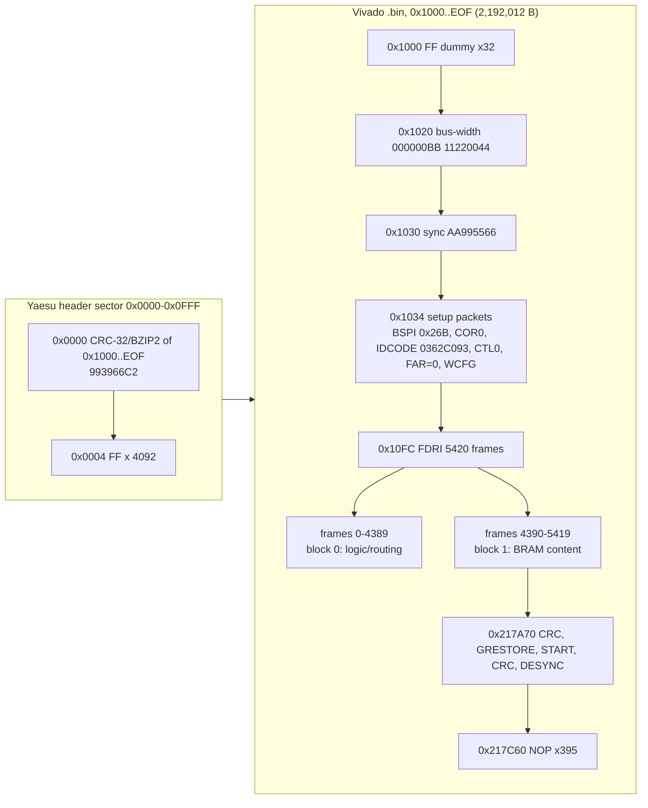

# Memory maps

Load addresses and internal layouts per firmware image. Each task owns its own section.

## SDR (SR image, `FT-710_SDR_V0104.SFL`) — T08

The decoded image (`build/FT-710_SDR_V0104.bin`, 2,196,108 bytes, produced by `tools/sfl_decode.py` from one line of ASCII hex)
is **not CPU code**. It is a 4 KiB Yaesu header sector followed by a standard, uncompressed, unencrypted Vivado `.bin`
bitstream for a **Xilinx Artix-7 XC7A50T**. There is no load address: the FPGA reads it from its own SPI config flash
(master-SPI x4 mode). Parse it with `python3 -I tools/xbit_parse.py build/FT-710_SDR_V0104.bin [--frames|--bram|--lead]`.

### Image layout

| File offset | Size (bytes) | Contents | Evidence |
|---|---|---|---|
| 0x000000 | 4 | `99 39 66 C2` = big-endian **CRC-32/BZIP2** (poly 0x04C11DB7, MSB-first, init and xorout 0xFFFFFFFF) of file[0x1000:EOF], i.e. of the whole Vivado `.bin` | **[fact]** recomputed by `xbit_parse.py --lead` |
| 0x000004 | 4,092 | 0xFF fill (pads the header to one 4 KiB flash sector) | **[fact]** |
| 0x001000 | 32 | 8 x `FFFFFFFF` dummy words (start of the standard Vivado `.bin`) | **[fact]** |
| 0x001020 | 8 | Bus-width detect `000000BB 11220044` | **[fact]** |
| 0x001028 | 8 | 2 x `FFFFFFFF` dummy | **[fact]** |
| 0x001030 | 4 | Sync word `AA995566` | **[fact]** |
| 0x001034 | 0xC8 (200) | Setup packets: BSPI = 0x26B + CMD BSPI_READ, TIMER = 0, WBSTAR = 0, CMD RCRC, COR0 = 0x02423FE5, COR1 = 0, **IDCODE = 0x0362C093**, CMD SWITCH, MASK/CTL0 = 0x501, CTL1 = 0, FAR = 0, CMD WCFG | **[fact]** |
| 0x0010FC | 4 + 2,189,680 | Type-2 **FDRI** write: 547,420 words = **5,420 frames** x 101 words (data from 0x001100) | **[fact]** |
| 0x001100 | 4390 x 404 = 1,773,560 | Frames 0-4389: block type 0 (CLB / IO / CLK interconnect and logic) | **[inference]** from the frame structure (see below) |
| 0x1B20F8 | 1030 x 404 = 416,120 | Frames 4390-5419: block type 1 (**BRAM content**): 3 FAR rows of 3, 2 and 3 BRAM columns (128 frames each), each row followed by 2 all-zero pad frames | **[inference, high]**: the 128-frame/2-pad-frame pattern lines up exactly |
| 0x217A70 | 0x1F0 | Trailer: CRC = 0x671F766B (verified), GRESTORE, DGHIGH, 100 NOPs, START, FAR = 0x03BE0000, MASK/CTL0 = 0x501, CRC = 0xE3AD7EA5 (verified), DESYNC | **[fact]** |
| 0x217C60 | 0x62C (1,580) | 395 type-1 NOP words (`20000000`) to EOF 0x21828C | **[fact]** |

Total from 0x1000 to EOF = 2,192,012 bytes = 17,536,096 bits, which is exactly the UG470 "configuration bitstream length" for
the XC7A35T/XC7A50T die. The IDCODE (0x0362C093) picks the XC7A50T. A 7A35T would be 0x0362D093, and the FPGA refuses an IDCODE mismatch.

