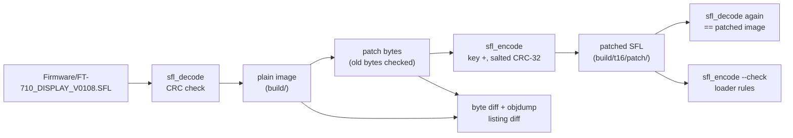

# Firmware patches (T16)

Patches for the FT-710, built from the shipped 2024-02 package. **Nothing here has been flashed.** Every
write to the radio (SD-card update, JTAG load, RAM write) needs the owner's explicit approval each time (AGENTS.md).
Patched images and SFL files are firmware-derived: they live only in `build/` (gitignored) and are never committed or
published. This page records only the few patched bytes.

Claims are tagged **[fact]** (seen in code or data, address given), **[inference]** or **[guess]**.

| Page / tool | Contents |
|---|---|
| this page | method, the two DISPLAY patches, verification, the debug-console enable plan |
| [fpga-jtag-hello.md](fpga-jtag-hello.md) | plan for a volatile (JTAG-only) "hello" bitstream on the SDR FPGA |
| `tools/sfl_encode.py` | plaintext → SFL encoder, `--check` runs the update loader's acceptance rules |
| `tools/test_sfl_roundtrip.py` | decode → encode round trip of all four shipped files, byte for byte |
| `tools/t16_patches.py` | builds and verifies the patches below into `build/t16/patch/<name>/` |
| [custom-firmware.md](../custom-firmware.md) | feasibility, acceptance rules, recovery paths and debug adapters |

## Method



1. `sfl_encode.py` is the inverse of `sfl_decode.py`: `enc[i] = (plain[i] + KEY[i mod 43]) & 0xFF`, the same loop as the
   radio's own encoder `FUN_201149e0` (*sfl_encode*), which DISPLAY uses for its MemList/Menu backups (*sfl_write_file*
   0x2010F370) **[fact, T11c]**. The tag line is `<tag>` at column 0, the total file length at column 16 and the CRC
   (8 uppercase hex digits) at column 32, space padded to 62 characters + CRLF; the comment box is 8 × (62 + CRLF)
   **[fact, from the four shipped files]**.
2. Per-image plaintext forms: MAIN = Motorola S-records (the original record layout, S0 and S7 are reused from a template
   SFL, so an unchanged binary re-encodes byte for byte; without a template a generic 16-byte S3 layout is written),
   DISPLAY and IFDSP = raw binary, SDR = one line of lowercase ASCII hex + CRLF.
3. `test_sfl_roundtrip.py` checks, for all four shipped files: raw payload → SFL, converted binary → SFL, and a comment
   box rebuilt from its fields all reproduce the original **byte for byte**; the generic MAIN layout decodes to the same
   512 KiB binary and 116-byte option-setting memory; all four originals pass `--check` **[fact: 6 tests pass]**.
4. `t16_patches.py` refuses to patch if the expected original bytes are not found, so it cannot be applied to another
   firmware version by mistake.

```sh
python3 -I tools/test_sfl_roundtrip.py -v     # round trip, all four images
python3 -I tools/t16_patches.py               # build + verify both patches
python3 -I tools/sfl_encode.py --check build/t16/patch/banner/FT-710_DISPLAY_V0108.SFL
```

### What `--check` verifies (from docs/code/display/update.md section 1)

| Rule | Loader code | Checked by the radio? |
|---|---|---|
| tag line 64 bytes, no NUL, 3rd token ≤ 8 hex digits | `sfl_read_header` 0x20114CA0 | yes **[fact]** |
| salted CRC-32 over bytes 0x240..EOF equals the 3rd token | `sfl_crc` 0x20114A64 | yes **[fact]** |
| comment block 3 is not `" : #UP0    "` (loader-region write when F1 is held) | `fwobj_display_run` 0x201607E8 | yes; our files must never carry it **[fact]** |
| file name `FT-710__V????.SFL` | `fwname_pattern_match` 0x20163600 | yes **[fact]** |
| DISPLAY: size ≥ 0x242, payload ≤ 6 MiB (bank size), ARM vector at offset 0 | `fwobj_display_run` | size yes; 6 MiB and vector are our own safety rules **[inference]** |
| IFDSP: payload ≤ 0xA0000 (erase region), `FCFB` at 0x400 | `dsp_isp_erase_region` 0x2010B0F4 | erase size fixed **[fact]**; the limit is our rule |
| SDR: file size exactly 0x43075A, payload is hex | `fwobj_sdr_run` 0x201602AC | size yes **[fact]** |
| MAIN: every S-record checksum valid, S7 present | `srec_parse_line` 0x2010E670 | yes; the written data are read back and compared **[fact]** |
| length field = file size, tag known | — | **not** checked by the radio **[fact]**; kept correct for our tools |

## Patch 1 — "banner" (harmless string change)

| Item | Value |
|---|---|
| Image | DISPLAY V01-08 (`PC`), plain image base 0x20100000 |
| String | `bootloader_screen` (0x2015938C) title `"YAESU FT-710 BOOT LOADER V01-02"` at VMA 0x204280BC (rodata, not compressed) **[fact]** |
| Change | VMA **0x204280D5**, file offset **0x3280D5**, 6 bytes `V01-02` → `T16-01` (same length, NUL kept) |
| Bytes that differ | 4: 0x3280D5 `56→54`, 0x3280D6 `30→31`, 0x3280D7 `31→36`, 0x3280DA `32→31` |
| Users of the string | one: the `FUN_20159d98(param_1, …)` title call in `bootloader_screen`; no `strcmp` or other reference **[fact, decomp grep]** |
| Where it shows | the power-on maintenance screen after key line 6 + encoder unlock ([update.md](../code/display/update.md) section 4) **[fact for the code]** |

Why this string: it is a version string, it lives in uncompressed `.rodata` (below the LZ-compressed `.data` streams at
0x20428840..), it is not compared anywhere, and it is drawn only on a maintenance screen. Strings that are compared
were ruled out: `"FIRMWARE UPDATE      "` (0x20115763 / 0x20428170) is matched with `strcmp` against menu labels
(`FUN_2015507c`, 0x201587fc file line 2252) **[fact]**. Note that reaching the screen puts the GUI in loader mode
(boot-info word 0 = 0xBBBB), so a DISPLAY update started from that screen writes the **loader** region; only look at
the title and leave the screen without starting an update **[fact for the mode; inference for the advice]**.

### Verification (from `t16_patches.py`, all **[fact]**)

| Check | Result |
|---|---|
| original SFL CRC | `1166734A` OK |
| patched SFL | 3,325,520 bytes (same as the original), tag `PC`, CRC `A2C6D222` |
| decode(patched SFL) == patched image | yes |
| `--check` (all rules above) | all pass |
| byte diff original vs patched image | exactly the 4 bytes above |
| comment box | only the `[DATE]` field differs (build date) |
| `arm-none-eabi-objdump` listing of the whole image (817,010 lines) | 2 lines differ, both the data words at 0x204280D4/0x204280D8 inside the string; no instruction changed |
| zlib CRC-32 of the decoded image (input to the bank-flag word +0x10, which update.md gives as `~CRC-32`; the exact stored form is not needed, boot does not check it) | `9A3B08F1` |

## Patch 2 — "debuggate" (enable the USB-keyboard debug console) — **built, not approved**

| Item | Value |
|---|---|
| Function | `debug_enabled` 0x20111098: `ldr r0,=0x20450000; ldr r1,=0xA0B9C8E7; ldr r0,[r0]; cmp r0,r1; moveq r0,#1; movne r0,#0; bx lr` **[fact, objdump]** |
| Change | VMA **0x201110AC**, file offset **0x110AC**: `00 00 a0 13` (`movne r0,#0`) → `01 00 a0 13` (`movne r0,#1`); 1 byte differs |
| Effect | `debug_enabled()` always returns 1. Its two callers are `usbkbd_report` (runs `hid_chain1_dispatch`) and *`debug_overlay_draw`* 0x201367B4 **[fact, input.md]** |
| Patched SFL | CRC `D79669B5`, same size, all `--check` rules pass, listing diff = 1 instruction **[fact]** |

This is option A of [input.md](../code/display/input.md#enabling-it-input-for-t16-docscustom-firmwaremd). Options B
(re-encode the LZ `.data` stream so 0x20450000 starts as 0xA0B9C8E7) and D (call `debug_unlock`, which needs P4_3 and
P8_3 low) are worse **[inference, input.md]**.

### Plan for owner approval: enabling the DISPLAY debug console

**What the owner gets:** the chain-1 USB-keyboard handlers (memory monitor `ADDR` / `ADDR VAL` / `b|h ADDR VAL`,
`NAME.txt` scripts from SD, `date`/`time`, `dsp XX YYYY` frames, F1–F12 debug overlays and the F6–F8 link logger, the
`fw1up`/`up0`/`up1`/`up2` self-flash and `uptest`/`mrst`/`reset` commands) **[fact, input.md]**. There is no text output:
progress shows on the keyboard LEDs, and read values land in RAM (0x20800390), so the monitor is most useful with the F1
overlay or with JTAG **[fact for the code]**.

**Step 0 — volatile test first (option C, recommended if a JTAG probe is available).** With a J-Link (or another ARM
JTAG probe) on J6003, halt the Cortex-A9 after boot, write `0xA0B9C8E7` to 0x20450000, resume. The console is live until
the next reset; nothing in flash changes. Rollback = power cycle **[inference]**.

**Step 1 — flash patch 2 through the normal SD-card update** (only after step 0 or a deliberate decision to skip it):

1. Back up: keep the stock `FT-710_DISPLAY_V0108.SFL` (and the other three stock files) on the SD card's `FT-710`
   folder in a second folder or card; save MemList/Menu backups from the radio menu.
2. Copy `build/t16/patch/debuggate/FT-710_DISPLAY_V0108.SFL` to `I:\FT-710\` (archive bit set by the PC copy). Same file
   name as stock, so remove the stock file from that folder first; the highest name wins **[fact, update.md]**.
3. SD CARD → FIRMWARE UPDATE: the row must say "Ready" (CRC OK). Tick **DISPLAY only**. The radio writes the non-running
   bank, writes its flag, erases the other bank's flag, then resets **[fact, update.md section 6]**.
4. Do **not** hold F1 on a USB keyboard while entering the update screen (the `#UP0` path is not in our file anyway).
5. Test with a USB keyboard: F1 should show the overlay **[inference]**.

**Risks.**

| Risk | Why | Mitigation |
|---|---|---|
| Accidental flash or reset commands | every chain-1 slot sees every keyboard report, regardless of which GUI field has focus. Typing `up0⏎` in a CW-text or memory-name field would also rewrite the DISPLAY **loader** region from `I:\AH068_DISPLAY_Loader.bin`; `up1`/`up2`/`fw1up` rewrite a bank, `reset`/`mrst`/`wdr` reset CPUs **[fact for the dispatch, inference for the consequence]**. The file-based commands fail harmlessly when the file is absent **[inference]** | keep no `AH0*` files on the card; attach a keyboard only when using the console; a later patch can blank slot 0 (`fwdbg_init` result) if needed |
| F-keys get a second meaning | F1–F12 toggle bits of 0x20808A84 (overlays, logger, test data); F11 replaces live scope data by test tables **[fact]** | press F-keys only on purpose; toggling again turns them off |
| `cli` writes crash the CPU | the monitor writes any address **[fact]** | stick to reads; recovery is a power cycle |
| Patched bank does not boot | the loader at flash 0 jumps to any bank with a valid flag without a CRC check, before any key check, so a bank that crashes early cannot be escaped from the panel **[fact for the order, T11a/T11c]**. The patch changes one instruction in a function that only runs on keyboard reports or overlay draws, so an early crash is very unlikely **[inference]** | JTAG recovery below |
| Update interrupted (power loss) | between "erase target flag" and "write flag" no new flag exists; the old bank's flag is erased only after the new flag is written, so the old bank stays bootable **[inference from the order, T11c]** | retry the update |

**Rollback.**

- Normal case (patched firmware boots): run SD CARD → FIRMWARE UPDATE with the stock `FT-710_DISPLAY_V0108.SFL`. It is
  written into the other bank, which then becomes the only valid one **[fact for the mechanism]**.
- Note on "dual bank": after a **successful** update only the new bank has a valid flag; the old image bytes stay in
  the other bank, but its flag is erased, so it is not bootable by itself **[fact, update.md section 6]**. The old bank
  stays bootable only if the update was interrupted.
- Patched bank does not boot: over J6003 (J-Link + J-Flash/OpenOCD, SPI flash via the RZ/A1H SPIBSC): either rewrite the
  20-byte flag of the old bank (`{0x11111111, len, 0, 0, ~crc}` at 0x3E0000 or 0x3F0000) and erase the bad one, or erase
  both flags so the loader keeps running its own copy at flash 0 (`BOOT LOADER V01-02` screen, update from SD)
  **[inference from `boot_select_bank` 0x20100ABC]**. The factory path `loader_selfinstall` (0x20110F0C, word 0xFCFF400C =
  0xAABBCCDD) rewrites the loader region from RAM over JTAG **[inference, high]**.

**Approval needed for:** step 0 (JTAG RAM write), step 1 (SD update with the patched file), and any later rollback that
uses JTAG flash writes.

## Follow-ups

- Optional patch 2b: register an empty slot instead of `fwdbg_init` (slot 0) so `up0`/`up1`/`up2`/`fw1up` cannot be
  typed by accident, while keeping the monitor.
- A visible version marker in normal operation needs the place where DISPLAY reports its own version to MAIN (MAIN's
  0x60 status frame carries the installed versions); changing that value affects the update screen's pre-marking, so it
  is not a "harmless" first patch.
